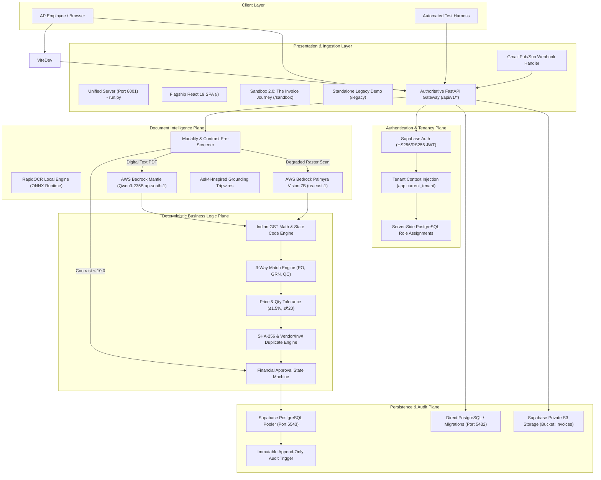
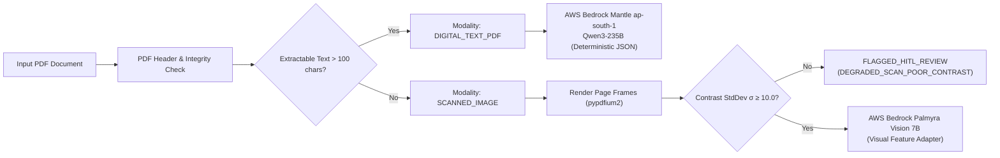

# Technical Architecture Specification

This document provides a comprehensive system architecture reference for the Autonomous Accounts Payable (AP) Command Center.

---

## 1. System Context & Layered Architecture

The AP Command Center employs a hybrid architecture that couples probabilistic generative AI (for layout interpretation and field extraction) with deterministic Python/SQL business rules (for tax math, matching, duplicate detection, and financial approval controls).



---

## 2. Backend Architecture (FastAPI & Python 3.12)

The backend is built with FastAPI and Python 3.12, organized in three distinct packages:

```
backend/
├── api/
│   └── v1/
│       ├── auth.py          # Session minting & authentication endpoints
│       ├── invoices.py      # Ingestion, matching, review actions, and invoice detail
│       ├── dashboard.py     # Executive KPI metrics & financial summaries
│       ├── connections.py   # Ingestion channel status & quarantined documents
│       ├── webhooks.py      # Google Cloud Pub/Sub push notification receivers
│       └── health.py        # Readiness and liveness container probes
│
├── core/
│   ├── config.py            # Pydantic v2 settings & production truth validation
│   ├── auth.py              # Supabase JWT token validation & server-side RBAC
│   ├── database.py          # SQLAlchemy 2.0 engine, pooling, and tenant context
│   ├── storage.py           # Supabase Storage client & signed URL generator
│   └── gmail.py             # Gmail OAuth 2.0 & History API synchronization
│
└── models/
    ├── invoice.py           # Documents, Invoices, Line Items, Match Runs
    ├── enterprise.py        # Organisations, Users, Role Assignments
    ├── erp.py               # Vendors, Purchase Orders, GRNs, QC Certificates
    ├── audit.py             # Immutable Audit Events
    └── quarantine.py        # Non-payable Quarantined Commercial Documents
```

### Key Backend Design Principles
1. **Dependency Injection:** Database sessions (`get_db`) and authenticated user identities (`get_current_user`, `require_role`) are resolved via FastAPI dependencies.
2. **Strict Production Truth Invariants:** SQLite is rejected at startup if `APP_ENV` is `staging` or `production`. Local auth bypass is rejected in production.
3. **Decoupled Architecture:** Business logic engines in `engine/` are provider-independent and do not directly depend on web frameworks.

---

## 3. Frontend Architecture (React 19 & Vite)

The frontend is a single-page application (SPA) built with React 19, TypeScript, Vite, and Tailwind CSS:

```
frontend/src/
├── pages/
│   ├── DashboardPage.tsx     # Executive KPIs (Total Ingested, Exceptions, Blocked Value)
│   ├── InboxPage.tsx         # Ledger table with stage/decision filters & search
│   ├── InvoiceDetailPage.tsx # Two-column Review Workspace (Evidence | Gates, Reconciliation, Actions)
│   ├── ConnectionsPage.tsx   # Mailbox ingestion status & Quarantined Documents ledger
│   └── SettingsPage.tsx      # Policy tolerances, thresholds, and role assignments
│
├── components/
│   ├── AuthScreen.tsx        # Enterprise sign-in screen with dev-session quick logins
│   ├── Navbar.tsx            # Navigation header with active tenant, user persona, and role badge
│   └── ThreePaneReview.tsx   # Side-by-side evidence, line items, and decision action form
│
└── api/
    └── client.ts             # Typed HTTP client handling Bearer tokens and error propagation
```

### Two-Column Inspection Architecture
The flagship invoice view is a two-column Review Workspace (`InvoiceDetailPage.tsx`):
- **Left column (~42%):** Document Evidence. Embeds the original vendor PDF via signed Supabase storage URL (300s expiration).
- **Right column (~58%):** Match Decision Gates, Line Reconciliation & Human Actions. Displays the status of all 7 deterministic policy gates, exception explanations, extracted data, billed-vs-contracted line reconciliation with GST amounts, and operational action buttons (`APPROVE_AP_REVIEW`, `HOLD_PENDING_EVIDENCE`, `REJECT_INVOICE`).

---

## 4. Supabase Database & Private Object Storage

- **Database Engine:** PostgreSQL 15 on Supabase.
- **Connection Separation:**
  - Runtime queries use PgBouncer Transaction Pooler on port `6543` (`DATABASE_URL`).
  - DDL schema migrations use direct PostgreSQL on port `5432` (`MIGRATION_DATABASE_URL`).
- **Private Storage:** Ingested PDF files are stored in a private Supabase Storage bucket (`invoices`). Documents are never publicly accessible; browser rendering uses time-limited HMAC-signed URLs.

---

## 5. Authentication, RBAC & Tenant Isolation

1. **Authentication:** Supabase Auth issues JWT tokens.
2. **Claim Segregation:**
   - Database role claim `role: "authenticated"` grants PostgreSQL RLS access.
   - Application roles (`AP_ASSOCIATE`, `AP_LEAD`, `CONTROLLER`, `AUDITOR`, `SYSTEM_ADMIN`) are carried in `user_role` and `app_metadata.role`.
   - Authorization checks rely on server-side PostgreSQL queries to `role_assignments`, neutralizing token claim spoofing.
3. **Tenant Isolation:** Every operational query is scoped to `org_id`. Multi-tenancy is reinforced by application session binding and PostgreSQL RLS.

---

## 6. Document Intelligence & OCR Pipeline



- **Bedrock Mantle (Qwen3-235B):** Primary document intelligence model in AWS Mumbai (`ap-south-1`). Performs commercial classification, table extraction, and Indian tax parsing with zero temperature.
- **Commercial Classification:** Identifies non-payable documents (e.g. `PAYMENT_RECEIPT`). Automatically quarantines receipts to prevent unauthorized liabilities.
- **Palmyra Vision 7B:** Feature-flagged visual adapter in AWS N. Virginia (`us-east-1`). Evaluated for raster scans; fails closed to HITL review on tax variance.

---

## 7. Deterministic Financial Controls & 3-Way Matching

The system applies 7 deterministic validation gates:
1. **Gate 1 (Vendor Master):** Validates supplier GSTIN, PAN, and active status in ERP vendor master.
2. **Gate 2 (PO Authorization):** Validates PO reference, open status, and unbilled balance.
3. **Gate 3 (GRN Match):** Reconciles warehouse Goods Receipt Note quantities.
4. **Gate 4 (QC Acceptance):** Verifies engineering Quality Certificate acceptance.
5. **Gate 5 (GST Math):** Validates $\left|\text{Subtotal} + \text{Taxes} - \text{Total}\right| \le ₹20.00$ and confirms interstate (IGST) vs intrastate (CGST+SGST) tax splits.
6. **Gate 6 (Price & Qty Tolerance):** Confirms unit rate variance $\le 1.50\%$ and quantity within PO limits.
7. **Gate 7 (Duplicate Detection):** Validates SHA-256 file hash and (Vendor + Invoice# + FY) uniqueness.

---

## 8. Financial Approval State Machine & Audit Immutability

1. **State Machine:**
   - **`MATCH_CANDIDATE`:** Recommendation when all 7 gates pass.
   - **`AUTO_APPROVED`:** Reserved strictly for automated straight-through processing (zero human touch).
   - **`MANUALLY_APPROVED`:** Assigned upon human reviewer sign-off (`APPROVE_AP_REVIEW`).
   - **`HOLD_PENDING_EVIDENCE`:** Applied by AP Lead when awaiting credit notes or PO amendments.
   - **`QUARANTINED`:** Applied to non-payable files (payment receipts).
2. **Dual Control Policy ($\ge ₹5,00,000$):**
   - High-value invoices require initial approval by `AP_LEAD` followed by secondary approval by `CONTROLLER`.
   - Anti-self-approval rule prevents the same user from performing both actions.
3. **Decoupled from Payments/ERP:** Internal approval represents AP operational review only. Zero payment gateway execution or direct ERP ledger posting occurs.
4. **Audit Immutability:** All events are recorded in `audit_events`. PostgreSQL trigger `prevent_audit_events_mutation()` actively prevents `UPDATE` and `DELETE` operations at the database engine level.
