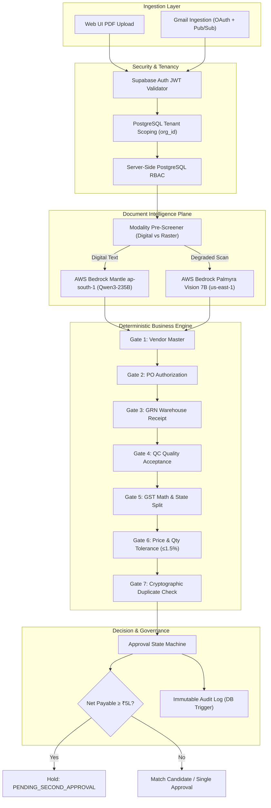

# Autonomous Accounts Payable (AP) Command Center
### Enterprise Multi-Tenant AI Document Processing & Financial Control Platform

[](./tests/)
[](https://python.org)
[](https://fastapi.tiangolo.com)
[](https://react.dev)
[-336791.svg?style=flat-square)](https://supabase.com)
[-orange.svg?style=flat-square)](https://aws.amazon.com/bedrock/)
[](#)

---

## 🌟 Executive Overview & Business Problem

Mid-size and enterprise organizations process thousands of commercial vendor invoices monthly across decentralized email inboxes, paper receipts, and supplier portals. Manual AP processing creates acute financial and regulatory liabilities:
- **Duplicate Payments:** Inadvertent double payment of identical vendor invoices across different accounting periods or batches.
- **Price & Quantity Leakage:** Overlooking unauthorized unit price increases exceeding contracted Purchase Order (PO) rates or paying for goods not yet delivered to the warehouse.
- **Indian GST Non-Compliance:** Miscalculating interstate (IGST) versus intrastate (CGST + SGST) tax splits, invalid supplier GSTINs, or missing statutory 45-day payment deadlines under Section 15 of the MSME Development Act.
- **Auditor Liability:** Lack of an immutable, cryptographic audit trail linking invoice approvals to source document coordinates, purchase order lines, and human justifications.

The **Autonomous AP Command Center** solves these challenges by combining **multi-modal document intelligence** (powered by AWS Bedrock Mantle Qwen3-235B) with a **deterministic Python/SQL matching engine**. The system autonomously classifies commercial documents, verifies Indian GST arithmetic, performs 3-way reconciliation (PO, GRN, QC), absorbs allowable contractual tolerances, and packages exceptions for human review in an interactive **3-Pane Review Workspace**.

---

## 🚀 Core Capabilities & Highlights

1. **Hybrid AI & Deterministic Architecture:**
   - **Probabilistic LLM:** Interprets ambiguous unstructured PDF layouts, extracts complex tables, and detects commercial document types.
   - **Deterministic Guardrails:** 100% Python/SQL mathematical invariants for tax arithmetic, tolerance calculations, duplicate detection, and dual-control approval rules. Zero LLM hallucinations enter the accounting ledger.
2. **Indian Tax & Statutory Compliance:**
   - Full support for Indian GST rules: automated supplier state-code verification, Interstate (IGST) vs Intrastate (CGST + SGST) reconciliation, and ₹20 penny/rounding tolerance.
   - MSME supplier tracking with statutory payment aging alerts.
3. **Deterministic 7-Gate 3-Way Matching:**
   - Evaluates invoices across 7 sequential policy gates: Vendor Master, PO Authorization, Goods Receipt Note (GRN) match, Quality Certificate (QC) acceptance, GST math, PO price/quantity tolerances ($\le 1.5\%$), and cryptographic SHA-256 duplicate detection.
4. **Interactive 3-Pane Review Workspace:**
   - **Pane 1 (Left):** Signed, secure document evidence viewer rendering original PDF pages.
   - **Pane 2 (Center):** Line-item reconciliation comparing invoice billed lines against PO contracted rates and GST splits.
   - **Pane 3 (Right):** Deterministic match gate status, variance details, reason justification input, and human approval controls.
5. **Enterprise Multi-Tenancy & Security:**
   - PostgreSQL Row-Level Security (RLS) and session tenant isolation (`org_id`).
   - Supabase Auth JWT verification with server-side authoritative Role-Based Access Control (RBAC) across 5 roles: `AP_ASSOCIATE`, `AP_LEAD`, `CONTROLLER`, `AUDITOR`, and `SYSTEM_ADMIN`.
   - Append-only, database-level immutable audit logging protected by PostgreSQL triggers (`prevent_audit_events_mutation`).
   - High-value dual-control threshold policy ($\ge ₹5,00,000$ requires secondary Controller sign-off with anti-self-approval enforcement).
6. **Strict Decoupling from Payments & ERP Mutations:**
   - Internal approval represents operational AP review clearance only. The system contains zero live payment rails (no funds disbursement) and triggers zero direct ledger mutations in SAP S/4HANA.

---

## 🏛️ System Architecture



For complete architectural details, see [**ARCHITECTURE.md**](./ARCHITECTURE.md).

---

## 💻 Technology Stack

| Layer | Technology | Version | Purpose |
| :--- | :--- | :--- | :--- |
| **Backend Runtime** | Python | 3.12 | Core backend application execution |
| **API Framework** | FastAPI / Uvicorn | 0.110+ | High-performance async REST API gateway |
| **Data Validation** | Pydantic v2 | 2.5+ | Typed schemas, configuration, and arithmetic invariants |
| **Database** | PostgreSQL | 15+ (Supabase) | Multi-tenant relational storage & RLS enforcement |
| **ORM & Migrations**| SQLAlchemy / Alembic | 2.0 / 1.13 | Database models and transactional DDL migrations |
| **Object Storage** | Supabase Storage / S3 | API v1 | Private encrypted storage with signed URL access (900s TTL)|
| **Frontend Framework**| React | 19.0 | Component hierarchy, state management, and SSE streaming |
| **Build Tooling** | Vite / Tailwind CSS | 5.0 / 3.4 | Fast SPA bundling and utility-first styling |
| **Primary LLM** | AWS Bedrock Mantle | Qwen3-235B | Commercial classification and structured invoice extraction |
| **Multimodal Vision**| AWS Bedrock Palmyra | Vision 7B | Visual extraction adapter evaluated on degraded raster scans |
| **Testing** | Pytest / Playwright | 8.0+ / 1.40+ | Automated unit, security, and headless browser tests |

---

## ⚡ Quickstart & Local Setup

### 1. Prerequisites
- Python 3.10+ (Python 3.12 recommended).
- Node.js 18+ LTS and `npm`.
- PostgreSQL 15+ (local or Supabase).

### 2. Installation
```bash
# 1. Clone repository
git clone https://github.com/neerajs22is-ux/Zamp-Case-Study-PS-1-.git
cd Zamp-Case-Study-PS-1-

# 2. Python environment & dependencies
python -m venv venv
# Windows: .\venv\Scripts\Activate.ps1 | Linux/macOS: source venv/bin/activate
pip install -r requirements.txt

# 3. Frontend dependencies
cd frontend
npm install
cd ..

# 4. Configure environment
cp .env.example .env
# Edit .env with your PostgreSQL DATABASE_URL and MANTLE_API_KEY
```

### 3. Database Migrations & Evaluation Seeding
```bash
# Apply migrations
alembic upgrade head

# Seed synthetic evaluation tenant (org_sme_eval)
python engine/sme_eval_setup.py
```

### 4. Running Backend and Frontend
```bash
# Terminal 1: Backend Server (Port 8000)
python -m uvicorn backend.main:app --host 127.0.0.1 --port 8000 --reload

# Terminal 2: Frontend Dev Server (Port 5173)
cd frontend
npm run dev
```

- **Application UI:** [`http://localhost:5173`](http://localhost:5173) (or [`http://127.0.0.1:8000`](http://127.0.0.1:8000))
- **Interactive OpenAPI Specification:** [`http://127.0.0.1:8000/docs`](http://127.0.0.1:8000/docs)
- **Health Check Probe:** [`http://127.0.0.1:8000/api/v1/health`](http://127.0.0.1:8000/api/v1/health)

For comprehensive setup details, see [**docs/LOCAL_SETUP.md**](./docs/LOCAL_SETUP.md).

---

## 🧪 Automated Testing & Verification

The repository contains 256 automated test items:
- **244 passed, 12 skipped, 0 failed in ~20 seconds.**

```bash
# Run the complete test suite
python -m pytest tests/ -v

# Run Phase E security & financial control tests
python -m pytest tests/phase_e/ -v

# Run automated browser tests (Playwright with headless Edge)
python scratch/test_browser_acceptance.py
```

For test suite architecture and benchmark details, see [**docs/TESTING_AND_EVALUATION.md**](./docs/TESTING_AND_EVALUATION.md).

---

## 👥 Enterprise User Roles & Personas

When running locally with `ENABLE_DEV_SESSION=true`, use the enterprise quick-login buttons:

| Persona | Email | Assigned Role | Capabilities & Workflow |
| :--- | :--- | :---: | :--- |
| **Priya Sharma** | `sme_lead@company.internal` | `AP_LEAD` | Primary reviewer. Inspects 3-pane evidence, approves sub-₹5L invoices, applies query holds (`HOLD_PENDING_EVIDENCE`), and rejects invalid invoices. |
| **Rajesh Nair** | `sme_controller@company.internal` | `CONTROLLER` | Financial Controller. Executive metrics inspection, secondary dual-control sign-off on invoices $\ge ₹5,00,000$. |
| **Ananya Iyer** | `sme_assoc@company.internal` | `AP_ASSOCIATE` | AP Associate. Document ingestion, initial triage, and extraction verification. |
| **Vikram Malhotra**| `sme_auditor@company.internal` | `AUDITOR` | Statutory Auditor. Strictly read-only access; all mutation actions return HTTP 403 Forbidden. |

---

## 🎨 Context for Independent UI/UX Review & Redesign

> [!IMPORTANT]
> **Instructions for Reviewing AI Model:** This codebase has been packaged for your independent UI/UX audit and redesign. The interface has been preserved exactly as tested.
> 
> Key operator workflows and known friction points to review:
> 1. **3-Pane Density:** Review [`frontend/src/pages/InvoiceDetailPage.tsx`](./frontend/src/pages/InvoiceDetailPage.tsx). On screens $\le 1440\text{px}$, the 3-pane split causes visual crowding. Evaluate collapsible layouts or tabbed workflows.
> 2. **Keyboard Shortcuts:** Evaluate adding power-user hotkeys (`A` to approve, `H` to hold, `J`/`K` to navigate table rows).
> 3. **Action Justification Friction:** Action submission modals require mandatory text justification; evaluate pre-populated macro templates for common reasons.
> 4. **Bulk Triage:** Review [`frontend/src/pages/InboxPage.tsx`](./frontend/src/pages/InboxPage.tsx) to consider batch approval for low-risk clean match candidates.
> 
> Full usability catalog: [**docs/KNOWN_LIMITATIONS.md**](./docs/KNOWN_LIMITATIONS.md).

---

## 📚 Documentation Index

### Root Specifications
- [**PROJECT_STATUS.md**](./PROJECT_STATUS.md): Authoritative milestone ledger, implemented features, live-tested subsystems, and test results.
- [**ARCHITECTURE.md**](./ARCHITECTURE.md): Comprehensive technical architecture, Mermaid diagrams, and data flows.
- [**CONTRIBUTING.md**](./CONTRIBUTING.md): Engineering conventions, commit rules, and security policies.

### Deep-Dive Topic Guides
- [**docs/LOCAL_SETUP.md**](./docs/LOCAL_SETUP.md): Step-by-step local installation and environment setup.
- [**docs/ENVIRONMENT_VARIABLES.md**](./docs/ENVIRONMENT_VARIABLES.md): Full reference for all settings and configuration options.
- [**docs/DATABASE_AND_MIGRATIONS.md**](./docs/DATABASE_AND_MIGRATIONS.md): Schema ER diagrams, connection separation, and Alembic guides.
- [**docs/SECURITY_AND_RBAC.md**](./docs/SECURITY_AND_RBAC.md): Supabase JWT architecture, RBAC matrix, and dev-session sandboxing.
- [**docs/GMAIL_INTEGRATION.md**](./docs/GMAIL_INTEGRATION.md): Gmail OAuth 2.0, History API synchronization, and Pub/Sub webhooks.
- [**docs/AI_AND_DOCUMENT_PROCESSING.md**](./docs/AI_AND_DOCUMENT_PROCESSING.md): Bedrock Mantle Qwen 235B, Palmyra Vision 7B, and contrast pre-screening.
- [**docs/AP_BUSINESS_RULES.md**](./docs/AP_BUSINESS_RULES.md): 7 deterministic match gates, Indian GST tax rules, and state machine transitions.
- [**docs/TESTING_AND_EVALUATION.md**](./docs/TESTING_AND_EVALUATION.md): Pytest architecture, 40-doc corpus evaluation, and browser tests.
- [**docs/DEPLOYMENT_RUNBOOK.md**](./docs/DEPLOYMENT_RUNBOOK.md): Docker multi-stage containerization, Render, and Cloud Run guides.
- [**docs/KNOWN_LIMITATIONS.md**](./docs/KNOWN_LIMITATIONS.md): UI/UX usability audit catalog and system boundaries.

### Preserved Milestone Reports
- [**Phase A Architecture Corrections & Security Validation**](./docs/project-history/phase_a_architecture_corrections_security_validation.md)
- [**Phase C AP Evaluation & Mantle Architecture Report**](./docs/project-history/phase_c_ap_evaluation_and_mantle_architecture.md)
- [**Phase D Production Readiness Report**](./docs/project-history/phase_d_production_readiness_report.md)
- [**Phase E Controlled SME Acceptance Testing Report**](./docs/project-history/phase_e_sme_acceptance_testing_report.md)
- [**Full 40-Document Evaluation Report (JSON)**](./docs/project-history/full_40_evaluation_report.json)
- [**Palmyra Vision 7B Benchmark Report (JSON)**](./docs/project-history/palmyra_vision_benchmark_report.json)
- [**Phase E Acceptance Verification Report (JSON)**](./docs/project-history/phase_e_full_acceptance_verification_report.json)
- [**Real Browser Verification Screenshots**](./docs/images/browser_verification/)

---

## 🔒 Security & Git Hygiene Compliance

- `.env` and local credentials are strictly excluded via `.gitignore`.
- All credentials in reports and sample configuration are redacted or use safe placeholders.
- Frontend bundles contain zero server-side secrets or master keys.
- Codebase scanned with automated secret scanners: **0 leaked credentials in tree**.
- Production deployment to Render is **on HOLD** awaiting explicit user sign-off.
