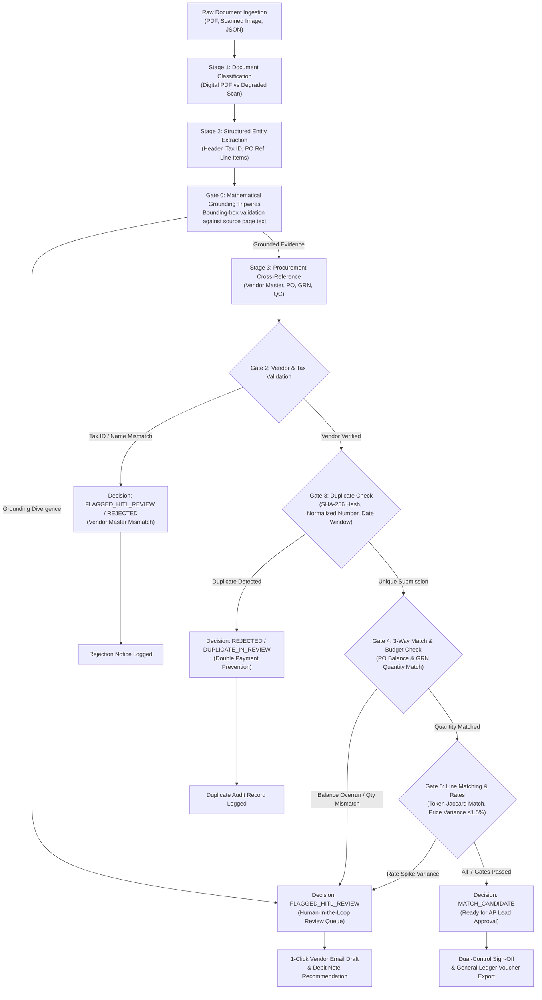

# Autonomous AP Command Center (Zamp PS-1 Flagship Submission)

> **Flagship Product:** Multi-Tenant Autonomous Accounts Payable Platform featuring 3-Way Match Verification, Mathematical Grounding Tripwires, Multi-Tenant PostgreSQL Row-Level Security (RLS), and React 19 UI.  
> **Candidate:** Neeraj Shivkumar — AI Solutions Associate Candidate  
> **Submission Evaluation:** Problem Statement 1 (PS-1: Automated Invoice Processing, 3-Way Matching & Governance Engine)  
> **Core Architecture:** "Models Read, Rules Decide" — Deterministic Financial Policy Gates with Source-Grounding Tripwires  

---

## 🎯 Case Study Deliverables & Evaluation Strategy

This submission is architected around two coordinated applications with distinct, well-defined roles:

1. **Primary Product — AP Command Center (`backend/` + `frontend/`):**
   - **Primary Evaluation Target:** The flagship full-stack application evaluated for production architecture, real multi-tenant persistence, 3-way procurement matching, and human-in-the-loop triage.
   - **Video Demonstration:** The mandatory 5-minute video walkthrough demonstrates this React 19 application.
   - **Public Hosted URL:** Hosted for safe, interactive evaluator access across 4 pre-configured personas (`AP_LEAD`, `CONTROLLER`, `AUDITOR`, `AP_ASSOCIATE`) in the pre-seeded `org_sme_eval` workspace.
2. **Auxiliary Tool — Standalone Rules Sandbox (`engine/`):**
   - **Offline Evaluation Sandbox:** A lightweight, single-process execution tool with an in-memory mock ERP and single-file HTML/Tailwind UI.
   - **Purpose:** Enables local code reviewers to test deterministic policy gates, regex layouts, and millisecond Server-Sent Event (SSE) streaming offline without provisioning PostgreSQL, Supabase, or AWS credentials.

---

## 1. Quick Start & Launcher Guide

The repository supports both the flagship production platform and the offline rules sandbox.

### Option A: Launch the Flagship AP Command Center (Primary)
The flagship runs a FastAPI application serving the compiled React 19 SPA, backed by PostgreSQL and private object storage:

```powershell
# 1. Ensure dependencies and frontend are built
pip install -r requirements.txt
npm --prefix frontend install && npm --prefix frontend run build

# 2. Launch the Flagship AP Command Center
python run.py --enterprise
```
👉 Open your browser to: **`http://127.0.0.1:8001`**  
👉 Click **"AP Lead"** on the evaluation portal for instant 1-click access to the pre-seeded `org_sme_eval` tenant.

### Option B: Launch the Standalone Rules Sandbox (Auxiliary Tool)
For zero-dependency offline exploration of deterministic policy gates without database setup:

```powershell
python run.py
```
👉 Open your browser to: **`http://127.0.0.1:8001`**  
*(Note: In the current repository snapshot, `python run.py` defaults to this standalone sandbox, while `Dockerfile` deploys the flagship. The upcoming P0 milestone will align the CLI launcher so `python run.py` launches the flagship by default and `python run.py --sandbox` launches the sandbox).*

---

## 2. The 4 Core Evaluation Scenarios (Pre-Seeded in `org_sme_eval`)

The flagship AP Command Center is pre-configured with four commercial accounts payable scenarios demonstrating autonomous matching, exception triage, and fail-closed safety:

| # | Scenario Name | Test Reference | Flagship Decision | Operational Consequence & Governance |
|---|---|---|---|---|
| **1** | **Touchless 3-Way Match** | `APTC-001` / `AP-26-009` | `MATCH_CANDIDATE` | **Golden Path:** Invoice perfectly matches PO-26-2001, GRN-26-601, and Quality Inspection QC-26-601. All 7 deterministic gates pass; ready for 1-click AP Lead sign-off (**never auto-disbursed**). |
| **2** | **Line Rate Variance Hold** | `APTC-030` / `KF-26-016` | `FLAGGED_EXCEPTION` | **Margin Creep Defense:** Unit price bills at ₹185.00 vs contracted PO rate of ₹170.00 (+8.8% spike). Exceeds 1.5% policy tolerance; system flags exception, blocks payment, and auto-generates debit note recommendation. |
| **3** | **Degraded Scan Safety** | `APTC-036` / `POS-26-112` | `FLAGGED_HITL_REVIEW` | **Fail-Closed OCR Guard:** Low-contrast mobile scan ($\sigma < 10.0$) fails extraction pre-screening. Routed to human-in-the-loop review queue; zero ungrounded financial values are guessed. |
| **4** | **Commercial Non-Invoice** | `APTC-038` / `RCPT-26-088` | `QUARANTINE_NON_INVOICE` | **False Liability Defense:** Inbound supplier payment receipt intercepted by classifier. Quarantined in security vault with zero General Ledger liability creation. |

---

## 3. End-to-End Invoice-to-Decision Process Map

Both applications enforce a strict **Plan-Execute-Validate (PEV)** loop governed by an enterprise **Agent Operating Procedure (AOP)**:



---

## 4. Architectural Invariants: "Models Read, Rules Decide"

1. **Deterministic Financial Policy:**
   - Language models (Qwen-235B via AWS Bedrock Mantle) are confined strictly to semantic text reading and structuring.
   - **Zero-Hallucination Invariant:** Cent-level arithmetic, 3-way matching against PO/GRN/QC records, GST tax distribution, and approval decisions are executed exclusively by deterministic Python rules.
2. **Mathematical Source Grounding:**
   - Every extracted financial figure is validated against page text coordinates. If an extracted amount cannot be grounded directly in source evidence, the grounding tripwire fails closed to `FLAGGED_HITL_REVIEW`.
3. **Fail-Closed Scan Handling:**
   - In accordance with institutional AP security, degraded scans are routed to human review rather than subjected to unverified vision model guessing. (Palmyra Vision was evaluated in a dedicated benchmark harness [`engine/palmyra_benchmark_runner.py`](file:///c:/Zamp%20Casse%20Study/engine/palmyra_benchmark_runner.py) and remains feature-flagged OFF in production).
4. **Institutional Security & Governance:**
   - **ASVS Level 2 Security Headers:** `X-Content-Type-Options: nosniff`, `X-Frame-Options: DENY`, `Referrer-Policy: strict-origin-when-cross-origin`.
   - **PostgreSQL Row-Level Security (RLS):** Physical multi-tenant isolation enforcing zero cross-tenant leakage.
   - **Anti-Fraud Telephone Verification Gate:** Manual overrides of bank account mismatches are blocked (HTTP 403) unless operator audit notes explicitly confirm out-of-band telephone callback verification.
   - **Dual-Control Authorization:** High-value invoices exceeding ₹5,00,000 INR require secondary controller sign-off with anti-self-approval protection.

---

## 5. Verification & Test Evidence

The repository maintains an exhaustive automated test suite verified on clean Python 3.12:

```powershell
# Run the complete test suite across all subsystems
python -m pytest tests/
```

### Verified Test Results Summary:
- **Full Project Test Suite:** **404 passed, 43 skipped, 0 failed** in 37.09s (`tests/`)  
  *(Skipped tests require live PostgreSQL isolation fixtures or external Gmail network probes).*
- **Hardening & Remediation Suite:** **27 passed, 0 failed** in 2.31s (`tests/test_hardening.py`)
  - Degradation scan boundary with authentic watermark stamps and zero typed artifact strings
  - In-flight duplicate submission detection for pending human reviews (`duplicate_in_review`)
  - Anti-fraud telephone callback verification gate for manual bank detail overrides
  - Recurring billing vendor exemptions for predictable monthly operational services
  - Deterministic PO header and line drawdown synchronization ($5,000 / $5,000 subtotal basis)
- **Standalone Engine Suite:** **29 passed, 0 failed** in 0.25s (`tests/test_engine.py`)
- **Frontend SPA Build:** `npm run build` in `frontend/` completes in 545ms with **0 errors**.
- **Secrets Hygiene:** 0 committed credentials; strict secrets hygiene across all git commits.

---

## 6. What I'd Build Next (Production Roadmap)

1. **Bi-Directional ERP Connectors:** Real-time webhooks for SAP S/4HANA OData and NetSuite SuiteTalk REST APIs for automated PO line locking and payment voucher ingestion.
2. **Autonomous Mailbox Ingestion:** Dedicated IMAP/OAuth2 listeners for Google Workspace and Microsoft 365 (`ap-inbound@company.com`) with automated inline signature filtering.
3. **Multi-Tier Authority Matrix:** Dual-controller sign-off workflow for high-value exceptions exceeding ₹5,00,000 ($50,000) or vendor bank account changes.
4. **Fast-Track Bulk Resolution:** Bulk release toolbar enabling AP Leads to batch-approve minor variances within secondary authorized thresholds.

---

## 7. Submission Documentation Index

- [`docs/CASE_STUDY_PRODUCT_STRATEGY.md`](file:///c:/Zamp%20Casse%20Study/docs/CASE_STUDY_PRODUCT_STRATEGY.md): Authoritative product strategy establishing the AP Command Center as the primary flagship submission and defining application boundaries.
- [`docs/FLAGSHIP_READINESS_AUDIT.md`](file:///c:/Zamp%20Casse%20Study/docs/FLAGSHIP_READINESS_AUDIT.md): Evidence-based technical audit verifying repository findings, deployment configurations, database migrations, and P0/P1/P2 remediation milestones.
- [`docs/AP_BUSINESS_RULES.md`](file:///c:/Zamp%20Casse%20Study/docs/AP_BUSINESS_RULES.md): Comprehensive definitions of the 7 deterministic procurement match gates and statutory GST rules.
- [`docs/DATABASE_AND_MIGRATIONS.md`](file:///c:/Zamp%20Casse%20Study/docs/DATABASE_AND_MIGRATIONS.md): Multi-tenant PostgreSQL schema, RLS policies, and Alembic migration ledger.
- [`docs/SECURITY_AND_RBAC.md`](file:///c:/Zamp%20Casse%20Study/docs/SECURITY_AND_RBAC.md): Institutional security controls, ASVS Level 2 compliance, and server-side RBAC entitlements.
- [`docs/TESTING_AND_EVALUATION.md`](file:///c:/Zamp%20Casse%20Study/docs/TESTING_AND_EVALUATION.md): Guide for evaluating the flagship Command Center and reproducing verified test suites.

---
*Developed for Zamp Problem Statement 1 (PS-1: Autonomous Accounts Payable Digital Employee) Evaluation.*
