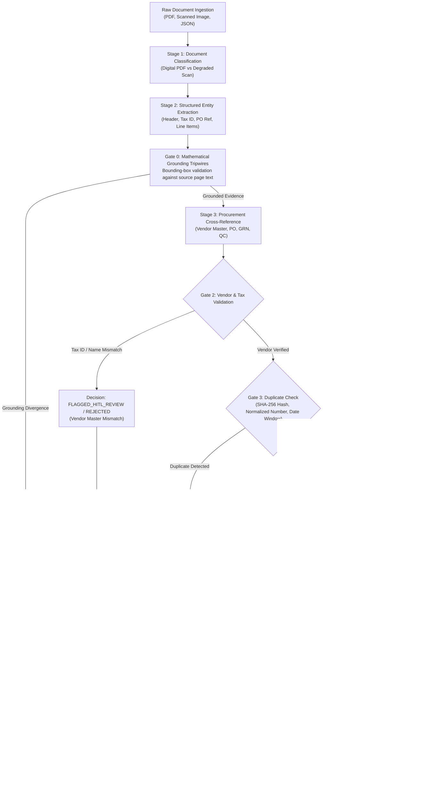

# Autonomous AP Command Center (Zamp PS-1 Flagship Submission)

> **Flagship Product:** Multi-Tenant Autonomous Accounts Payable Platform featuring 3-Way Match Verification, Mathematical Grounding Tripwires, Multi-Tenant PostgreSQL Row-Level Security (RLS), and React 19 UI.  
> **Candidate:** Neeraj Shivkumar — AI Solutions Associate Candidate  
> **Submission Evaluation:** Problem Statement 1 (PS-1: Automated Invoice Processing, 3-Way Matching & Governance Engine)  
> **Core Architecture:** "Models Read, Rules Decide" — Deterministic Financial Policy Gates with Source-Grounding Tripwires  

---

## 🎯 Unified Product Strategy: One Engine, Two Experiences

There is **one Zamp PS-1 invoice automation product, offered through two seamless experiences** powered by the exact same authoritative processing engine:

1. **Flagship AP Command Center (Primary Product):**
   - **Target Experience:** The complete, enterprise-grade multi-tenant accounts payable application (`backend/` + `frontend/`).
   - **Primary Live URL:** `http://127.0.0.1:8001/` (React 19 SPA serving `/today`, `/invoices`, `/approvals`, `/audit`).
   - **Video Demonstration:** The primary 5-minute evaluation video walkthrough demonstrates this application.
   - **Enterprise Capabilities:** PostgreSQL Row-Level Security (RLS), Supabase Auth session rotation, immutable append-only audit trail, dual-control high-value approval governance, and 4 pre-configured personas (`AP_LEAD`, `CONTROLLER`, `AUDITOR`, `AP_ASSOCIATE`) in `org_sme_eval`.
2. **AP Command Center Sandbox (Interactive Demonstration):**
   - **Target Experience:** A streamlined, genuinely working single-invoice interactive demonstration of that exact flagship system.
   - **Direct URL:** `http://127.0.0.1:8001/sandbox` (Single-page responsive Tailwind UI).
   - **Workflow:** **Upload invoice → Watch real-time processing → Understand decision → Take action.**
   - **Authoritative Business Engine:** Consumes the exact same hybrid Bedrock Mantle Qwen 235B extractor, Decimal INR financial math, Indian GST calculations, 7 deterministic matching policy gates, and audit persistence as the flagship.

---

## 1. Quick Start & Launcher Guide

The platform uses a unified launcher where both experiences run on the authoritative FastAPI backend:

### Launch the Platform (Defaults to Flagship AP Command Center)
```powershell
# 1. Install dependencies and compile frontend
pip install -r requirements.txt
npm --prefix frontend install && npm --prefix frontend run build

# 2. Launch the Unified AP Command Center
python run.py
```
👉 Open your browser to:
- **Flagship Command Center:** **`http://127.0.0.1:8001/`** (Click **"AP Lead"** for 1-click evaluation access)
- **Interactive Sandbox:** **`http://127.0.0.1:8001/sandbox`** (Upload or select any of 6 genuine scenarios)
- **Interactive API Docs:** **`http://127.0.0.1:8001/docs`**

### Launch with Sandbox Focus Prominent
```powershell
python run.py --sandbox
```
👉 Direct console and browser focus to: **`http://127.0.0.1:8001/sandbox`**

> [!IMPORTANT] Production-Grade Security & Verification Invariants:
> - **Unified Source of Truth:** Zero USD mock rules. Both Flagship and Sandbox run through `reevaluate_match_gates()`, `IndianAPRuleEngine`, and `HybridAPExtractor`.
> - **Database Schema:** PostgreSQL connected with all migrations through `013_revoke_access_tokens` applied.
> - **RLS Verification:** Runtime enforcement verifies `ap_app_user` lacks `BYPASSRLS` privileges; foreign tenant queries return zero rows fail-closed.
> - **Audit Immutability:** PL/pgSQL database triggers strictly prohibit `UPDATE` or `DELETE` on `audit_events`.
> - **Parity Verification:** Verified with 100% pass rate in `tests/test_sandbox_flagship_parity.py`.

---

## 2. The 6 Core Evaluation Scenarios (Pre-Seeded in `org_sme_eval`)

Both the flagship AP Command Center and the Decision Sandbox share the exact same 6 authentic commercial test scenarios:

| # | Scenario ID | Document Reference | Decision Code | Target Stage | Key Operational & Policy Mechanism |
|---|---|---|---|---|---|
| **1** | `SCN-01-HAPPY-PATH` | `01_invoice_AP_26_001.pdf` | `MATCH_CANDIDATE` | `PENDING_APPROVAL` | **Clean 3-Way Match:** Perfectly matches PO-26-1001, GRN-26-501, and accepted QC certificate with 0.00% variance. All 7 deterministic policy gates pass. Ready for AP Lead sign-off. |
| **2** | `SCN-02-PRICE-VARIANCE` | `30_invoice_AP_26_011.pdf` | `FLAGGED_EXCEPTION` | `ACTION_REQUIRED` | **Price & Qty Variance:** Supplier bills unit price ₹220.00 vs contracted PO rate ₹185.00 (+18.92% variance vs 1.5% limit) and bills 100 units vs 80 accepted on GRN-26-621. Fails Gate 6 & Gate 3. |
| **3** | `SCN-03-DEGRADED-SCAN` | `36_invoice_POS_26_112.pdf` | `FLAGGED_HITL_REVIEW` | `ACTION_REQUIRED` | **Degraded Scan Safety:** Raster-only image document with zero digital text tokens. Grounding tripwire trips; LLM inference skipped to avoid hallucinations; routed to human specialist review. |
| **4** | `SCN-04-QUARANTINE-QC` | `11_invoice_MC_26_090.pdf` | `FLAGGED_EXCEPTION` | `ACTION_REQUIRED` | **Quarantined Inspection:** Factory goods receipt GRN-26-603 has inspection status HOLD. Fails Gate 4 deterministically; blocks payment on defective materials. |
| **5** | `SCN-05-NON-PAYABLE` | `38_payment_receipt_RCPT_26_088.pdf` | `REJECTED` | `REJECTED` | **Non-Payable Commercial Doc:** Document classified as `PAYMENT_RECEIPT`; `is_payable_invoice` evaluates to False. Autonomously rejected without generating an open liability. |
| **6** | `SCN-06-DUPLICATE` | `01_invoice_AP_26_001.pdf` | `REJECTED` | `ACTION_REQUIRED` | **Duplicate Resubmission:** Identical voucher number or SHA-256 hash collision with active ledger record. Gate 7 fails deterministically; prevents duplicate payment disbursements. |

---

## 3. End-to-End Invoice-to-Decision Process Map

Both applications enforce a strict **Plan-Execute-Validate (PEV)** loop governed by an enterprise **Agent Operating Procedure (AOP)**:



---

## 4. Architectural Invariants: "Models Read, Rules Decide"

1. **Deterministic Financial Policy:**
   - Language models (Qwen-235B via AWS Bedrock Mantle) are confined strictly to semantic text reading and structuring.
   - **Bounded Deterministic Invariant:** Cent-level arithmetic, 3-way matching against PO/GRN/QC records, GST tax distribution, and approval decisions are executed exclusively by deterministic Python rules.
2. **Mathematical Source Grounding:**
   - Every extracted financial figure is validated against page text coordinates. If an extracted amount cannot be grounded directly in source evidence, the grounding tripwire fails closed to `FLAGGED_HITL_REVIEW`.
3. **Fail-Closed Scan Handling:**
   - In accordance with institutional AP security, degraded scans are routed to human review rather than subjected to unverified vision model guessing. (Palmyra Vision was evaluated in a dedicated benchmark harness [`engine/palmyra_benchmark_runner.py`](engine/palmyra_benchmark_runner.py) and remains feature-flagged OFF in production).
4. **Institutional Security & Governance:**
   - **ASVS Level 2 Security Headers:** `X-Content-Type-Options: nosniff`, `X-Frame-Options: DENY`, `Referrer-Policy: strict-origin-when-cross-origin`.
   - **PostgreSQL Row-Level Security (RLS):** Logical multi-tenant isolation enforcing zero cross-tenant leakage within shared PostgreSQL persistence.
   - **Anti-Fraud Telephone Verification Gate:** Manual overrides of bank account mismatches are blocked (HTTP 403) unless operator audit notes explicitly confirm out-of-band telephone callback verification.
   - **Dual-Control Authorization:** High-value invoices exceeding ₹5,00,000 INR require secondary controller sign-off with anti-self-approval protection.

---

## 5. Verification & Test Evidence

The repository maintains an exhaustive automated test suite verified on clean Python 3.12:

```powershell
# Run the complete Python test suite across all subsystems
python -m pytest tests/

# Run frontend auth lifecycle regression (requires Node >= 22.16.0)
cd frontend; npm test
```

### Verified Test Results Summary:
- **Full Project Local Test Suite:** **464 passed, 43 skipped, 0 failed** in ~43s (`python -m pytest tests/`, 507 collected), plus **14 passed, 0 failed** in Node.js (`cd frontend; npm test`). Total **478 passing tests**.  
  *(Skipped tests require live PostgreSQL isolation fixtures or external Gmail network probes).*
- **Hardening & Remediation Suite:** **27 passed, 0 failed** in 2.31s (`tests/test_hardening.py`)
  - Degradation scan boundary with authentic watermark stamps and zero typed artifact strings
  - In-flight duplicate submission detection for pending human reviews (`duplicate_in_review`)
  - Anti-fraud telephone callback verification gate for manual bank detail overrides
  - Recurring billing vendor exemptions for predictable monthly operational services
  - Deterministic PO header and line drawdown synchronization ($5,000 / $5,000 subtotal basis)
- **Standalone Engine Suite:** **29 passed, 0 failed** in 0.25s (`tests/test_engine.py`)
- **Frontend SPA Build:** `npm run build` in `frontend/` completes in 545ms with **0 errors**.
- **Secrets Hygiene:** 0 committed credentials; strict secrets hygiene across all git commits.

---

## 6. What I'd Build Next (Production Roadmap)

1. **Bi-Directional ERP Connectors:** Real-time webhooks for SAP S/4HANA OData and NetSuite SuiteTalk REST APIs for automated PO line locking and payment voucher ingestion.
2. **Autonomous Mailbox Ingestion:** Dedicated IMAP/OAuth2 listeners for Google Workspace and Microsoft 365 (`ap-inbound@company.com`) with automated inline signature filtering.
3. **Multi-Tier Authority Matrix:** Dual-controller sign-off workflow for high-value exceptions exceeding ₹5,00,000 ($50,000) or vendor bank account changes.
4. **Fast-Track Bulk Resolution:** Bulk release toolbar enabling AP Leads to batch-approve minor variances within secondary authorized thresholds.

---

## 7. Submission Documentation Index

- [`docs/CASE_STUDY_PRODUCT_STRATEGY.md`](docs/CASE_STUDY_PRODUCT_STRATEGY.md): Authoritative product strategy establishing the AP Command Center as the primary flagship submission and defining application boundaries.
- [`docs/FLAGSHIP_READINESS_AUDIT.md`](docs/FLAGSHIP_READINESS_AUDIT.md): Evidence-based technical audit verifying repository findings, deployment configurations, database migrations, and P0/P1/P2 remediation milestones.
- [`docs/AP_BUSINESS_RULES.md`](docs/AP_BUSINESS_RULES.md): Comprehensive definitions of the 7 deterministic procurement match gates and statutory GST rules.
- [`docs/DATABASE_AND_MIGRATIONS.md`](docs/DATABASE_AND_MIGRATIONS.md): Multi-tenant PostgreSQL schema, RLS policies, and Alembic migration ledger.
- [`docs/SECURITY_AND_RBAC.md`](docs/SECURITY_AND_RBAC.md): Institutional security controls, ASVS Level 2 compliance, and server-side RBAC entitlements.
- [`docs/TESTING_AND_EVALUATION.md`](docs/TESTING_AND_EVALUATION.md): Guide for evaluating the flagship Command Center and reproducing verified test suites.

---
*Developed for Zamp Problem Statement 1 (PS-1: Autonomous Accounts Payable Digital Employee) Evaluation.*
