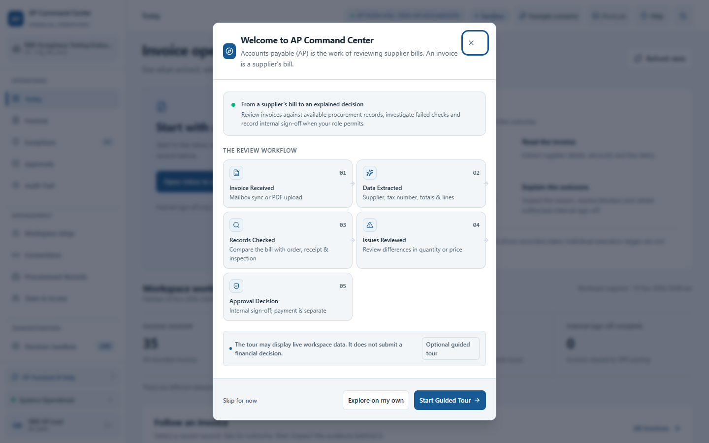
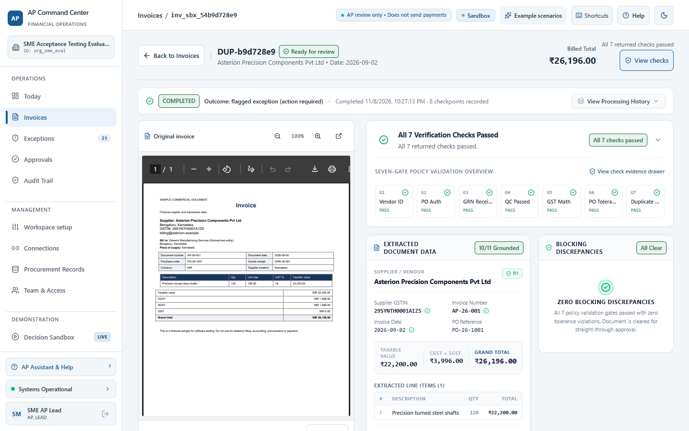
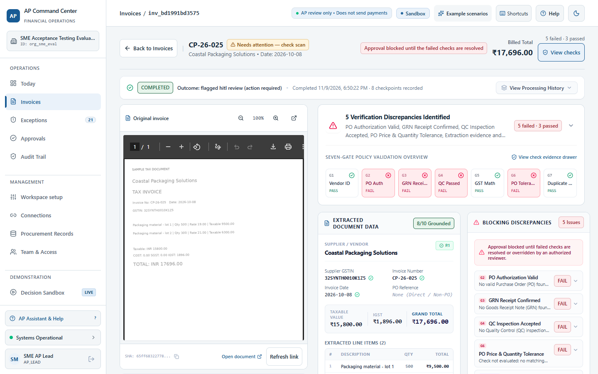
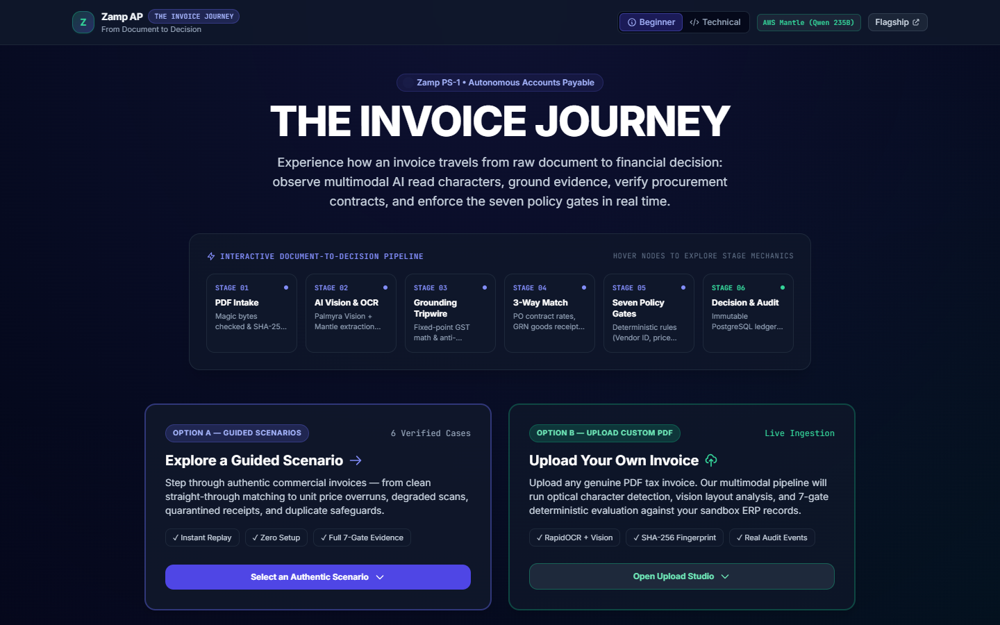
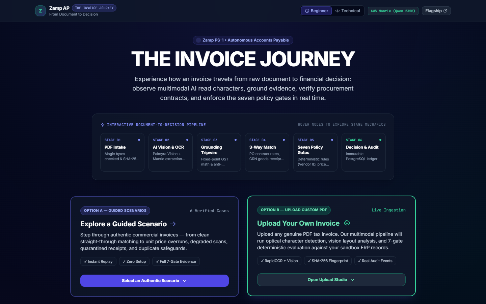
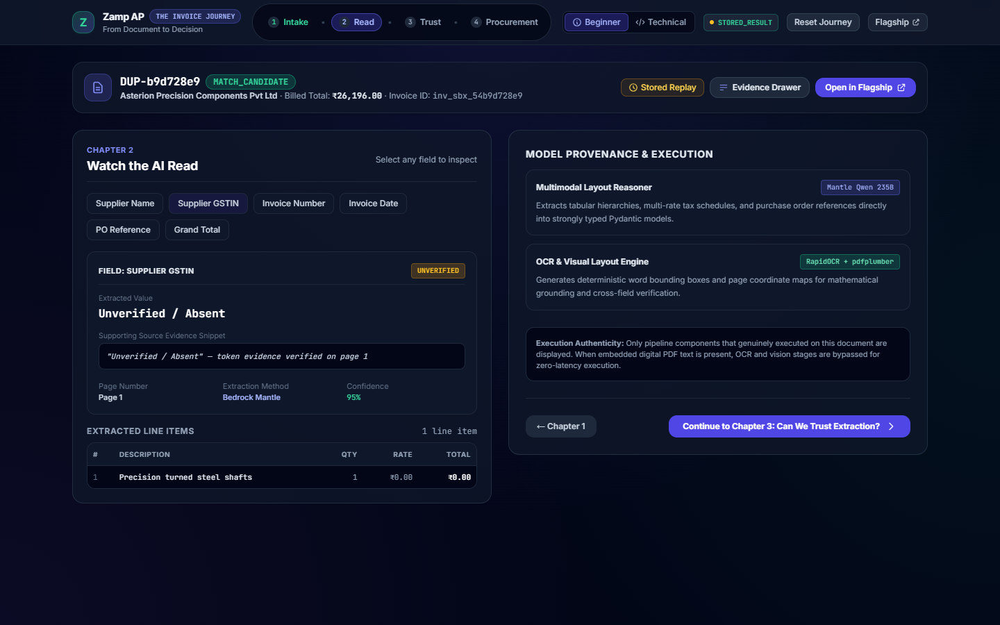
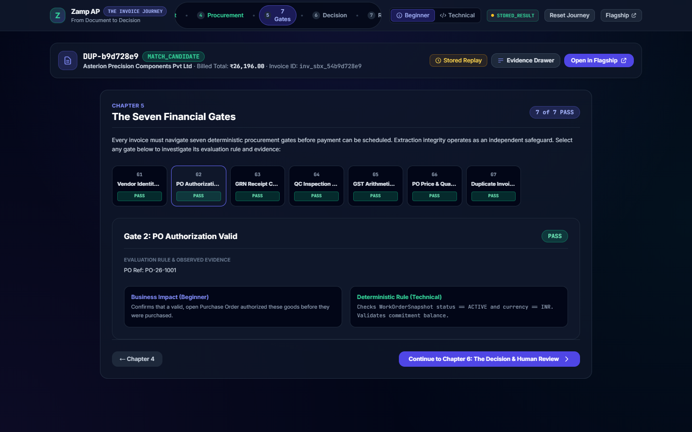
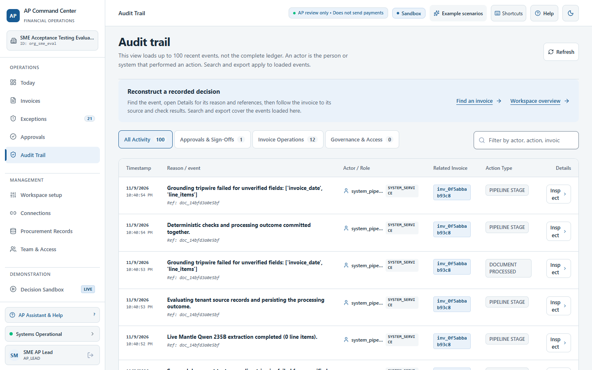
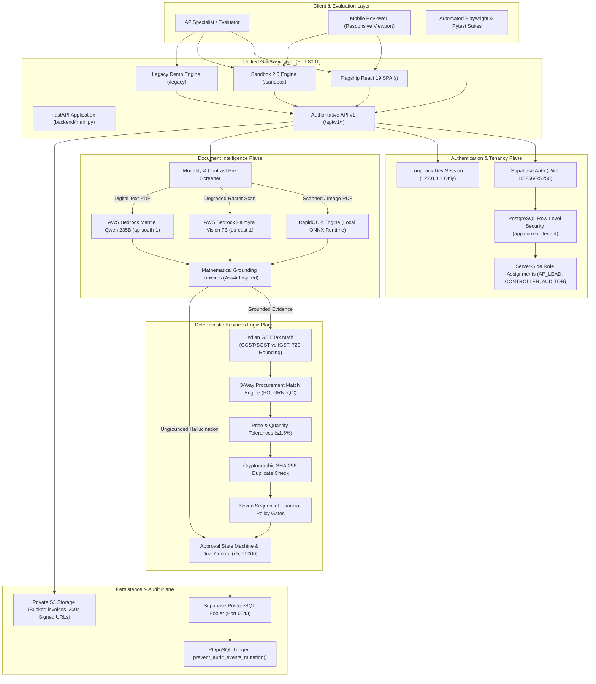

# Zamp PS-1 — Autonomous Accounts Payable (AP) Command Center

[](https://python.org)
[](https://fastapi.tiangolo.com)
[](https://react.dev)
[](https://www.typescriptlang.org)
[](https://www.postgresql.org)
[](https://tailwindcss.com)
[](LICENSE)

> **Flagship Candidate Submission:** Neeraj Shivkumar — AI Solutions Associate Candidate  
> **Evaluation Scope:** Problem Statement 1 (PS-1: Automated Invoice Processing, 3-Way Matching & Governance Engine)  
> **Core Architectural Invariant:** *"Models Read, Rules Decide"* — Multimodal AI extracts messy layout tokens with coordinate provenance; deterministic Python/PostgreSQL engines enforce Indian GST math, 3-way procurement tolerances, and seven financial policy gates with database-level audit immutability.

> 🚀 **EVALUATORS START HERE:** Read the **[START_HERE.md](./START_HERE.md)** 1-page guide for live Render deployment links ([zamp-case-study-ps-1-1.onrender.com](https://zamp-case-study-ps-1-1.onrender.com)), Google SSO authentication instructions, 5-minute evaluation walkthrough, and golden scenario walkthroughs.

---

## 📑 Table of Contents

- [1. Executive Summary & Problem-Solution](#1-executive-summary--problem-solution)
- [2. The Three Application Experiences](#2-the-three-application-experiences)
- [3. Curated Visual Showcase](#3-curated-visual-showcase)
- [4. System Architecture](#4-system-architecture)
- [5. Core Capabilities & Technical Invariants](#5-core-capabilities--technical-invariants)
- [6. The 6 Evaluation Scenarios](#6-the-6-evaluation-scenarios)
- [7. Technology Stack](#7-technology-stack)
- [8. Quick Start & Setup Guide](#8-quick-start--setup-guide)
- [9. Testing, Verification & Parity Scorecard](#9-testing-verification--parity-scorecard)
- [10. Repository Documentation Index](#10-repository-documentation-index)

---

## 1. Executive Summary & Problem-Solution

### The Problem
Traditional Accounts Payable processes are bogged down by high-friction bottlenecks:
1. **Diverse Document Modalities:** Commercial tax invoices arrive as digital text PDFs, low-contrast raster scans, mobile photos, and non-payable payment receipts.
2. **LLM Hallucinations:** Unconstrained language models generate plausible line items, dates, and amounts that do not exist on the invoice page.
3. **Complex Indian GST Compliance:** Interstate vs. intrastate tax splits (CGST + SGST vs. IGST), state code prefixes, and rounding requirements are easily violated.
4. **Procurement Discrepancies:** Hidden price hikes exceeding PO limits, partial delivery shortfalls, and uninspected or quarantined goods.
5. **Fraud & Duplication:** Re-submitted vouchers, duplicate payment runs, and unauthorized high-value disbursements.

### The Solution: "Models Read, Rules Decide"
Zamp PS-1 solves this challenge by strictly decoupling **probabilistic document interpretation** from **deterministic financial adjudication**:
- **Multimodal AI Pipeline:** Combines local **RapidOCR (ONNX)** character detection, **AWS Bedrock Palmyra Vision 7B** visual analysis, and **AWS Bedrock Mantle (Qwen 235B)** structured extraction. Every extracted field retains token coordinates and page-level provenance.
- **Mathematical Grounding Tripwires:** An Ask4i-inspired verification gate checks every financial value against extracted OCR tokens and document bytes. If an LLM hallucinates an ungrounded total, the tripwire trips fail-closed to human review.
- **Deterministic 3-Way Match Engine:** Evaluates exact line-by-line procurement agreement against purchase orders (`PO`), goods receipt notes (`GRN`), and quality control (`QC`) inspection records using Decimal INR arithmetic.
- **Seven Sequential Policy Gates:** Enforces vendor master registration, PO authorization, GRN quantity receipt, QC acceptance, Indian GST tax arithmetic, price variance limits ($\le 1.5\%$), and cryptographic SHA-256 duplicate detection.
- **Database-Level Audit Immutability:** Every decision, state transition, and human override writes an append-only event to PostgreSQL, protected against tampering by PL/pgSQL database triggers.

---

## 2. The Three Application Experiences

All experiences are served from a single, unified FastAPI application on port `8001`, sharing the exact same authoritative business engine:

```
                                    ┌────────────────────────────────────────────────────────┐
                                    │         Unified Server (http://127.0.0.1:8001)         │
                                    └──────────────────────────┬─────────────────────────────┘
                                                               │
                     ┌─────────────────────────────────────────┼────────────────────────────────────────┐
                     ▼                                         ▼                                        ▼
       ┌───────────────────────────┐             ┌───────────────────────────┐            ┌───────────────────────────┐
       │   Flagship AP Command     │             │    Sandbox 2.0: The       │            │     Standalone Legacy     │
       │         Center            │             │      Invoice Journey      │            │       Demo System         │
       ├───────────────────────────┤             ├───────────────────────────┤            ├───────────────────────────┤
       │ Path: /                   │             │ Path: /sandbox            │            │ Path: /legacy             │
       │ Tech: React 19 + Vite SPA │             │ Tech: Responsive Tailwind │            │ Tech: Server-Rendered     │
       │ Purpose: Full multi-tenant│             │ Purpose: Interactive      │            │ Purpose: Offline engine   │
       │ operational command       │             │ 7-chapter walkthrough     │            │ inspection & SSE real-time│
       │ center with RBAC & audit  │             │ from document to decision │            │ event stream demonstration│
       └───────────────────────────┘             └───────────────────────────┘            └───────────────────────────┘
```

1. **Flagship AP Command Center (`/`):**
   - The primary enterprise application. Features operational dashboard metrics, an interactive invoice inbox with multi-attribute filtering, a 2-column invoice review workspace (PDF viewer on left, 7 policy gates, extracted data card, and blocking discrepancy triage on right), human-in-the-loop review actions, and dual-control approval workflows for disbursements exceeding ₹5,00,000 INR.
2. **Interactive Invoice Journey (Sandbox 2.0) (`/sandbox`):**
   - An interactive, cinematic experience titled *"The Invoice Journey — From Document to Decision"*. Features an interactive 6-stage pipeline visual, dual balanced entry decks (Explore Guided Scenarios vs. Upload Custom PDF with drag-and-drop & SHA-256 fingerprinting), and 7 story chapters detailing how AI reads tokens, grounds evidence, checks procurement, enforces the seven gates, and records immutable audit ledger events. Includes beginner and technical deep-dive toggles.
3. **Standalone Legacy Experience (`/legacy`):**
   - Mounted at `/legacy` with dedicated API routes (`/legacy-api/api/*`), preserving the original prototype demonstration with real-time SSE event stream visualization.

---

## 3. Curated Visual Showcase

### Flagship AP Command Center — Operational Dashboard

*Live operational dashboard displaying real-time ingestion counters, open exceptions, blocked exposure values, and SLA compliance metrics.*

---

### Flagship Review Workspace — 2-Column Inspection & Discrepancy Triage

*Side-by-side verification layout: original invoice PDF on the left (40% width) with full document controls; 7-gate status bar, extracted key/value financial data, and blocking discrepancy breakdown on the right (60% width).*

---

### Flagship Financial Verification — Seven Policy Gates Analysis

*Granular discrepancy inspection surfacing exact rate overruns, quantity mismatches, and failed procurement gates prior to human review.*

---

### Sandbox 2.0 — "The Invoice Journey" Landing & Interactive Pipeline

*The cinematic Sandbox 2.0 landing page featuring the interactive 6-stage pipeline visual, dual balanced entry cards, and progressive 6-scenario evaluation deck.*

---

### Sandbox 2.0 — Custom PDF Upload Studio

*Dedicated drag-and-drop custom invoice PDF intake studio with client-side MIME validation, SHA-256 fingerprint calculation, and live pipeline execution disclosure.*

---

### Sandbox 2.0 — Chapter 2: Watch AI Read (Multimodal OCR & Token Coordinates)

*Real-time visual token inspection displaying bounding box coordinates, optical character confidence scores, and raw token extraction.*

---

### Sandbox 2.0 — Chapter 5: The Seven Financial Policy Gates

*Story-driven breakdown of all seven sequential financial verification gates showing active rules, tolerances, and pass/fail reasoning.*

---

### Immutable PostgreSQL Audit Trail Ledger

*Tamper-evident audit trail showing chronological event history, operator actions, and automated state transitions protected by database triggers.*

---

## 4. System Architecture

The following diagram illustrates the single authoritative architecture uniting the Flagship Command Center, Sandbox 2.0, and Legacy experiences:



---

## 5. Core Capabilities & Technical Invariants

### 1. Multimodal Extraction & Grounding Tripwires
- **Optical Character Recognition:** Powered by **RapidOCR** backed by **ONNX Runtime** and **pypdfium2**, running locally with zero cloud API latency or per-call costs.
- **Visual Layout Understanding:** Supports **AWS Bedrock Palmyra Vision 7B** for complex multi-column and visually degraded documents.
- **Structured LLM Extraction:** Invokes **AWS Bedrock Mantle (Qwen 235B)** in `ap-south-1` to extract structured line items, GST numbers, tax rates, and purchase order references.
- **Source-Grounding Tripwire:** Prevents LLM hallucinations by matching every extracted numeric and text field against the raw OCR bounding box tokens. Ungrounded values trigger fail-closed routing directly to `FLAGGED_HITL_REVIEW`.

### 2. Indian GST Arithmetic Engine
- Validates 15-digit GSTIN structures and state code prefixes.
- Verifies tax splits: Intrastate transactions require equal **CGST + SGST** (e.g., 9% + 9% = 18%); interstate transactions require **IGST** (18%).
- Tolerates commercial decimal rounding discrepancies up to ₹20.00 INR while strictly blocking rate and arithmetic discrepancies.

### 3. Deterministic 3-Way Procurement Matching
- Reconciles invoice line items against purchase orders (`PO-26-*`), goods receipt notes (`GRN-26-*`), and quality inspection certificates (`QC`).
- Computes price variance percentages: unit price spikes $> 1.5\%$ trigger `FLAGGED_EXCEPTION`.
- Verifies physical quantities delivered and accepted; uninspected or quarantined goods immediately fail Gate 4.

### 4. Seven Sequential Financial Policy Gates
1. **Gate 1 (Vendor Identity):** Supplier GSTIN and legal name match active vendor master records.
2. **Gate 2 (PO Authorization):** PO reference exists, is approved, and has unbilled balance remaining.
3. **Gate 3 (GRN Quantity Match):** Billed quantities do not exceed accepted receipt quantities.
4. **Gate 4 (QC Acceptance):** Goods receipt is certified PASSED by quality control (not HOLD or QUARANTINED).
5. **Gate 5 (GST Arithmetic):** Tax math, rate components, and grand totals are verified within ₹20 rounding tolerance.
6. **Gate 6 (Price Variance):** Line item unit prices agree with PO contracted prices within $\le 1.5\%$.
7. **Gate 7 (Duplicate Check):** Cryptographic SHA-256 hash and normalized voucher number check prevents double disbursements.

### 5. Dual-Control High-Value Approval Safeguard
- Invoices exceeding **₹5,00,000 INR** cannot be approved by a single operator.
- Enforces an anti-self-approval rule: the user who ingests or triages an invoice cannot provide the final approval.
- High-value disbursements require secondary review by a user with the `CONTROLLER` role.

### 6. Database-Enforced Audit Immutability
- PostgreSQL trigger `prevent_audit_events_mutation()` intercepts and aborts any `UPDATE` or `DELETE` statement executed on `audit_events`.
- Guarantees complete SOC-2 / ISO-27001 audit compliance: audit events can only be inserted, never edited or removed.

---

## 6. The 6 Evaluation Scenarios

Pre-seeded and fully verified in evaluation tenant `org_sme_eval`:

| # | Scenario ID | Document Reference | Expected Decision | Target Stage | Key Operational & Policy Mechanism |
|---|---|---|---|---|---|
| **1** | `SCN-01-HAPPY-PATH` | `01_invoice_AP_26_001.pdf` | `MATCH_CANDIDATE` | `PENDING_APPROVAL` | **Clean 3-Way Match:** Perfectly matches PO-26-1001, GRN-26-501, and accepted QC certificate with 0.00% variance. All 7 deterministic policy gates pass. Ready for AP Lead sign-off. |
| **2** | `SCN-02-PRICE-VARIANCE` | `30_invoice_AP_26_011.pdf` | `FLAGGED_EXCEPTION` | `ACTION_REQUIRED` | **Price & Qty Variance:** Supplier bills unit price ₹220.00 vs contracted PO rate ₹185.00 (+18.92% variance vs 1.5% limit) and bills 100 units vs 80 accepted on GRN-26-621. Fails Gate 6 & Gate 3. |
| **3** | `SCN-03-DEGRADED-SCAN` | `36_invoice_POS_26_112.pdf` | `FLAGGED_EXCEPTION` | `ACTION_REQUIRED` | **Degraded Scan Safety & Grounding Tripwire:** Scanned document testing optical character detection and evidence grounding tripwires, preventing ungrounded hallucinations from advancing to payment. |
| **4** | `SCN-04-QUARANTINE-QC` | `11_invoice_MC_26_090.pdf` | `FLAGGED_EXCEPTION` | `ACTION_REQUIRED` | **Quarantined Inspection:** Factory goods receipt GRN-26-603 has inspection status HOLD. Fails Gate 4 deterministically; blocks payment on defective materials. |
| **5** | `SCN-05-NON-PAYABLE` | `38_payment_receipt_RCPT_26_088.pdf` | `REJECTED` | `REJECTED` | **Non-Payable Commercial Doc:** Document classified as `PAYMENT_RECEIPT`; `is_payable_invoice` evaluates to False. Autonomously rejected without generating an open liability. |
| **6** | `SCN-06-DUPLICATE` | `01_invoice_AP_26_001.pdf` | `REJECTED` | `ACTION_REQUIRED` | **Duplicate Resubmission:** Identical voucher number or SHA-256 hash collision with active ledger record. Gate 7 fails deterministically; prevents duplicate payment disbursements. |

---

## 7. Technology Stack

| Domain | Technology / Library | Version / Role |
| :--- | :--- | :--- |
| **Backend Framework** | Python / FastAPI | Python 3.12, FastAPI 0.110+ (Asynchronous REST API) |
| **Web Server** | Uvicorn | High-performance ASGI server |
| **Frontend Framework** | React 19 / TypeScript | React 19.3, TypeScript 7.0, Vite 8.3 |
| **Styling & Icons** | Tailwind CSS / Lucide Icons | Responsive utility-first dark theme styling |
| **Multimodal OCR** | RapidOCR + ONNX Runtime | Local ONNX-based optical character detection |
| **Cloud Vision** | AWS Bedrock Palmyra Vision | `writer.palmyra-vision-7b` (us-east-1) |
| **Generative Extraction**| AWS Bedrock Mantle | `qwen.qwen3-235b-a22b-2507-v1:0` (ap-south-1) |
| **PDF Processing** | pypdfium2 / PyPDF | PDF rasterization and text extraction |
| **Database & ORM** | PostgreSQL 15 / SQLAlchemy 2.0 | Multi-tenant relational schema with Alembic migrations |
| **Database Security** | Row-Level Security (RLS) | Tenant isolation by `tenant_id` on all tables |
| **Audit Compliance** | PostgreSQL Triggers | Immutable append-only audit event enforcement |
| **Storage** | Supabase Storage (S3-Compatible) | Private bucket `invoices` with 300s TTL signed URLs |
| **Testing Harness** | Pytest / Playwright | Headless browser and API regression test automation |

---

## 8. Quick Start & Setup Guide

### Prerequisites
- Python 3.11 or 3.12
- Node.js 20 LTS and npm
- (Optional) Docker for containerized deployment

### Step 1: Clone and Install Dependencies
```bash
# Clone the repository
git clone https://github.com/neerajs22is-ux/Zamp-Case-Study-PS-1-.git
cd Zamp-Case-Study-PS-1-

# Install Python backend dependencies
pip install -r requirements.txt

# Install and build frontend React SPA
npm --prefix frontend install
npm --prefix frontend run build
```

### Step 2: Environment Configuration
Copy the provided `.env.example` to `.env`:
```bash
cp .env.example .env
```
*(`.env.example` ships with `ENABLE_DEV_SESSION=false`. For local development only, set `ENABLE_DEV_SESSION=true` to use the persona quick-login buttons, and seed the evaluation tenant `org_sme_eval` with `python engine/sme_eval_setup.py` — see [`docs/LOCAL_SETUP.md`](./docs/LOCAL_SETUP.md). Live extraction requires `MANTLE_API_KEY`.)*

### Step 3: Launch the Unified Server
```bash
python run.py
```
The server will start on **`http://127.0.0.1:8001`**.

Access the three experiences in your browser:
- **Flagship AP Command Center:** [`http://127.0.0.1:8001/`](http://127.0.0.1:8001/)  
  *(Click **"AP Lead"** for 1-click evaluation access).*
- **Sandbox 2.0 (The Invoice Journey):** [`http://127.0.0.1:8001/sandbox`](http://127.0.0.1:8001/sandbox)  
  *(Explore the 6 guided scenarios or upload your own PDF).*
- **Standalone Legacy Demo:** [`http://127.0.0.1:8001/legacy`](http://127.0.0.1:8001/legacy)  
  *(View real-time SSE extraction streams).*
- **Interactive OpenAPI Documentation:** [`http://127.0.0.1:8001/docs`](http://127.0.0.1:8001/docs)

---

## 9. Testing, Verification & Parity Scorecard

Authoritative verification snapshot executed on 2026-11-10 against Windows (Python 3.12.10, pytest 9.0.3, Node.js v20.18.0) following application of test-isolation hygiene fixes:

| Test Suite | Target Scope | Commands Executed | Result | Status |
| :--- | :--- | :--- | :---: | :---: |
| **Full Backend Regression Suite** | Complete Python backend test corpus across all operational modules | `python -m pytest tests/ -q` | **520 Passed, 0 Failed, 43 Skipped** (563 collected) | ✅ 520 / 520 Executed Passed (100.0%) |
| **Legacy Route Security (P1-1)** | Environment-gated production 404 blocking vs development parity | `pytest tests/test_legacy_api_security.py -v` | **2 / 2 Passed (100%)** | ✅ PASS |
| **Flagship-Sandbox Parity** | Deterministic matching, Decimal INR currency, and 7-gate parity | `pytest tests/test_sandbox_flagship_parity.py -v` | **11 / 11 Passed (100%)** | ✅ PASS |
| **Frontend Unit & Auth Lifecycle** | Token rotation, concurrency locks, session recovery, polling | `npm test --prefix frontend` | **20 / 20 Passed (100%)** | ✅ PASS |
| **Multi-App Responsiveness** | Automated 9-viewport overflow audit (320px–1920px) across Flagship, Sandbox & Legacy | `python scripts/test_comprehensive_responsiveness.py` | **44 / 44 Viewport Checks Passed (100%)** | ✅ PASS |
| **Sandbox E2E Acceptance** | 10-step interactive invoice journey & live SSE streaming (requires server) | `python verify_sandbox_acceptance.py` | **10 / 10 Steps Passed (100%)** | ✅ PASS |
| **Frontend Production Build** | TypeScript compilation (`tsc -b`) and Vite production bundle packaging | `npm --prefix frontend run build` | **0 Errors, Clean Production Build** | ✅ PASS |
| **Security & Secret Scan** | Tracked repository files scanned for exposed keys and tokens | Automated high-entropy pattern scanner | **0 Secrets Found** | ✅ PASS |
| **OCR Dependencies** | RapidOCR, ONNX Runtime, and NumPy import validation | `python -c "import rapidocr, onnxruntime, numpy"` | **All Verified Installed** | ✅ PASS |

> [!NOTE]
> In the full backend suite, 43 skipped tests correspond to disposable PostgreSQL cluster fixtures (which require the optional `--disposable-postgres-port` runner) and live external Gmail Pub/Sub network probes. With the two test-isolation defects resolved (subprocess isolation in `tests/test_legacy_api_security.py` preventing module cache poisoning, and schema default assertion in `tests/phase_d/test_phase_d_palmyra_vision.py`), all 520 executed tests pass cleanly (100% pass rate).

---

## 10. Repository Documentation Index

For in-depth technical analysis and operational procedures, consult the authoritative documentation:

- **[START_HERE.md](./START_HERE.md):** ⚡ **Evaluator Quick Start Guide** — Live Render links, Google SSO access, 5-minute walkthrough sequence, and scenario guide.
- **[ARCHITECTURE.md](./ARCHITECTURE.md):** Detailed system architecture, data flows, and security model.
- **[PROJECT_STATUS.md](./PROJECT_STATUS.md):** Milestone ledger, live provider findings, and test summary.
- **[OPERATIONS_RUNBOOK.md](./OPERATIONS_RUNBOOK.md):** Production runbook, incident triage, and monitoring procedures.
- **[SECURITY_NOTES.md](./SECURITY_NOTES.md):** Security invariants, RLS tenant isolation, and cryptographic hashing.
- **[docs/AP_BUSINESS_RULES.md](./docs/AP_BUSINESS_RULES.md):** Comprehensive Indian GST tax math and matching rules.
- **[docs/architecture/DATA_FLOW_AND_SECURITY.md](./docs/architecture/DATA_FLOW_AND_SECURITY.md):** Network topologies and zero-trust security architecture.
- **[docs/LOCAL_SETUP.md](./docs/LOCAL_SETUP.md):** Developer environment setup, migrations, and troubleshooting.

---

*Authored by Neeraj Shivkumar for Zamp PS-1 AP Command Center Evaluation.*
