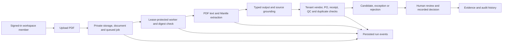

# AP Command Center

AP Command Center is a case-study prototype for reviewing supplier invoices against purchase orders, receipts and quality records. It combines model-assisted PDF extraction with deterministic checks, human decisions, document evidence and an audit trail. It records an internal AP decision; it does not send a payment or post a voucher to an ERP.

The original [PS-1 process specification](specs/PS1_INVOICE_PROCESSING_SPEC.md) describes the intended problem, including capabilities that are not implemented. This README describes the current authenticated application. The separate `engine.server` is an unauthenticated, in-memory **mock evaluation** and is not evidence of the protected workflow.

## Invoice-to-decision flow



The React/Vite frontend calls the FastAPI API under `/api/v1`. Supabase Auth JWTs are verified and resolved to active server-side workspace memberships and assigned roles; PostgreSQL row-level security provides an additional boundary when configured with the restricted application role. Uploaded PDFs are validated, hashed and stored privately. A durable job records actual intake, extraction, matching and outcome events; lease fencing prevents stale workers from committing results. Text-bearing PDFs can use AWS Bedrock Mantle; output is schema-validated and checked against document text before deterministic matching against **workspace snapshots**, not live ERP data. Reviewers can inspect the source PDF, recorded checks, outcome and history. A successful match is a candidate for review, not an automatic payment.

## What has been verified

The offline suite uses disposable SQLite fixtures and blocks outbound connections. Separate tests create a disposable PostgreSQL cluster and exercise migrations, restricted-role isolation, approval concurrency, worker recovery and backup/restore. An earlier isolated provider-backed run exercised one synthetic happy path, an exact duplicate, a price variance, missing QC and a payment receipt. That provider environment was removed; the result is **historical**, not a fresh live-demo guarantee. See [verification summary](docs/CASE_STUDY_VERIFICATION.md), [database verification](docs/OFFLINE_POSTGRES_VERIFICATION.md), [live-run reliability](docs/LIVE_RUN_RELIABILITY.md) and [dependency and recovery follow-up](docs/CLEAN_DEPENDENCY_RECOVERY_FOLLOWUP.md). Older reports document earlier states and are superseded where later follow-ups say so.

## Local setup

These steps target PowerShell on Windows. Python **3.12**, Node.js **22.18 or newer** (Node 26.7 was used for the checks below), npm, and a disposable PostgreSQL database are required. The Python requirements file contains minimum versions and test dependencies; it is **not a Python lockfile**. The frontend has `frontend/package-lock.json`.

```powershell
py -3.12 -m venv .venv
.\.venv\Scripts\python.exe -m pip install --upgrade "pip>=26.2"
.\.venv\Scripts\python.exe -m pip install -r requirements.txt
Copy-Item .env.example .env
cd frontend
npm ci
npm run build
cd ..
```

Edit the local, ignored `.env` with values for **your own isolated test services**. Never commit it or put server secrets in `VITE_` variables. At minimum, a real authenticated processing run needs:

| Area | Environment variable names | Purpose |
| --- | --- | --- |
| Runtime | `APP_ENV`, `BASE_URL`, `SECRET_KEY` | Use an isolated configuration and a strong unique secret. `APP_ENV=development` is the template default; staging additionally enforces PostgreSQL, a configured bucket and a strong secret. |
| Database | `DATABASE_URL`, `MIGRATION_DATABASE_URL` | Runtime connection uses a non-superuser, non-BYPASSRLS application role; migrations use a separately reviewed privileged connection. |
| Identity | `SUPABASE_URL`, `SUPABASE_ANON_KEY`, `SUPABASE_ISSUER`, `SUPABASE_AUDIENCE`, `SUPABASE_JWKS_URL` | A disposable Supabase Auth project, its public key configuration and an actual provider user. Legacy HS256 installations additionally use `SUPABASE_JWT_SECRET`; do not expose it to the frontend. |
| Private documents | `STORAGE_PROVIDER`, `STORAGE_BUCKET_NAME`, `SUPABASE_STORAGE_BUCKET`, `SUPABASE_SERVICE_ROLE_KEY` | A private, isolated Supabase bucket and server-only access. Other storage backends require their own credentials and verification. |
| Extraction | `MANTLE_BASE_URL`, `MANTLE_MODEL_ID`, `MANTLE_API_KEY`, `MANTLE_PROJECT_ID` | An authorized isolated Mantle project, model access and credential. `MANTLE_PROJECT_ID` is optional in code but should be set when using project-scoped access. Model calls incur provider charges. |

`VITE_SUPABASE_URL` may be set to the public project URL for Google sign-in; the UI can also obtain the configured URL from the API. Configure the provider's Google OAuth redirect for the local frontend and verify email confirmation is required. `IDENTITY_EMAIL_CONFIRMATION_ENFORCED=true` is an operator attestation required for invitation acceptance outside test mode, not an automatic check of provider settings.

Apply migrations to the **disposable** database after reviewing the identity migration notes:

```powershell
.\.venv\Scripts\python.exe -m alembic upgrade head
.\.venv\Scripts\python.exe -m alembic current
```

Migration `010` requires a migration-function owner with appropriate RLS-bypass authority; use the restricted `ap_app_user` role for normal application traffic. Migrations through `013` are required by the current code, including the session-revocation store. Migration and runtime credentials must not be interchangeable. See [workspace identity migration](docs/WORKSPACE_IDENTITY_MIGRATION.md) and [durable controls](docs/DURABLE_CONTROLS_FOLLOWUP.md) before applying them to any existing data.

An administrator must provision a test organisation, a provider identity, its matching `identity_memberships` binding and an assigned role, and load synthetic vendor, PO, receipt and QC snapshots. The app does **not** have a finished self-service bootstrap or ERP sync. The acceptance harness illustrates synthetic setup, but provisions external disposable resources and must be reviewed and configured before use; it is not a one-command local seed. No working provider credentials or workspace are supplied in this repository.

Start the backend and frontend in separate terminals after configuration:

```powershell
# Terminal 1, repository root: Vite's /api proxy expects port 8000.
.\.venv\Scripts\python.exe -m uvicorn backend.main:app --host 127.0.0.1 --port 8000

# Terminal 2
cd frontend
npm run dev
```

Open the Vite URL printed by the second command. The built frontend can alternatively be served by FastAPI after `npm run build`. `run.py` starts its server on port 8001; use the explicit command above with the Vite proxy. Setup, migrations, sign-in and live provider calls require the external services described above and were not rerun as part of the README review.

## Demo path and scenarios

1. Prepare a **new, disposable** workspace, identity, private bucket, Mantle project and matching synthetic procurement records. Confirm the signed-in user's membership and role. Do not use actual invoices or submit a real financial decision.
2. Generate the synthetic PDFs and expected procurement data locally. The output directory must not already exist:

   ```powershell
   .\.venv\Scripts\python.exe scripts/prepare_ps1_acceptance.py --output scratch/ps1-demo-fixtures
   ```

3. Upload `happy.pdf`. Open the invoice and follow its recorded run events, source evidence, checks and outcome. Processing may be dispatched in the background; an authorized reviewer can also request the next queued job. Inspect failure or queued states rather than assuming a stage completed.
4. Repeat with `price_variance.pdf`, `missing_qc.pdf`, and `payment_receipt.pdf`; upload `happy.pdf` again for an exact-byte duplicate. The generated manifest specifies the necessary synthetic source records and expected results. It does not seed the workspace or call a provider. See [the acceptance plan](docs/PROVIDER_ACCEPTANCE.md) for setup and [historical observed outcomes](docs/CASE_STUDY_VERIFICATION.md).

## Checks

From the repository root, the broad offline runner disables dotenv/integration credentials and outbound network access; the explicitly live Supabase module is excluded:

```powershell
.\.venv\Scripts\python.exe scripts/inspect_offline.py tests -q -rs --ignore=tests/phase_b/test_stage9_live_supabase_verification.py --tb=short --disable-warnings
.\.venv\Scripts\python.exe scripts/inspect_offline.py tests/test_production_inspection.py tests/test_operations_boundaries.py tests/test_processing_events.py -q --tb=short
cd frontend
npm run build
npm run lint
node --test tests/runPolling.test.mjs
cd ..
```

For PostgreSQL tests on Windows, supply a local portable PostgreSQL `bin` directory to the disposable runner; it creates and removes its own loopback cluster and never uses `.env`:

```powershell
.\.venv\Scripts\python.exe scripts/inspect_postgres.py --bin-dir C:/path/to/postgresql/bin --tb=short
```

The runner expects Windows `initdb.exe` and `pg_ctl.exe`. The legacy mock benchmark is separate: `.\.venv\Scripts\python.exe scripts/benchmark_ps1_offline.py`. It must not be interpreted as live model accuracy or authenticated workflow evidence.

## Boundaries and remaining risks

- Upload supports PDFs. Textless scans require human review; OCR/vision is not a verified end-to-end path. PDF parsing and grounding checks reduce risk but do not establish semantic correctness or malware safety.
- Matching uses saved workspace reference records with no verified upstream freshness or external commitment synchronization. General GST treatment, currency conversion, non-INR approval, multi-receipt allocation and partial-quantity allocation are not supported. A corrected line is blocked until authoritative re-grounding is available.
- Invitation and multi-workspace onboarding remain incomplete. Provider email-confirmation settings must be verified separately. Sign-out revokes the presented application access token, but provider refresh sessions and other tokens require separate handling. After restoring an older database, use the documented recovery cutoff and provider-session procedure.
- The run view reports persisted events and actual failures; it does not backfill older invoices or infer provider progress. An interrupted provider call can still complete and incur charges. Per-tenant reservations are estimates, not a hard provider billing cap.
- Production backup schedules, provider identity recovery, full object-store restore behavior, a clean locked production build and an independent penetration test remain outstanding. Two unpatched dependency advisories are discussed in [dependency and recovery follow-up](docs/CLEAN_DEPENDENCY_RECOVERY_FOLLOWUP.md). This is not a compliance or production-readiness claim.

## Repository guide

`backend/api/v1/` contains authenticated routes; `backend/core/` contains auth, storage, jobs and recovery; `backend/migrations/` contains schema changes; `engine/` contains extraction and deterministic evaluation; `frontend/src/` contains the review UI; `tests/` and `scripts/inspect_*.py` contain disposable checks. The `docs/` inspection and acceptance reports capture findings and their historical context. Generated graphs, local fixtures, scratch environments, raw local evidence and logs are excluded from the commit where they may contain local paths or provider metadata; they are not required to run the application.
