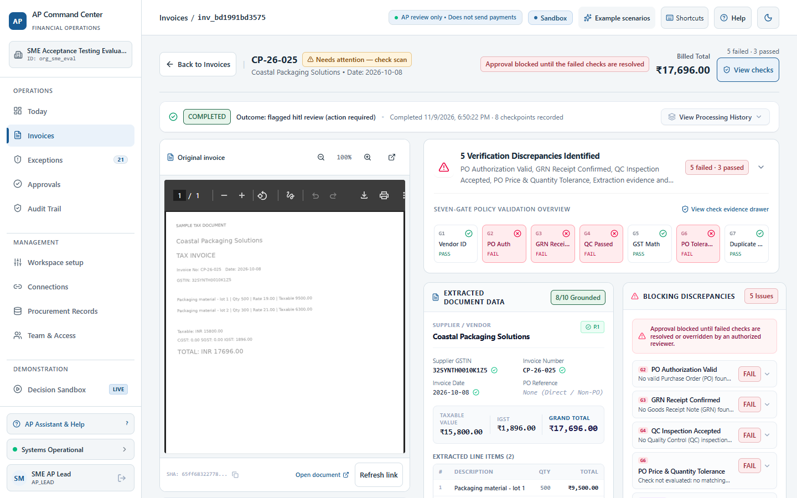
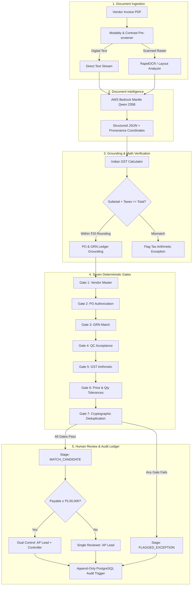

# Autonomous Accounts Payable (AP) Command Center

[](https://python.org)
[](https://fastapi.tiangolo.com)
[](https://react.dev)
[](https://www.typescriptlang.org)
[](https://www.postgresql.org)
[](https://tailwindcss.com)
[](LICENSE)

An AI-assisted accounts payable invoice processing and 3-way matching system built for the **Zamp AI Solutions Associate (Problem Statement 1)** take-home case study.

The application ingests vendor invoices, extracts structured data with multimodal AI, cross-checks line items against procurement and warehouse records (PO, GRN, and QC), evaluates seven deterministic financial policy gates, and routes exceptions for dual-control human review with an immutable database audit trail.

---

### Quick Navigation

- **[Live Application](https://zamp-case-study-ps-1-1.onrender.com/)** — Hosted production deployment on Render
- **[Decision Sandbox](https://zamp-case-study-ps-1-1.onrender.com/sandbox)** — Guided interactive workflow and custom PDF test studio
- **[Evaluator Quick Start (START_HERE.md)](START_HERE.md)** — 3-minute testing path for hiring evaluators
- **[System Architecture (ARCHITECTURE.md)](ARCHITECTURE.md)** — In-depth architectural specification and data flow
- **[Local Setup Guide (docs/LOCAL_SETUP.md)](docs/LOCAL_SETUP.md)** — Step-by-step local development setup
- **[Live Build Liveness Probe](https://zamp-case-study-ps-1-1.onrender.com/api/v1/liveness)** — Container status and Git commit parity

---

## Executive Summary: Operational Workflow & Machine Economics

Accounts payable automation requires balancing automated document processing with financial control:

- **Machine Processing Latency:** ~25–28 seconds end-to-end (PDF ingestion $\rightarrow$ AWS Bedrock Mantle Qwen 235B multimodal extraction $\rightarrow$ deterministic 7-gate validation).
- **Direct Model Inference Cost:** ~$0.0022 USD (~₹0.18) in Bedrock token usage per processed invoice (excluding cloud database hosting and human review labor).
- **Workflow Role Shift:** Instead of manually re-keying invoice headers and line items into an ERP and performing manual math checks against POs and warehouse GRNs, the AP reviewer acts as an exception manager—inspecting pre-reconciled items with coordinate-anchored provenance and handling commercial discrepancies.

---

## Core Edge Cases & Decision Scenarios (Two-Layer Implementation)

To maintain complete transparency for evaluators, edge case capabilities are divided across two distinct layers:

### 1. Live Cloud Flagship Deployment (Render Web Service)
The hosted web application at [https://zamp-case-study-ps-1-1.onrender.com/](https://zamp-case-study-ps-1-1.onrender.com/) demonstrates:
- **Clean 3-Way Match (`MATCH_CANDIDATE`):** Ingests valid invoices, runs live AWS Bedrock Mantle Qwen 235B extraction, validates Indian GST tax splits, and verifies all 7 deterministic gates with 0.00% variance.
- **Rate Variance Exception (`FLAGGED_EXCEPTION`):** Detects billed unit rate exceeding PO contracted price (+18.9% variance), failing Gate 6 and halting payment recommendation.
- **Cryptographic Deduplication (`HTTP 409 Conflict`):** Rejects byte-identical re-submissions at the API boundary via SHA-256 hash.
- **Degraded Low-Contrast Scan Safety:** Diverts raster scans with low contrast ($\sigma < 10.0$) fail-closed to HITL review.
- **Non-Payable Document Quarantine:** Classifies payment receipts (`PAYMENT_RECEIPT`) and routes to quarantine with zero open AP liability.
- **Dual-Control Approval:** High-value invoices ($\ge ₹5,00,000$) require secondary Controller approval with anti-self-approval enforcement.

### 2. Standalone Core Engine Test Suite (`tests/test_engine.py` & `engine/rules.py`)
*Note for Evaluators: These specialized commercial edge cases are implemented and verified in the automated pytest suite (30 passing tests in ~3.3s via `pytest tests/test_engine.py -v`); they reflect the standalone PS-1 engine logic and are not currently wired into the live Render web interface.*

| Edge Case | Scenario & Verification Command | System Behavior & Decision | Safety Invariant |
| :--- | :--- | :--- | :--- |
| **Split-PO Overrun** | `test_edge_case_1_split_po_overrun`<br>Bills $6,500 against PO-1042 with $10,000 authorized and $8,000 previously billed ($2,000 balance remaining). | Engine flags $4,500 budget overrun (`split_po_overrun`), halts voucher creation, routes to `FLAGGED_HITL_REVIEW`, and drafts a vendor inquiry email. | Prevents cumulative over-billing across multi-invoice purchase orders. |
| **Near-Tolerance Boundary (1.4% vs 1.6%)** | `test_near_tolerance_boundary_1_4_vs_1_6`<br>Tests exact 1.5% policy tolerance threshold. | 1.4% increase ($507 vs $500) passes and auto-approves (`AUTO_APPROVED`). 1.6% increase ($508 vs $500) flags `PRICE_VARIANCE` and routes to `FLAGGED_HITL_REVIEW`. | Validates sharp boundary enforcement without floating-point drift. |
| **Missing PO Reference** | `test_inferred_po_requires_hitl_review`<br>Invoice omits PO reference; verified vendor has open PO-1042 in ERP. | Engine infers the open PO for line matching, but strictly suppresses auto-approval (`inferred_po`), routing to `FLAGGED_HITL_REVIEW`. | Never touchless-approves an invoice with an inferred procurement reference. |
| **Missing Critical Fields** | `test_no_data_fabrication_on_missing_invoice_number_and_date`<br>PDF omits invoice number, date, or totals. | Pipeline halts downstream matching, records missing fields, and refuses to fabricate surrogate values. | Anti-hallucination guard against model guessing on missing data. |
| **Reformatted Duplicate** | `test_reformatted_duplicate_invoice_number_detected`<br>Vendor re-submits with altered spacing/delimiters (`INV-2024-001` vs `INV2024001`) or re-exported PDF. | Tier 2 deduplication normalizes supplier GSTIN/name and invoice number, matching against active ledger. | Rejects commercial duplicate with zero second liability created. |
| **Bank Account Mismatch** | `test_bank_details_mismatch_held_for_fraud_review`<br>Invoice remittance bank details differ from ERP vendor master bank records. | Halts processing and triggers a compliance security hold (`bank_details_mismatch`). | Guards against vendor email compromise and invoice redirection fraud. |
| **Touchless ERP Voucher** | `test_happy_path_auto_approved`<br>Clean invoice matching open PO within tolerance. | Emits `AUTO_APPROVED` state, computes confidence $\ge 0.95$, and generates an ERP voucher ID (`VCHR-...`). | Automates straight-through processing for verified clean invoices. |

---

## Visual Showcase

### Two-Column Invoice Review Workspace
The flagship interface provides side-by-side verification: the original document rendered on the left, with extracted line items, 3-way reconciliation, and deterministic gate results on the right.


### Seven Deterministic Policy Gates
Every invoice is evaluated against seven sequential checks before any payment recommendation can be generated.



---

## Evaluator Quick Start (3-Minute Live Verification)

Evaluators can test the end-to-end pipeline on the live deployment without configuring local environments or authoring personal mailbox permissions:

1. **Launch Workspace:**  
   Open the **[Live Deployment](https://zamp-case-study-ps-1-1.onrender.com/)** and click **Launch Live Demo Workspace** (or jump directly to the **[Decision Sandbox](https://zamp-case-study-ps-1-1.onrender.com/sandbox)**).
2. **Run a Clean 3-Way Match:**  
   In the Decision Sandbox, select **Option B: Custom PDF Upload**. Click **Download clean invoice**, then upload the resulting PDF. Follow the live processing stages (Ingestion $\rightarrow$ AI Extraction $\rightarrow$ Tax Validation $\rightarrow$ 7 Policy Gates). The job completes with decision `MATCH_CANDIDATE`.
3. **Test an Exception (Rate Variance):**  
   Click **Download price-variance invoice** and upload it. The pipeline detects that the billed rate (₹220.00/unit) exceeds the contracted PO rate (₹185.00/unit) beyond the 1.5% tolerance, failing Gate 6 and routing to `FLAGGED_EXCEPTION`.
4. **Test Cryptographic Deduplication:**  
   Re-upload the exact same PDF file. The system computes the SHA-256 hash at the boundary, detects an identical document in the ledger, and rejects it with `HTTP 409 Conflict`.

> [!NOTE]  
> **Cold Start Notice:** The live demo is hosted on Render's web service tier. If the instance has been idle, the initial page load may take 20 to 40 seconds while the container initializes. Subsequent requests respond within normal operational latencies.

> [!IMPORTANT]  
> **Prepared Records vs. Live Provider Runs:** The demo workspace contains five pre-seeded synthetic records for immediate interface exploration. Custom PDF uploads in Option B invoke the live processing pipeline (AWS Bedrock Mantle Qwen 235B and Supabase PostgreSQL).

---

## Architectural Principles: "Models Read, Rules Decide"

Accounts payable automation requires balancing flexible document interpretation with zero-tolerance financial accuracy. Large language models excel at parsing unstructured invoices, varying table layouts, and misaligned tokens. However, probabilistic models must never calculate tax totals, determine policy tolerances, or authorize disbursements.



### The Seven Deterministic Policy Gates

| Gate | Validation Rule | Deterministic Check | Exception Condition |
| :---: | :--- | :--- | :--- |
| **1** | **Vendor Master** | Supplier GSTIN, PAN, and active status exist in the ERP vendor registry. | Unregistered vendor or mismatched tax identifier. |
| **2** | **PO Authorization** | PO reference is valid, approved, unexpired, and has an open line balance. | Closed PO, missing authorization, or unapproved amendment. |
| **3** | **GRN Match** | Billed item quantities do not exceed accepted warehouse Goods Receipt Notes. | Billed quantity > warehouse received quantity. |
| **4** | **QC Acceptance** | Delivered goods have passed engineering quality inspection. | Inspection status is `HOLD` or `REJECTED`. |
| **5** | **GST Arithmetic** | Billed math satisfies $\text{abs}(\text{Subtotal} + \text{Taxes} - \text{Total}) \le ₹20.00$ and confirms intrastate (CGST+SGST) vs interstate (IGST) split. | Tax calculation discrepancy or invalid state code mapping. |
| **6** | **Tolerances** | Unit price variance $\le 1.50\%$; line total variance $\le ₹20.00$. | Billed unit rate exceeds contracted purchase order rate. |
| **7** | **Deduplication** | Dual-tier check: Tier 1 SHA-256 binary hash collision + Tier 2 commercial composite key `(normalized_supplier, normalized_invoice_number)` matching across re-exported or altered PDFs. | Duplicate payment submission or identical re-transmission. |

---

## Core Engineering Decisions

1. **Arbitrary-Precision Arithmetic:**  
   All monetary calculations, percentages, and taxes use Python `Decimal` and PostgreSQL `numeric(15,2)` types. Binary floating-point representation (`float`) is barred from financial code paths to prevent rounding drift.
2. **Indian Statutory GST Validation:**  
   Validates 15-character alphanumeric GSTIN formats, extracts 2-digit state prefixes, and deterministically enforces tax classification:
   - Same supplier and recipient state: mandatory 50/50 split between **CGST** and **SGST**.
   - Differing supplier and recipient state: 100% allocation to **IGST**.
   - Standard rounding tolerance allowed up to ₹20.00 to accommodate ERP truncation conventions.
3. **Database-Level Audit Immutability:**  
   Financial audit events are written to `audit_events`. Immutability is enforced at the database engine level via PostgreSQL trigger `trg_audit_events_immutable`, which aborts any `UPDATE` or `DELETE` statement. Corrections require new compensating ledger events.
4. **Tenant Isolation via PostgreSQL RLS:**  
   Multi-tenant security uses PostgreSQL Row-Level Security (RLS) forced across all tables. Queries set transaction-local configuration (`SET LOCAL app.current_org_id`), and connection poolers execute `RESET ALL` upon check-in to prevent cross-tenant session leakage.
5. **High-Value Dual-Control Workflow:**  
   Invoices with a net payable balance $\ge ₹5,00,000$ mandate secondary approval by a Financial Controller following initial sign-off by the AP Lead. Anti-self-approval rules prevent the initial approver from granting secondary clearance.

---

## Integration Status & Boundaries

To ensure complete clarity during evaluation, current integration boundaries are explicitly documented:

| Subsystem | Status | Details & Implementation Scope |
| :--- | :---: | :--- |
| **AWS Bedrock Mantle (Qwen 235B)** | **Live** | Active in `ap-south-1` (Mumbai). Zero-temperature structured extraction with fallback handling. |
| **Supabase PostgreSQL 15 & Storage** | **Live** | Production database and private S3-compatible document storage using 300s presigned URLs. |
| **Gmail Mailbox Ingestion** | **Configured** | Code implements OAuth 2.0, Fernet token encryption, Pub/Sub webhook receiver, and history sync. Mailbox OAuth consent is omitted from the public demo to avoid requiring evaluator personal credentials. |
| **SAP S/4HANA ERP Synchronization** | **Roadmap** | Procurement records are grounded against internal database models (`erp.py`). Direct bidirectional RFC/BAPI synchronization is an architectural roadmap item. |
| **Banking & Payment Rails** | **Decoupled** | The application governs accounts payable review and approval. Internal sign-off does not trigger disbursement or initiate automated bank transfers. |

---

## Testing & Verification Summary

The codebase is protected by automated tests across security invariants, matching gates, tenant isolation, and UI responsiveness:

- **Standalone Core Engine Suite:** **30 passed, 0 failed** in ~3.3s (`pytest tests/test_engine.py -v`), verifying split-PO overruns, 1.4% vs 1.6% near-tolerance boundaries, reformatted duplicate matching, and inferred POs.
- **Full Pytest Collection:** 278 test functions defining **625 collected test cases** across parametrized matrices in `tests/`. (Note: 43 tests in the full suite are skipped when disposable local PostgreSQL container fixtures or live external Gmail credentials are not present).
- **Live Acceptance Suite:** 9 end-to-end browser tests executed via Playwright against the live Render deployment (`https://zamp-case-study-ps-1-1.onrender.com/`), confirming:
  - 1-click demo workspace launch (11.05s)
  - Fresh clean invoice upload to `MATCH_CANDIDATE` (28.03s)
  - Price variance upload to `FLAGGED_EXCEPTION` (26.74s)
  - Cryptographic duplicate rejection (`HTTP 409 Conflict`)
  - Container build parity matching Git commit `9354d404cad4`
- **Milestone Baseline Snapshot:** An earlier development baseline recorded 464 passed / 43 skipped across 507 collected tests. Subsequent test suite expansion across edge cases, parity testing, and isolation hardening brought the collection to 625 items.

---

## Repository Structure

```
├── backend/                       # FastAPI application & REST endpoints
│   ├── api/v1/                   # Route handlers (auth, invoices, dashboard, webhooks)
│   ├── core/                     # Infrastructure (config, database, security, storage)
│   ├── models/                   # SQLAlchemy domain models (invoice, enterprise, erp, audit)
│   └── migrations/               # Alembic database schema migrations
│
├── frontend/                      # React 19 / Vite single-page application
│   ├── src/pages/                # Primary views (Dashboard, Inbox, Review Workspace)
│   ├── src/components/           # Reusable UI components & authentication views
│   └── public/sandbox.html       # Standalone interactive Decision Sandbox
│
├── engine/                        # Provider-independent business logic
│   ├── mantle_client.py          # AWS Bedrock Mantle client (Qwen 235B)
│   ├── indian_tax_rules.py       # GST arithmetic & 7-gate matching engine
│   ├── duplicate_detector.py     # Cryptographic SHA-256 deduplication
│   └── ocr_engine.py             # PDF text extraction & contrast pre-screening
│
├── docs/                          # In-depth architectural & operational documentation
│   ├── assets/screenshots/       # High-resolution application screenshots
│   ├── AP_BUSINESS_RULES.md      # Detailed 7-gate specifications & GST formulas
│   └── LOCAL_SETUP.md            # Local developer installation guide
│
├── fixtures/                      # Synthetic vendor invoices & ERP reference datasets
├── tests/                         # Pytest test suite (Phases A–E, engine, parity)
├── Dockerfile                     # Multi-stage production container build
├── render.yaml                    # Render Web Service blueprint
└── requirements.txt               # Locked Python dependencies
```

---

## Documentation Index

| Topic | Document | Focus Area |
| :--- | :--- | :--- |
| **Evaluator Walkthrough** | **[START_HERE.md](START_HERE.md)** | Step-by-step 3-minute evaluation guide and live test instructions |
| **Architecture Specification** | **[ARCHITECTURE.md](ARCHITECTURE.md)** | System context, data models, and technical design decisions |
| **AP Business Rules** | **[docs/AP_BUSINESS_RULES.md](docs/AP_BUSINESS_RULES.md)** | Exact GST calculations, tolerance thresholds, and state transitions |
| **Local Development** | **[docs/LOCAL_SETUP.md](docs/LOCAL_SETUP.md)** | Prerequisites, local PostgreSQL, and running frontend/backend servers |
| **Operations Runbook** | **[OPERATIONS_RUNBOOK.md](OPERATIONS_RUNBOOK.md)** | Deployment triage, health check probes, and monitoring guides |
| **Security Architecture** | **[SECURITY_NOTES.md](SECURITY_NOTES.md)** | PostgreSQL RLS policies, audit immutability, and token governance |
| **Contributing Standards** | **[CONTRIBUTING.md](CONTRIBUTING.md)** | Coding conventions, commit guidelines, and security requirements |
| **License** | **[LICENSE](LICENSE)** | Open-source MIT License terms |
