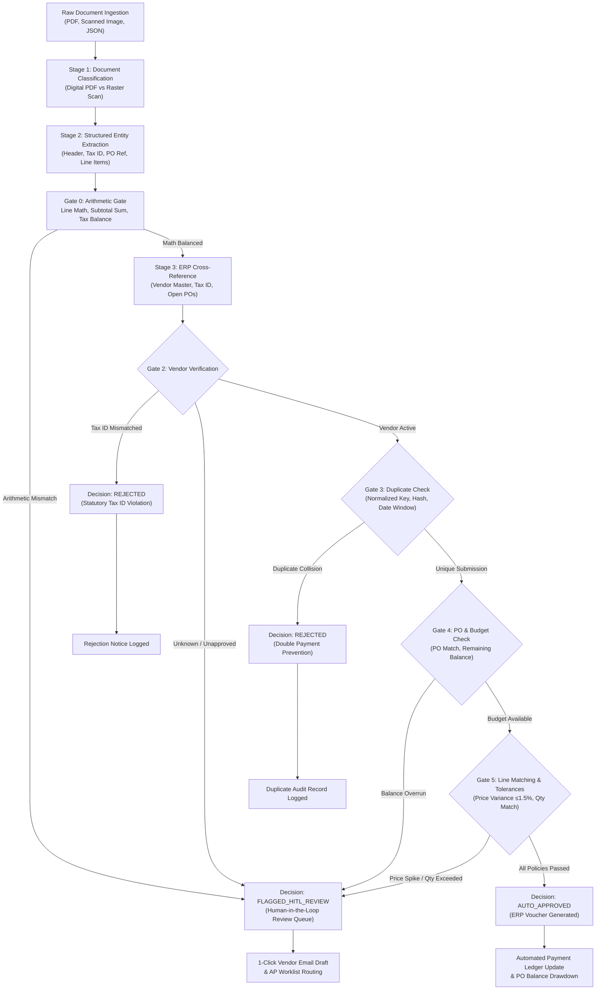

# Autonomous AP Digital Employee (Zamp PS-1)
> **Problem Statement 1: Automated Invoice Processing, 2-Way/3-Way Matching & AOP Tolerance Policy Engine**  
> **Candidate:** Neeraj Shivkumar — AI Solutions Associate Candidate  
> **Evaluation Framework:** Deterministic Plan-Execute-Validate (PEV) Architecture

---

## 1. Quick Start — 1-Command Live Demo (Zero Configuration)

Start the autonomous AP Digital Employee and interactive execution dashboard with a single command. **No external cloud accounts, Supabase keys, or API tokens are required** for the core case-study evaluation:

```powershell
python run.py
```

Open your browser to:
👉 **`http://127.0.0.1:8001`**

- **Interactive Execution UI:** Select from 5 pre-configured enterprise test scenarios or upload an arbitrary invoice PDF.
- **Real-Time Stage Stepper:** Server-Sent Events (SSE) stream execution latencies across all 5 pipeline stages in under 50ms.
- **Explainable Decision Cards:** Instant visibility into the decision badge (`AUTO_APPROVED`, `FLAGGED_HITL_REVIEW`, `REJECTED`), mathematical variance breakdown, "What Happens Next" operational guidance, and 1-click vendor email drafts.
- **Mock ERP Master:** Live inspection of active Vendor Records, open Purchase Orders, and the historical duplicate-detection ledger.
- **One-Click Reset:** Reset demo data and metrics back to baseline at any moment.

*(To launch the multi-tenant enterprise backend instead, run `python run.py --enterprise`).*

---

## 2. End-to-End Invoice-to-Decision Process Map

The Digital Employee enforces a strict **Plan-Execute-Validate (PEV)** loop governed by an enterprise **Agent Operating Procedure (AOP)**:



---

## 3. The 4 Core Edge Cases (+ Fraud Prevention)

Every scenario represents a distinct, high-friction accounts payable failure mode evaluated by the AOP Policy Engine:

| # | Scenario Name | Fixture File | Expected Decision | Why It Matters to CFOs & AP Teams |
|---|---|---|---|---|
| **HP-01** | **Clean Happy Path** | `HP-01-Happy-Path.json` / `.pdf` | `AUTO_APPROVED` | Routine, compliant invoice for $5,425 matches open PO-1042 lines. Line items and taxes balance within tolerance. Generates ERP Voucher (`VCHR-XXXXXX`) for straight-through payment. |
| **EC-01** | **Split-PO Budget Overrun** | `EC-01-Split-PO-Overrun.json` / `.pdf` | `FLAGGED_HITL_REVIEW` | Invoice for $6,500 exceeds remaining PO balance ($2,000) on a $10,000 PO where $8,000 was previously billed. Catches the **$4,500 deficit** and routes to procurement with an over-billing audit trail. |
| **EC-02** | **Duplicate Submission** | `EC-02-Duplicate-Submission.json` / `.pdf` | `REJECTED` | Re-submission of invoice `INV-2026-089` previously approved 12 days earlier. Normalizes delimiters (strips dashes/spaces) and checks cryptographic hashes, instantly killing the double-payment risk. |
| **EC-03** | **Line-Item Price Spike** | `EC-03-Price-Spike-Variance.json` / `.pdf` | `FLAGGED_HITL_REVIEW` | Freight vendor bills $135.00/unit vs contracted $100.00/unit (**+35% price increase**). Catches unapproved vendor margin creep exceeding the 1.5% policy tolerance limit. |
| **EC-04** | **Low-Res Scan & Missing PO** | `EC-04-Low-Res-Missing-PO.json` / `.pdf` | `FLAGGED_HITL_REVIEW` | Degraded mobile receipt (62% OCR confidence) omitting PO reference. Infers open PO-3015 for Valley Hardware but flags for human confirmation; pre-drafts vendor clarification email. |
| **SEC-01** | **Remittance Bank Mismatch** | *Programmatic / Unit Test* | `FLAGGED_HITL_REVIEW` | Remittance account on invoice differs from registered vendor master banking instructions. Catches invoice redirection fraud before payment release. |

---

## 4. Core Design Decisions

### Why Rules Decide & the LLM Only Reads
- **The Zero-Hallucination Boundary:** Language models excel at flexible semantic extraction from messy, unstructured PDF layouts (handling OCR noise, rotated tables, varying date formats). However, LLMs must **never** make financial authorization decisions or perform cent-level arithmetic.
- **Architectural Isolation:** The extractor outputs typed, schema-validated Pydantic structures. All matching, budget validation, duplicate checking, and approval decisions are executed by deterministic Python rules.

### Why HOLD (Flagged for Review) vs REJECT
- **Fatal Violations (`REJECTED`):** Duplicate submissions, mismatched tax identification numbers, and suspended vendors are hard-rejected. No payable voucher is created, preventing double disbursements or regulatory penalties.
- **Commercial Discrepancies (`FLAGGED_HITL_REVIEW`):** Legitimate vendors with uncontracted price spikes, split-PO budget deficits, or omitted PO references are placed on **HOLD**. The system packages the exact mathematical variance and auto-generates a vendor email draft so an AP Lead can resolve the issue in 1 click.

---

## 5. Verification & Test Evidence

The repository maintains two comprehensive automated test suites verified on a clean Python 3.12 environment:

```powershell
# 1. Run the standalone PS-1 engine verification suite (28 tests)
python run.py --test

# 2. Run full repository verification suite (393 tests)
python -m pytest tests/ -q
```

### Verified Test Results Summary:
- **Standalone PS-1 Engine Suite:** **28 passed, 0 failed** in 0.25s (`tests/test_engine.py`)
  - HP-01 through EC-04 deterministic scenario test matrix
  - Tax ID mismatch strict rejection (never falls back to name)
  - Short vendor name rejection (minimum 3-char threshold)
  - Deterministic arithmetic gates (line math, subtotal sum, tax rounding tolerance)
  - Reformatted duplicate detection (stripping delimiters and leading zeros)
  - Single-line PO strict matching (no arbitrary line fallback)
  - Inferred PO human confirmation flag
  - Remittance bank account mismatch fraud prevention
  - Multi-line quantity aggregation per PO line
  - Multi-currency formatting (USD `$`, INR `₹`, EUR `€`, GBP `£`)
- **Full Project Test Suite:** **393 passed, 43 skipped, 0 failed** in ~48s (Skipped tests require disposable PostgreSQL or external services).
- **Security & Hygiene:** 0 committed credentials; `.env`, `.agents`, `.vibe-wise`, employer dossiers, and external project files scrubbed from git tracking.

---

## 6. What I'd Build Next (Production Roadmap)

1. **Bi-Directional ERP Connectors:** Real-time webhooks for SAP S/4HANA OData and NetSuite SuiteTalk REST APIs for automated PO line locking and payment voucher ingestion.
2. **Autonomous Mailbox Ingestion:** Dedicated IMAP/OAuth2 listeners for Google Workspace and Microsoft 365 (`ap-inbound@company.com`) with automated inline signature filtering.
3. **Multi-Tier Authority Matrix:** Dual-controller sign-off workflow for high-value exceptions exceeding ₹5,00,000 ($50,000) or vendor bank account changes.
4. **Fast-Track Bulk Resolution:** Bulk release toolbar enabling AP Leads to batch-approve minor variances within secondary authorized thresholds.

---

## 7. Enterprise Architecture (Optional Deep-Dive)

For enterprise-scale production evaluations, the repository also includes a multi-tenant SaaS implementation accessible via `python run.py --enterprise`:
- **Identity & RBAC:** Supabase Auth JWTs, session revocation store, and 4-role permission hierarchy (`AP_ASSOCIATE`, `AP_LEAD`, `CONTROLLER`, `SYSTEM_ADMIN`).
- **Data Boundary:** PostgreSQL Row-Level Security (RLS) enforcing tenant isolation with restricted application roles (`ap_app_user`).
- **Resilience:** Lease-protected worker queues with heartbeat fencing preventing stale worker commits.
- **Private Storage:** Tenant-scoped storage adapters supporting S3, Supabase Storage, and local disposable file systems.

---

## 8. Repository Structure

```
├── run.py                          # 1-command launcher (default: PS-1 engine on :8001)
├── engine/                         # Core PS-1 Autonomous AP Digital Employee
│   ├── rules.py                    # AOP Policy & Rules Engine (Gates 0-5)
│   ├── mock_erp.py                 # In-memory ERP database & duplicate ledger
│   ├── models.py                   # Pydantic v2 financial data models & contracts
│   ├── pipeline.py                 # 5-stage Plan-Execute-Validate pipeline orchestrator
│   ├── duplicate_detector.py       # Dual-tier cryptographic & semantic duplicate detector
│   ├── server.py                   # FastAPI server with SSE streaming & reset endpoints
│   └── templates/index.html        # Interactive dark-mode execution UI & dashboard
├── fixtures/data/                  # PS-1 benchmark test fixtures (HP-01, EC-01 to EC-04)
├── specs/                          # Case study blueprints and specifications
│   └── PS1_INVOICE_PROCESSING_SPEC.md
├── ASSUMPTIONS.md                  # 10 core enterprise AP operating assumptions
├── tests/                          # 436 automated verification tests
│   ├── test_engine.py              # 28 deterministic regression tests for PS-1 rules
│   └── test_hardening.py           # Engine fail-soft and extraction regression tests
└── docs/                           # Architecture, verification reports, and blueprints
    ├── architecture/               # High-availability and storage design
    ├── AP_BUSINESS_RULES.md        # Comprehensive business rule definitions
    └── CASE_STUDY_VERIFICATION.md  # Production verification evidence register
```

---
*Developed for Zamp Problem Statement 1 (PS-1) Hiring Evaluation.*
