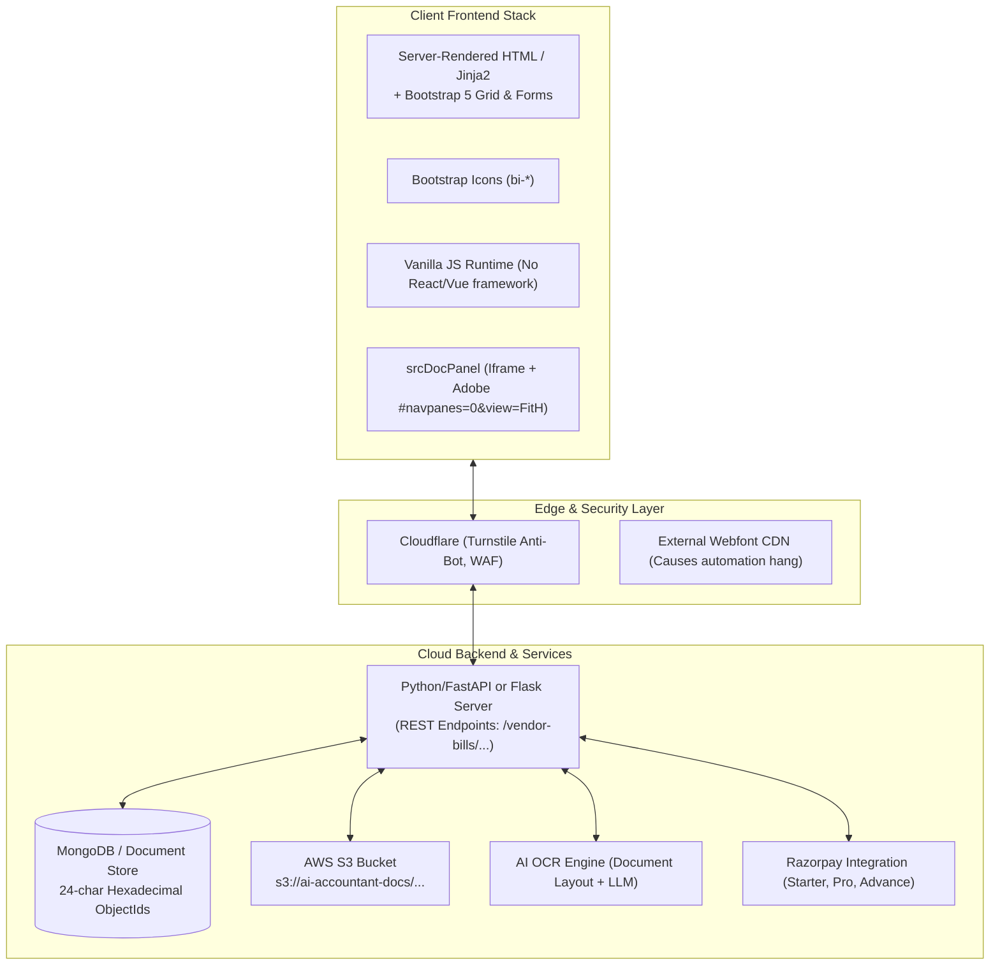

# REA Mission 01 — FinBooks Product & Architecture Reverse-Engineering Report

**Target:** FinBooks AI (`https://app.finbooks.ai/`)  
**Mission Scope:** Complete Product, UI/UX, Workflow, and Technical Reverse Engineering  
**Investigation Standard:** REA (Reverse Engineer Anything) + Chrome CDP Native Telemetry  
**Deliverable Directory:** `C:\REA\competitor_research\01_finbooks\`  
**Date of Mission Completion:** November 03, 2026  

---

## 1. Executive Summary

FinBooks (`https://app.finbooks.ai/`) is an Indian SME-focused financial accounting and AP automation web application. It combines AI-driven optical character recognition (OCR) with GST compliance, bank statement reconciliation, and native bidirectional sync with TallyPrime and Zoho Books.

By leveraging an authorized trial session on the live application (`Svit` organization, user `SUBRAMANIAN`), this reverse-engineering mission dissected the entire logged-in product: its frontend runtime, DOM architecture, underlying data schemas, backend endpoints, OCR extraction pipeline, exception handling models, and workflow interaction costs.

### The Core Finding
FinBooks delivers strong regional localization for Indian tax compliance (GSTIN checksum validation, GSTR-2B ITC matching, CGST/SGST/IGST isolation, and Tally XML DayBook export). However, its **ergonomic workflow design suffers from severe architectural fragmentation**. The product separates the document viewer from the data-editing form, completely discards line-item editing in the UI despite extracting line items in the backend, and falls back to native browser alerts (`window.prompt`) for order matching. These design failures create substantial manual interaction friction that our AP Command Center can directly exploit and improve upon.

---

## 2. Technical Stack & Infrastructure Teardown



### 2.1 Frontend Architecture
- **Rendering Pattern:** Server-side rendered (SSR) multipage application (likely Python Jinja2 templates) combined with vanilla JavaScript DOM manipulation (`document.getElementById`, `requestAnimationFrame`). There is **no client-side SPA framework** (no React, Vue, or Angular bundle on the bills route).
- **Styling & Components:** Built on top of Bootstrap 5 grid utility classes (`row`, `col-md-6`, `col-12`) layered with custom dark-mode CSS variables (`--bg-card: #1e293b`, `--teal: #0d9488`, `--heading: #ffffff`).
- **Document Viewing Engine:** Pure browser iframe embedding using Adobe PDF viewer query parameters: `src = url + '#navpanes=0&view=FitH'`. For image formats (`.jpg`, `.png`, `.webp`), it dynamically falls back to an `` tag with CSS transform rotation and zoom.
- **Identified Frontend Defect:** External webfont references fail to properly resolve `document.fonts.ready` events in headless environments, causing automation tools to hang unless bypassed using native CDP raster snapshotting.

### 2.2 Backend & Data Persistence Layer
- **Database Engine:** **MongoDB / Document DB**. Evidenced by standard 24-character hexadecimal MongoDB ObjectIds across all entities:
  - Organization ID: `6ae9b769883aba2968f8a62c`
  - Bill ID: `6ae9c8092cc937b7118e8798`
  - Vendor ID: `6ae9c8092cc937b7118e8797`
  - User ID: `6ae9b769883aba2968f8a62d`
- **File Storage:** AWS Simple Storage Service (S3) bucket named `ai-accountant-docs`. Files are organized by tenant: `s3://ai-accountant-docs/organizations/{org_id}/vendors/{uuid}.pdf`.
- **Deduplication Cryptography:** Computes two separate SHA-256 hashes per document:
  1. `file_hash`: Exact binary file hash.
  2. `business_invoice_hash`: Composite hash of `[vendor_id + invoice_number + invoice_date + total_amount]`.

---

## 3. Product Teardown: Information Architecture & Dashboard

### 3.1 Information Architecture Strengths
- **Regional Tax First:** GSTR-1 (Sales), GSTR-2B (Purchases ITC), and TDS compliance are treated as top-level architectural citizens, rather than buried in settings.
- **Accrual vs. Cash Accounting Toggle:** The executive dashboard allows switching between the *Finances* view (accrual basis driven by vendor bills and sales invoices) and the *Bank Statements* view (cash basis driven by real cleared transactions).
- **Embedded Knowledge System:** An interactive right-side drawer embeds 25+ visual onboarding guides and an exhaustive version changelog (v2.0 through v2.13), dramatically reducing customer support overhead.

### 3.2 Information Architecture Failures
- **Lack of Backlog Visibility:** Top-level navigation items (`Bills`, `Expenses`, `Bank Statements`) display zero workload indicators. A user cannot tell if there are 2 bills or 200 bills awaiting review without clicking through to the respective pages.
- **Metrics Hidden in Carousels:** The executive dashboard wraps primary financial indicators (Total Revenue, Total Spend, Net Profit) in a horizontal carousel. Key numbers are hidden behind scroll chevrons on laptops.
- **Table Column Overlap Defect:** In the Vendor Master table, fixed column width definitions cause the `GSTIN / PAN` header to collide and render directly on top of `EMAIL / PHONE` on screens below 1400px width (`screenshots/other_features/01_vendor_master.png`).

---

## 4. Deep Dive: Invoice Review & Verification Workspace

The invoice review workspace is the operational core of any AP platform. FinBooks' execution in this area represents its greatest product vulnerability.

### 4.1 The Disconnected Workspace Problem
High-throughput AP teams require continuous visual cross-referencing between the source document and extracted fields. FinBooks segregates these into two isolated dialogs:

```text
[ FinBooks Vendor Bills Queue ]
       │
       ├──> Click Paperclip: Opens `srcDocPanel` (Sliding Right Drawer, 560px)
       │    └── Read-only document viewer. Cannot edit any fields.
       │
       └──> Click Pencil: Opens `editForm` (Centered Modal Dialog)
            └── Form inputs covering the screen. Closes document viewer.
```

Because `editForm` and `srcDocPanel` cannot be open simultaneously, a reviewer caught in a validation question must:
1. Open the PDF panel to inspect the line item.
2. Memorize the tax value or write it down.
3. Close the PDF panel.
4. Open the Edit Modal.
5. Enter the corrected value and click Save.

### 4.2 The "Missing Line Items" Phenomenon
As verified through live payload inspection during synthetic invoice ingestion (`synthetic_vendor_invoice.pdf`):
- **Backend Extracted:**
  - Item 1: `Cloud Compute Virtual Instances (CPU/RAM)`, Qty: 2, Rate: ₹3,000, Amount: ₹6,000.
  - Item 2: `Managed SSD Storage Volume (1 TB NVMe)`, Qty: 1, Rate: ₹4,000, Amount: ₹4,000.
- **Frontend Exposes:**
  - `Amount (₹)`: `10000.00` (Header taxable aggregate only).
  - Line items: **COMPLETELY ABSENT FROM THE EDIT MODAL**.

The user has no mechanism to review item descriptions, quantities, unit prices, or HSN/SAC codes in the review modal. If the OCR misreads a line-item rate, the user is forced to tamper with the top-level taxable amount, corrupting inventory and GL records.

---

## 5. Exceptions, Deduplication & Error Handling

FinBooks demonstrates strong backend duplicate prevention paired with poor interactive resolution tooling.

### 5.1 Deduplication UX (`dupCard`)
When a duplicate invoice is uploaded, FinBooks intercepts the document and renders a dedicated `dupCard` component:
- **Level 1 (File Duplicate):** Flags identical file uploads using binary hash matching.
- **Level 2 (Business Duplicate):** Flags identical vendor/invoice#/date/amount combinations.
- **Resolution Action:** Provides a direct link (`<a class="btn-primary-g">View Invoice</a>`) that immediately filters the queue to the existing bill.
- **Bypass Capability:** Provides a secondary button allowing the user to upload anyway for legitimate recurring sequences.

### 5.2 PO Matching Failure (`window.prompt`)
When an invoice cannot be automatically linked to an Inbound Purchase Order:
- The bill row displays a grey badge: `No matching order`.
- Clicking this badge executes:
  ```javascript
  const num = prompt('Sales order number this bill belongs to (e.g. SO-00003), or clear the box and OK to unlink:');
  ```
- **Friction:** Native browser dialogs block the UI thread, provide zero search capabilities, offer no dropdown of active POs for that vendor, and force the user to open a new tab to find the order number.

---

## 6. Commercial Model & Packaging Strategy

Sourced directly from live billing DOM inspection (`screenshots/other_features/13_billing.png`, `billing_extracted.json`):

| Plan Tier | Monthly Price (INR) | Effective with 18% GST | Monthly AI Ingestion Quota | Key Included Capabilities | Critical Omissions |
|:---|:---:|:---:|:---:|:---|:---|
| **Starter** (Trial) | ₹499 / mo | ₹588.82 | 50 AI uploads / mo | OCR extraction, Bank statement parsing, CSV export | **No Double-Entry Ledger, No PO Auto-Match, No AI CFO** |
| **Pro** | ₹1,499 / mo | ₹1,768.82 | 200 AI uploads / mo | Double-entry ledger, PO auto-match, AI CFO Assistant | No inventory batch tracking, No Tally export pack |
| **Advance** | ₹4,999 / mo | ₹5,898.82 | 1,000 AI uploads / mo | Full inventory, Dispatch tracking, Tally export pack | Enterprise custom integrations |

**Key Commercial Takeaway:** FinBooks aggressively gates basic financial integrity features (the Double-Entry General Ledger and PO matching) behind the Pro Plan (₹1,499/mo), treating the ₹499 Starter tier merely as a paid OCR intake utility.

---

## 7. Strategic Recommendations for AP Command Center

Based on the empirical evidence gathered during this mission, our AP Command Center can establish decisive competitive superiority by implementing the following 10 architectural principles:

```text
┌────────────────────────────────────────────────────────────────────────┐
│                   AP COMMAND CENTER ARCHITECTURAL BLUEPRINT            │
├────────────────────────────────────────────────────────────────────────┤
│ 1. Unified Split-Screen Workspace (50/50 View: Document + Data Sync)  │
│ 2. First-Class Line-Item Grid with Direct Cell Editing & HSN Lookup   │
│ 3. Click-to-Coordinate OCR Bounding Box Cross-Highlighting             │
│ 4. Intelligent PO Matching Drawer with Fuzzy Suggestions & Tolerances  │
│ 5. Global Navigation Workload Badges (Backlog visibility at a glance)   │
│ 6. Dual-Hash Deduplication Engine with Visual Side-by-Side Comparison │
│ 7. Integrated Per-Invoice Audit Timeline (Approvals, edits, webhooks)  │
│ 8. True Keyboard-First Navigation (J/K next bill, E edit, A approve)   │
│ 9. Single-Tier Double-Entry Integrity (Never paywall general ledger)  │
│ 10. Modern Component Resilience (Zero CSS header overlap defects)     │
└────────────────────────────────────────────────────────────────────────┘
```

1. **Implement a Unified Split-Screen Review Workspace:** Replace FinBooks' disconnected modal/drawer architecture with a synchronized split-screen interface (document on the left, fields and line items on the right).
2. **Expose Full Line-Item Grid Editing:** Ensure every line item, quantity, unit rate, HSN code, and tax bracket extracted by OCR is fully viewable and editable directly in the grid.
3. **Synchronous Visual Bounding Boxes:** Clicking into an extracted field (e.g., Invoice Date) should instantly pan and zoom the PDF viewer to highlight the exact bounding box where the value was read.
4. **Modernize Exception Resolution:** Replace primitive `window.prompt` dialogs with a slide-over matching assistant that automatically surfaces open POs for that vendor with variance scoring.
5. **Persistent Workload Navigation Badges:** Surface real-time counts of pending, blocked, and failed invoices directly on sidebar navigation items.
6. **Retain and Elevate Dual-Hash Deduplication:** Adopt FinBooks' dual `file_hash` and `business_invoice_hash` structure, but add side-by-side visual document comparison when a potential duplicate is detected.
7. **Per-Document Audit History:** Embed an immutable activity log drawer on each invoice displaying the exact user, IP address, OCR confidence score, and timestamp for every state change.
8. **Keyboard-First Finance Workflows:** Empower high-velocity finance clerks with keyboard shortcuts (`J`/`K` for next/prev bill, `A` for approve, `E` for edit, `Esc` to dismiss).
9. **Democratize Core Accounting:** Avoid FinBooks' error of paywalling the double-entry general ledger behind higher tiers. Deliver general ledger posting out of the box to capture serious finance teams.
10. **Build with Resilient Component Frameworks:** Utilize robust UI design systems (e.g., Tailwind CSS with headless component libraries) that prevent table header label collisions and font loading deadlocks.

---

## 8. Artifact Inventory & Master Directory Map

All artifacts, evidence dumps, workflow diagrams, and raw screenshots have been generated and preserved inside `C:\REA\competitor_research\01_finbooks\`:

```text
competitor_research/01_finbooks/
├── screenshots/
│   ├── dashboard/
│   │   ├── 01_dashboard_full.png
│   │   └── 02_dashboard_bank_statement_view.png
│   ├── navigation/
│   │   ├── 01_sidebar_initial.png
│   │   └── 02_sidebar_expanded.png
│   ├── invoice_workflow/
│   │   ├── 01_vendor_bills_workspace.png
│   │   ├── 02_upload_modal.png
│   │   ├── 03_purchase_orders.png
│   │   ├── 04_sales_invoices.png
│   │   ├── 05_quotations.png
│   │   ├── 06_modal_file_selected.png
│   │   └── 07_bills_list_after_upload.png
│   ├── review_and_validation/
│   │   ├── 01_invoice_review_workspace.png
│   │   └── 02_source_doc_viewer.png
│   ├── exceptions/
│   │   └── 01_exception_handling.png
│   ├── reports/
│   │   └── 01_mis_reports.png
│   └── other_features/
│       ├── 01_vendor_master.png
│       ├── 02_bank_statements.png
│       ├── 03_expenses.png
│       ├── 04_payroll.png
│       ├── 05_cfo_assistant.png
│       ├── 06_gst_compliance.png
│       ├── 07_accounting_ledger.png
│       ├── 08_assets.png
│       ├── 09_cost_centres.png
│       ├── 10_integrations_import.png
│       ├── 11_integrations_export.png
│       ├── 12_settings.png
│       ├── 13_billing.png
│       └── 14_crm_customers.png
│
├── workflow_maps/
│   └── invoice_lifecycle.mermaid
│
├── rea_findings.md            (Master Technical Teardown Report)
├── ui_ux_analysis.md          (Deep UI/UX & Frontend Design Critique)
├── workflow_analysis.md       (Invoice Lifecycle & Click-Cost Efficiency)
├── feature_inventory.md       (35+ Capability Matrix with [V]/[P]/[M]/[I]/[U])
├── evidence_log.md            (Complete Telemetry & Payload Ledger)
├── investigation_state.md     (Audit Trail, Coverage & Paywall Matrix)
├── billing_extracted.json     (Raw Pricing, Quotas & Merchant JSON)
└── crawl_metadata.json        (DOM Structure & Navigation Data)
```
