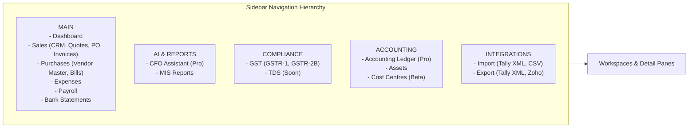

# FinBooks UI/UX & Frontend Design Deep Analysis

**Artifact ID:** `ui_ux_analysis.md`  
**Target:** FinBooks (`https://app.finbooks.ai/`)  
**Methodology:** Direct DOM, CSS stylesheet, layout engine inspection, and visual snapshot auditing via Chrome DevTools Protocol (CDP).

---

## 1. Executive Summary & Aesthetic Assessment

FinBooks exhibits an aesthetic positioned between a traditional Indian accounting utility (like Tally or Busy) and a modern SaaS tool. The interface utilizes a dark-mode first or dark-slate primary theme with teal (`#0d9488` / `var(--teal)`) accents, high-contrast white typographic headers, and compact tabular layouts designed to accommodate finance density.

While the visual style appears polished at first glance, deep reverse engineering reveals severe interaction design fragmentation:
1. **Disconnected Modals:** Document preview (`srcDocPanel`) and data editing (`editForm`) are mutually exclusive overlays rather than an integrated split-screen workspace.
2. **Missing Line Item Editing:** The backend extracts line items accurately, but the frontend edit modal provides zero UI controls to view, verify, or modify line items.
3. **Primitive Fallback Interactions:** Complex actions like linking an invoice to a Purchase Order fall back to native browser alerts (`window.prompt()`).
4. **Header Overlap Rendering Glitches:** In several tables (e.g., Vendor Master), CSS flexbox and absolute positioning rules cause column header titles (`GSTIN / PAN` and `EMAIL / PHONE`) to collide and overlap.

---

## 2. Information Architecture & Navigation



### 2.1 Navigation Model
- **Left Navigation Rail:** Persistent sidebar divided into 5 thematic groups: `MAIN`, `AI & REPORTS`, `COMPLIANCE`, `ACCOUNTING`, and `INTEGRATIONS`.
- **Accordion Submenus:** The `Sales` and `Purchases` sections expand with accordion carats. However, this creates vertical scroll in standard 768px height viewports.
- **Top Bar:** Houses the Organization switcher (`Svit`), Plan Quota pill (`AI Uploads: 1/50`), Trial Countdown (`29 days left`), Theme toggle (`light/dark`), and User Profile icon (`SU`).
- **In-App Help Panel:** An embedded drawer sliding from the right containing 25+ guides and a full release changelog dating from v2.0 to v2.13.

### 2.2 Workload Prioritization & Discovery
- **Cognitive Friction:** The navigation fails to communicate total pending workload at the menu level. There are no numeric badges or notification dots on the `Bills` or `Bank Statements` nav items indicating how many documents await review.
- **Context Loss:** Navigating to review a bill forces the user completely out of the dashboard or vendor context.

---

## 3. Dashboard Analysis (Investigation B)

| Layout Zone | Visual Elements | Financial Utility | Interactivity / Actionability |
|:---|:---|:---|:---|
| **Zone 1: Executive Greeting** | "Good evening, SUBRAMANIAN", Trial status banner | Low (Wasted screen real estate) | Static |
| **Zone 2: Business Health Carousel** | Total Revenue, Total Spend, Net Profit cards | Medium (Informational snapshot) | Carousel scroll arrows; non-clickable |
| **Zone 3: Needs Attention** | Pending bills, missing GSTIN warnings, unmatched bank rows | **High (Core AP driver)** | Clickable rows routing directly to queues |
| **Zone 4: Cash Flow Forecast** | Dual toggle: Bills & Entries vs. Bank Statement; Projection curve | Medium (Macro-planning) | Toggle switches projection model; non-interactive data points |
| **Zone 5: Recent AI Activity** | Log of recent OCR ingestions and automated ledger entries | Low-Medium (Audit visibility) | Clickable links to documents |

### 3.1 Strengths of the Dashboard
- **Cash Flow Dual Engine:** A toggle allows switching between *Accrual Accounting* (Bills & Invoices with due dates) and *Cash Accounting* (Bank Statement transactions). This is a helpful distinction for Indian SMEs.
- **Immediate Attention Queue:** The "Needs Attention" container surfaces actionable blocks (e.g., bills lacking tax breakdown or unmapped bank entries) right on the landing view.

### 3.2 Weaknesses & Usability Failures
- **Carousel Pagination for Core KPIs:** Hiding core financial metrics (e.g., Accounts Payable vs Accounts Receivable balance) behind carousel arrows prevents an AP clerk or CFO from scanning exposure in a single glance.
- **No Direct Batch Action from Dashboard:** The user cannot approve pending bills directly from the dashboard attention list; they must navigate to the full `Vendor Bills` table.

---

## 4. Visual Design & Component Breakdown

### 4.1 Typography
- **Primary Font Stack:** Inter / Roboto with monospace fallbacks (`ui-monospace, SFMono-Regular, Menlo, Monaco, Consolas, monospace`).
- **Header Weights:** Bold 600/700 with high contrast white text on dark background.
- **Monospace Usage:** Invoice numbers (`INV-2026-9042`), HSN codes (`998315`), and GSTINs (`29AABCA1234F1Z5`) are consistently rendered in monospace font, aiding legibility for alphanumeric tax identifiers.
- **Defect:** FinBooks triggers font requests to external CDNs that fail to signal `document.fonts.ready` in headless webkit/chromium runners, leading to automation timeouts if not bypassed.

### 4.2 Color Palette & Semantic Tokens
- **Background Root:** Dark charcoal `#0f172a` (Slate 900) and card surfaces `#1e293b` (Slate 800).
- **Brand Accent:** Emerald Teal `#0d9488` (`var(--teal)`), used for primary buttons, active nav items, and file attachment badges.
- **Status Green:** `#10b981` (`.badge-green`), applied to `Approved` bills and positive cash flow.
- **Status Yellow / Amber:** `#f59e0b` (`.badge-amber`), applied to `Pending Review`.
- **Status Red / Danger:** `#ef4444` (`.btn-danger`, `.text-danger`), applied to delete actions, missing GSTIN warnings, and duplicate detection alerts.

### 4.3 Table Component Architecture
- **Dense Row Layout:** Tables use 36px to 42px row height with 12px text, allowing 15+ rows above the fold on a 1080p display.
- **Hover Micro-Interactions:** Hovering a row highlights background color with smooth transition and reveals secondary action icons (`Edit`, `View Attachment`, `Delete`).
- **Defect (Vendor Master):** The table header CSS fails to allocate fixed min-width for columns, resulting in `GSTIN / PAN` colliding directly into `EMAIL / PHONE` on standard viewports (`screenshots/other_features/01_vendor_master.png`).

---

## 5. Invoice Review Workspace UX (Investigation D)

### 5.1 The Split-Screen Deficit
In high-performing AP automation platforms, the golden rule of document review is the **Synchronized Split-Screen**: the source document on the left, extracted line items and fields on the right, with bounding-box hover highlighting.

FinBooks completely fails this requirement:
1. **The PDF Viewer is a Sliding Drawer (`srcDocPanel`):**
   - Width: 560px, fixed to the right viewport boundary (`z-index: 1050`).
   - Uses an `<iframe>` with Adobe PDF parameters `#navpanes=0&view=FitH`.
   - Provides basic zoom and rotation controls for images, but is purely read-only.
2. **The Edit Interface is a Modal Dialog (`editForm`):**
   - A centered modal popup with a dark backdrop (`z-index: 1040`).
   - Completely covers the table.
   - **Crucial Flaw:** When `editForm` is opened, the user CANNOT see the PDF drawer. If the user opens the PDF drawer, they cannot edit form fields.
   - To verify an invoice, the user must open the PDF drawer, read and memorize the figures (or open the PDF in a separate physical browser tab via `srcDocOpen`), close the drawer, click the edit pencil icon, and type the corrections.

### 5.2 Line Item Erasure in UI
While the AI extraction engine extracts full line item records:
```json
[
  {"description": "Cloud Compute Virtual Instances", "quantity": 2, "rate": 3000.0, "amount": 6000.0},
  {"description": "Managed SSD Storage Volume", "quantity": 1, "rate": 4000.0, "amount": 4000.0}
]
```
The edit modal (`editForm`) provides **no line-item table whatsoever**. It only provides inputs for:
- Subtotal (`edit_amount`)
- CGST, SGST, IGST (`edit_cgst`, `edit_sgst`, `edit_igst`)
- Round off (`edit_round_off`)
- Total (`edit_total_amount`)

If an OCR engine mistakenly reads a line item quantity as 20 instead of 2, the user cannot correct the line item. They can only manipulate the aggregate total.

---

## 6. Exceptions & Error Handling UX (Investigation E)

FinBooks handles duplicate invoices through a dedicated `dupCard` component embedded above the table.

### 6.1 Strengths of Exception Handling
- **Multi-Level Detection:** Distinguishes between exact file re-uploads (`reason === 'file'`) and business duplicate entries (`reason === 'business'`).
- **Clear Metadata Presentation:** Renders a clean `<dl>` definition list displaying the conflicting invoice's Vendor, Date, Total, and Uploaded date.
- **Direct Resolution Link:** Surfaces an immediate `<a class="btn-primary-g">View Invoice</a>` that filters the table to the existing duplicate.
- **Non-Blocking Override:** Provides a "Continue / Upload Anyway" secondary button for edge cases where duplicate numbers are legitimate (e.g., utility bills with identical sequence numbers).

### 6.2 Weaknesses
- **Passive Warnings:** The system does not warn about missing vendor GSTINs at the moment of upload; it merely displays a missing badge in the table after processing has finished.
- **Alert Dialog for PO Matching:** If a bill fails 3-way matching, clicking the `No matching order` badge opens a native browser `window.prompt('Sales order number...')`. This provides no search, no auto-complete, no list of open POs, and zero validation until after a network round-trip.

---

## 7. Comparative Scorecard for AP Command Center

| Dimension | FinBooks Rating (1–10) | Root Cause / Observation | AP Command Center Recommendation |
|:---|:---:|:---|:---|
| **Information Density** | 8.5 / 10 | High-density tables, concise rows, clear currency tags. | Adopt similar high-density monospace typography for financial identifiers. |
| **Workspace Ergonomics** | 3.0 / 10 | Disconnected PDF drawer and edit modal; no split-screen. | Implement true 50/50 or 60/40 synchronous split-screen with click-to-highlight OCR bounding boxes. |
| **Line-Item Editing** | 1.0 / 10 | Backend extracts line items; frontend completely lacks edit UI. | Build an editable inline grid for line items, quantities, HSN codes, and tax rates. |
| **Deduplication UX** | 8.0 / 10 | Dedicated `dupCard` with metadata and 1-click view link. | Adopt FinBooks' dual file-hash + business-hash duplicate detection model. |
| **PO Matching UX** | 2.0 / 10 | Uses primitive `window.prompt()`. | Provide an intelligent modal drawer with searchable open POs, line-level 3-way matching, and quantity discrepancy tolerances. |
| **Batch Capabilities** | 7.5 / 10 | Checkbox row selection with 1-click bulk approve. | Support bulk approval, bulk export, and bulk GL re-coding. |
