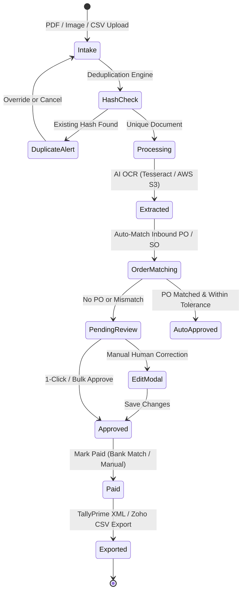

# FinBooks Workflow & Efficiency Analysis

**Artifact ID:** `workflow_analysis.md`  
**Target:** FinBooks (`https://app.finbooks.ai/`)  
**Methodology:** End-to-end task tracing, click-cost measurement, state-transition logging, and cognitive friction assessment.

---

## 1. End-to-End Invoice Lifecycle Architecture

### 1.1 Stage-by-Stage Workflow Breakdown

| Stage | Trigger / Actor | Automated System Actions | Human Intervention Required | Information Displayed | Completion Signal | Failure State & Recovery |
|:---|:---|:---|:---|:---|:---|:---|
| **1. Intake** | User / Batch Drop | Files staged; SHA-256 binary hash calculated; optional batch splitting per vendor. | Drag-and-drop files; toggle "Split merged PDF". | File dropzone with format tags (`.pdf`, `.png`, `.jpg`, `.xlsx`, `.csv`). | File badge changes to "Ready to process". | Unsupported extension or >25MB file error. |
| **2. Deduplication** | System | Compares `file_hash` and `business_invoice_hash` against database records. | User decides whether to review existing bill or force upload. | `dupCard` alert box displaying conflicting vendor, date, amount. | Hash check passes; upload begins. | If duplicate, displays `dupCard` with 1-click link to existing bill. |
| **3. OCR & Extraction** | System (Cloud S3 + OCR) | File uploaded to `s3://ai-accountant-docs/...`; OCR extracts text, vendor name, invoice #, date, tax breakdown, and line items. | None (Passive wait ~5–12s). | Upload modal progress spinner; quota decrement (`1/50`). | Modal closes; bill appears in queue table. | Extraction failure sets bill status to `Pending` with blank fields. |
| **4. Vendor Resolution** | System | Matches vendor name/GSTIN against Vendor Master; auto-creates vendor record if new. | None if recognized; manual correction if misspelled. | Table row displays vendor name with link to master. | Vendor record attached to `vendor_id`. | Unregistered vendor tagged with `-` in master. |
| **5. PO Matching** | System | Searches for open Sales Orders / Inbound POs matching vendor and line items. | If unlinked, user clicks `No matching order` badge and enters PO number. | Badge: `Matched` or `No matching order`. | Badge turns green with linked PO number. | Native `window.prompt()` displayed; user must manually look up PO. |
| **6. Review & Correction** | Human Reviewer | Computes auto-sum for GST total and grand total upon field change. | Opens edit modal; manually enters/corrects invoice date, amount, taxes. | Modal form with 14 input fields; receipt attachment widget. | "Save Changes" button clicked; status set to `Approved`. | Validation prevents saving negative amounts or invalid dates. |
| **7. Approval** | Human Reviewer / Manager | Updates record `status: "approved"`; logs timestamp and user ID in audit trail. | Clicks "Approve" button or selects bulk checkbox -> "Bulk Approve". | Status badge turns green: `Approved`. | Metric card `Approved` increments. | Permission check failure if user role is Viewer. |
| **8. Settlement (Payment)** | Human / Bank Parser | Reconciles bank statement against bill net of TDS within 30–60 day window. | User clicks "Mark Paid" button on row, or triggers bank auto-reconciliation. | Status badge turns blue: `Paid`; payment date recorded. | Metric card `Paid` increments. | Discrepancy between bill amount and bank debit flagged in Bank tab. |
| **9. Posting / Export** | System / Accountant | Generates TallyPrime XML DayBook format or Zoho Books CSV; pushes to `localhost:9000`. | Clicks "Export", selects date range, downloads file or triggers direct push. | Export modal with format selector and voucher type options. | Download initiated or HTTP 200 from Tally local connector. | XML schema validation error if GL accounts are unmapped. |

---

## 2. Quantitative Efficiency & Interaction Cost Analysis (Investigation F)

To benchmark workflow efficiency, six standard finance journeys were traced and measured for clicks, screen changes, and context switches.

### Journey 1: Find an Invoice Needing Attention
- **Starting Point:** Dashboard (`/dashboard/`)
- **Action Sequence:**
  1. Scan "Needs Attention" container on dashboard (0 clicks).
  2. Click on the bill row or navigate via sidebar `Purchases -> Bills` (1 click).
  3. Filter by `Status: Pending` dropdown (2 clicks).
- **Screens Visited:** 2 (`Dashboard`, `Vendor Bills`).
- **Total Clicks:** 3 clicks.
- **Context Switching:** Yes (leaves dashboard context completely).
- **Friction:** Dashboard attention container only shows 3 items; full backlog requires navigating to the bills table.

### Journey 2: Open and Review an Invoice
- **Starting Point:** Vendor Bills Table (`/vendor-bills/`)
- **Action Sequence:**
  1. Locate bill in table.
  2. Click paperclip icon to open PDF source drawer (`srcDocPanel`) (1 click).
  3. Review document in 560px drawer (0 clicks).
  4. Notice an incorrect amount or tax breakdown.
  5. Close drawer via `X` or ESC (1 click).
  6. Click pencil icon to open edit modal (`editForm`) (1 click).
- **Screens Visited:** 1 screen, 2 overlay modals/drawers.
- **Total Clicks:** 3 clicks.
- **Context Switching:** Severe. The reviewer must close the document viewer in order to open the edit dialog, forcing them to memorize numbers or open a secondary browser tab.

### Journey 3: Correct an Extracted Field
- **Starting Point:** Inside Edit Modal (`editForm`)
- **Action Sequence:**
  1. Click into `Amount` field (1 click).
  2. Clear and type corrected taxable amount (keystrokes).
  3. Tab to `IGST` field and type corrected tax amount.
  4. Note that `GST Total` and `Total Amount` auto-recalculate via JavaScript `recalcTotal()`.
  5. Click `Save Changes` button (1 click).
- **Screens Visited:** 1 modal.
- **Total Clicks:** 2 clicks + keystrokes.
- **Context Switching:** None.
- **Friction:** Inability to correct line items; reviewer can only correct top-level summary totals.

### Journey 4: Resolve an Unmatched Purchase Order Exception
- **Starting Point:** Vendor Bills Table (`/vendor-bills/`)
- **Action Sequence:**
  1. Identify row with badge `No matching order`.
  2. Click `No matching order` badge (1 click).
  3. Browser displays native modal alert `prompt('Sales order number this bill belongs to (e.g. SO-00003)...')`.
  4. Reviewer must open a new browser tab to `Inbound PO`, search for vendor, copy the PO number (`SO-00003`), return to first tab, paste into prompt (4 clicks + 2 tab switches).
  5. Click `OK` in browser prompt (1 click).
  6. Page triggers full reload (`location.reload()`) to update badge.
- **Screens Visited:** 2 screens (`Vendor Bills`, `Inbound PO`) + browser modal.
- **Total Clicks:** 6 clicks + 2 tab switches.
- **Context Switching:** Extreme. Zero in-context lookup or autocomplete.

### Journey 5: Complete Review or Approval
- **Starting Point:** Vendor Bills Table (`/vendor-bills/`)
- **Action Sequence (Single Bill):**
  1. If fields are correct, click row checkbox (1 click).
  2. Click "Bulk Actions -> Approve" or click "Mark Paid" (1 click).
- **Action Sequence (Bulk 20 Bills):**
  1. Click header checkbox "Select All" (1 click).
  2. Sticky bottom bar appears with count: "20 bills selected".
  3. Click "Approve Selected" (1 click).
- **Screens Visited:** 1 screen.
- **Total Clicks:** 2 clicks.
- **Efficiency Rating:** **High (9/10).** Bulk approval is well-implemented with a dedicated sticky floating bar.

### Journey 6: Trace History & Audit Trail of a Processed Invoice
- **Starting Point:** Vendor Bills Table (`/vendor-bills/`)
- **Action Sequence:**
  1. Filter table by `Status: Paid` (2 clicks).
  2. Type invoice number `INV-2026-9042` into search input (1 click + typing).
  3. Row shows status `Paid`, linked PDF attachment, and date.
  4. Attempt to view who approved the invoice or payment reference.
  5. Discovery: Row has NO audit log button or history modal in the UI!
  6. Reviewer must navigate to `Settings -> Team / Audit` to view global event logs.
- **Screens Visited:** 2 screens (`Vendor Bills`, `Settings`).
- **Total Clicks:** 4 clicks.
- **Friction:** Audit logs are decoupled from the document record; no per-invoice activity timeline exists in the UI.

---

## 3. Summary of Workflow Friction & Interaction Costs

| Journey | FinBooks Clicks | Context Switches | Ergonomic Flaw | AP Command Center Target |
|:---|:---:|:---:|:---|:---:|
| **Find Invoices Needing Action** | 3 | 1 (Page switch) | Dashboard queue limited to 3 items. | Persistent top-level "Inbox" counter with 1-click filter. |
| **Document Review & Verification** | 3 | 2 (Drawer vs Modal) | Cannot view document and edit fields at the same time. | 0 switches (Fixed split-screen with sync scrolling). |
| **Field Correction** | 2 | 0 | Cannot edit individual line items or HSN codes. | Direct inline cell editing on table or extracted cards. |
| **Resolve PO Match Exception** | 6 | 2 (Tab switches) | Primitive `window.prompt()` with no search or auto-complete. | Slide-over drawer with fuzzy PO suggestions and 1-click link. |
| **Bulk Approval** | 2 | 0 | None (Floating bulk bar works well). | Retain floating bulk bar; add bulk keyboard shortcuts (`Shift + A`). |
| **Audit & History Lookup** | 4 | 1 (Settings switch) | No per-document audit trail drawer. | Slide-out activity timeline tab on every invoice row. |

---

## 4. Key Takeaways for AP Command Center

1. **Eliminate Modal Toggling:** The greatest single ergonomic bottleneck in FinBooks is separating `srcDocPanel` (document) from `editForm` (data). Our AP Command Center must feature a unified split-screen view where clicking any field pans the PDF directly to that coordinate.
2. **First-Class Line Items:** Never reduce invoice review to header totals. AP clerks need line-level control to catch pricing variances, tax rate errors, and unbilled items.
3. **Contextual PO Matching:** Replace manual PO lookup with automated fuzzy matching, displaying open PO line items side-by-side with invoice line items and highlighting quantity/rate variances.
4. **Embedded Per-Document Timeline:** Place user approval timestamps, OCR confidence scores, and payment references directly in a slide-out drawer on the document row.
