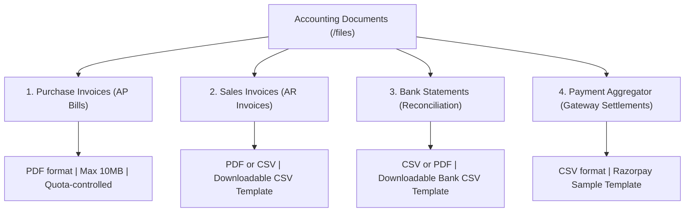

# Document Management & Review Workspace Analysis: Flick AI

**Artifact ID:** `document_workspace_analysis.md`  
**Target Application:** `https://app.flickai.in/` (Flick AI — Accounting Simplified)  
**Evaluator:** AP Command Center Document Intelligence Group  
**Key Routes Audited:** `/files` (Document Ingestion) and `/invoices/new` (Review & Builder Workspace)  
**Date of Audit:** November 03, 2026  

---

## 1. Document Management Architecture (`/files`)

The document repository in Flick AI serves as the primary intake funnel for all external financial collateral entering the organization.


### 1.1 Temporal Partitioning: The Period Selector
At the top of `/files`, Flick AI places two synchronized Material-UI dropdown selectors:
- **Year Selector:** (e.g., `2026`).
- **Month Selector:** (e.g., `November`).
- *Architectural Purpose:* This partition model isolates accounting data by calendar month. Rather than loading an infinite list of lifetime invoices, queries are strictly scoped to the active financial period, ensuring fast client-side rendering and mirroring standard corporate closing books.

### 1.2 Category Taxonomy & Ingestion Channels
Flick AI organizes incoming financial documents into four dedicated tabs:



1. **Purchase Invoices (Vendor AP):**
   - Ingestion format: PDF (single and multi-page).
   - Maximum size: 10MB per document.
   - Quota tracking: Live badge indicating `0/100 PDFs used` for the active billing cycle.
2. **Sales Invoices (Customer AR):**
   - Ingestion format: PDF or CSV.
   - Self-service utility: Includes a dedicated `CSV Template` download button, allowing businesses with thousands of billing lines to upload bulk sales data without OCR overhead ([04_sales_invoices_tab.png](file:///c:/REA/competitor_research/03_flickai/screenshots/files_and_documents/04_sales_invoices_tab.png)).
3. **Bank Statements:**
   - Ingestion format: PDF or CSV.
   - Purpose: Feeds raw debits, credits, and reference IDs directly into the reconciliation engine ([01_bank_statements_upload_tab.png](file:///c:/REA/competitor_research/03_flickai/screenshots/reconciliation/01_bank_statements_upload_tab.png)).
4. **Payment Aggregator:**
   - Tailored specifically for digital economy businesses.
   - Features a direct **Razorpay** sample template and upload channel to ingest gateway settlements, transaction fees, and net payouts ([02_payment_aggregator_tab.png](file:///c:/REA/competitor_research/03_flickai/screenshots/reconciliation/02_payment_aggregator_tab.png)).

---

## 2. Ingestion Mechanics & Dropzone Engineering

### 2.1 Technical Dropzone Implementation `[V]`
The file intake interface is powered by a unified hidden HTML5 file input:
```html
<input id="unified-upload-input" type="file" multiple="" hidden="" accept=".pdf">
```
- **Multiple File Selection:** Supports batch uploading via the `multiple=""` attribute.
- **Drag-and-Drop Interaction:** The outer `<Paper>` container listens for dragover and drop events, visually highlighting border styles when files are dragged over the viewport.
- **Client-Side Validation:** Enforces a strict 10MB size ceiling and validates file extensions before dispatching upload payloads to the backend API.

---

## 3. Review Workspace & Data Extraction Architecture (`/invoices/new`)


### 3.1 Structural Philosophy: Spreadsheet Matrix vs. Split-Screen Viewer
In enterprise IDP platforms such as Rossum, the review interface is strictly split: a 50% left pane displays the scanned PDF document with color-coded bounding boxes, while the 50% right pane presents structured key-value pairs.

Flick AI departs radically from this paradigm:
- **Full-Width Accounting Matrix:** Flick AI treats the review workspace as an **interactive, high-density financial spreadsheet**.
- **Rationale:** For standard invoices and business billing, finance operators prefer rapid tabular scanning and keyboard data entry over inspecting physical document pixels.

### 3.2 Field Hierarchy & Column Schema
The extraction and review grid features the following validated schema:

| Column Title | Input Type | Validation Constraint | Description |
|:---|:---|:---|:---|
| **PRODUCT/SERVICE** | Autocomplete / Text | Required | Item name or SKU from master catalog. |
| **DETAILS** | Textarea / Text | Optional | Granular item description or scope of work. |
| **HSN/SAC** | Text / 4-8 Digit Code | Recommended for GST | Harmonized System of Nomenclature code. |
| **QTY\*** | Numeric Input | Mandatory (`min=1`) | Billed quantity of units. |
| **UNIT** | Dropdown Selector | Optional | Unit of measure (e.g., `PCS`, `KGS`, `HRS`, `BOX`). |
| **RATE\*** | Numeric (Currency) | Mandatory (`min=0.01`) | Unit rate excluding tax. |
| **DISCOUNT** | Percentage / Flat | Optional | Line-item discount applied before tax. |
| **FINAL** | Calculated Read-only | Computed | Subtotal after discount. |
| **ACTIONS** | Delete Icon | — | Removes line item from calculation matrix. |

### 3.3 Dynamic Row Addition & Tax Recalculation
- **One-Click Row Injection:** Clicking `Add New Row` ([04_invoice_builder_added_row.png](file:///c:/REA/competitor_research/03_flickai/screenshots/invoice_processing/04_invoice_builder_added_row.png)) instantly appends a new row object to client state without re-rendering the surrounding form.
- **Real-Time Tax Computation:** As the user modifies Quantity, Rate, or Discount, the client-side calculation engine updates:
  $$\text{Taxable Value} = \sum (\text{Qty} \times \text{Rate} - \text{Discount})$$
  $$\text{CGST} = \text{Taxable Value} \times \frac{\text{GST \%}}{2}, \quad \text{SGST} = \text{Taxable Value} \times \frac{\text{GST \%}}{2} \quad (\text{Intra-State})$$
  $$\text{IGST} = \text{Taxable Value} \times \text{GST \%} \quad (\text{Inter-State})$$
  $$\text{Total Invoice Amount} = \text{Taxable Value} + \text{Tax} \pm \text{Round Off}$$

---

## 4. Form Validation & Error Feedback Mechanics


### 4.1 Client-Side Validation Triggers `[V]`
When a user attempts to save an invoice with incomplete data by clicking `Generate & Save Invoice`:
1. **Field Border Coloration:** The invalid input's container receives the Material-UI `.Mui-error` class, rendering a high-contrast crimson border (`#d32f2f`).
2. **Contextual Helper Text:** A dedicated alert label appears directly beneath the input: `"Customer is required"`.
3. **Focus Snapping:** Keyboard focus is automatically shifted to the first invalid field in the DOM, preventing accidental blind submissions.

---

## 5. Architectural Comparison: Flick AI vs. Rossum Review Workspaces

| Evaluation Criterion | Rossum Document Reviewer | Flick AI Document Workspace |
|:---|:---|:---|
| **Layout Topology** | Split-screen (PDF left, extraction fields right) | Full-width spreadsheet data grid |
| **PDF Visual Feedback** | Click field $\rightarrow$ highlights bounding box on PDF | No visual PDF bounding box (pure data grid) |
| **Line Item Scalability** | Excellent for 100+ line tables with pagination | Excellent for 1–25 line business bills |
| **Tax Intelligence** | Generic rule formula engine | Native statutory Indian GST engine (CGST/SGST/IGST) |
| **Reviewer Throughput** | Highly optimized for micro-task reviewers (`Ctrl+Enter`) | Optimized for end-to-end accounting clerks |
| **Exception Resolution** | Inline confidence thresholds (Red/Amber/Green) | Form validation errors and alert toasts |

---

## 6. Recommendations for our AP Command Center

1. **Implement Hybrid Document Layout:** While Flick AI's spreadsheet grid is clean, enterprise AP workflows still require cross-referencing the original vendor invoice. Our AP Command Center should deploy a **Hybrid Workspace**: a 40% collapsible PDF viewer pane alongside a 60% high-speed data entry matrix.
2. **Adopt Dynamic Column Config:** Allow reviewers to toggle columns like `HSN/SAC` or `Discount` on or off based on vendor profile to maximize horizontal screen real estate.
3. **Instant Quota & Progress Stepper:** Emulate Flick AI's visible quota bar (`0/100 used`), adding a visual pipeline progress stepper showing: `Ingested` $\rightarrow$ `Extracted` $\rightarrow$ `Validated` $\rightarrow$ `Reconciled` $\rightarrow$ `Posted`.
