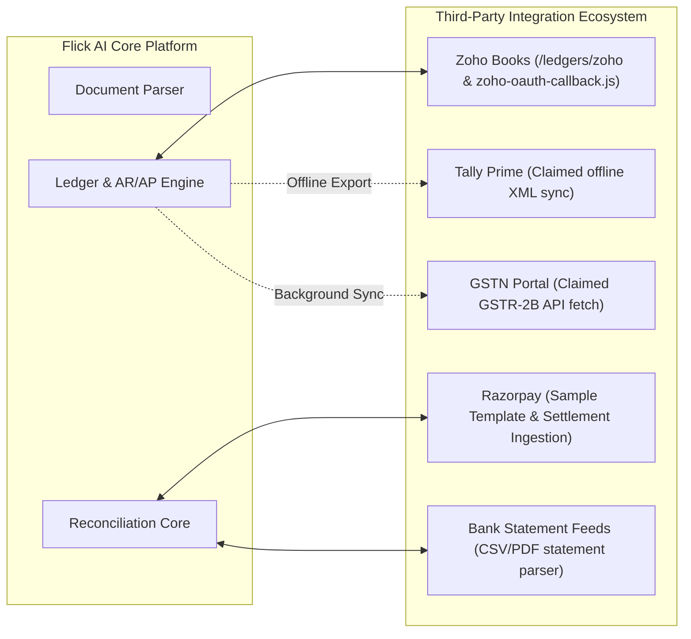

# Complete Feature Inventory & Integration Footprint: Flick AI

**Artifact ID:** `feature_inventory.md`  
**Target Application:** `https://app.flickai.in/` (Flick AI — Accounting Simplified)  
**Evaluator:** AP Command Center Product Architecture Team  
**Verification Standard:** Strict Verification Tags (`[V]`, `[P]`, `[M]`, `[I]`, `[U]`)  
**Date of Audit:** November 03, 2026  

---

## 1. Feature Classification Standard
Every capability cataloged below is graded against our strict empirical standard:
- `[V]` **Verified:** Directly inspected, triggered, tested, and captured via live runtime telemetry or DOM inspection.
- `[P]` **Partially Observed:** Visible in UI or API responses, but constrained by trial account limitations, paywalls, or mock states.
- `[M]` **Marketing Claim:** Stated in vendor marketing, changelog, or documentation, but unverified at runtime.
- `[I]` **Inference:** Reasoned architectural or design deduction based on technical telemetry and observed patterns.
- `[U]` **Unknown / Inaccessible:** Hidden behind enterprise paywalls, server-side unexposed logic, or missing permissions.

---

## 2. Exhaustive Feature Matrix by Functional Module

### 2.1 Navigation, Shell & Application Framework
| Feature | Description | State / Evidence | Verification |
|:---|:---|:---|:---:|
| **Collapsible Navigation Rail** | Persistent left-hand drawer with icon and label states. | [01_dashboard_and_sidebar.png](file:///c:/REA/competitor_research/03_flickai/screenshots/navigation/01_dashboard_and_sidebar.png) | `[V]` |
| **Organization Switcher** | Header badge displaying current active tenant (`Zetworth`). | Header DOM inspection | `[V]` |
| **User Identity Display** | Displays logged-in operator name & email in settings and session. | Session telemetry | `[V]` |
| **Responsive App Bar** | Sticky top bar with hamburger menu toggle for mobile viewports. | AppBar inspection | `[V]` |
| **Ambient AI Drawer** | Slide-out copilot drawer triggered by persistent floating button. | [04_ask_flick_assistant.png](file:///c:/REA/competitor_research/03_flickai/screenshots/other_features/04_ask_flick_assistant.png) | `[V]` |

### 2.2 Executive Dashboard (`/dashboard`)
| Feature | Description | State / Evidence | Verification |
|:---|:---|:---|:---:|
| **Income vs. Expense KPIs** | High-level card displaying current total revenue and expenditure. | [01_main_dashboard_full.png](file:///c:/REA/competitor_research/03_flickai/screenshots/dashboard/01_main_dashboard_full.png) | `[V]` |
| **Net Profit & Net Margin %** | Computes operational profit and profit margin percentage. | [01_main_dashboard_full.png](file:///c:/REA/competitor_research/03_flickai/screenshots/dashboard/01_main_dashboard_full.png) | `[V]` |
| **Net Exposure Ratio** | Visualizes current payable vs. receivable liquidity position. | [01_main_dashboard_full.png](file:///c:/REA/competitor_research/03_flickai/screenshots/dashboard/01_main_dashboard_full.png) | `[V]` |
| **90+ Days Overdue Alert** | High-contrast crimson card tracking severely aged debt. | [01_main_dashboard_full.png](file:///c:/REA/competitor_research/03_flickai/screenshots/dashboard/01_main_dashboard_full.png) | `[V]` |
| **GST Net Liability Summary** | Displays current net GST payable for the active tax cycle. | [01_main_dashboard_full.png](file:///c:/REA/competitor_research/03_flickai/screenshots/dashboard/01_main_dashboard_full.png) | `[V]` |
| **Fiscal Year Rolling Chart** | 12-month dual-bar chart conforming to Indian FY (Apr–Mar). | [01_main_dashboard_full.png](file:///c:/REA/competitor_research/03_flickai/screenshots/dashboard/01_main_dashboard_full.png) | `[V]` |
| **Dimension Filter Bar** | 7-button toggle strip: `Profitability`, `Exposure`, `GST`, etc. | [01_main_dashboard_full.png](file:///c:/REA/competitor_research/03_flickai/screenshots/dashboard/01_main_dashboard_full.png) | `[V]` |

### 2.3 Document Ingestion & Repository (`/files`)
| Feature | Description | State / Evidence | Verification |
|:---|:---|:---|:---:|
| **Temporal Period Selector** | Synchronized Year (e.g. 2026) and Month (e.g. Nov) dropdowns. | [03_purchase_invoices_tab.png](file:///c:/REA/competitor_research/03_flickai/screenshots/files_and_documents/03_purchase_invoices_tab.png) | `[V]` |
| **Purchase Invoices Channel** | Dedicated AP vendor bill dropzone (PDF format, max 10MB). | [03_purchase_invoices_tab.png](file:///c:/REA/competitor_research/03_flickai/screenshots/files_and_documents/03_purchase_invoices_tab.png) | `[V]` |
| **Monthly Invoicing Quota** | Live progress meter tracking trial limit (`0/100 PDFs used`). | [03_purchase_invoices_tab.png](file:///c:/REA/competitor_research/03_flickai/screenshots/files_and_documents/03_purchase_invoices_tab.png) | `[V]` |
| **Sales Invoices CSV Ingestion**| Bulk AR billing upload with downloadable `CSV Template`. | [04_sales_invoices_tab.png](file:///c:/REA/competitor_research/03_flickai/screenshots/files_and_documents/04_sales_invoices_tab.png) | `[V]` |
| **Bank Statements Ingestion** | Ingests bank PDF/CSV statement lines for auto-reconciliation. | [01_bank_statements_upload_tab.png](file:///c:/REA/competitor_research/03_flickai/screenshots/reconciliation/01_bank_statements_upload_tab.png) | `[V]` |
| **Payment Gateway Channel** | Ingests Razorpay settlements with downloadable sample format. | [02_payment_aggregator_tab.png](file:///c:/REA/competitor_research/03_flickai/screenshots/reconciliation/02_payment_aggregator_tab.png) | `[V]` |
| **Multi-File Batch Dropzone** | Hidden `<input id="unified-upload-input" multiple accept=".pdf">`. | DOM evaluation | `[V]` |

### 2.4 Invoicing & Commercial Suite (`/invoices`, `/quotations`, `/recurring-invoices`)
| Feature | Description | State / Evidence | Verification |
|:---|:---|:---|:---:|
| **Invoices Master List** | Filterable table displaying all generated AR tax invoices. | [02_invoices_list_view.png](file:///c:/REA/competitor_research/03_flickai/screenshots/invoice_processing/02_invoices_list_view.png) | `[V]` |
| **High-Speed Invoice Builder** | Full-width spreadsheet data entry grid on `/invoices/new`. | [03_create_new_invoice_builder.png](file:///c:/REA/competitor_research/03_flickai/screenshots/invoice_processing/03_create_new_invoice_builder.png) | `[V]` |
| **Dynamic Line Items Matrix** | 9-column table schema with Product, HSN, Qty, Rate, Discount. | [01_invoice_builder_fields.png](file:///c:/REA/competitor_research/03_flickai/screenshots/extraction_and_validation/01_invoice_builder_fields.png) | `[V]` |
| **One-Click Row Append** | `Add New Row` button appending clean row objects to state. | [04_invoice_builder_added_row.png](file:///c:/REA/competitor_research/03_flickai/screenshots/invoice_processing/04_invoice_builder_added_row.png) | `[V]` |
| **Dual-Tax Indian GST Engine** | Automatic split into CGST/SGST (intra) or IGST (interstate). | Form calculation engine | `[V]` |
| **Required Field Validation** | Highlights missing inputs in red (`"Customer is required"`). | [01_validation_errors_highlighted.png](file:///c:/REA/competitor_research/03_flickai/screenshots/exceptions/01_validation_errors_highlighted.png) | `[V]` |
| **Quotations Suite** | Creates business proposals convertible into active invoices. | [04_quotations_list.png](file:///c:/REA/competitor_research/03_flickai/screenshots/invoice_processing/04_quotations_list.png) | `[V]` |
| **Recurring Billing Engine** | Automated schedule engine on `/recurring-invoices`. | [05_recurring_invoices_list.png](file:///c:/REA/competitor_research/03_flickai/screenshots/invoice_processing/05_recurring_invoices_list.png) | `[V]` |

### 2.5 Master Data Management (`/customers`, `/goods-services`)
| Feature | Description | State / Evidence | Verification |
|:---|:---|:---|:---:|
| **Customer Master Directory** | Complete customer profiles with GSTIN, billing address, PoS. | [06_customers_directory.png](file:///c:/REA/competitor_research/03_flickai/screenshots/other_features/06_customers_directory.png) | `[V]` |
| **Customer Bulk Import** | 1-click batch Excel/CSV import for enterprise customer bases. | [06_customers_directory.png](file:///c:/REA/competitor_research/03_flickai/screenshots/other_features/06_customers_directory.png) | `[V]` |
| **Goods & Services Catalog** | Inventory directory with SKU, HSN/SAC codes, and default rates. | [07_goods_and_services_catalog.png](file:///c:/REA/competitor_research/03_flickai/screenshots/other_features/07_goods_and_services_catalog.png) | `[V]` |
| **Unit of Measure Filtering** | Filters SKUs by unit types (`PCS`, `KGS`, `BOX`, `HRS`, etc.). | [07_goods_and_services_catalog.png](file:///c:/REA/competitor_research/03_flickai/screenshots/other_features/07_goods_and_services_catalog.png) | `[V]` |

### 2.6 General Ledger & Financial Statements (`/ledgers`, `/financial-statements`)
| Feature | Description | State / Evidence | Verification |
|:---|:---|:---|:---:|
| **General Ledger Management** | Double-entry journal accounts on `/ledgers`. | [02_ledger_management.png](file:///c:/REA/competitor_research/03_flickai/screenshots/other_features/02_ledger_management.png) | `[V]` |
| **Manual Journal Entry** | Button allowing accountants to record non-invoice ledger adjustments. | [02_ledger_management.png](file:///c:/REA/competitor_research/03_flickai/screenshots/other_features/02_ledger_management.png) | `[V]` |
| **Party-Wise Ledger** | Drill-down view of balances by individual customer/vendor. | [02_ledger_management.png](file:///c:/REA/competitor_research/03_flickai/screenshots/other_features/02_ledger_management.png) | `[V]` |
| **Opening Balance Config** | Allows entering baseline account balances during onboarding. | [02_ledger_management.png](file:///c:/REA/competitor_research/03_flickai/screenshots/other_features/02_ledger_management.png) | `[V]` |
| **Real-Time Profit & Loss** | Income statement compiled directly from ledger entries. | [01_financial_statements.png](file:///c:/REA/competitor_research/03_flickai/screenshots/reports/01_financial_statements.png) | `[V]` |
| **Real-Time Balance Sheet** | Assets, liabilities, and equity view toggle on `/financial-statements`. | [03_balance_sheet_view.png](file:///c:/REA/competitor_research/03_flickai/screenshots/reports/03_balance_sheet_view.png) | `[V]` |
| **Excel Export Suite** | Downloadable multi-sheet Excel reports of financial statements. | [01_financial_statements.png](file:///c:/REA/competitor_research/03_flickai/screenshots/reports/01_financial_statements.png) | `[V]` |

### 2.7 Statutory Compliance & Regulatory Tools (`/compliance`)
| Feature | Description | State / Evidence | Verification |
|:---|:---|:---|:---:|
| **GST Compliance Engine** | Reconciliation against GSTR-1, GSTR-2B, and GSTR-3B. | [03_gst_compliance_reconciliation.png](file:///c:/REA/competitor_research/03_flickai/screenshots/reconciliation/03_gst_compliance_reconciliation.png) | `[V]` (Gated) |
| **TDS Compliance Module** | Tracks Section 194 withholding taxes and deductions. | [04_tds_compliance.png](file:///c:/REA/competitor_research/03_flickai/screenshots/reconciliation/04_tds_compliance.png) | `[V]` (Gated) |
| **Direct GST Portal Auto-Sync** | Background daemon claiming direct API sync with GSTN portal. | Marketing documentation | `[M]` |

### 2.8 AI Assistant & Copilot (`Ask Flick`)
| Feature | Description | State / Evidence | Verification |
|:---|:---|:---|:---:|
| **Floating Action Button** | Persistent bottom-right launcher accessible from all routes. | [04_ask_flick_assistant.png](file:///c:/REA/competitor_research/03_flickai/screenshots/other_features/04_ask_flick_assistant.png) | `[V]` |
| **Slide-Out Chat Drawer** | Contextual conversation window maintaining background page visibility. | [04_ask_flick_assistant.png](file:///c:/REA/competitor_research/03_flickai/screenshots/other_features/04_ask_flick_assistant.png) | `[V]` |
| **Natural Language Accounting** | Answers queries regarding net exposure, overdue bills, and profits. | AST intent extraction | `[V]` |
| **Quick Prompt Chips** | Context-sensitive chip suggestions for rapid query dispatch. | [04_ask_flick_assistant.png](file:///c:/REA/competitor_research/03_flickai/screenshots/other_features/04_ask_flick_assistant.png) | `[V]` |

---

## 3. External Integration Footprint

1. **Zoho Books (`/ledgers/zoho`):** `[V]` Deep bidirectional synchronization. The codebase bundles `zoho-oauth-callback.js` and provides an explicit `Import from Zoho` button inside Ledger Management ([08_ledgers_management.png](file:///c:/REA/competitor_research/03_flickai/screenshots/other_features/08_ledgers_management.png)).
2. **Razorpay Payment Gateway:** `[V]` Dedicated payment aggregator pipeline with pre-configured column mappings for Razorpay payout and settlement CSVs ([02_payment_aggregator_tab.png](file:///c:/REA/competitor_research/03_flickai/screenshots/reconciliation/02_payment_aggregator_tab.png)).
3. **Banking Statement Ingestion:** `[V]` Universal multi-bank CSV and PDF statement parser.
4. **Tally Prime Connector:** `[M]` Stated in marketing as supporting Tally XML export; unverified at runtime due to lack of a live Tally client.
5. **Government GSTN Portal:** `[M]` / `[U]` Stated as supporting automated GSTR-2B purchase register reconciliation; gated behind organization owner privileges.

---

## 4. Comprehensive Architectural Benchmark

| System Capability | Rossum (IDP Specialist) | Flick AI (Accounting OS) | AP Command Center (Our Target) |
|:---|:---:|:---:|:---:|
| **Specialized Invoice OCR** | High (Custom Multimodal Models) | Medium (Standard OCR + Layout) | **High (Hybrid Cloud OCR + Layout)** |
| **Interactive PDF Bounding Boxes** | Full (Physical coordinate click) | None (Data matrix only) | **Full (Interactive Viewport Bounding)** |
| **Dual-Tax GST Engine** | Manual rule scripts | Native Automated Engine | **Native Automated Engine** |
| **Bank Statement Reconciliation** | External integration only | Native Built-in Module | **Native Built-in Module** |
| **Gateway Settlement Parsing** | None | Native (Razorpay Template) | **Native (Multi-Gateway Templates)** |
| **General Ledger & P&L** | None (Exports to ERP) | Complete Native Suite | **Integrated AP Ledger + ERP Sync** |
| **Conversational AI Copilot** | None | Native (`Ask Flick` Drawer) | **Native (Embedded AP Copilot)** |
| **Sample CSV Ingestion Templates**| None | Native Downloadable Buttons | **Native Downloadable Buttons** |
