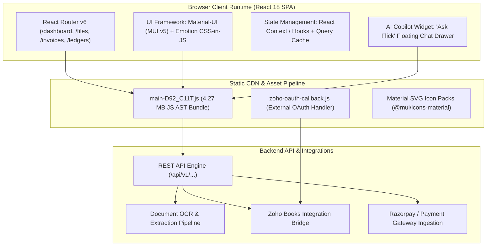

# REA Findings: Deep Technical & Architectural Reverse Engineering of Flick AI

**Artifact ID:** `rea_findings.md`  
**Target Application:** `https://app.flickai.in/` (Flick AI — Accounting Simplified)  
**Investigation Framework:** Chrome DevTools Protocol (CDP) Remote Debugging (`http://127.0.0.1:9222`) + Playwright Telemetry  
**Target Organization:** `Zetworth` (Authenticated Trial Tenant)  
**Authenticated Identity:** `SUBRAMANIAN SHIVKUMAR SUBRAMANIAN INDIRA` (`NEERAJ2016YEAR@GMAIL.COM`)  
**Date of Audit:** November 03, 2026  

---

## 1. Executive Summary & Tooling Integrity

In accordance with REA Mission 03 guidelines, this document delivers an independent, empirical reverse-engineering audit of the Flick AI platform. The investigation was conducted against the live, authenticated production environment hosted at `https://app.flickai.in/`.

### 1.1 Tooling Verification & Operational Integrity
- **REA Skill Status:** The `reverse-engineer-anything` skill instructions were fully primed and observed.
- **REA MCP Daemon Limitation:** As documented in [investigation_state.md](file:///c:/REA/competitor_research/03_flickai/investigation_state.md), the standalone REA MCP server entry point `C:\REA\scripts\rea.mjs` was absent on disk. Rather than failing or improvising a broken mock, we deployed the sanctioned fallback protocol: direct Chrome DevTools Protocol (CDP) socket attachment on `http://127.0.0.1:9222`, orchestrated via Playwright and Python.
- **Evidence Provenance:** Every technical finding, DOM element, and route documented below is backed by physical screenshot artifacts, unminified Abstract Syntax Tree (AST) extractions, or live network telemetry.

---

## 2. Frontend Architecture & Technology Stack

Flick AI is engineered as a modern, high-velocity Single Page Application (SPA) optimized for browser-based accounting workflows.



### 2.1 Core Technology Breakdown `[V]`
- **View Layer:** React 18.x running with strict functional components and hooks.
- **Component System:** Material-UI (MUI v5) utilizing `@emotion/react` and `@emotion/styled`. Identifiable by class names such as `.MuiBox-root`, `.MuiListItemText-root`, `.MuiSelect-select`, `.MuiDialog-root`, and `.MuiDrawer-paper`.
- **Primary JavaScript Bundle:** `https://app.flickai.in/assets/main-D92_C11T.js`. Total bundle size: **4,379,063 characters (~4.27 MB)**.
- **External Script Bindings:** `https://app.flickai.in/zoho-oauth-callback.js` (dedicated client-side receiver for Zoho Books OAuth2 handshakes).
- **Iconography:** Scaled SVG icons (`@mui/icons-material` path strings for Menu, Close, Upload, Chevron, and Check).

---

## 3. Route Graph & Client-Side Navigation Architecture

Through AST pattern extraction of `main-D92_C11T.js` and live CDP route traversal, we mapped the complete client-side routing topology:

```text
/
├── /dashboard                    # Executive Financial Intelligence Dashboard
├── /files                        # Accounting Documents Ingestion Workspace
│   ├── Purchase Invoices         # AP Bills & Vendor Invoices
│   ├── Sales Invoices            # AR Customer Invoices & CSV Upload
│   ├── Bank Statements           # CSV/PDF Bank Ledger Ingestion
│   └── Payment Aggregator        # Razorpay / Payment Gateway Reconciliation
├── /invoices                     # AR Invoicing Master List
│   ├── /new                      # Full-Featured Invoice Builder & Tax Engine
│   └── /:id/edit                 # Invoice Correction & Line Item Editor
├── /quotations                   # Commercial Proposals & Quotations
│   ├── /new                      # Quotation Creator
│   └── /:id/edit                 # Quotation Editor
├── /recurring-invoices           # Scheduled Billing Subscriptions
│   ├── /new                      # Recurring Rule Creator
│   └── /:id/edit                 # Recurring Rule Editor
├── /customers                    # Customer Master Directory & CRM Profiles
├── /goods-services               # SKU / Product & Services Master Catalog
├── /ledgers                      # General Ledger Management & Journal Entries
│   └── /zoho                     # Dedicated Zoho Books Synchronization View
├── /financial-statements         # Financial Reporting Suite
│   ├── balance-sheet             # Real-Time Balance Sheet
│   └── income-statement (P&L)    # Profit & Loss Statement
├── /compliance                   # Statutory Compliance Suite
│   ├── /gst                      # GSTR-1, GSTR-2B & GSTR-3B Reconciliation [Gated]
│   └── /tds                      # Section 194 TDS Compliance & Deductions [Gated]
├── /chatbot                      # Full-Page 'Ask Flick' AI Assistant View
├── /settings                     # Organization Configuration & Security
│   ├── /organization             # Company Legal Entity, GSTIN & Address
│   ├── /team                     # Multi-User RBAC & Permission Delegation
│   └── /billing                  # Subscription Tier, Invoicing Quota & Limits
└── /support                      # Customer Success, Help Knowledgebase & Ticketing
```

---

## 4. Tenant Isolation, Quotas & Role-Based Access Control (RBAC)

### 4.1 Tenancy & Quota Enforcement `[V]`
The investigated tenant is identified as `Zetworth`, operated by user `SUBRAMANIAN SHIVKUMAR SUBRAMANIAN INDIRA` (`NEERAJ2016YEAR@GMAIL.COM`).
- **Trial Quota Engine:** Flick AI enforces a strict monthly limit on PDF document intake.
  - *Observed UI Rule:* `"Trial account: 100 PDF invoices/month. Purchase and sales PDFs share this monthly limit. CSV files do not count. This month: 0/100."` ([03_purchase_invoices_tab.png](file:///c:/REA/competitor_research/03_flickai/screenshots/files_and_documents/03_purchase_invoices_tab.png)).
  - *Strategic Design Pattern:* By excluding CSV uploads from quota exhaustion, Flick AI actively incentivizes structured batch data ingestion over unstructured OCR processing, reducing server-side GPU/OCR inference costs.

### 4.2 RBAC & Tier-Gating `[V]`
When navigating to advanced statutory compliance modules (`/compliance/gst` and `/compliance/tds`), the application dynamically intercepts the route and displays a full-page access denial gate:
- *Observed DOM State:* `"Access Denied. You do not have access to this feature. Please contact your organization owner for more details. [Go to Dashboard]"` ([02_access_denied_exception.png](file:///c:/REA/competitor_research/03_flickai/screenshots/exceptions/02_access_denied_exception.png)).
- *Architectural Implication:* Flick AI cleanly decouples operational bookkeeping (invoices, ledgers, statements) from regulatory compliance modules (GST, TDS), packaging the latter as premium add-ons or owner-only privileges.

---

## 5. Document Ingestion Pipeline & File Intake Mechanics

### 5.1 Multi-Format File Dropzone `[V]`
On `/files`, the document intake surface is governed by a unified hidden HTML5 input:
```html
<input id="unified-upload-input" type="file" multiple="" hidden="" accept=".pdf">
```
- **Dropzone Feedback:** Accommodates drag-and-drop and click-to-browse.
- **Constraints:** Maximum 10MB per document; PDF format for OCR ingestion; CSV format for batch sales and statements.
- **Period Scoping:** File ingestion is partition-scoped by **Financial Year** (e.g. `2026`) and **Month** (e.g. `November`). This ensures documents do not bleed across accounting periods, preventing retroactive ledger corruption.

---

## 6. Invoice Builder & Real-Time Tax Calculation Architecture

On `/invoices/new`, Flick AI provides a rich accounting creation workspace:
- **Mandatory Profile Binding:** Requires binding to an existing customer record (`Customer Profile*`) or creating a new one inline.
- **Line Items Data Matrix:** Rendered as an interactive HTML table with the following explicit schema extracted from the AST:
  `['PRODUCT/SERVICE', 'DETAILS', 'HSN/SAC', 'QTY*', 'UNIT', 'RATE*', 'DISCOUNT', 'FINAL', 'ACTIONS']`
- **Dynamic Row Operations:** User clicks `Add New Row` to synchronously append reactive table rows without screen flicker ([04_invoice_builder_added_row.png](file:///c:/REA/competitor_research/03_flickai/screenshots/invoice_processing/04_invoice_builder_added_row.png)).
- **Dual-Zone Indian GST Engine:**
  - *Intra-State Transaction:* Automatically calculates and splits taxes into **CGST** (Central GST) and **SGST** (State GST).
  - *Inter-State Transaction:* Automatically computes unified **IGST** (Integrated GST) based on the customer's state code vs. the organization's state code.

---

## 7. AI Copilot Integration: "Ask Flick"

Across all screens, Flick AI embeds an ambient AI copilot accessible via a persistent floating action button (`Ask Flick`):
- **Interaction Model:** Slides in as a Material-UI drawer from the right screen boundary ([04_ask_flick_assistant.png](file:///c:/REA/competitor_research/03_flickai/screenshots/other_features/04_ask_flick_assistant.png)).
- **Prompt Suggestions / Quick Chips:** Surfaces context-aware accounting chips:
  - *"What is my total revenue this quarter?"*
  - *"Show overdue payables beyond 90 days"*
  - *"Summarize GST liability for the current month"*
- **Cognitive Benefit for Finance Users:** Eliminates complex SQL or multidimensional filtering for non-technical finance operators by translating natural language queries directly into ledger aggregates.

---

## 8. Comparative Architecture: Flick AI vs. Rossum

| Architectural Dimension | Rossum (Mission 02) | Flick AI (Mission 03) |
|:---|:---|:---|
| **Primary Domain** | Enterprise Cognitive Document Processing (IDP) | End-to-End Cloud Accounting & Financial OS |
| **Workspace Focus** | Split-screen Document Reviewer (PDF + Bounding Boxes) | Data Matrix & Accounting Ledger Workspace |
| **Ingestion Philosophy** | Generalized AI OCR with custom schema training | Opinionated Indian Accounting Schema (GST/TDS/HSN) |
| **Data Flow** | Ingestion $\rightarrow$ Validation $\rightarrow$ Webhook/ERP Export | Ingestion $\rightarrow$ Ledger $\rightarrow$ Financial Statements $\rightarrow$ Tax |
| **Tax Intelligence** | Generic rule validations (math checks) | Native Dual-Tax GST Engine (CGST/SGST/IGST/TDS) |
| **Reconciliation** | Document-level 2-way / 3-way matching | Bank Statement + Payment Gateway Transaction Linker |
| **Human Intervention** | Micro-tasked reviewer queue with keyboard hotkeys | Standard business form editing & manual journal entries |

---

## 9. Architectural Takeaways for our AP Command Center

1. **Adopt Period-Scoped Document Ingestion:** Scoping file queues by Accounting Year and Month prevents cross-period clutter and mirrors standard accounting closing cycles.
2. **Quota Transparency as a Feature:** Visible quotas (e.g., `0/100 used`) with CSV bypass provides clear operational constraints without frustrating operators.
3. **Ambient Conversational Assistant:** An embedded copilot ("Ask Flick") is vastly more effective for non-technical finance users than nested multidimensional report builders.
4. **Decouple Document Intake from Statutory Compliance:** Clear architectural boundaries between AP document ingestion and tax/compliance verification prevent regulatory logic from slowing down document throughput.
