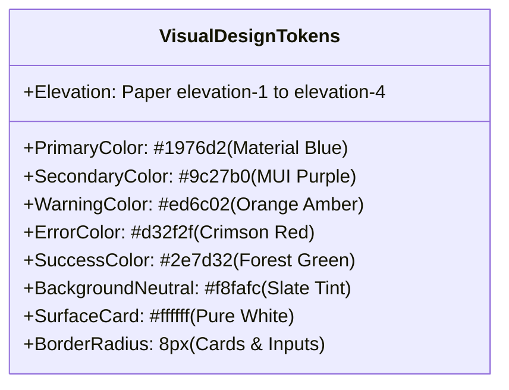

# UI/UX & Frontend Design Analysis: Flick AI

**Artifact ID:** `ui_ux_analysis.md`  
**Target Application:** `https://app.flickai.in/` (Flick AI — Accounting Simplified)  
**Evaluator:** AP Command Center Product & UX Research Team  
**Visual Artifacts Audited:** 37 High-Resolution Captures across `screenshots/`  
**Date of Evaluation:** November 03, 2026  

---

## 1. Executive UX Philosophy & Design Tenets

Flick AI positions itself around the brand promise of *"Accounting Simplified"*. Unlike enterprise Document Processing engines (such as Rossum), which are built around intense micro-tasked data-entry reviewer workstations, Flick AI is designed as a **comprehensive cloud financial cockpit**.

Its UI/UX architecture aims to bridge two historically conflicting user personas:
1. **The Small Business Owner / Founder:** Demands high-level clarity on cash runway, profit margins, overdue receivables, and tax liabilities without learning double-entry bookkeeping jargon.
2. **The Operational Bookkeeper / Accountant:** Requires strict ledger accuracy, HSN/SAC codes, CGST/SGST/IGST tax splits, journal entries, and bank reconciliation.

---

## 2. Dashboard Experience & Information Architecture

### 2.1 The Visual First-Glance Hierarchy
When a finance operator logs into Flick AI, the `/dashboard` does not greet them with a document queue; instead, it presents an **Executive Financial Health Scorecard**:
1. **Top Metric Strip (High-Level KPIs):**
   - **Income vs. Expenses:** Large numerical totals accompanied by a color-coded delta percentage.
   - **Net Profit & Net Margin:** Highlights current profitability (e.g. `₹0.00 | 0.0%`).
   - **Net Exposure:** Explicitly displays the payable/receivable ratio, signaling cash-flow liquidity risks.
   - **90+ Days Overdue:** Immediately surfaces toxic aged debts in high-contrast red warning typography.
   - **GST Net Liability:** Current period tax liability calculated in real-time.
2. **Monthly Financial Trajectory (Bar Chart):**
   - Displays a 12-month rolling bar chart conforming to the Indian Fiscal Year (**April to March**).
   - Dual-bar visualization contrasting monthly revenue against operational expenditure.
3. **Multidimensional Filter Bar:**
   - Positioned cleanly above the metrics: `[Profitability]` `[Classifications]` `[Exposure]` `[GST]` `[Dimension]` `[Accounting]` `[Quality]`.
   - Allows users to pivot the entire dashboard view with a single click without page reloads.

### 2.2 Actionable vs. Informational Metrics
- *Strengths:* The dashboard excels at **informational synthesis**. An executive can assess cash runway and tax exposure within 5 seconds.
- *Shortcomings:* The dashboard is **poorly optimized for operational reviewers**. There is no visible document-intake queue on the dashboard. A reviewer cannot see how many vendor bills are pending OCR validation or blocked with errors without manually navigating to `/files`.

---

## 3. Visual Design System & Component Library

### 3.1 Color Palette & Semantic Tokens `[V]`
- **Primary Brand Color:** Deep Material Blue (`#1976d2`), utilized for primary call-to-actions, active navigation highlights, and table headers.
- **Surface & Background:** Off-white neutral background (`#f8fafc` / `#f4f6f8`), preventing eye fatigue during lengthy bookkeeping sessions.
- **Alert & State Badging:**
  - *Success (`#2e7d32`):* `Completed`, `Matched`, and positive profit margins.
  - *Warning (`#ed6c02`):* `Pending`, `Unmatched`, and approaching quota boundaries.
  - *Error (`#d32f2f`):* `Failed`, `Customer is required`, and `90+ Days Overdue`.

### 3.2 Typography & Numeric Readability `[V]`
- Utilizes system-native sans-serif fonts (`Roboto`, `Segoe UI`, `Helvetica Neue`), ensuring rapid rendering across platforms.
- Numerical figures (e.g., `₹0.00`) are rendered in bold weight with monospaced digit spacing, preventing visual jitter during dynamic calculation updates.

### 3.3 Layout & Component Composition
- **Collapsible Navigation Rail:** A persistent left sidebar ([01_dashboard_and_sidebar.png](file:///c:/REA/competitor_research/03_flickai/screenshots/navigation/01_dashboard_and_sidebar.png)) that can collapse to icon-only mode, expanding the data workspace for wide financial tables.
- **Card Containers:** Material-UI `<Paper elevation={1}>` components with clean 8px corner radiuses and subtle border outlines (`1px solid #e2e8f0`).

---

## 4. Invoice Processing & Workspace UX

### 4.1 Data Entry Ergonomics: The Invoice Matrix
On `/invoices/new`, Flick AI opts for a **spreadsheet-inspired interactive data grid**:
- **Field Organization:**
  - *Top Section:* Metadata cards for Customer Profile selection, Billing Date picker, and Payment Due terms.
  - *Middle Section:* High-density line items matrix with explicit column titles:
    `[PRODUCT/SERVICE] [DETAILS] [HSN/SAC] [QTY*] [UNIT] [RATE*] [DISCOUNT] [FINAL] [ACTIONS]`
  - *Bottom Section:* Real-time subtotal, GST breakdown (CGST/SGST or IGST), round-off toggle, and total amount.
- **Dynamic Interaction:** Clicking `Add New Row` ([04_invoice_builder_added_row.png](file:///c:/REA/competitor_research/03_flickai/screenshots/invoice_processing/04_invoice_builder_added_row.png)) appends an editable row instantly without page jumps.
- **Form Validation UX:**
  - Triggering submission with missing required fields instantly illuminates the offending fields with red outlines (`.Mui-error`) and displays helper text: `"Customer is required"` ([01_validation_errors_highlighted.png](file:///c:/REA/competitor_research/03_flickai/screenshots/exceptions/01_validation_errors_highlighted.png)).

---

## 5. Non-Technical Learnability & Cognitive Friction

### 5.1 Where Flick AI Succeeds
1. **Plain-English Terminology:** Replaces opaque accounting terms with conversational labels (`"Money In"` / `"Money Out"`, `"Purchase Invoices"`, `"Sales Invoices"`).
2. **Self-Service Sample Templates:** Both Bank Statements and Payment Aggregator upload tabs supply instant downloadable sample templates (`CSV Template`, `Sample Template`), eliminating guesswork regarding required CSV column headers ([02_payment_aggregator_tab.png](file:///c:/REA/competitor_research/03_flickai/screenshots/reconciliation/02_payment_aggregator_tab.png)).
3. **Ambient Conversational AI (`Ask Flick`):** Non-technical users who cannot construct complex filters can simply ask the floating AI assistant for instant summaries ([04_ask_flick_assistant.png](file:///c:/REA/competitor_research/03_flickai/screenshots/other_features/04_ask_flick_assistant.png)).

### 5.2 Where Flick AI Creates UX Friction
1. **Hidden Document Status:** In `/files`, if a folder has no documents, it shows a sparse `"No files yet"` empty state without onboarding instructions on how OCR extraction behaves once a document is uploaded.
2. **Context Disconnection Between Files & Invoices:** Ingested files live in `/files`, but generated invoices live in `/invoices`. Users must mentally navigate between two separate top-level modules to follow an invoice from document intake to ledger completion.

---

## 6. Detailed UX Benchmark: Flick AI vs. Rossum vs. AP Command Center

| UX & Design Feature | Rossum (IDP Specialist) | Flick AI (Financial OS) | Recommended AP Command Center Standard |
|:---|:---|:---|:---|
| **Primary Visual Layout** | Split-screen (50% PDF viewer / 50% extraction fields) | Full-width spreadsheet data matrix | **Hybrid Split-Screen:** Collapsible PDF pane + responsive data matrix |
| **Reviewer Focus** | Single-document laser focus with micro-task queue | Multi-tab ledger with full accounting suite | **Focused Review Queue** with 1-click drill-down to General Ledger |
| **Data Validation Visuals** | Bounding boxes linked to physical PDF coordinates | Standard form input borders & red error text | **Interactive Bounding Boxes:** Clicking field highlights source text on PDF |
| **Assistance Model** | Keystroke cheat sheet (`Ctrl+Enter`, `Tab`) | Ambient AI Chat Assistant (`Ask Flick` drawer) | **Dual Assistance:** Keyboard shortcuts for power users + AI Assistant for exceptions |
| **Progress Visibility** | Visual queue cards with live confidence bars | Numerical quota badge (`0/100 used`) | **Live Pipeline Progress:** Quota badge + document stage progress stepper |

---

## 7. Concrete UI/UX Design Adaptations for AP Command Center

1. **Incorporate the Top Executive KPI Strip:** Adapt Flick AI's high-contrast metric strip (`Net Exposure`, `Overdue > 90 Days`, `GST Liability`) to the top of our AP Command Center dashboard.
2. **Provide Downloadable Ingestion Templates:** Embed 1-click CSV/Excel sample templates directly inside our upload dialogs to eliminate vendor format mismatches.
3. **Contextual Floating AI Copilot:** Introduce an ambient AP Assistant widget that can answer natural-language questions like *"Which vendor invoices are due this Friday?"*
4. **Interactive Period Selectors:** Adopt year and month selector dropdowns at the top of file workspaces to segment historical records and speed up table loading.
