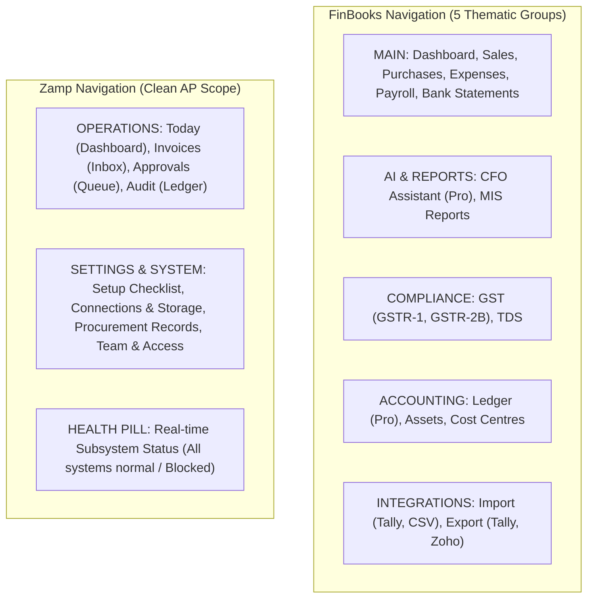

# FinBooks vs Zamp AP Command Center — UI/UX & Frontend Design Gap Analysis

**Target Competitor:** FinBooks (`https://app.finbooks.ai/`)  
**Our Product:** Zamp AP Command Center  
**Methodology:** Design System Teardown, Component-Level Inspection, Typographic Auditing, Information Density Analysis & Accessibility Review  
**Date:** November 03, 2026  

---

## 1. Design Philosophy & Aesthetic Comparison

```text
┌───────────────────────────────────────┬───────────────────────────────────────┐
│              FINBOOKS                 │        ZAMP AP COMMAND CENTER         │
├───────────────────────────────────────┼───────────────────────────────────────┤
│ • Utility-first Indian Accounting     │ • Enterprise Decision Support         │
│ • Dark-slate theme with teal accents  │ • Light/Dark adaptive slate palette   │
│ • Hand-rolled Bootstrap 5 + CSS vars  │ • Modern Tailwind CSS utility system  │
│ • Fragmented modal-over-drawer flow   │ • Unified 50/50 Synchronized Split    │
│ • Dense tabular accounting layout     │ • High-density cards + 4 evidence tabs│
│ • Visual defects on standard viewports│ • Highly responsive component layout  │
└───────────────────────────────────────┴───────────────────────────────────────┘
```

### 1.1 Aesthetic Intent & Tone

- **FinBooks:** Styled to appeal to traditional Indian accounting practitioners (Chartered Accountants, Tally operators, and SME owners). It employs a dark theme (`#0f172a` Slate 900 background, `#1e293b` Slate 800 cards) with vibrant teal (`#0d9488`) accents. The layout prioritizes fitting standard financial ledger columns on screen, but suffers from visual rough edges, inconsistent padding, and table header overlaps.
- **Zamp AP Command Center:** Styled to reflect mission-critical enterprise financial operations. It utilizes a clean, high-contrast design system with neutral slate backgrounds, indigo primary accents (`#4f46e5`), emerald verification badges, and amber exception warnings. The visual hierarchy emphasizes **"Verdict First"** (clear pass/fail outcome at top) followed by evidence and action controls.

---

## 2. Visual Density, Typography & Color Tokens

### 2.1 Typographic Hierarchy & Formatting

| Typographic Element | FinBooks | Zamp AP Command Center | UX Impact |
|:---|:---|:---|:---|
| **Font Family** | Inter / Roboto with standard sans-serif fallbacks | Inter / System UI with dedicated monospace stack | Both render clean modern sans-serif typography suitable for desktop web applications. |
| **Financial Monospace Usage** | Monospace applied to Invoice Numbers, HSN codes, and GSTINs | Monospace consistently applied to all Currency Values (INR), GSTINs, PO numbers, SHA-256 hashes, timestamps, and Actor IDs | **Zamp Wins.** Zamp applies tabular monospace numbers to all financial figures, preventing layout jank when digits increment. |
| **Table Font Size & Row Height** | 12px text; 36px–42px row height (allows 15+ rows above fold on 1080p) | 12px text; 40px–48px row height with rounded status badges and hover highlights | **FinBooks has slight density edge; Zamp has readability edge.** FinBooks packs slightly more rows; Zamp provides better touch/click targets and scannability. |
| **Header Styling** | Bold 600/700 white text on dark cards | Bold 700 slate-900 / white headers with category sub-labels | Zamp provides clearer hierarchical grouping with uppercase micro-labels (`OPERATIONS`, `TRIAGE`, `GOVERNANCE`). |

### 2.2 Semantic Color Tokens

| Semantic Role | FinBooks Token & Hex | Zamp Token & Hex | Evaluation |
|:---|:---|:---|:---|
| **Primary Brand / Action** | Teal `#0d9488` (`var(--teal)`) | Indigo `#4f46e5` (`indigo-600`) | FinBooks' teal is distinctive; Zamp's indigo aligns with modern SaaS standards. |
| **Success / Approved** | Green `#10b981` (`.badge-green`) | Emerald `#059669` (`emerald-600`) | Both clearly communicate verified or approved state. |
| **Warning / Needs Review** | Amber `#f59e0b` (`.badge-amber`) | Amber `#d97706` (`amber-600`) | Both use amber effectively for attention items. |
| **Danger / Failed / Blocked** | Red `#ef4444` (`.btn-danger`) | Rose `#e11d48` (`rose-600`) | Zamp uses rose for failed policy gates, blocked approvals, and reject actions. |
| **Dual Control / Governance** | Absent (No dual control) | Purple `#7c3aed` (`purple-600`) | **Zamp Advantage.** Distinct purple theme visually isolates high-value dual approval items. |

---

## 3. Information Architecture & Navigation Audit

### 3.1 Primary Navigation Model



### 3.2 Navigation Comparison & Workload Indicators

| Navigation Dimension | FinBooks Behavior | Zamp AP Command Center Behavior | Critical Assessment |
|:---|:---|:---|:---|
| **Menu Scope** | Broad Accounting Suite (Sales, Payroll, Ledgers, Assets, Banking) | Focused AP Verification Command Center (Today, Invoices, Approvals, Audit) | **Product Scope Alignment.** FinBooks attempts to be QuickBooks/Tally; Zamp is dedicated AP operations. |
| **Workload Counter Badges** | **Zero count badges on sidebar items.** User cannot tell how many bills or statements are pending without clicking. | **Dynamic numeric badges on Invoices and Approvals.** Amber badge for pending invoices; purple badge for secondary approvals. | **Zamp Superiority.** High-velocity AP leads require instant backlog visibility from any screen. |
| **System Health Transparency** | Hidden; failures surface only on failed operations | Persistent Subsystem Health Pill in sidebar footer (`All systems normal`, `Setup required`, `Subsystem blocked`) | **Zamp Superiority.** Provides continuous assurance of DB, storage, IdP, and mailbox status. |
| **Workspace Organization Switcher** | Dropdown in top header | Embedded workspace pill in sidebar header (`Primary Workspace / org_sme_eval`) | Both provide clear tenant context. |
| **Mobile Drawer Navigation** | Standard off-canvas menu | Responsive slide-over drawer with backdrop blur and touch dismiss | Zamp provides smoother mobile transition animations. |

---

## 4. Dashboard UX Deep Dive

### 4.1 Layout Structure & Zone Analysis

#### FinBooks Dashboard Zones (`screenshots/dashboard/01_dashboard_full.png`):
1. **Executive Greeting:** "Good evening, SUBRAMANIAN" with active trial banner. Consumes 80px vertical space without operational utility.
2. **Business Health Carousel:** Total Revenue, Total Spend, Net Profit. Hiding core metrics behind carousel chevrons forces laptop users to scroll horizontally.
3. **Needs Attention Widget:** Surfaces 3 pending items. Clickable, but truncated to 3 rows.
4. **Cash Flow Forecast:** Dual toggle switching between Accrual projection (bills/invoices) and Cash projection (bank statements).
5. **Recent AI Activity:** Ingestion log with links to documents.

#### Zamp Dashboard Zones (`screenshots/02_dashboard_today.png`):
1. **Header Bar:** "Today's AP Operations" with live Indian date stamp and 1-click "Go to Invoices" CTA.
2. **Executive AP Paradigm Card:** Plain-English summary of pre-payment verification controls and a 4-step linear journey (Intake → Extraction → 7 Policy Gates → Dual Control).
3. **Three High-Level Outcome Tiles:**
   - *Needs Attention (Amber):* Unresolved exceptions count + blocked INR value (e.g. ₹25,960). 1-click routes to `/invoices?stage=ACTION_REQUIRED`.
   - *Ready to Approve (Emerald):* Count of invoices where all 7 checks passed cleanly. 1-click routes to clean match queue.
   - *Waiting for Second Approval (Purple):* Count of high-value disbursements (≥ ₹5,00,000) awaiting Controller sign-off.
4. **Operational Readiness Checklist:** 6 live subsystem verification pills (Authenticated Tenant, Team Active, Mailbox Ingest, Reference Synced, Invoices Ingested, Decision Logged).
5. **Pipeline Velocity Strip:** Real-time counts across the 4 stages: Received → Exceptions → Ready → Approved.
6. **Prioritized Next-Up Queue Table:** Top actionable invoices ordered by financial exposure and statutory MSMED Act 45-day payment deadlines.

### 4.2 Dashboard Usability Assessment

| User Question | Can FinBooks Answer It? | Can Zamp AP Command Center Answer It? |
|:---|:---:|:---:|
| "What is the total value of invoices blocked right now?" | ❌ No. Shows total spend, not blocked exception value. | ✅ Yes. Displayed prominently in INR on Tile 1. |
| "How many invoices are ready for immediate approval?" | ❌ No. Mixed together in generic bills list. | ✅ Yes. Dedicated "Ready to Approve" tile. |
| "Are any high-value bills waiting on Controller sign-off?" | ❌ No. FinBooks has no dual-control tier. | ✅ Yes. Dedicated "Waiting for Second Approval" tile. |
| "Which invoices must be paid first to avoid MSMED penalties?" | ❌ No. Standard invoice due date only. | ✅ Yes. Statutory MSMED §15 / §43B(h) deadline badges. |
| "Are all underlying integrations and storages functioning?" | ❌ No. Subsystems are opaque. | ✅ Yes. 6-point live Operational Readiness Checklist. |

---

## 5. Invoice Review Workspace UX Comparison

This is the most critical operational area of both platforms.

```text
┌────────────────────────────────────────────────────────────────────────┐
│               INVOICE REVIEW WORKSPACE ARCHITECTURE                    │
├───────────────────────────────────┬────────────────────────────────────┤
│             FINBOOKS              │       ZAMP AP COMMAND CENTER       │
├───────────────────────────────────┼────────────────────────────────────┤
│ • Disconnected Drawer + Modal     │ • Integrated 50/50 Synchronized    │
│ • Document in 560px Drawer        │ • Original PDF on Left Pane        │
│ • Form in Centered Modal          │ • 4 Evidence Tabs on Right Pane    │
│ • Mutually Exclusive Overlays     │ • Coexist on Screen Simultaneously │
│ • Line Items Dropped from Form    │ • Full Line-by-Line 3-Way Match    │
│ • No Policy Gate Explanations     │ • 7 Explicit Policy Gates          │
│ • Native prompt() for PO Matching │ • Complete 4-Node Procurement Flow │
│ • Header Fields Editable          │ • Fields Read-Only (Needs Edit!)   │
└───────────────────────────────────┴────────────────────────────────────┘
```

### 5.1 The Disconnected Modal Problem (FinBooks)

As verified during CDP DOM inspection (`screenshots/review_and_validation/01_invoice_review_workspace.png` and `02_source_doc_viewer.png`):
- To inspect a document, the user clicks the paperclip icon, opening `srcDocPanel` (a 560px sliding drawer on the right).
- In this drawer, the user can zoom and rotate the PDF iframe, but cannot edit any fields.
- To correct a field, the user must close `srcDocPanel` and click the pencil icon, opening `editForm` (a modal dialog centered with a dark backdrop).
- `editForm` covers the entire screen and completely obscures the document.
- **Result:** Reviewers must write down figures on paper, memorize numbers, or open the PDF in a secondary physical browser tab via `srcDocOpen`.

### 5.2 The Unified Synchronized Split Screen (Zamp)

As verified on live runtime (`screenshots/04_invoice_detail_matching.png`):
- When an invoice is opened, Zamp loads a unified two-pane layout:
  - **Left Pane (5 cols on lg, or 12 cols in Doc Focus):** Embeds the original PDF using an on-demand pre-signed URL (300s TTL) with zoom-in, zoom-out, 100% reset, open-in-new-tab, SHA-256 hash copy, and download controls.
  - **Right Pane (7 cols on lg, or 12 cols in Analysis Focus):** Houses 4 synchronized tabs:
    1. `Matching & Lines`: 4-Node Procurement Verification Flow (Invoice, PO, GRN, QC) + Line-by-Line Match + Net Payable Waterfall.
    2. `Policy Checks`: 7 Grouped Policy Checks with Pass/Fail indicators, notes, and required next actions.
    3. `Extracted Information`: AI extracted header fields with confidence scores (Verified / Needs Review) and source pages.
    4. `Audit Trail`: Complete chronological event ledger with actor IDs, roles, actions, timestamps, and justification reasons.
- **Result:** Zero context loss. The reviewer can inspect every figure on the right while referencing the PDF on the left.

### 5.3 Line Item Verification

- **FinBooks:** Backend extracts line items into JSON (`billing_extracted.json`), but the review modal provides **zero line-item UI**. Reviewers cannot see line item descriptions, unit rates, quantities, or HSN codes.
- **Zamp:** Renders a dedicated Line-by-Line Procurement Match table comparing Billed lines against Authoritative PO Lines. It flags unit rate variance in INR and percentage, enforces 0.00% quantity variance, and provides two view modes ("Comparison" for compact side-by-side and "9-Col Ledger" for complete accounting detail).

---

## 6. Frontend Defects & Glitches Identified

### 6.1 FinBooks Defects Observed in Telemetry

1. **Vendor Master Table Header Collision:** Fixed column width calculations fail below 1400px width. The column header text `GSTIN / PAN` collides directly into `EMAIL / PHONE`, rendering the text illegible (`screenshots/other_features/01_vendor_master.png`).
2. **Webfont CDN Network Deadlock:** FinBooks calls external font stylesheets that fail to signal `document.fonts.ready` in headless environments, causing automation runners (Playwright, Puppeteer) to hang indefinitely unless explicitly bypassed via CDP raster snapshotting.
3. **Primitive `window.prompt()` for PO Matching:** Fallback to native browser alert dialog blocks the JavaScript execution thread, lacks autocomplete, and forces full page reload on submission.

### 6.2 Zamp AP Command Center UX Vulnerabilities Identified

1. **The "Read-Only Trap":** Extracted fields and line items in Zamp are 100% read-only in the UI. If the OCR engine misreads an invoice date or adds a typo in an invoice number, the user cannot edit it in place.
2. **Absence of PO Relinking Interface:** If an invoice fails Gate 2 (`PO Authorization Valid`), Zamp provides no interactive drawer to search open POs and link the correct order.
3. **Lack of Bulk Multi-Invoice Selection:** Invoices must be reviewed and approved strictly one by one. Approving 50 clean matches requires 200 manual clicks.
4. **Duplicate 409 Dead-End:** Uploading a duplicate file returns a text warning without a direct link to the existing conflicting voucher.
5. **No OCR Bounding Box Cross-Highlighting:** Clicking an extracted field on the right does not highlight or pan to the coordinate on the PDF on the left.

---

## 7. Comparative UI/UX Scorecard

| Dimension | FinBooks Rating (1–10) | Zamp AP Command Center Rating (1–10) | Key Evaluative Rationale |
|:---|:---:|:---:|:---|
| **Visual Polish & Styling** | 6.5 / 10 | **8.5 / 10** | Zamp's Tailwind design system is cleaner, has better contrast, and avoids header collision bugs. |
| **Workspace Ergonomics** | 3.5 / 10 | **9.5 / 10** | Zamp's 50/50 Synchronized Split Screen eliminates FinBooks' disconnected modal/drawer flaw. |
| **Line-Item Inspection** | 1.0 / 10 | **9.5 / 10** | FinBooks completely drops line items; Zamp provides authoritative 3-way line matching. |
| **Field Correction Utility** | **8.0 / 10** | 1.5 / 10 | FinBooks allows header editing; Zamp's UI is currently 100% read-only. |
| **High-Volume Velocity** | **8.5 / 10** | 4.0 / 10 | FinBooks' bulk approval bar clears batches in 2 clicks; Zamp requires 200 clicks for 50 invoices. |
| **Exception Resolution Guidance**| 2.5 / 10 | **9.0 / 10** | Zamp provides plain-English explanations and specific next actions for every failed gate. |
| **Governance & Dual Control** | 2.0 / 10 | **9.5 / 10** | Zamp enforces mandatory ₹5L dual approval and separation of duties; FinBooks has no thresholds. |
| **Audit Traceability** | 3.0 / 10 | **9.0 / 10** | Zamp embeds an immutable per-invoice activity timeline; FinBooks buries events in settings. |
| **Keyboard Ergonomics** | 2.0 / 10 | **7.5 / 10** | Zamp provides shortcuts (`1-4` for tabs, `D` for zoom, `A/H/C/S/R` for triage actions). |
| **First-Time User Comprehension**| 5.0 / 10 | **8.5 / 10** | Zamp includes a 6-step guided coachmark tour, glossary modal, and case summary cards. |
| **OVERALL UX SCORE** | **3.9 / 10** | **7.7 / 10** | **Zamp establishes substantial architectural and ergonomic superiority.** |
