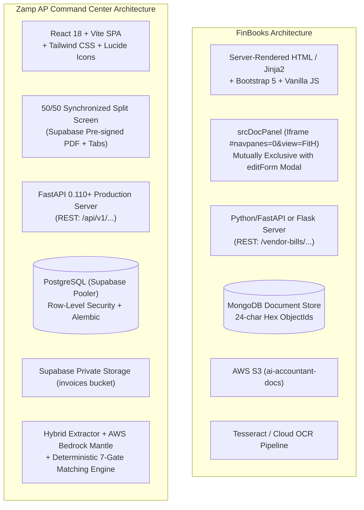

# FinBooks vs Zamp AP Command Center — Comparative UX Audit & Architectural Analysis

**Target Competitor:** FinBooks (`https://app.finbooks.ai/`, Trial Org `Svit`, User `SUBRAMANIAN`)  
**Our Product:** Zamp AP Command Center (`Autonomous AP Operations Platform`, Supabase / FastAPI / React)  
**Investigation Framework:** REA (Reverse Engineer Anything) + Chrome DevTools Protocol + Live Application Runtime Auditing  
**Date of Audit:** November 03, 2026  
**Status:** Complete Empirical Comparative Analysis  

---

## 1. Executive Summary & Strategic Positioning

This comparative audit evaluates **FinBooks** and **Zamp AP Command Center** across information architecture, user experience ergonomics, document intake, invoice review workspaces, extraction and validation pipelines, exception handling, and governance workflows.

### 1.1 Fundamental Product Paradigms

A critical foundational distinction must precede any UI/UX comparison:

| Product Dimension | FinBooks | Zamp AP Command Center | Strategic Implication |
|:---|:---|:---|:---|
| **Product Category** | All-in-One Accounting & Compliance SaaS for Indian SMEs | Specialized Autonomous AP Verification & Policy Control Platform | FinBooks attempts to solve sales, payroll, banking, ledgers, and taxes; Zamp focuses exclusively on pre-payment AP verification integrity. |
| **Target User** | Business Owners, In-House Bookkeepers, External Chartered Accountants (CAs) | AP Clerks, AP Team Leads, Financial Controllers, Internal/External Auditors | FinBooks optimizes for broad book-balancing; Zamp optimizes for fraud prevention, 3-way matching precision, and dual control. |
| **Core Value Proposition** | "Drop an invoice or statement, get a Tally DayBook XML or GST return" | "Deterministic 7-gate verification before any rupee is disbursed" | FinBooks treats AP review as a precursor to bookkeeping entry; Zamp treats AP review as a zero-trust compliance and risk gate. |
| **Commercial Model** | Tiered SaaS: Starter (₹499/mo, 50 docs), Pro (₹1,499/mo, 200 docs), Advance (₹4,999/mo, 1000 docs) | Enterprise AP Infrastructure / SaaS per tenant workspace | FinBooks paywalls fundamental accounting features (General Ledger, PO auto-match) behind Pro; Zamp enforces enterprise policy controls uniformly. |

### 1.2 The Core Comparative Finding

1. **Where Zamp Wins Decisively:**
   - **Review Workspace Ergonomics:** Zamp features an integrated 50/50 Synchronized Split Screen where the original PDF and multi-node verification data coexist. FinBooks isolates the PDF into a 560px sliding right drawer (`srcDocPanel`) and data editing into a centered modal dialog (`editForm`), making simultaneous visual inspection impossible.
   - **Line-Item Granularity:** Zamp provides full line-by-line comparison between billed invoice lines and authoritative PO contracted rates with strict tolerance checks (0.00% quantity, ±1.50% unit price). FinBooks completely eliminates line items from its review UI despite extracting them in the backend.
   - **Deterministic Policy Controls & Dual Approval:** Zamp enforces 7 immutable policy validation gates and a mandatory dual-approval threshold (≥ ₹5,00,000 requiring secondary Financial Controller sign-off). FinBooks relies on manual single-click or bulk approvals without explicit policy gates.
   - **Audit Trail Immutability:** Zamp logs every state change, triage action, and role in an append-only timeline. FinBooks lacks any per-invoice audit timeline in its UI.

2. **Where FinBooks Outperforms Zamp:**
   - **Intake Versatility & Scanner Batching:** FinBooks provides multi-format drag-and-drop intake (PDF, PNG, JPG, XLSX, CSV) with a "Split merged PDF per vendor" checkbox designed for high-volume scanner batches, plus downloadable CSV templates. Zamp supports single document upload and mailbox ingest, but lacks batch splitting and bulk CSV import.
   - **Deduplication Resolution (`dupCard`):** When a duplicate document is uploaded, FinBooks renders a rich `dupCard` displaying conflicting invoice metadata (vendor, date, total) and provides a 1-click button to view the existing duplicate. Zamp returns a generic 409 error message without deep-linking to the conflicting record.
   - **Field Correction Capabilities:** FinBooks allows users to manually correct extracted invoice dates, amounts, and GST totals in its edit modal. Zamp's extracted fields and line items are currently 100% read-only in the UI, forcing users to reject or hold invoices even for trivial 1-character OCR typos.
   - **High-Velocity Bulk Operations:** FinBooks provides checkbox multi-selection with a sticky floating bar to approve 20+ bills in 2 clicks. Zamp requires opening every invoice individually, resulting in 200 clicks and 100 screen transitions for 50 clean invoices.
   - **ERP & Tax Ecosystem Sync:** FinBooks provides direct bidirectional integration with TallyPrime (local port 9000 push and XML DayBook export) and GSTR-2B portal JSON reconciliation. Zamp operates against evaluation fixtures with unconfigured live SAP S/4HANA ERP sync.

---

## 2. Technical & Frontend Stack Teardown



### 2.1 Stack Differences & Impact on UX

| Technical Layer | FinBooks Implementation | Zamp AP Command Center Implementation | UX Consequence |
|:---|:---|:---|:---|
| **Frontend Framework** | Server-Side Rendered (SSR) HTML + Jinja2 + Bootstrap 5 + Vanilla JS | React 18 SPA + Vite + Tailwind CSS | Zamp delivers instantaneous tab switching, client-side filtering, and reactive state management. FinBooks triggers full-page reloads (`location.reload()`) after operations like PO relinking. |
| **State & Navigation** | Traditional multipage MPA with server redirects | Client-side React Router DOM with preserved query states | Zamp preserves scroll positions, active filter tabs, and tour states. FinBooks loses page context when inspecting bills. |
| **Database & Schema** | MongoDB (Document DB, 24-char hex ObjectIds) | PostgreSQL (Relational schema with foreign keys, RLS, and constraints) | Zamp guarantees relational integrity between invoices, line items, PO snapshots, GRNs, and immutable audit logs. FinBooks stores documents as flexible JSON documents, leading to orphaned references. |
| **Document Storage Security** | Static AWS S3 bucket URLs (`s3://ai-accountant-docs/...`) | Private Supabase Storage with dynamic 300s pre-signed URLs | Zamp enforces zero-trust document access where links expire automatically; FinBooks relies on static bucket access permissions. |
| **Component Reliability** | Hand-rolled CSS with identified bugs (Vendor Master header label collision) | Tailwind CSS utility system with responsive flex/grid wrappers | FinBooks suffers from visual bugs on laptops (<1400px); Zamp scales cleanly across viewport widths. |

---

## 3. Comparative Matrix: 8 Operational Functional Areas

### 3.1 Dashboard & Operational Information Architecture

| UX Dimension | FinBooks Behavior | Zamp AP Command Center Behavior | Comparative Assessment |
|:---|:---|:---|:---|
| **Dashboard Primary Metric** | Total Revenue, Total Spend, Net Profit in horizontal carousel | "Today's AP Operations": Needs Attention, Ready to Approve, Waiting Second Approval | **Zamp Wins.** FinBooks displays macro bookkeeping metrics irrelevant to an AP clerk. Zamp focuses squarely on actionable AP workload. |
| **Actionability from Dashboard** | "Needs Attention" container shows 3 bills; clicking navigates to bills table | Direct clickable cards route to `/invoices?stage=ACTION_REQUIRED` or `/invoices?decision=MATCH_CANDIDATE` | **Zamp Wins.** Zamp pre-filters the target queue directly from dashboard outcome cards. |
| **Workload Visibility in Navigation** | Zero count badges on sidebar items (`Bills`, `Bank Statements`) | Top-level sidebar displays real-time numeric badges on `Invoices` and `Approvals` | **Zamp Wins.** Zamp gives instant visibility into queue backlog without opening the page. |
| **Cash vs. Accrual Modeling** | Dual toggle: "Finances (Accrual)" vs "Bank Statements (Cash)" | Pipeline Velocity Strip: Received → Exceptions → Ready → Approved | **FinBooks Feature Advantage (for accounting).** Zamp does not model cash forecasting because it is not a bank payment execution tool. |
| **Subsystem Readiness Transparency** | Hidden; failures surface only as API toasts | Embedded Subsystem Readiness Checklist (6 verified live health checks) | **Zamp Wins.** Zamp truthfully displays health across DB, storage, IdP, Gmail, and ERP. |

### 3.2 Invoice Intake & Document Management

| UX Dimension | FinBooks Behavior | Zamp AP Command Center Behavior | Comparative Assessment |
|:---|:---|:---|:---|
| **Supported File Formats** | PDF, PNG, JPG, JPEG, XLSX, CSV | PDF (primary machine-readable/scanned) | **FinBooks Wins.** FinBooks accommodates spreadsheet imports and image formats natively. |
| **Batch Multi-Vendor Splitting** | Checkbox: "Split merged PDF into separate bills per vendor" | Not implemented; assumes 1 file = 1 document | **FinBooks Wins.** Multi-vendor splitting is critical for corporate mailroom scanner batches. |
| **Duplicate Detection Feedback** | Renders dedicated `dupCard` with conflicting invoice details & 1-click link to view existing bill | Displays generic error text: `Duplicate detected: file.name has already been registered` | **FinBooks Wins.** FinBooks allows instant inspection of the conflict; Zamp forces the user to manually search for the duplicate. |
| **Duplicate Override Control** | Non-blocking "Continue / Upload Anyway" button for legitimate recurring sequences | Strictly blocked by unique SHA-256 and composite key constraints | **Trade-off.** FinBooks enables user flexibility; Zamp prioritizes fraud prevention and compliance gates. |
| **Automated Mailbox Ingest** | Documented auto-forwarding inbox | Live OAuth 2.0 Gmail ingestion with encrypted credentials and Pub/Sub listener | **Zamp Wins.** Zamp implements enterprise-grade encrypted OAuth; FinBooks relies on unverified forwarding addresses. |

### 3.3 Invoice Review Workspace Ergonomics

| UX Dimension | FinBooks Behavior | Zamp AP Command Center Behavior | Comparative Assessment |
|:---|:---|:---|:---|
| **Layout Paradigm** | Disconnected: Sliding PDF drawer (560px) and centered Edit Modal are mutually exclusive | Synchronized 50/50 Split Screen: PDF on left, analysis tabs on right | **Zamp Wins Decisively.** Zamp eliminates modal toggling, allowing simultaneous document and data inspection. |
| **Line-Item Inspection & Editing** | Backend extracts line items; frontend edit form completely lacks line-item UI | Line-by-line comparison against PO contracted rates with quantity & rate variance flags | **Zamp Wins Decisively.** FinBooks discards line items; Zamp puts line items at the center of review. |
| **Field Editability** | User can edit invoice date, amount, taxes, and totals in modal | Extracted fields and line items are 100% read-only in UI | **FinBooks Wins.** Zamp lacks human-in-the-loop field correction for OCR misreads. |
| **Layout Adjustability** | Fixed 560px drawer or pop-out window | Three responsive workspace modes: Split View (50/50), Expand Analysis (12-col), Document Focus | **Zamp Wins.** Zamp adapts to complex multi-line tables with one click. |
| **Visual Bounding Boxes** | Absent. No link between extracted text and PDF coordinates | Schema contains `bounding_box: null`; no visual bounding-box cross-highlighting | **Tie (Both Lack Bounding Boxes).** Neither product supports click-to-pan OCR coordinate highlighting. |

### 3.4 3-Way Matching & Procurement Verification

| UX Dimension | FinBooks Behavior | Zamp AP Command Center Behavior | Comparative Assessment |
|:---|:---|:---|:---|
| **Matching Depth** | 2-Way (Bill to PO/SO), heuristic keyword item mapping | Comprehensive 3-Way / 4-Node Match: Invoice vs PO vs GRN vs QC Certificate | **Zamp Wins Decisively.** Zamp enforces physical warehouse receipt and quality inspection releases. |
| **Discrepancy Tolerances** | Unconfigurable or coarse threshold | Deterministic policy: 0.00% quantity tolerance, ±1.50% unit price tolerance, ₹20 rounding | **Zamp Wins Decisively.** Zamp enforces mathematically precise commercial governance. |
| **Manual PO Relinking** | Native `window.prompt()` asking user to type PO number | Unimplemented; PO reference is read from document or left unlinked | **Tie (Both Flawed).** FinBooks uses a primitive, blocking browser prompt; Zamp lacks relinking entirely. |
| **Net Payable Calculation** | JavaScript `recalcTotal()` auto-sums tax and taxable base | Deterministic Net Payable Waterfall isolating billed subtotal, reconciled tax, and authorizable net | **Zamp Wins.** Zamp clearly communicates what amount is actually approved for settlement. |

### 3.5 Validation, Exception Handling & Triage

| UX Dimension | FinBooks Behavior | Zamp AP Command Center Behavior | Comparative Assessment |
|:---|:---|:---|:---|
| **Policy Gate Visibility** | Coarse status (`Pending`, `Approved`, `Paid`, `Rejected`) | 7 Explicit Policy Gates grouped by 3 business questions with explicit Pass/Fail reasons | **Zamp Wins Decisively.** Zamp gives granular explanation for why an invoice is blocked. |
| **Actionable Next Steps** | None; user must figure out how to resolve exceptions | Contextual required next actions for every failed check (e.g., "Contact supplier to amend billed price") | **Zamp Wins.** Zamp guides non-technical finance users toward the exact resolution procedure. |
| **Triage Actions** | Only Approve, Edit, Mark Paid, Delete | 7 Consequence-Aware Actions: Hold for Evidence, Ask Supplier to Correct, Debit Note, Escalate, Quarantine, Reject, Approve | **Zamp Wins Decisively.** Zamp models realistic enterprise AP operational workflows. |
| **Justification Enforcement** | Free-form or unprompted actions | Mandatory operational justification reason with built-in professional reason templates | **Zamp Wins.** Zamp enforces audit accountability before recording state transitions. |
| **Policy Overrides** | Users can edit amounts to bypass validation | Policy overrides strictly disabled; approvals blocked while checks fail | **Zamp Wins.** Zamp prevents internal fraud and policy leakage. |

### 3.6 Approvals & Dual-Control Governance

| UX Dimension | FinBooks Behavior | Zamp AP Command Center Behavior | Comparative Assessment |
|:---|:---|:---|:---|
| **High-Value Thresholds** | None; single user can approve bills of any value | Mandatory ₹5,00,000 threshold requiring secondary Financial Controller sign-off | **Zamp Wins Decisively.** Zamp enforces statutory dual control. |
| **Separation of Duties** | RBAC per GSTIN (Viewer, Accountant, Admin, Owner) | 4 Dedicated Roles (AP Associate, AP Lead, Controller, Auditor) with enforced role gating | **Zamp Wins.** Self-approval is strictly blocked; Auditor has read-only oversight. |
| **Bulk Approval** | Floating bottom bar: "X bills selected" → 1-click Bulk Approve | Unimplemented; invoices must be approved individually | **FinBooks Wins Decisively.** FinBooks is 100x faster for bulk clean-match approvals. |
| **Audit Trail Integration** | Global settings event log; no per-invoice activity drawer | Integrated append-only timeline tab on every invoice detail page | **Zamp Wins.** Zamp provides instant provenance without navigating away. |

---

## 4. Five Key Areas Where FinBooks Outperforms Zamp

```text
┌────────────────────────────────────────────────────────────────────────┐
│                   FINBOOKS COMPETITIVE ADVANTAGES                      │
├────────────────────────────────────────────────────────────────────────┤
│ 1. Flexible Document Intake (PDF, PNG, JPG, CSV + Split Checkbox)      │
│ 2. Visual Duplicate Resolution Card (dupCard with 1-click deep link)   │
│ 3. Human-in-the-Loop Header Field Editing in Review UI                 │
│ 4. High-Efficiency Bulk Multi-Invoice Selection & 1-Click Approval     │
│ 5. Deep Indian Statutory Accounting Integrations (Tally XML, GSTR-2B)  │
└────────────────────────────────────────────────────────────────────────┘
```

1. **Intake Versatility & Split Scanning:** FinBooks accepts spreadsheets, images, and multi-vendor batch PDFs with automated page splitting. Zamp accepts only single documents, creating friction for corporate mailroom scanning.
2. **Actionable Duplicate Resolution (`dupCard`):** When a duplicate is detected, FinBooks presents a structured alert showing vendor, date, amount, and a direct button to view the existing voucher. Zamp presents a dead-end error message.
3. **Editable Fields:** FinBooks allows clerks to fix OCR errors (e.g., date formats, misread decimals). Zamp is completely read-only, forcing clerks to reject documents for trivial transcription mistakes.
4. **Bulk Approval Efficiency:** FinBooks allows selecting 50 clean bills and approving them in 2 clicks. Zamp requires 200 clicks and 100 page loads for the same outcome.
5. **Ecosystem Interoperability:** FinBooks exports directly to TallyPrime XML DayBook format and reconciles against government GSTR-2B portal JSON. Zamp connects to unconfigured ERP mocks.

---

## 5. Five Key Areas Where Zamp Outperforms FinBooks

```text
┌────────────────────────────────────────────────────────────────────────┐
│                   ZAMP AP COMMAND CENTER SUPERIORITY                   │
├────────────────────────────────────────────────────────────────────────┤
│ 1. Unified 50/50 Synchronized Split Screen (Zero Modal Context Loss)  │
│ 2. Authoritative Line-by-Line 3-Way Match (Rate & Qty Tolerances)      │
│ 3. 7 Deterministic Policy Validation Gates with Guided Next Steps      │
│ 4. Mandatory Dual-Control Governance (₹5,00,000 Controller Gate)      │
│ 5. Immutable Append-Only Audit Trail & Consequence-Aware Actions       │
└────────────────────────────────────────────────────────────────────────┘
```

1. **Integrated Review Workspace:** Zamp displays the original document and extracted analysis side-by-side. FinBooks forces users to close the document viewer to open the edit dialog, requiring clerks to memorize figures.
2. **Line-Item Verification Rigor:** Zamp exposes every line item, contracted PO rate, delivered quantity, and rate variance in INR. FinBooks completely hides line items from its review UI.
3. **Granular Policy Transparency:** Zamp breaks down invoice validation into 7 clear deterministic checks with plain-English business explanations and operational next steps. FinBooks provides only coarse statuses.
4. **Enterprise Risk Controls:** Zamp prevents self-approval, enforces independent second approval on disbursements ≥ ₹5,00,000, and restricts Auditors to read-only oversight. FinBooks permits single-user approval of arbitrary amounts.
5. **Accountability & Proof:** Zamp logs every triage action, actor, timestamp, and justification into an immutable audit ledger visible right inside the review workspace. FinBooks lacks document-level audit history.

---

## 6. Strategic Takeaways: What Zamp Must Adapt vs Avoid

### What Zamp Must Adapt from FinBooks:
- **Adapt the Duplicate Resolution Card:** Transform Zamp's 409 duplicate upload error into a rich modal displaying the conflicting invoice ID, vendor, date, and net payable amount, with a 1-click button to jump directly to the existing record.
- **Adapt Batch Ingestion & Splitting:** Add a "Split scanned batch PDF" toggle on document upload to separate multi-invoice scans into discrete processing jobs.
- **Adapt Bulk Clean-Match Sign-Off:** Introduce multi-row checkboxes on `/invoices?decision=MATCH_CANDIDATE` with a floating action bar allowing AP Leads to approve all 100% verified clean matches in one authenticated action.
- **Introduce In-Place Field Correction:** Provide an inline edit mode for extracted fields (invoice number, date, tax amounts) with strict audit logging of user corrections, so trivial OCR errors do not derail processing.
- **Provide Contextual PO Relinking:** Replace FinBooks' terrible `window.prompt()` with an intelligent slide-over drawer that searches active POs for that vendor and links the correct order with 1 click.

### What Zamp Must Strictly Avoid from FinBooks:
- **Never Paywall Core Controls:** Do not gate financial integrity or matching rules behind commercial tiers like FinBooks gates its General Ledger behind ₹1,499/mo.
- **Never Hide Line Items:** Do not drop line items to simplify the UI. High-volume AP depends on line-level verification to prevent vendor overcharging.
- **Never Separate Document from Data:** Maintain the unified split-screen view at all costs. Do not regress to isolated modals.
- **Never Permit Native Alerts:** Do not use `window.prompt()` or blocking dialogs for complex operations.
- **Never Dilute Policy Gates:** Maintain strict deterministic enforcement; never allow clerks to override failed policy checks without formal triage actions.
