# FinBooks vs Zamp AP Command Center — Side-by-Side Workflow & Interaction-Cost Comparison

**Target Competitor:** FinBooks (`https://app.finbooks.ai/`)  
**Our Product:** Zamp AP Command Center  
**Methodology:** Empirical Task Tracing, Click-Cost Measurement, Screen Transition Auditing & Cognitive Load Analysis  
**Date:** November 03, 2026  

---

## 1. High-Level Workflow Architecture

```mermaid
flowchart TD
    subgraph FB_Flow["FinBooks Document Lifecycle"]
        FB_1["1. Dropzone Ingestion<br/>(PDF, PNG, JPG, CSV)"] --> FB_2{"Deduplication Hash Check"}
        FB_2 -->|Duplicate| FB_2A["dupCard Alert Dialog<br/>- View Existing Invoice<br/>- Upload Anyway Option"]
        FB_2 -->|Unique| FB_3["AI OCR Extraction<br/>(Header + Line Items Extracted)"]
        FB_3 --> FB_4["Vendor Bills Table Queue"]
        FB_4 -->|Click Paperclip| FB_5["srcDocPanel Drawer (560px)<br/>Read-only PDF View"]
        FB_4 -->|Click Pencil| FB_6["editForm Modal<br/>Header Fields Only<br/>Line Items Dropped!"]
        FB_5 -.->|Context Conflict: Cannot open together| FB_6
        FB_4 -->|Unmatched PO| FB_7["window.prompt() Alert<br/>Type SO/PO Number"]
        FB_6 -->|Save Changes| FB_8["Status: Approved"]
        FB_4 -->|Bulk Checkbox + Bar| FB_9["Bulk Approve (1 Click)"]
        FB_8 & FB_9 --> FB_10["Mark Paid / Export Tally XML"]
    end

    subgraph ZAMP_Flow["Zamp AP Command Center Lifecycle"]
        Z_1["1. Intake (PDF Upload / Gmail OAuth)"] --> Z_2{"Cryptographic SHA-256 Check"}
        Z_2 -->|Duplicate 409| Z_2A["Error Notice in UI<br/>(Duplicate File Blocked)"]
        Z_2 -->|Unique| Z_3["Hybrid Extractor + Bedrock Mantle<br/>Header + Full Lines Extracted"]
        Z_3 --> Z_4["7 Deterministic Policy Gates Evaluated<br/>3-Way Match vs PO, GRN, QC Snapshots"]
        Z_4 --> Z_5["Invoices Queue (/invoices)<br/>Stage: Received, Action Required, Pending Approval"]
        Z_5 -->|Click Row| Z_6["50/50 Synchronized Split Screen<br/>Left: Original PDF with Zoom/Pan<br/>Right: 4 Unified Evidence Tabs"]
        Z_6 -->|Tab 1| Z_7["Line-by-Line 3-Way Match<br/>Rate & Qty Tolerances"]
        Z_6 -->|Tab 2| Z_8["7 Grouped Policy Checks<br/>Passed / Failing with Next Actions"]
        Z_6 -->|Sticky Bar| Z_9["Consequence-Aware Triage Actions<br/>Hold, Supplier Correction, Debit Note, Escalate, Reject"]
        Z_9 -->|All Checks Pass| Z_10{"Disbursement Amount Check"}
        Z_10 -->|< ₹5L| Z_11["Single Sign-Off (AP Lead)"]
        Z_10 -->|≥ ₹5L| Z_12["Mandatory Dual Control<br/>Step 2: Financial Controller Sign-Off"]
        Z_11 & Z_12 --> Z_13["Append-Only Audit Ledger Logged"]
    end
```

---

## 2. Granular Task-by-Task Journey Tracing

Below is the side-by-side empirical breakdown of equivalent finance journeys executed across both applications. Every interaction count represents verified UI operations.

---

### Journey 1: Find an Invoice Needing Attention

| Parameter | FinBooks (`https://app.finbooks.ai/`) | Zamp AP Command Center |
|:---|:---|:---|
| **Starting Point** | Dashboard (`/dashboard/`) | Dashboard (`/today`) |
| **Screens Visited** | 2 (`/dashboard/`, `/vendor-bills/`) | 2 (`/today`, `/invoices?stage=ACTION_REQUIRED`) |
| **Actual Interactions** | 3 clicks: 1. Scan "Needs Attention" container (shows 3 items max). 2. Click sidebar `Purchases -> Bills` (1 click). 3. Open filter dropdown and select `Status: Pending` (2 clicks). | 1 click: 1. Scan "Needs Attention" summary card showing count and blocked INR. 2. Click the card directly (1 click) to land on pre-filtered exception queue. |
| **Decisions Required** | Determine which filter to apply to see all pending items. | Zero. Clicking "Needs Attention" routes directly to filtered queue. |
| **Context Switching** | High. Leaves dashboard context; loses overall spend/revenue picture. | Low. Smooth client-side SPA routing; browser back button preserves state. |
| **Main Friction** | Dashboard "Needs Attention" widget displays only 3 items; full backlog requires multiple navigation clicks. | None. One-click routing with clear count badge. |
| **Outcome** | Vendor Bills queue filtered to Pending bills. | Invoices queue filtered to `ACTION_REQUIRED` stage. |

---

### Journey 2: Open and Review an Invoice

| Parameter | FinBooks (`https://app.finbooks.ai/`) | Zamp AP Command Center |
|:---|:---|:---|
| **Starting Point** | Vendor Bills Table (`/vendor-bills/`) | Invoices Inbox (`/invoices`) |
| **Screens Visited** | 1 page, 2 mutually exclusive overlay containers | 1 unified workspace screen (`/invoices/{id}`) |
| **Actual Interactions** | 3 clicks: 1. Click paperclip icon to open PDF drawer (`srcDocPanel`) (1 click). 2. Inspect document in 560px drawer. 3. Close drawer via `X` or ESC (1 click). 4. Click pencil icon to open edit modal (`editForm`) (1 click). | 1 click: 1. Click invoice row in table (1 click). Lands in 50/50 split screen with PDF automatically loaded and matching tabs populated. |
| **Decisions Required** | Decide whether to memorize extracted amounts before closing the PDF drawer or open the PDF in a second browser window. | Zero. Both document and data are simultaneously visible. |
| **Context Switching** | **Severe.** Reviewer cannot view document and form fields at the same time. | **Zero.** Side-by-side synchronized workspace. |
| **Main Friction** | Closing the document viewer is mandatory before any data can be edited or reviewed in depth. | If the PDF presigned link expires (300s TTL), reviewer must click "Generate Fresh Signed URL" (1 click). |
| **Outcome** | Edit modal open, but document is invisible. | Document visible on left, 3-way matching and policy checks visible on right. |

---

### Journey 3: Inspect Extracted Information & Header Data

| Parameter | FinBooks (`https://app.finbooks.ai/`) | Zamp AP Command Center |
|:---|:---|:---|
| **Starting Point** | Vendor Bills Table or Edit Modal | Invoice Detail Workspace (`/invoices/{id}`) |
| **Screens Visited** | 1 modal dialog (`editForm`) | 1 screen, Tab 3 (`Extracted Information`) |
| **Actual Interactions** | 1 click to open `editForm`. 14 header input fields displayed in stacked modal. | 1 click to switch from `Matching & Lines` tab to `Extracted Information` tab (or press key `3`). |
| **Decisions Required** | Verify whether tax components (CGST/SGST/IGST) add up to total manually. | None. Confidence scores (Verified / Needs Review) and 7 automated policy checks indicate validity. |
| **Context Switching** | Document is hidden behind dark modal backdrop. | Document remains fully visible on left pane with zoom/pan controls. |
| **Main Friction** | No confidence scores; no source page indicators; document is obscured. | Extracted fields table is read-only; user cannot correct a typo directly in the table. |
| **Outcome** | Header fields inspected in modal. | Header fields inspected with confidence badges, source pages, and side-by-side document proof. |

---

### Journey 4: Correct an Extracted Field (e.g., Invoice Date or Tax Amount)

| Parameter | FinBooks (`https://app.finbooks.ai/`) | Zamp AP Command Center |
|:---|:---|:---|
| **Starting Point** | Inside Edit Modal (`editForm`) | Invoice Detail Workspace (`/invoices/{id}`) |
| **Screens Visited** | 1 modal dialog | 1 screen |
| **Actual Interactions** | 2 clicks + keystrokes: 1. Click input field (`edit_amount` or `edit_invoice_date`) (1 click). 2. Type correction (keystrokes). 3. Tax and Grand Total auto-recalculate via `recalcTotal()`. 4. Click `Save Changes` button (1 click). | **N/A (Feature Not Implemented in UI).** Extracted fields and line items in Zamp are 100% read-only in the UI. If OCR misreads a field, the clerk cannot edit it. |
| **Decisions Required** | Calculate line-level breakdown mentally because editForm only allows editing aggregate totals. | Clerk must decide whether to place invoice on `Hold for Evidence`, `Ask Supplier to Correct`, or `Reject`. |
| **Context Switching** | None inside modal. | Reviewer must switch to triage actions. |
| **Main Friction** | User can only adjust header totals; cannot correct underlying line items or HSN codes. | **Severe Defect in Zamp.** Inability to perform human-in-the-loop field correction forces rejection of valid invoices for trivial OCR typos. |
| **Outcome** | Bill header updated in database; status updated to Approved. | Invoice remains blocked; clerk must log formal triage action. |

---

### Journey 5: Inspect Line Items & 3-Way Match

| Parameter | FinBooks (`https://app.finbooks.ai/`) | Zamp AP Command Center |
|:---|:---|:---|
| **Starting Point** | Vendor Bills Queue | Invoice Detail Workspace (`/invoices/{id}`) |
| **Screens Visited** | 0 (Line items are completely dropped from review UI) | 1 screen, Tab 1 (`Matching & Lines`) |
| **Actual Interactions** | **N/A (Impossible in UI).** The reviewer has zero interface controls to view line descriptions, quantities, rates, or HSN codes. Must open raw PDF. | 0 clicks (Default tab on load): Displays 4-node Procurement Verification Flow and Line-by-Line Match table with Billed vs PO Contracted Rates and quantity comparison. |
| **Decisions Required** | Reviewer must inspect lines manually by zooming into the PDF viewer. | Reviewer instantly sees whether quantity variance is 0.00% and unit rate variance is within ±1.50%. |
| **Context Switching** | Complete manual context shift to PDF reading. | Zero. Integrated visual comparison grid. |
| **Main Friction** | **Severe Architectural Flaw in FinBooks.** Complete absence of line-item verification tooling. | On narrow screens, 9-column table requires toggling between "Comparison" and "9-Col Ledger" mode. |
| **Outcome** | Line items unverified or verified purely by manual eyeball on PDF. | Authoritative line-level match verified with explicit rate variance in INR and percentage. |

---

### Journey 6: Identify and Locate Supporting Procurement Records (PO, GRN, QC)

| Parameter | FinBooks (`https://app.finbooks.ai/`) | Zamp AP Command Center |
|:---|:---|:---|
| **Starting Point** | Vendor Bills Queue | Invoice Detail Workspace (`/invoices/{id}`) |
| **Screens Visited** | 2 screens (`Vendor Bills`, `Inbound PO`) | 1 screen (`/invoices/{id}`) |
| **Actual Interactions** | 4 clicks + search: 1. Identify unlinked bill row. 2. Open sidebar `Purchases -> Purchase Orders` in new tab (2 clicks). 3. Search vendor name and locate PO (typing + 1 click). 4. Locate GRN or QC: **N/A (FinBooks has no GRN/QC tracking in Starter/Pro)**. | 0 clicks: The 4-node Procurement Verification Flow immediately surfaces: - Node 2: PO number, status, total authorized amount, and remaining balance. - Node 3: GRN number, receipt date, and accepted units. - Node 4: QC certificate number and QA verdict. |
| **Decisions Required** | Determine whether a matching PO exists by searching external lists. | None. Snapshot records are embedded directly in the review pane. |
| **Context Switching** | High. Multi-tab navigation across bills and orders. | Zero. All 4 procurement nodes displayed in single view. |
| **Main Friction** | FinBooks does not track GRN delivery or QC inspection certificates. | Reference records are evaluation snapshots; live ERP API sync is unconfigured. |
| **Outcome** | Manual PO correlation across browser tabs. | Complete 4-way procurement audit trail visible in one place. |

---

### Journey 7: Resolve an Unmatched Purchase Order Exception

| Parameter | FinBooks (`https://app.finbooks.ai/`) | Zamp AP Command Center |
|:---|:---|:---|
| **Starting Point** | Vendor Bills Queue (`/vendor-bills/`) | Invoice Detail Workspace (`/invoices/{id}`) |
| **Screens Visited** | 2 screens + native browser alert dialog | 1 screen |
| **Actual Interactions** | 6 clicks + 2 tab switches: 1. Click `No matching order` badge (1 click). 2. Native alert appears: `prompt('Sales order number...')`. 3. Open new tab to `Purchase Orders` (1 click). 4. Search and copy PO number `SO-00003` (2 clicks). 5. Switch back to bills tab (1 click). 6. Paste PO into prompt and click OK (1 click + typing). 7. Browser triggers full reload (`location.reload()`). | **N/A (PO Relinking Not Implemented).** If PO is missing or OCR read the wrong number, user cannot re-link. Must triage via `Ask Supplier to Correct` or `Hold for Evidence`. |
| **Decisions Required** | Ensure correct PO number is copied without typo. | Choose appropriate operational triage action. |
| **Context Switching** | **Extreme.** Blocking browser dialog halts UI execution and forces multi-tab copy-pasting. | Low. Triage modal opens over current workspace. |
| **Main Friction** | Primitive `window.prompt()` provides zero search, no autocomplete, and no validation. | Zamp lacks an interactive PO search drawer to link an open PO. |
| **Outcome** | Bill linked to PO and page reloaded. | Invoice placed on Hold or flagged for supplier correction. |

---

### Journey 8: Resolve a Policy Validation Exception (Triage)

| Parameter | FinBooks (`https://app.finbooks.ai/`) | Zamp AP Command Center |
|:---|:---|:---|
| **Starting Point** | Vendor Bills Queue | Invoice Detail Workspace (`/invoices/{id}`) |
| **Screens Visited** | 1 modal dialog (`editForm`) | 1 screen, sticky bottom action bar + modal |
| **Actual Interactions** | 3 clicks: 1. Open edit modal (1 click). 2. Change amounts or change status dropdown to `Approved` (1 click). 3. Click Save Changes (1 click). Overrides validation without structured reason! | 3 clicks + keystrokes: 1. Click triage action (e.g. `Hold for Evidence` or `Ask Supplier to Correct`) (1 click). 2. ConsequenceAwareActionModal opens, displaying action implications and reason templates. 3. Select reason template or type justification (1 click / typing). 4. Click "Confirm Action" (1 click). |
| **Decisions Required** | Whether to fudge the taxable amount to make the numbers balance. | Select the appropriate operational resolution procedure (Hold, Correction, Debit Note, Escalate, Quarantine, Reject). |
| **Context Switching** | None. | None. In-context modal with consequence warnings. |
| **Main Friction** | Validation can be bypassed by editing numbers; no structured triage categories. | Policy overrides strictly blocked; clerk cannot approve an exception invoice even if authorized without formally clearing checks. |
| **Outcome** | Bill marked Approved without audit justification. | Triage action recorded in append-only timeline with mandatory audit explanation. |

---

### Journey 9: Complete Review or Approval (Single Invoice)

| Parameter | FinBooks (`https://app.finbooks.ai/`) | Zamp AP Command Center |
|:---|:---|:---|
| **Starting Point** | Vendor Bills Queue | Invoice Detail Workspace (`/invoices/{id}`) |
| **Screens Visited** | 1 screen | 1 screen |
| **Actual Interactions** | 2 clicks: 1. Click row checkbox (1 click). 2. Click "Approve Selected" on floating bar (1 click). | 3 clicks + keystrokes: 1. Click "Approve Review" button on sticky bar (1 click). 2. Modal prompts for operational justification reason. 3. Select reason template (1 click). 4. Click "Confirm Approval" (1 click). |
| **Decisions Required** | Decide if bill is ready to approve. | Verify that all 7 policy checks passed (button is locked if any check failed). |
| **Context Switching** | None. | None. |
| **Main Friction** | No check validation; user can approve unverified or duplicate bills. | Mandatory typing/selecting reason adds 1 extra interaction per invoice. |
| **Outcome** | Bill status updated to `Approved`. | If < ₹5L: Internal AP review complete. If ≥ ₹5L: Status moves to `PENDING_SECOND_APPROVAL` for Controller sign-off. |

---

### Journey 10: Complete Review or Approval (Bulk 50 Clean Invoices)

| Parameter | FinBooks (`https://app.finbooks.ai/`) | Zamp AP Command Center |
|:---|:---|:---|
| **Starting Point** | Vendor Bills Queue (`/vendor-bills/`) | Invoices Inbox (`/invoices?decision=MATCH_CANDIDATE`) |
| **Screens Visited** | 1 screen | 50 separate invoice detail screens! |
| **Actual Interactions** | **2 clicks total:** 1. Click header checkbox "Select All" (1 click). 2. Click "Approve Selected" on floating bar (1 click). | **200 clicks total:** For each invoice: Click to open (1) + Click Approve (1) + Select reason (1) + Confirm (1) + Back to queue (1) = 4 clicks * 50 = 200 clicks! |
| **Decisions Required** | 1 global decision. | 50 individual repetitive decisions. |
| **Context Switching** | Zero. | 100 screen transitions (open detail, return to inbox). |
| **Main Friction** | No policy gate verification before bulk approval. | **Extreme Productivity Bottleneck in Zamp.** Complete absence of bulk approval for clean-match invoices. |
| **Outcome** | All 50 bills approved in ~3 seconds. | 50 invoices approved after 15–20 minutes of repetitive manual clicking. |

---

### Journey 11: Trace Audit History of a Processed Invoice

| Parameter | FinBooks (`https://app.finbooks.ai/`) | Zamp AP Command Center |
|:---|:---|:---|
| **Starting Point** | Vendor Bills Queue | Invoice Detail Workspace (`/invoices/{id}`) |
| **Screens Visited** | 2 screens (`Vendor Bills`, `Settings -> Audit`) | 1 screen, Tab 4 (`Audit Trail`) |
| **Actual Interactions** | 4 clicks + search: 1. Notice bills row has no audit history button. 2. Click `Settings` in sidebar (1 click). 3. Click `Team / Audit` tab (1 click). 4. Scroll through global organization event log searching for invoice number. | 1 click: Click `Audit Trail` tab in the review workspace (or press key `4`). Immediately displays chronological timeline of all actions, actors, roles, timestamps, and reasons. |
| **Decisions Required** | Figure out where audit logs are stored. | None. Tab is embedded directly on the invoice. |
| **Context Switching** | High. Leaves AP workflow completely to enter system administration. | Zero. In-context drawer. |
| **Main Friction** | Audit logs decoupled from documents; no per-invoice activity history. | None. High-contrast vertical timeline. |
| **Outcome** | Fragmented global log entry found. | Complete immutable document provenance verified. |

---

## 3. Comprehensive Interaction Cost & Metric Summary Table

| Operational Journey | FinBooks Clicks | FinBooks Screen Transitions | Zamp AP Command Center Clicks | Zamp Screen Transitions | Efficiency Winner |
|:---|:---:|:---:|:---:|:---:|:---:|
| **1. Find Actionable Invoice** | 3 clicks | 1 page switch | **1 click** | 1 page switch | **Zamp (3x faster)** |
| **2. Open & Review Invoice** | 3 clicks | 2 modal toggles | **1 click** | 0 modal toggles | **Zamp (Zero context loss)** |
| **3. Inspect Extracted Fields** | 1 click | 1 modal popup | **1 click** | 0 modal popups | **Zamp (Side-by-side view)** |
| **4. Correct Extracted Field** | **2 clicks** | 0 | *N/A (Read-only)* | *N/A* | **FinBooks (Zamp lacks edit)** |
| **5. Inspect Line Items** | *N/A (Dropped)* | *N/A* | **0 clicks** | 0 | **Zamp (Infinite advantage)** |
| **6. Locate PO/GRN/QC Records** | 4 clicks | 2 tab switches | **0 clicks** | 0 | **Zamp (Instant snapshots)** |
| **7. Resolve Unmatched PO** | 6 clicks | 2 tab switches + prompt | *N/A (No relink)* | *N/A* | **FinBooks (Clunky vs Absent)** |
| **8. Triage Exception** | 3 clicks | 1 modal | **3 clicks** | 1 modal | **Zamp (Structured reasons)** |
| **9. Approve Single Invoice** | **2 clicks** | 0 | 3 clicks | 0 | **FinBooks (1 click less)** |
| **10. Approve 50 Clean Invoices** | **2 clicks** | 0 | **200 clicks** | 100 page loads | **FinBooks (100x faster)** |
| **11. Trace Audit History** | 4 clicks | 1 page switch | **1 click** | 0 | **Zamp (Embedded timeline)** |

---

## 4. Key Takeaways for Workflow Optimization

1. **Zamp is vastly superior for deep exception investigation:** In Journeys 1, 2, 5, 6, 8, and 11, Zamp reduces screen transitions to zero and presents all supporting evidence (PDF, lines, PO, GRN, QC, 7 gates, audit events) in a single unified canvas.
2. **FinBooks crushes Zamp in repetitive high-volume throughput:** FinBooks' floating bulk approval bar allows a finance manager to clear clean batches in seconds. Zamp's lack of bulk operations imposes a massive 200-click penalty on 50 clean invoices.
3. **Zamp's greatest workflow vulnerability is the "Read-Only Trap":** By making extracted fields and line items 100% read-only with no PO relinking capability, Zamp forces finance clerks into dead-end exception triage for trivial OCR typos that take 2 seconds to fix in FinBooks.
