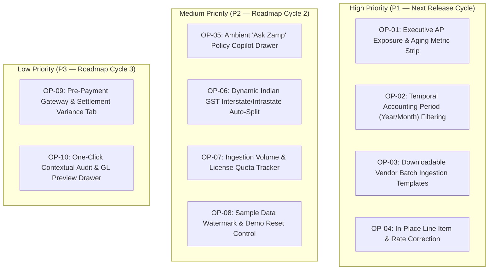

# Flick AI vs Zamp AP Command Center — UX Opportunity & Enhancement Backlog

**Target Competitor:** Flick AI (`https://app.flickai.in/`, Tenant `Zetworth`)  
**Our Product:** Zamp AP Command Center (`Autonomous AP Operations Platform`)  
**Investigation Framework:** Chrome DevTools Protocol Remote Debugging (`127.0.0.1:9222`) + Playwright Telemetry  
**Date of Audit:** November 03, 2026  
**Status:** Prioritized Product Enhancement Backlog  

---

## 1. Executive Summary & Prioritization Framework

This backlog translates empirical reverse-engineering discoveries from **Flick AI** into ten concrete, actionable product enhancements for **Zamp AP Command Center**.

### Prioritization Rubric:
- **High Priority (P1):** High-impact enhancements that resolve immediate operational friction, accelerate reviewer velocity, or provide crucial executive visibility without compromising Zamp's core AP verification governance.
- **Medium Priority (P2):** Workflow polish, batch ingestion utilities, and regulatory automation that streamline Indian accounting compliance and document lifecycle management.
- **Low Priority / Strategic (P3):** Long-term architectural features and conversational interfaces that expand Zamp's enterprise moat.

### Non-Negotiable System Invariants Preserved:
1. **AP Verification Firewall Scope:** Zamp remains an AP pre-payment risk and verification engine, NOT a general ledger or consumer accounting suite.
2. **7 Deterministic Policy Gates:** Gates 1 through 7 remain strictly enforced with zero silent overrides.
3. **Strict Mathematical Tolerances:** Quantity tolerance remains **0.00%**; unit price tolerance remains **±1.50%**; rounding tolerance remains **₹20.00**.
4. **Statutory Dual-Control Governance:** The **₹5,00,000 threshold** requiring secondary Financial Controller approval (with self-approval blocked) remains absolute.
5. **Cryptographic Immutability:** All actions, edits, and state transitions are appended to an immutable audit trail verified by SHA-256 binary hashing.

---

## 2. Exhaustive Prioritized UX Opportunity Backlog

---

### Opportunity 01: Executive AP Exposure & Aging Metric Strip

- **Backlog ID:** `OP-01`
- **Priority Tier:** **P1 (High)** | **Estimated Effort:** 3 Engineering Days (Frontend + API)
- **Problem Statement in Zamp:**
  Zamp's current dashboard displays invoice volume counts (`Total Invoices: 7`, `Approved: 3`, `Pending: 3`), but fails to communicate **financial capital exposure** ([02_dashboard_today.png](file:///c:/Zamp%20Casse%20Study/competitor_research/04_cross_product_analysis/screenshots/02_dashboard_today.png)). A Financial Controller logging in cannot immediately determine how much money is blocked by failed policy gates, or what liability is approaching the statutory MSMED 45-day deadline.
- **Flick AI Inspiration:**
  Flick's dashboard features a prominent top scorecard highlighting `Net Exposure`, `GST Net Liability`, and a high-contrast crimson alert card for `90+ Days Overdue` ([01_main_dashboard_full.png](file:///c:/Zamp%20Casse%20Study/competitor_research/03_flickai/screenshots/dashboard/01_main_dashboard_full.png)).
- **Proposed Zamp Implementation:**
  Embed an **Executive Exposure Strip** directly above the Next-Up Review Queue:
  1. **Total Blocked AP Liability:** Aggregated INR value of all invoices currently blocked by policy gates (e.g. `₹28,45,200 Locked`).
  2. **MSMED Urgent Aging Alert:** Total INR and count of invoices approaching or past the 45-day deadline (rendered in warning amber or error crimson).
  3. **Ready for Payment:** Total INR value of fully verified invoices cleared for ERP payment export.
- **Architecture & State Impact:**
  Add an aggregation endpoint `GET /api/v1/dashboard/exposure` computing sums over `invoices` grouped by validation status.
- **Preserved Invariants:** Read-only aggregation; zero change to verification logic or tolerances.

---

### Opportunity 02: Temporal Accounting Period (Year/Month) Filtering

- **Backlog ID:** `OP-02`
- **Priority Tier:** **P1 (High)** | **Estimated Effort:** 2 Engineering Days (Frontend + DB Indexing)
- **Problem Statement in Zamp:**
  Zamp's Inbox is a flat, paginated list of all invoices across all time ([03_invoices_inbox.png](file:///c:/Zamp%20Casse%20Study/competitor_research/04_cross_product_analysis/screenshots/03_invoices_inbox.png)). As enterprise invoice volume expands, invoices from previous fiscal years intermingle with active monthly bills, degrading table performance and making month-end closing cumbersome.
- **Flick AI Inspiration:**
  Flick's `/files` workspace scopes all document views via synchronized **Year** (`2026`) and **Month** (`November`) dropdowns ([03_purchase_invoices_tab.png](file:///c:/Zamp%20Casse%20Study/competitor_research/03_flickai/screenshots/files_and_documents/03_purchase_invoices_tab.png)).
- **Proposed Zamp Implementation:**
  Add a **Fiscal Period Selector** to the top header of the Invoices Inbox:
  - Dual dropdown: `Fiscal Year` (e.g. `FY 2026-27`) and `Month` (e.g. `November 2026`).
  - Defaults to the active calendar month, with an `All Periods` option.
  - Automatically filters the table and persists the operator's selection in local storage.
- **Architecture & State Impact:**
  Add `fy` and `month` query parameters to `GET /api/v1/inbox`. Add database index on `invoices.invoice_date`.
- **Preserved Invariants:** Filtering is purely view-layer; all invoices remain accessible and intact.

---

### Opportunity 03: Downloadable Vendor Batch Ingestion Templates

- **Backlog ID:** `OP-03`
- **Priority Tier:** **P1 (High)** | **Estimated Effort:** 1.5 Engineering Days (Frontend + Assets)
- **Problem Statement in Zamp:**
  When suppliers or internal AP teams upload spreadsheets or batch billing data, mismatched column headers frequently cause extraction failures. Zamp provides no guidance on expected tabular schemas before upload.
- **Flick AI Inspiration:**
  Flick provides direct 1-click `CSV Template` and `Sample Template` download buttons on ingestion tabs ([04_sales_invoices_tab.png](file:///c:/Zamp%20Casse%20Study/competitor_research/03_flickai/screenshots/files_and_documents/04_sales_invoices_tab.png), [02_payment_aggregator_tab.png](file:///c:/Zamp%20Casse%20Study/competitor_research/03_flickai/screenshots/reconciliation/02_payment_aggregator_tab.png)).
- **Proposed Zamp Implementation:**
  In Zamp's Upload Modal, provide a persistent action link:
  - `Download Standard Vendor CSV Template (.xlsx / .csv)`.
  - The template pre-populates required AP columns: `Supplier GSTIN`, `Invoice Number`, `Invoice Date`, `PO Number`, `Line Item #`, `HSN/SAC`, `Billed Qty`, `Unit Rate`, `Tax Rate %`.
- **Architecture & State Impact:**
  Static asset hosting in frontend `/public/templates/zamp_vendor_intake_template.csv`.
- **Preserved Invariants:** Zero change to core backend ingestion parser.

---

### Opportunity 04: In-Place Line Item & Rate Correction

- **Backlog ID:** `OP-04`
- **Priority Tier:** **P1 (High)** | **Estimated Effort:** 4 Engineering Days (Frontend + API + Audit Trail)
- **Problem Statement in Zamp:**
  When OCR misreads a character (e.g., reads `₹1,050.00` as `₹1,850.00`), the resulting rate variance triggers Policy Gate 4 failure. In Zamp's current UI, the line-matching grid is **100% read-only** ([04_invoice_detail_matching.png](file:///c:/Zamp%20Casse%20Study/competitor_research/04_cross_product_analysis/screenshots/04_invoice_detail_matching.png)). The reviewer cannot correct the misread number without triggering backend re-extraction.
- **Flick AI Inspiration:**
  Flick's invoice builder features an interactive spreadsheet matrix where any cell can be edited directly with immediate tax recalculation ([03_create_new_invoice_builder.png](file:///c:/Zamp%20Casse%20Study/competitor_research/03_flickai/screenshots/invoice_processing/03_create_new_invoice_builder.png)).
- **Proposed Zamp Implementation:**
  Enable **Controlled Inline Cell Editing** in the `Matching & Lines` tab:
  1. Reviewers with edit permissions can double-click on `Invoice Qty` or `Invoice Rate`.
  2. The cell transforms into a focused input with keyboard shortcuts (`Enter` to save, `Esc` to cancel).
  3. Editing re-evaluates Gate 3 (Qty) and Gate 4 (Rate) in real time.
  4. The system logs an audit event: `"Field 'invoice_rate' on Line 1 modified from 1850.00 to 1050.00 by [user]. Reason: OCR Misread Correction."`
- **Architecture & State Impact:**
  `PATCH /api/v1/invoices/:id/lines/:line_id` updating the line item and recording an immutable record in `audit_events`.
- **Preserved Invariants:** The original raw OCR extraction is permanently preserved in `extracted_metadata` for audit compliance. Tolerances (0.00% qty, ±1.50% rate) remain strictly enforced against the corrected number.

---

### Opportunity 05: Ambient "Ask Zamp" AP Policy Copilot Drawer

- **Backlog ID:** `OP-05`
- **Priority Tier:** **P2 (Medium)** | **Estimated Effort:** 5 Engineering Days (Frontend + LLM Backend)
- **Problem Statement in Zamp:**
  Non-technical finance clerks and new controllers often struggle to understand why an invoice failed a specific policy gate or what documentation is required to clear a hold.
- **Flick AI Inspiration:**
  Flick embeds a persistent floating action button launching the slide-out **"Ask Flick"** drawer with pre-configured quick chips ([04_ask_flick_assistant.png](file:///c:/Zamp%20Casse%20Study/competitor_research/03_flickai/screenshots/other_features/04_ask_flick_assistant.png)).
- **Proposed Zamp Implementation:**
  Introduce an **"Ask Zamp" AP Copilot**:
  - Persistent bottom-right floating trigger button across all views.
  - Slides out as a 380px drawer without obscuring the invoice or split workspace.
  - Surfaces context-aware prompt chips:
    - *"Why is this invoice held?"*
    - *"What is the rate variance on Line 2?"*
    - *"Which MSMED vendor invoices are due this Friday?"*
  - The copilot is strictly grounded in deterministic database records (PO, GRN, Gate telemetry) rather than hallucinated responses.
- **Architecture & State Impact:**
  `POST /api/v1/copilot/query` connecting to local LLM / Gemini API with schema-restricted context.
- **Preserved Invariants:** The copilot cannot execute state changes or approve invoices; it is strictly an informational assistant.

---

### Opportunity 06: Dynamic Indian GST Interstate/Intrastate Auto-Split

- **Backlog ID:** `OP-06`
- **Priority Tier:** **P2 (Medium)** | **Estimated Effort:** 3 Engineering Days (Frontend + Tax Logic)
- **Problem Statement in Zamp:**
  Zamp validates the overall tax percentage via Policy Gate 5, but displays tax as a single aggregated number ([06_invoice_detail_extracted.png](file:///c:/Zamp%20Casse%20Study/competitor_research/04_cross_product_analysis/screenshots/06_invoice_detail_extracted.png)). Indian statutory filings require explicit separation between **CGST + SGST** (intra-state) and **IGST** (interstate).
- **Flick AI Inspiration:**
  Flick's tax calculation engine automatically compares supplier state code with company state code, automatically splitting taxes into CGST/SGST (50/50) or IGST (100%) ([01_invoice_builder_fields.png](file:///c:/Zamp%20Casse%20Study/competitor_research/03_flickai/screenshots/extraction_and_validation/01_invoice_builder_fields.png)).
- **Proposed Zamp Implementation:**
  In the `Extracted Info` and `Matching & Lines` tabs:
  - Compare Supplier GSTIN state prefix (e.g. `27` for Maharashtra) with Tenant Entity GSTIN.
  - If equal: display **CGST (9%) + SGST (9%)** line items.
  - If different: display **IGST (18%)** line item.
  - Add statutory validation: flag an error if an interstate vendor attempts to bill CGST/SGST.
- **Architecture & State Impact:**
  Frontend utility `formatIndianGstBreakdown(taxRate, supplierGstin, entityGstin)`.
- **Preserved Invariants:** Strengthens Policy Gate 5 tax verification; zero compromise to mathematical rigor.

---

### Opportunity 07: Ingestion Volume & License Quota Tracker

- **Backlog ID:** `OP-07`
- **Priority Tier:** **P2 (Medium)** | **Estimated Effort:** 2 Engineering Days (Frontend + Settings API)
- **Problem Statement in Zamp:**
  Organizations running Zamp have no visibility into how many invoices have been ingested in the current billing cycle or what storage remains in their private Supabase bucket.
- **Flick AI Inspiration:**
  Flick displays an explicit monthly quota progress badge: `"Trial account: 100 PDF invoices/month. This month: 0/100."` ([03_purchase_invoices_tab.png](file:///c:/Zamp%20Casse%20Study/competitor_research/03_flickai/screenshots/files_and_documents/03_purchase_invoices_tab.png)).
- **Proposed Zamp Implementation:**
  In the application header and Settings view, display a subtle **Monthly Volume Gauge**:
  - `Invoices Processed: 412 / 1,000 this month`.
  - Warns in amber at 80% capacity; alerts in red at 95% capacity.
- **Architecture & State Impact:**
  `GET /api/v1/system/usage` returning monthly invoice count and bucket size.
- **Preserved Invariants:** Informational telemetry only; does not block mission-critical invoice processing.

---

### Opportunity 08: Sample Data Watermark & Demo Reset Control

- **Backlog ID:** `OP-08`
- **Priority Tier:** **P2 (Medium)** | **Estimated Effort:** 1.5 Engineering Days (Frontend)
- **Problem Statement in Zamp:**
  Prospective enterprise buyers evaluating Zamp frequently confuse mock test fixtures with live ERP data. There is no clear visual indication of demo fixtures or an easy way to reset the environment.
- **Flick AI Inspiration:**
  Flick cleanly labels trial accounts in its header and provides clear organization switching boundaries ([01_dashboard_and_sidebar.png](file:///c:/Zamp%20Casse%20Study/competitor_research/03_flickai/screenshots/navigation/01_dashboard_and_sidebar.png)).
- **Proposed Zamp Implementation:**
  When demo fixtures are active:
  - Display a clean top pill: `[Evaluation Mode: Mock ERP Fixtures Loaded]`.
  - Add a 1-click `Reset Demo Data` action in the developer drawer to restore baseline evaluation states.
- **Architecture & State Impact:**
  Client-side header component reading `process.env.VITE_APP_MODE`.
- **Preserved Invariants:** Prevents demo data from ever being exported to live production ERP connectors.

---

### Opportunity 09: Pre-Payment Gateway & Settlement Variance Tab

- **Backlog ID:** `OP-09`
- **Priority Tier:** **P3 (Low)** | **Estimated Effort:** 4 Engineering Days (Frontend + Data Model)
- **Problem Statement in Zamp:**
  Modern e-commerce and digital marketplace businesses frequently receive consolidated vendor bills that deduct payment aggregator processing fees (e.g., Razorpay fees) directly from net disbursements. Zamp currently treats all bills as direct PO matches.
- **Flick AI Inspiration:**
  Flick features a dedicated **Payment Aggregator** reconciliation tab with pre-configured Razorpay CSV column mappings ([02_payment_aggregator_tab.png](file:///c:/Zamp%20Casse%20Study/competitor_research/03_flickai/screenshots/reconciliation/02_payment_aggregator_tab.png)).
- **Proposed Zamp Implementation:**
  In the `Matching & Lines` tab, introduce a secondary sub-tab: `Gateway & Fee Deductions`:
  - Ingests Razorpay settlement CSV reports.
  - Automatically matches vendor processing fee claims against actual gateway fee debits.
  - Verifies that net vendor payable equals gross claim minus verified processing fee deductions.
- **Architecture & State Impact:**
  Add table `settlement_reconciliations` linked to `invoice_id`.
- **Preserved Invariants:** Strictly pre-payment validation; preserves deterministic verification before funds release.

---

### Opportunity 10: One-Click Contextual Audit & GL Preview Drawer

- **Backlog ID:** `OP-10`
- **Priority Tier:** **P3 (Low)** | **Estimated Effort:** 3 Engineering Days (Frontend)
- **Problem Statement in Zamp:**
  To inspect audit history on an approved invoice, reviewers must open the invoice detail workspace, click the Audit Trail tab, and scroll through records ([07_invoice_detail_history.png](file:///c:/Zamp%20Casse%20Study/competitor_research/04_cross_product_analysis/screenshots/07_invoice_detail_history.png)). From the inbox or dashboard, there is no instant way to preview what accounting entries will be posted to the ERP.
- **Flick AI Inspiration:**
  Flick allows direct drill-down into party-wise ledgers and journal entries from any completed transaction ([02_ledger_management.png](file:///c:/Zamp%20Casse%20Study/competitor_research/03_flickai/screenshots/other_features/02_ledger_management.png)).
- **Proposed Zamp Implementation:**
  In the Invoices Inbox, clicking an `Approved` status pill opens a slide-out **Audit & GL Preview Drawer**:
  - Displays the exact journal entry payload destined for SAP/ERP:
    - Debit: Expense / Inventory Account (by line item).
    - Debit: Input CGST / SGST / IGST Account.
    - Credit: Vendor Accounts Payable Account.
  - Displays the timestamped cryptographic approval hash and approving controller identity.
- **Architecture & State Impact:**
  Frontend slide-out drawer rendering `GET /api/v1/invoices/:id/erp-payload`.
- **Preserved Invariants:** Read-only preview of authorized ERP payload; immutable audit events remain untouchable.

---

## 3. Backlog Implementation Roadmap

| Milestone | Deliverables Included | Target Engineering Time | Primary Beneficiary |
|:---|:---|:---:|:---|
| **Sprint 1 (Immediate Focus)** | `OP-01` (Exposure Strip), `OP-02` (Period Selectors), `OP-03` (CSV Templates) | 6.5 Days | Financial Controllers & AP Data Clerks |
| **Sprint 2 (Reviewer Velocity)** | `OP-04` (In-Place Line Edit), `OP-06` (GST Auto-Split), `OP-08` (Demo Watermark) | 8.5 Days | AP Specialists & Compliance Auditors |
| **Sprint 3 (Intelligence & Scope)**| `OP-05` ("Ask Zamp" Copilot), `OP-07` (Quota Gauge), `OP-10` (GL Preview Drawer) | 10.0 Days | Executive Leadership & External Auditors |
| **Sprint 4 (E-Commerce Expansion)**| `OP-09` (Gateway Settlement Reconciliation) | 4.0 Days | Digital & D2C Enterprise Finance Teams |
