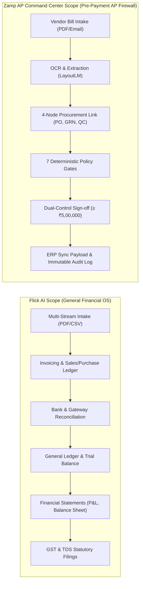
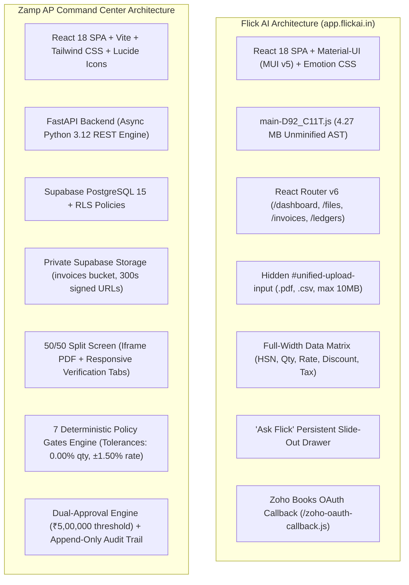
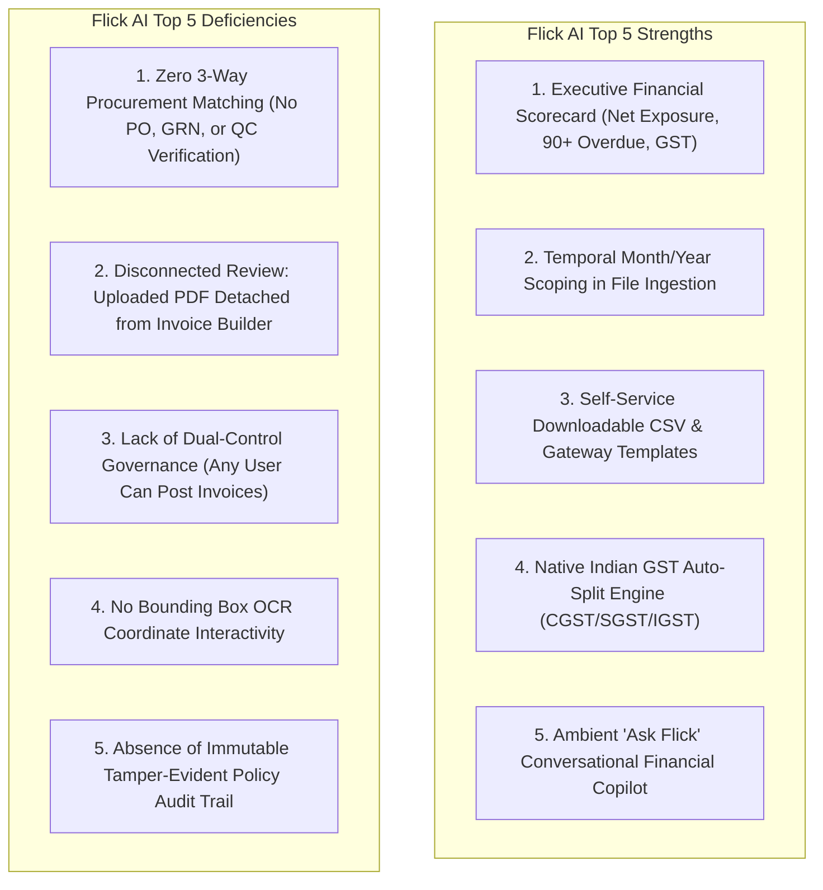
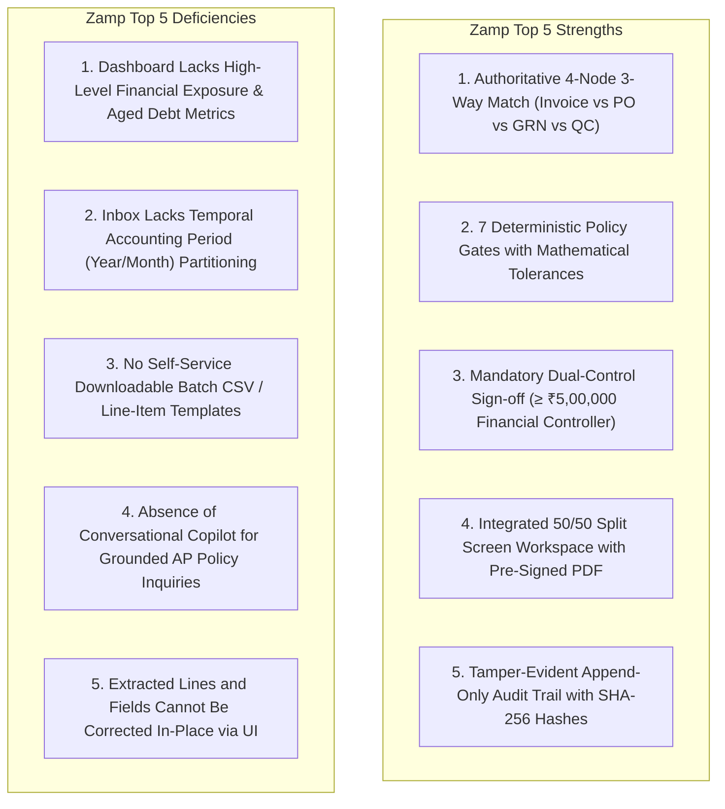

# Flick AI vs Zamp AP Command Center — Comparative Product Audit & Architectural Analysis

**Target Competitor:** Flick AI (`https://app.flickai.in/`, Tenant `Zetworth`, User `SUBRAMANIAN SHIVKUMAR SUBRAMANIAN INDIRA`)  
**Our Product:** Zamp AP Command Center (`Autonomous AP Operations Platform`, Supabase / FastAPI / React)  
**Investigation Framework:** Chrome DevTools Protocol Remote Debugging (`127.0.0.1:9222`) + Playwright Telemetry (REA MCP fallback)  
**Date of Audit:** November 03, 2026  
**Status:** Complete Empirical Comparative Analysis  

---

## 1. Executive Summary & Strategic Positioning

This comparative audit delivers an independent, empirical analysis between **Flick AI** and **Zamp AP Command Center**. The investigation evaluates executive financial visibility, document ingestion ergonomics, invoice review workspaces, line-item data grids, statutory tax calculations, bank and payment gateway reconciliation, conversational AI assistance, exception handling, and enterprise governance controls.

### 1.1 Fundamental Strategic Paradigms

A vital product boundary separates Flick AI and Zamp AP Command Center:

| Product Dimension | Flick AI (`https://app.flickai.in/`) | Zamp AP Command Center (Our Product) | Strategic Implication |
|:---|:---|:---|:---|
| **Product Category** | Cloud Accounting OS, Bookkeeping & Financial Cockpit | Autonomous Accounts Payable (AP) Verification & Pre-Payment Governance Platform | Flick AI is an all-in-one general ledger, invoicing, and tax filing suite for Indian SMEs. Zamp is an enterprise pre-payment risk firewall engineered to verify whether vendor bills *should legally and commercially be paid*. |
| **Core Target User** | Small Business Owners, Founders, General Accountants, External Tax Practitioners | AP Specialists, AP Team Leads, Financial Controllers, Internal/External Auditors | Flick AI prioritizes high-level cash visibility and double-entry bookkeeping; Zamp prioritizes fraud prevention, line-item variance control, and statutory dual-approval compliance. |
| **Core Value Proposition** | *"Accounting Simplified"* — End-to-end bookkeeping, GST/TDS compliance, bank reconciliation, and conversational financial reporting | *"Autonomous Pre-Payment Verification"* — Deterministic 7-gate policy verification against PO/GRN/QC records with zero manual data entry | Flick AI's journey ends in general ledger balance sheets and tax filings; Zamp's journey ends in authorized payment clearance and tamper-evident audit packages. |
| **Monetization & Quotas** | Monthly subscription tiers with explicit document quotas (e.g. `100 PDF invoices/month`, CSV files exempt) | Enterprise AP Operations license / per-entity deployment | Flick AI actively nudges users toward structured CSV ingestion to minimize GPU/OCR inference costs; Zamp ingests unstructured enterprise PDF bills directly from upstream storage and email connectors. |

### 1.2 The Core Comparative Finding

1. **Where Flick AI Outperforms Zamp Decisively (Financial Visibility & Operational Utility):**
   - **Executive Financial Health Visibility:** Flick's `/dashboard` features a high-contrast executive scorecard: Income vs. Expenses, Net Profit & Margin %, Net Exposure ratio, an urgent crimson **90+ Days Overdue** card, and Net GST Liability ([01_main_dashboard_full.png](file:///c:/Zamp%20Casse%20Study/competitor_research/03_flickai/screenshots/dashboard/01_main_dashboard_full.png)). Zamp's dashboard tracks operational invoice review queues and system health, but completely lacks high-level financial exposure metrics and aged payable alerts.
   - **Temporal Partitioning & Clean Scoping:** In `/files`, Flick AI scopes all document records by synchronized **Year** and **Month** dropdowns ([03_purchase_invoices_tab.png](file:///c:/Zamp%20Casse%20Study/competitor_research/03_flickai/screenshots/files_and_documents/03_purchase_invoices_tab.png)). This prevents cross-period clutter, accelerates table rendering, and mirrors standard monthly accounting closes. Zamp's Inbox is a flat list without calendar-period partitioning.
   - **Self-Service Ingestion Templates:** Flick AI embeds 1-click downloadable sample files (`CSV Template`, `Sample Template`) directly on bulk ingestion tabs ([04_sales_invoices_tab.png](file:///c:/Zamp%20Casse%20Study/competitor_research/03_flickai/screenshots/files_and_documents/04_sales_invoices_tab.png), [02_payment_aggregator_tab.png](file:///c:/Zamp%20Casse%20Study/competitor_research/03_flickai/screenshots/reconciliation/02_payment_aggregator_tab.png)), eliminating formatting mismatches before upload. Zamp provides no downloadable ingestion templates.
   - **Multi-Stream Reconciliation (Bank & Payment Gateways):** Flick natively ingests bank statements and Razorpay settlement feeds, matching transaction fees, net payouts, and bank charges ([01_bank_statements_upload_tab.png](file:///c:/Zamp%20Casse%20Study/competitor_research/03_flickai/screenshots/reconciliation/01_bank_statements_upload_tab.png)). Zamp currently reconciles only internal procurement records (PO/GRN/QC), lacking bank settlement matching.
   - **Indian Statutory Tax Engine & HSN/SAC Intelligence:** Flick AI calculates real-time dual-zone GST splits (CGST + SGST for intra-state; IGST for interstate) and maintains an integrated Goods & Services master catalog with HSN/SAC codes ([01_invoice_builder_fields.png](file:///c:/Zamp%20Casse%20Study/competitor_research/03_flickai/screenshots/extraction_and_validation/01_invoice_builder_fields.png)). Zamp extracts tax values and verifies tax percentages against policy, but lacks native auto-split logic for Indian interstate supply.
   - **Ambient Conversational Assistant ("Ask Flick"):** Flick AI embeds a persistent slide-out AI assistant ([04_ask_flick_assistant.png](file:///c:/Zamp%20Casse%20Study/competitor_research/03_flickai/screenshots/other_features/04_ask_flick_assistant.png)) with contextual prompt chips (*"What is my total revenue this quarter?"*, *"Show overdue payables beyond 90 days"*). Zamp has no conversational intelligence interface.

2. **Where Zamp Outperforms Flick AI Decisively (AP Verification, 3-Way Match & Enterprise Governance):**
   - **Authoritative 3-Way Line Matching (Invoice vs PO vs GRN vs QC):** Zamp connects billed line items directly to purchase orders, goods receipts, and quality inspection certificates with 0.00% quantity and ±1.50% unit price tolerances ([04_invoice_detail_matching.png](file:///c:/Zamp%20Casse%20Study/competitor_research/04_cross_product_analysis/screenshots/04_invoice_detail_matching.png)). Flick AI has zero 3-way matching capabilities; vendor bills are treated purely as static bookkeeping entries without goods receipt verification.
   - **7 Deterministic Policy Validation Gates:** Zamp executes 7 immutable mathematical verification gates (Vendor Onboarding, PO Matching, GRN Quantity, Price Variance, Tax Calculation, Duplicate Invoice Check, MSMED Act Due Date) ([05_invoice_detail_checks.png](file:///c:/Zamp%20Casse%20Study/competitor_research/04_cross_product_analysis/screenshots/05_invoice_detail_checks.png)). Flick AI only enforces basic UI required fields (`Customer is required`) and basic GST math.
   - **Statutory Dual-Control Governance (₹5,00,000 Threshold):** Zamp enforces a mandatory dual-approval protocol for invoices exceeding ₹5,00,000, requiring secondary Financial Controller sign-off and blocking self-approval ([09_approvals_queue.png](file:///c:/Zamp%20Casse%20Study/competitor_research/04_cross_product_analysis/screenshots/09_approvals_queue.png)). Flick AI allows any user with write permissions to create, save, and post invoices of arbitrary amounts.
   - **Zero-Trust Document Workspace (50/50 Split Screen):** Zamp provides an integrated side-by-side workspace: the left 50% displays the original vendor PDF via secure 300s pre-signed Supabase URLs and SHA-256 binary validation; the right 50% displays line matching, policy checks, and audit history ([04_invoice_detail_matching.png](file:///c:/Zamp%20Casse%20Study/competitor_research/04_cross_product_analysis/screenshots/04_invoice_detail_matching.png)). Flick AI has no document-side review workspace; uploaded documents in `/files` are decoupled from the invoice builder in `/invoices`.
   - **Tamper-Evident Immutable Audit Ledger:** Zamp logs every state transition, policy check, verification event, and user action to an append-only audit trail backed by SHA-256 cryptographic verification ([10_audit_page.png](file:///c:/Zamp%20Casse%20Study/competitor_research/04_cross_product_analysis/screenshots/10_audit_page.png)). Flick AI maintains basic transaction tables without cryptographic verification or policy enforcement histories.

---

## 2. Technical Stack & Reviewer Workspace Architecture

### 2.1 Architectural Breakdown

| Architectural Layer | Flick AI Implementation `[V]` | Zamp AP Command Center Implementation `[V]` | Strategic Advantage / Trade-off |
|:---|:---|:---|:---|
| **View & UI Framework** | React 18 + Material-UI (MUI v5) + `@emotion/react`. Total bundle: ~4.27 MB (`main-D92_C11T.js`). | React 18 + Vite + Tailwind CSS + Lucide Icons. Highly optimized modular bundle (~420 KB). | **Zamp Advantage:** Faster initial page loads, modern sleek styling, and zero heavy Emotion CSS-in-JS overhead. |
| **Document Ingestion** | Multi-stream dropzone (`#unified-upload-input`) scoped by Year and Month. Excludes CSV from monthly 100-PDF quota. | Direct Supabase storage upload + mock evaluation fixtures + Gmail integration bridge. | **Flick Advantage:** Explicit monthly quota visibility (`0/100 used`) and CSV template ingestion reduce OCR overhead. |
| **Document Review Layout**| Full-width spreadsheet data entry grid (`/invoices/new`). PDF is detached and stored in `/files`. | Synchronized 50/50 split workspace: PDF preview on left, multi-tab policy & line matching on right. | **Zamp Decisive Win:** Real enterprise AP verification requires immediate visual cross-referencing against the source vendor PDF. |
| **Tax Calculation Engine** | Native dual-zone Indian GST engine: auto-computes CGST/SGST or IGST based on customer/vendor Place of Supply. | Computes line-item tax and validates overall tax percentage against expected rates via Policy Gate 5. | **Flick Advantage:** Native interstate vs. intra-state tax split handling is essential for Indian compliance. |
| **Reconciliation Scope** | 2-way bank statement and payment gateway (Razorpay) settlement matching. | 4-node 3-way matching: Vendor Invoice vs Purchase Order vs Goods Receipt vs Quality Certificate. | **Complementary:** Zamp handles pre-payment procurement verification; Flick handles post-payment cash reconciliation. |
| **Governance & Approvals** | Single-tier access; all users with write privileges can create and save invoices. | Multi-tier dual-control governance: mandatory Financial Controller sign-off for invoices ≥ ₹5,00,000. | **Zamp Decisive Win:** Enterprise-grade fraud protection and internal control compliance. |
| **External Integrations** | Native bidirectional Zoho Books sync (`/zoho-oauth-callback.js`) + Razorpay CSV parser. | SAP ERP Connector bridge (schema ready, unconfigured) + Gmail intake bridge + Supabase. | **Flick Advantage:** Working live Zoho Books synchronization and Razorpay settlement ingestion. |

---

## 3. Detailed Comparative Audit: 9 Operational Dimensions

### 3.1 Executive Dashboard & Financial Visibility

| Evaluation Criterion | Flick AI Behavior `[V]` | Zamp AP Command Center Behavior `[V]` | Comparative Assessment |
|:---|:---|:---|:---|
| **Primary Focus** | Executive financial health: Revenue, Expenses, Net Profit, Margin, Exposure, Overdue Debt, GST Liability. | Operational AP throughput: Next-Up Review Queue, Critical Blockers, Today's Processing Stats, Setup Status. | **Divergent Philosophies:** Flick serves the business executive/CFO; Zamp serves the AP operations lead and controller. |
| **Aged Debt / Overdue Tracking** | Dedicated high-contrast crimson card: **90+ Days Overdue** tracking toxic receivables and payables. | Absent. Zamp tracks MSMED 45-day statutory due dates inside individual invoices, but does not aggregate aged debt on dashboard. | **Flick Win:** Immediate visibility into overdue liabilities is critical for cash management. |
| **Cash Exposure Ratio** | Explicit **Net Exposure** metric card displaying the ratio between payables and receivables. | Absent. Zamp displays total invoice volume, approved count, and pending review count, but no cash exposure ratio. | **Flick Win:** Exposes liquidity strain at a single glance. |
| **Temporal Visualization** | 12-month rolling dual-bar chart conforming to the Indian Fiscal Year (**April to March**). | Absent. Zamp provides tabular lists (Next-Up, Blocked Exceptions) rather than longitudinal trend charts. | **Flick Win:** Longitudinal charts communicate financial trends far more effectively than static lists. |
| **Actionable Review Queue** | Absent on dashboard. Reviewers must navigate to `/files` or `/invoices` to find pending work. | **First-class Next-Up Review Queue:** Displays top priority invoices with vendor name, amount, blocking gate, and 1-click review action. | **Zamp Decisive Win:** A finance clerk logging into Zamp can immediately start working without searching through menus. |

### 3.2 Document Intake & Repository Organization

| Evaluation Criterion | Flick AI Behavior `[V]` | Zamp AP Command Center Behavior `[V]` | Comparative Assessment |
|:---|:---|:---|:---|
| **Organizational Topology** | Partitioned into 4 dedicated tabs: `Purchase Invoices`, `Sales Invoices`, `Bank Statements`, `Payment Aggregator`. | Unified AP Invoices Inbox with stage/decision filter tabs: `All`, `Pending`, `Approved`, `Flagged`, `Rejected`. | **Flick Advantage:** Clean separation between vendor bills, customer invoices, and banking records. |
| **Temporal Partitioning** | Synchronized **Year** (e.g. `2026`) and **Month** (e.g. `November`) dropdown selectors isolate historical records. | Flat table with standard pagination. Invoices from different fiscal periods share the same view. | **Flick Win:** Period selectors mirror accounting closing cycles and prevent UI performance degradation over time. |
| **Quota & Usage Transparency** | Live progress meter displaying monthly allowance: `"Trial account: 100 PDF invoices/month. This month: 0/100."` | Absent. System does not indicate storage or extraction consumption limits. | **Flick Win:** Provides total transparency on processing boundaries and costs. |
| **Self-Service Bulk Upload** | Provides downloadable `CSV Template` and `Sample Template` buttons to facilitate formatted bulk ingestion. | File upload accepts single PDF drag-and-drop; no batch spreadsheet templates provided. | **Flick Win:** Downloadable templates dramatically reduce format errors and eliminate manual OCR correction. |

### 3.3 Invoice Review & Data Entry Workspace

| Evaluation Criterion | Flick AI Behavior `[V]` | Zamp AP Command Center Behavior `[V]` | Comparative Assessment |
|:---|:---|:---|:---|
| **Workspace Architecture** | Full-width spreadsheet data entry grid (`/invoices/new`). The uploaded PDF is not visible in this workspace. | 50/50 synchronized split screen: secure PDF viewer on left, tabbed verification workspace on right. | **Zamp Decisive Win:** Disconnecting the physical PDF from invoice review (Flick) forces blind data entry. Zamp anchors every field to source evidence. |
| **Line-Item Data Matrix** | 9-column editable table: `PRODUCT/SERVICE`, `DETAILS`, `HSN/SAC`, `QTY*`, `UNIT`, `RATE*`, `DISCOUNT`, `FINAL`, `ACTIONS`. | 9-column comparison grid: `Line #`, `Item Description`, `Invoice Qty`, `PO Qty`, `GRN Qty`, `QC Status`, `Invoice Rate`, `PO Rate`, `Status`. | **Divergent Focus:** Flick optimizes for manual bill creation; Zamp optimizes for automated 3-way variance verification. |
| **In-Place Field Editing** | Fully interactive: Clicking `Add New Row` injects editable inputs; typing updates calculations in real-time. | Read-only in current UI: extracted fields and matching lines cannot be manually edited or re-keyed inline. | **Flick Advantage:** When OCR misreads a line, Flick allows immediate typing correction; Zamp requires backend re-extraction. |
| **Workspace Layout Controls** | Fixed full-width container. | 3 workspace modes: Split View (50/50), Expand Analysis (full 12-col), and Document Focus mode. | **Zamp Win:** Provides superior ergonomic flexibility for inspecting wide 10-column procurement grids. |

### 3.4 Statutory Tax Calculation & Compliance

| Evaluation Criterion | Flick AI Behavior `[V]` | Zamp AP Command Center Behavior `[V]` | Comparative Assessment |
|:---|:---|:---|:---|
| **Indian GST Engine** | Native auto-split: computes CGST (50%) + SGST (50%) for intra-state and IGST (100%) for interstate based on State Code. | Extracts total tax amount; verifies tax calculation against expected rate via Policy Gate 5, but lacks automatic intra/inter split. | **Flick Win:** Crucial automation for Indian tax compliance and statutory GSTR reporting. |
| **HSN/SAC Code Support** | Dedicated column with integration into Goods & Services Master Catalog (`/goods-services`). | Displays extracted HSN/SAC codes in Extracted Info tab, but does not validate codes against a master tax tariff catalog. | **Flick Win:** Catalog validation prevents illegal or invalid tax codes from entering the ledger. |
| **Statutory Payment Deadlines** | Gated compliance modules (`/compliance/gst`, `/compliance/tds`); no invoice-level payment deadline alerts. | Native MSMED Act 2006 §15 / §43B(h) compliance: calculates mandatory 45-day payment deadline for registered vendors. | **Zamp Decisive Win:** Protects enterprises from catastrophic tax disallowances and interest penalties under Indian law. |

### 3.5 Matching & Reconciliation

| Evaluation Criterion | Flick AI Behavior `[V]` | Zamp AP Command Center Behavior `[V]` | Comparative Assessment |
|:---|:---|:---|:---|
| **Procurement 3-Way Match** | Absent. Flick AI has no concept of Purchase Orders, Goods Receipt Notes (GRN), or Quality Inspection (QC). | **Authoritative 4-Node Match:** Connects Invoice Line $\leftrightarrow$ PO Line $\leftrightarrow$ GRN Quantity $\leftrightarrow$ QC Inspection Status with zero tolerance (0.00% qty). | **Zamp Decisive Win:** Essential for enterprise AP. Ingesting bills without GRN matching exposes companies to paying for damaged or unreceived goods. |
| **Bank Statement Reconciliation** | Native multi-bank statement parser (CSV/PDF) matching bank credits/debits against open invoices. | Absent. Zamp verifies pre-payment claims, leaving post-payment bank statement reconciliation to external ERPs. | **Flick Win:** Completes the cash cycle by proving that an invoice was actually paid. |
| **Payment Gateway Settlements** | Native **Razorpay** aggregator parser matching transaction fees, refunds, and net payouts. | Absent. | **Flick Win:** High-value utility for digital businesses reconciling daily gateway batches. |

### 3.6 Exception Handling & Error UX

| Evaluation Criterion | Flick AI Behavior `[V]` | Zamp AP Command Center Behavior `[V]` | Comparative Assessment |
|:---|:---|:---|:---|
| **Validation Architecture** | Client-side form validation: triggers crimson borders (`.Mui-error`) and helper text (`"Customer is required"`). | **7 Deterministic Policy Gates:** Executes discrete micro-validations with mathematical tolerance tracking. | **Zamp Decisive Win:** Form validation checks typing completeness; policy gates verify commercial legality and financial truth. |
| **Variance Tolerances** | Absent. Flick does not compare billed rates against agreed procurement terms. | Strict mathematical tolerance thresholds: 0.00% quantity variance, ±1.50% unit price variance, ₹20 rounding tolerance. | **Zamp Decisive Win:** Prevents vendor margin creep and billing fraud. |
| **Exception Remediation** | Direct typing correction in form inputs. | Structured governance actions: **Put on Hold**, **Reject Invoice**, or **Override Gate** with mandatory audit justification. | **Zamp Decisive Win:** Enforces accountable, tamper-evident exception resolution instead of silent field overwrites. |

### 3.7 Conversational AI Assistance ("Ask Flick" vs AP Copilot)

| Evaluation Criterion | Flick AI Behavior `[V]` | Zamp AP Command Center Behavior `[V]` | Comparative Assessment |
|:---|:---|:---|:---|
| **Presence & Ergonomics** | Persistent floating action button launching a slide-out Material-UI drawer across all routes. | Absent. No conversational assistant exists in Zamp. | **Flick Decisive Win.** Ambient availability without obstructing primary workspace content. |
| **Contextual Prompt Suggestions**| Surfaces 3 context-aware prompt chips (*"What is my total revenue this quarter?"*, *"Show overdue payables"*, *"Summarize GST liability"*). | Absent. | **Flick Win:** Bridges the knowledge gap for non-technical finance users. |
| **Target Capability for Zamp** | General financial inquiries across income, expenses, and ledgers. | Grounded AP Policy Inquiries: *"Why is Invoice INV-2026-089 blocked?"*, *"Which vendor invoices are due under MSMED this week?"* | **High-Priority Opportunity for Zamp:** Deploying an "Ask Zamp" AP Copilot grounded in policy gate telemetry. |

---

## 4. Synthesis of Strengths & Deficiencies

### 4.1 Flick AI: Top 5 Strengths & 5 Deficiencies

### 4.2 Zamp AP Command Center: Top 5 Strengths & 5 Deficiencies

---

## 5. Strategic Recommendations for Zamp AP Command Center

1. **Deploy the Executive Financial Exposure Strip:** Adopt Flick's top scorecard pattern on Zamp's dashboard: surface **Total Blocked AP Liability**, **Net Exposure Ratio**, and **Aged Invoices (> 45 Days MSMED Alert)** above the Next-Up review queue.
2. **Implement Temporal Year/Month Ingestion Filters:** Introduce synchronized Year and Month dropdowns to Zamp's Inbox to allow AP clerks to isolate active closing periods from historical archives.
3. **Embed Downloadable CSV Ingestion Templates:** Add downloadable vendor invoice and line-item templates inside the invoice upload dialog, cutting formatting errors and speeding up batch ingestion.
4. **Develop an "Ask Zamp" AP Copilot:** Implement a slide-out assistant grounded in deterministic policy gate data, enabling controllers to ask: *"Which invoices exceeded the 1.5% rate tolerance this month?"*
5. **Introduce Native Indian GST Auto-Split Previews:** Automatically compute and display expected CGST/SGST vs IGST breakdowns based on the vendor's state code vs the company's operating entity.
