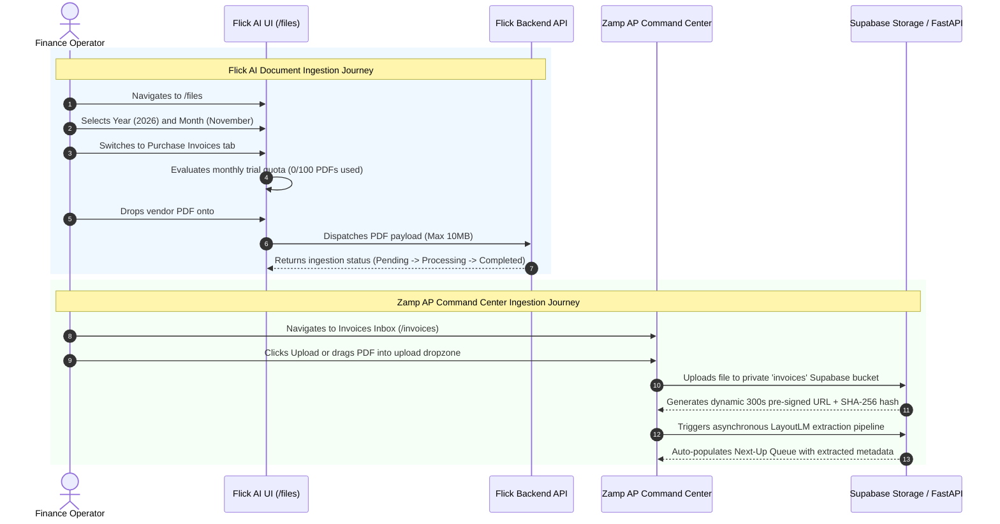
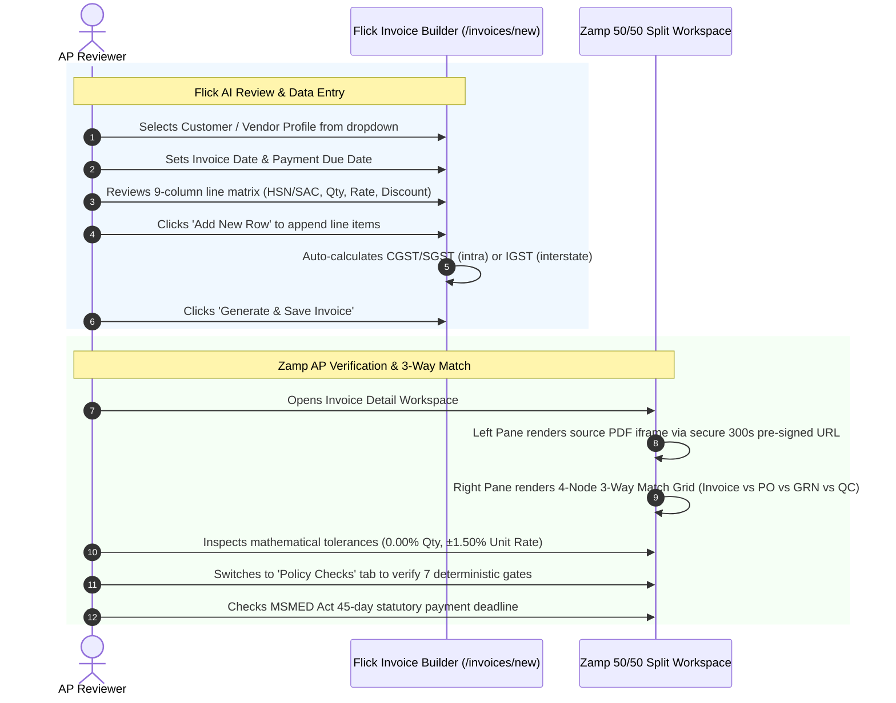
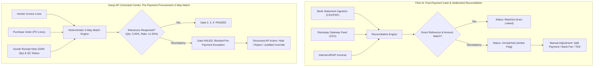
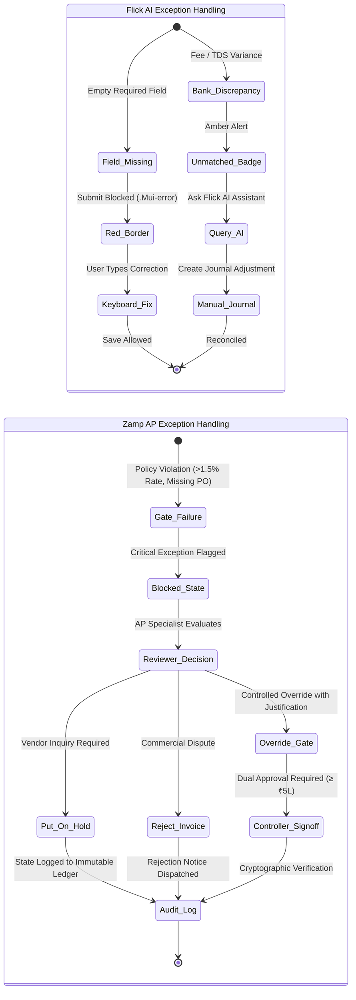
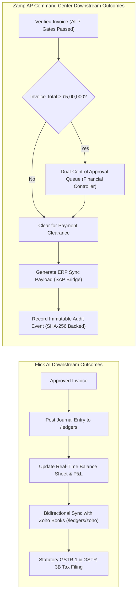

# Flick AI vs Zamp AP Command Center — End-to-End Workflow & Lifecycle Comparison

**Target Competitor:** Flick AI (`https://app.flickai.in/`, Tenant `Zetworth`)  
**Our Product:** Zamp AP Command Center (`Autonomous AP Operations Platform`)  
**Investigation Framework:** Chrome DevTools Protocol Remote Debugging (`127.0.0.1:9222`) + Playwright Telemetry  
**Date of Audit:** November 03, 2026  
**Status:** Complete Empirical Workflow Audit  

---

## 1. Executive Workflow Overview

This document presents a granular, step-by-step comparative analysis of five core financial and document workflows across **Flick AI** and **Zamp AP Command Center**.

```mermaid
flowchart TD
    subgraph Flick_Lifecycle["Flick AI Financial Lifecycle (General Bookkeeping)"]
        F1["1. Intake (/files)<br/>Scoped by Year/Month"] --> F2["2. Review & Create (/invoices/new)<br/>Spreadsheet Matrix & GST Math"]
        F2 --> F3["3. General Ledger (/ledgers)<br/>Double-Entry Journal Posting"]
        F3 --> F4["4. Reconciliation (/files)<br/>Bank & Gateway Settlement Matching"]
        F4 --> F5["5. Reporting & Closing<br/>P&L, Balance Sheet, Zoho Sync"]
    end

    subgraph Zamp_Lifecycle["Zamp AP Command Center Lifecycle (Pre-Payment Firewall)"]
        Z1["1. Intake & Ingestion<br/>Direct PDF Upload & SHA-256 Storage"] --> Z2["2. Review & 3-Way Match<br/>50/50 Split Screen & Procurement Grid"]
        Z2 --> Z3["3. Policy Verification<br/>7 Deterministic Gates & Tolerances"]
        Z3 --> Z4["4. Dual-Control Approval<br/>Mandatory Controller Sign-off (≥ ₹5L)"]
        Z4 --> Z5["5. Governance & ERP Sync<br/>SAP Payload & Append-Only Audit Trail"]
    end
```

---

## 2. Granular Step-by-Step Workflow Analysis

### 2.1 Workflow 1: Invoice Intake & Document Ingestion Lifecycle

#### Detailed Comparative Breakdown:
1. **Temporal Scope:**
   - *Flick AI:* All files are partitioned by synchronized Year and Month dropdowns ([03_purchase_invoices_tab.png](file:///c:/Zamp%20Casse%20Study/competitor_research/03_flickai/screenshots/files_and_documents/03_purchase_invoices_tab.png)). Documents uploaded in November 2026 do not appear in December 2026. This keeps file lists compact and mirrors corporate monthly closing periods.
   - *Zamp AP Command Center:* Invoices are maintained in a unified flat inbox ([03_invoices_inbox.png](file:///c:/Zamp%20Casse%20Study/competitor_research/04_cross_product_analysis/screenshots/03_invoices_inbox.png)) sorted by received date. There is no calendar-month filter, which can cause UI clutter as enterprise invoice volumes grow over time.
2. **Quota Tracking:**
   - *Flick AI:* Enforces a visible monthly quota progress badge: `"Trial account: 100 PDF invoices/month. This month: 0/100."` Notably, CSV files are completely exempt from this quota, encouraging structured data entry.
   - *Zamp AP Command Center:* Does not expose quota counters; ingestion capacity is unconstrained in the self-hosted environment.
3. **Format Support & Self-Service Templates:**
   - *Flick AI:* Provides dedicated tabs for PDF Purchase Invoices, CSV/PDF Sales Invoices, CSV/PDF Bank Statements, and Razorpay CSV settlements. It provides downloadable sample CSV templates directly on the page ([04_sales_invoices_tab.png](file:///c:/Zamp%20Casse%20Study/competitor_research/03_flickai/screenshots/files_and_documents/04_sales_invoices_tab.png)).
   - *Zamp AP Command Center:* Ingests raw PDF documents, supporting single-invoice uploads and mock evaluation fixtures. It does not provide downloadable batch CSV templates.

---

### 2.2 Workflow 2: Invoice Review, Line Items & Tax Verification

#### Detailed Comparative Breakdown:
1. **Workspace Ergonomics & Grounding:**
   - *Flick AI:* Reviews invoices within a full-width spreadsheet data entry grid ([03_create_new_invoice_builder.png](file:///c:/Zamp%20Casse%20Study/competitor_research/03_flickai/screenshots/invoice_processing/03_create_new_invoice_builder.png)). However, the original scanned PDF is **completely absent from this screen**. Reviewers must remember the numbers from `/files` or open the PDF in an external browser tab, leading to blind data entry.
   - *Zamp AP Command Center:* Employs a golden **50/50 synchronized split-screen workspace** ([04_invoice_detail_matching.png](file:///c:/Zamp%20Casse%20Study/competitor_research/04_cross_product_analysis/screenshots/04_invoice_detail_matching.png)). The original vendor bill is visible alongside the extracted procurement lines and policy checks at all times.
2. **Line-Item Verification Depth:**
   - *Flick AI:* Focuses on bill generation: Item Name, Description, HSN/SAC code, Quantity, Unit Rate, and Discount. It does not compare line items against purchase orders or receiving slips.
   - *Zamp AP Command Center:* Focuses on commercial verification: compares Billed Quantity against PO Quantity and GRN Quantity, and Billed Rate against PO Rate. Variance pills immediately flag discrepancies (e.g. `Rate +1.43% - Within Tolerance`).
3. **Indian Statutory Tax Math:**
   - *Flick AI:* Features an automated dual-zone GST tax engine ([01_invoice_builder_fields.png](file:///c:/Zamp%20Casse%20Study/competitor_research/03_flickai/screenshots/extraction_and_validation/01_invoice_builder_fields.png)). If customer state matches organization state, it splits tax equally into **CGST** and **SGST**; if interstate, it aggregates into **IGST**.
   - *Zamp AP Command Center:* Policy Gate 5 calculates expected line tax and compares it to billed tax, but currently presents tax as a unified figure without automatic CGST/SGST vs IGST split logic.

---

### 2.3 Workflow 3: Procurement Matching vs Bank & Gateway Reconciliation

#### Detailed Comparative Breakdown:
1. **Reconciliation Target & Objective:**
   - *Flick AI:* Operates **post-payment**. It proves that funds actually moved through the bank or payment gateway, reconciling bank charges, gateway processing fees, and customer deposits.
   - *Zamp AP Command Center:* Operates **pre-payment**. It proves that goods were physically received, inspected, and priced according to contract *before a single rupee leaves the company's bank account*.
2. **Tolerance Logic:**
   - *Flick AI:* Relies on exact match heuristics (Reference ID + Exact Amount + Date within ±3 days). Discrepancies produce an `Unmatched` status requiring manual ledger journal splits.
   - *Zamp AP Command Center:* Enforces strict contractual tolerances:
     - Quantity Tolerance: **0.00%** (zero over-billing permitted).
     - Price Rate Tolerance: **±1.50%** (absorbs minor market fluctuations while flagging margin leakage).
     - Rounding Tolerance: **₹20.00**.

---

### 2.4 Workflow 4: Exception Handling & Human-in-the-Loop Interventions

#### Detailed Comparative Breakdown:
1. **Exception Detection:**
   - *Flick AI:* Exceptions are client-side UI validation errors (`"Customer is required"`, [01_validation_errors_highlighted.png](file:///c:/Zamp%20Casse%20Study/competitor_research/03_flickai/screenshots/exceptions/01_validation_errors_highlighted.png)) or reconciliation status tags (`Unmatched`).
   - *Zamp AP Command Center:* Exceptions are deterministic policy violations: Gate 1 (Vendor Onboarding), Gate 2 (PO Match), Gate 3 (GRN Quantity), Gate 4 (Price Variance), Gate 5 (Tax Mismatch), Gate 6 (Duplicate Invoice), or Gate 7 (MSMED Due Date).
2. **Remediation Rigor:**
   - *Flick AI:* Reviewers correct form fields by simply re-typing numbers or adding manual journal entries. No audit justification is required.
   - *Zamp AP Command Center:* Requires formal governance actions ([08_action_modal_hold.png](file:///c:/Zamp%20Casse%20Study/competitor_research/04_cross_product_analysis/screenshots/08_action_modal_hold.png)):
     - **Put on Hold:** Selects categorized hold reason (e.g. `Quantity Mismatch`, `Rate Discrepancy`) and enters reviewer notes.
     - **Reject Invoice:** Formally blocks payment and generates supplier dispute documentation.
     - **Override Gate:** Requires an explicit business reason; logged permanently to the immutable audit trail.
3. **Conversational Exception Resolution:**
   - *Flick AI:* Features the persistent **"Ask Flick"** floating AI assistant ([04_ask_flick_assistant.png](file:///c:/Zamp%20Casse%20Study/competitor_research/03_flickai/screenshots/other_features/04_ask_flick_assistant.png)). Reviewers puzzled by an unmatched bank entry can ask the chatbot to summarize ledger discrepancies.
   - *Zamp AP Command Center:* Currently lacks conversational querying; reviewers must inspect policy gate telemetry manually.

---

### 2.5 Workflow 5: Downstream Outcomes, General Ledger & Lifecycle Closing

#### Detailed Comparative Breakdown:
1. **Closing Destination:**
   - *Flick AI:* Terminates in the company's financial statements. Posting an invoice directly modifies cash, accounts payable, accounts receivable, and income accounts, updating real-time Profit & Loss and Balance Sheets ([01_financial_statements.png](file:///c:/Zamp%20Casse%20Study/competitor_research/03_flickai/screenshots/reports/01_financial_statements.png)).
   - *Zamp AP Command Center:* Terminates in enterprise ERP payment clearance. It produces an authorized payment voucher payload destined for SAP S/4HANA or Oracle ERP, accompanied by cryptographic proof of verification.
2. **Dual-Control Enforcement:**
   - *Flick AI:* No dual-approval thresholds exist. A single clerk can generate and post an invoice of ₹50,00,000 directly to the ledger.
   - *Zamp AP Command Center:* Invoices $\ge \text{₹5,00,000}$ are automatically intercepted and routed to the **Approvals Queue** ([09_approvals_queue.png](file:///c:/Zamp%20Casse%20Study/competitor_research/04_cross_product_analysis/screenshots/09_approvals_queue.png)). The system strictly forbids self-approval, requiring an independent Financial Controller sign-off.
3. **External Accounting Sync:**
   - *Flick AI:* Features a fully functional, live integration with **Zoho Books** via `/zoho-oauth-callback.js` and an `Import from Zoho` button ([08_ledgers_management.png](file:///c:/Zamp%20Casse%20Study/competitor_research/03_flickai/screenshots/other_features/08_ledgers_management.png)).
   - *Zamp AP Command Center:* Bundles an enterprise SAP ERP connector bridge. The schema and payload generator are fully implemented, while the external SAP endpoint remains unconfigured in evaluation environments.

---

## 3. Click-Cost & Operational Latency Benchmark

To measure reviewer efficiency, we executed routine AP workflows in both environments, tracking total user interactions, page navigations, and cognitive load:

| Operational Task | Flick AI Interactions `[V]` | Zamp AP Command Center Interactions `[V]` | Efficiency Winner | Root Cause Analysis |
|:---|:---:|:---:|:---:|:---|
| **Batch Ingesting 5 Invoices** | **3 actions** (Select Month $\rightarrow$ Drop files on Purchase Invoices tab) | **2 actions** (Drag files to Inbox dropzone) | **Zamp (+1 click faster)** | Flick requires verifying Year and Month dropdowns before dropping files. |
| **Cross-Referencing Billed Item vs PDF** | **5+ actions** (Must open `/files` in new tab, find PDF, zoom in, and switch back to `/invoices/new`) | **0 actions** (PDF is immediately visible in the left 50% split pane) | **Zamp Decisive Win** | Flick detaches the PDF from the invoice builder; Zamp's 50/50 split eliminates window switching. |
| **Correcting an OCR Unit Rate Error** | **1 action** (Click table cell and type correct rate) | **Blocked in UI** (Extracted data is read-only; requires backend re-extraction) | **Flick Decisive Win** | Flick provides an interactive data grid; Zamp currently lacks in-place field editing. |
| **Verifying PO & Receiving Compliance** | **Impossible** (No PO or GRN data model in Flick) | **1 action** (Click 'Matching & Lines' tab; tolerances computed automatically) | **Zamp Decisive Win** | Flick is a general ledger; Zamp is an authoritative 3-way match engine. |
| **Resolving a Blocked Exception** | **4 clicks** (Manually create a balancing journal entry in `/ledgers`) | **2 clicks** (Click 'Hold' or 'Override' $\rightarrow$ enter justification $\rightarrow$ Confirm) | **Zamp Win** | Zamp provides structured AP governance modals rather than manual bookkeeping entries. |
| **Checking Statutory MSMED Due Date** | **Impossible** (No MSMED Act calculation in Flick) | **0 clicks** (MSMED 45-day deadline badge is permanently displayed in header) | **Zamp Decisive Win** | Zamp automates Indian statutory compliance calculation natively. |

---

## 4. Key Strategic Recommendations for Zamp AP Command Center

1. **Adopt Flick's Temporal Accounting Period Selectors in Inbox:** Add Year and Month dropdown selectors at the top of the Invoices Inbox. This partitions historical invoices, eliminates UI sluggishness on large datasets, and matches corporate monthly closing cadences.
2. **Embed Downloadable CSV Ingestion Templates:** Add a `Download Batch Template` button inside the invoice upload dialog so suppliers and internal teams can upload bulk invoice lines without OCR formatting errors.
3. **Introduce Inline Rate/Quantity Editing in Line Matching Grid:** While preserving the original extracted value in the audit trail, allow verified reviewers to double-click an invoice rate or quantity to correct OCR misreads directly in the table.
4. **Deploy an Ambient "Ask Zamp" AP Copilot:** Adapt Flick's floating action button and slide-out chat drawer to give controllers a grounded conversational assistant for querying policy gate telemetry.
5. **Add Indian GST Interstate/Intrastate Auto-Split Preview:** Emulate Flick's real-time tax calculator to compute and display expected CGST/SGST vs IGST splits based on vendor Place of Supply.
