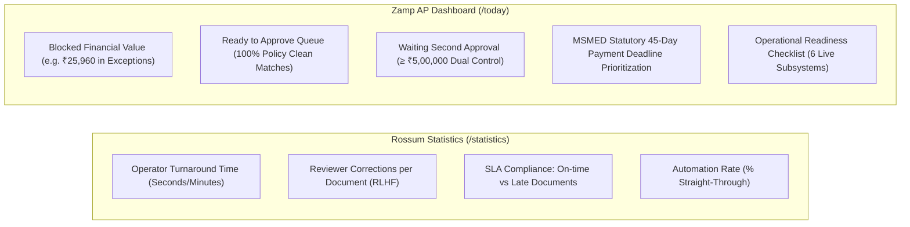

# Rossum vs Zamp AP Command Center — UI/UX & Frontend Design Gap Analysis

**Target Competitor:** Rossum Cloud Platform (`https://svit.rossum.app/`)  
**Our Product:** Zamp AP Command Center  
**Methodology:** Design System Teardown, Component-Level Inspection, Typographic Auditing, Information Density Analysis & Accessibility Review  
**Date:** November 03, 2026  

---

## 1. Design System & Frontend Architecture Comparison

```text
┌───────────────────────────────────────┬───────────────────────────────────────┐
│                ROSSUM                 │        ZAMP AP COMMAND CENTER         │
├───────────────────────────────────────┼───────────────────────────────────────┤
│ • React 18 + Vite / Rolldown          │ • React 18 + Vite SPA                 │
│ • Material-UI (MUI v5) + Emotion      │ • Tailwind CSS + Lucide React         │
│ • Tiled image canvas + SVG rect mesh  │ • Native PDF iframe + Tabbed views    │
│ • Floating contextual input overlay   │ • Tabular evidence cards & grids      │
│ • Royal Blue #2563EB / Crimson #DC2626│ • Indigo #4f46e5 / Emerald #059669    │
│ • Continuous queue auto-advance       │ • Deliberative review & inbox return  │
│ • 8 Multi-queue schema silos          │ • Unified 4-stage AP pipeline         │
└───────────────────────────────────────┴───────────────────────────────────────┘
```

---

## 2. Visual Density, Typography & Color Tokens

### 2.1 Typographic Hierarchy & Formatting

| Typographic Level | Rossum Implementation | Zamp AP Command Center Implementation | Evaluation |
|:---|:---|:---|:---|
| **Primary Font Family** | `Inter` (licensed woff2 webfonts) | `Inter` / System UI with monospace font stack | Both employ industry-standard `Inter` for clean legibility at small sizes. |
| **Section Labels** | 14px–16px Medium with uppercase letter-spacing (e.g. `BASIC INFORMATION`, `TOTALS AND SUBTOTALS`) | 11px–12px Bold with uppercase tracking (e.g. `1. SUPPLIER INVOICE`, `PROCUREMENT VERIFICATION FLOW`) | Zamp provides tighter vertical packing; Rossum provides slightly larger section separation. |
| **Field Data Labels** | 12px Regular in Slate `#64748B` | 11px–12px Medium in Slate `#64748B` (`text-slate-500`) | Both use muted slate text for secondary labels to guide eye focus to primary values. |
| **Data Values / Inputs**| 14px Regular in Slate-900 `#0F172A` | 12px–13px Semibold in Slate-900 `#0F172A` (with tabular monospace digits) | **Zamp Advantage.** Zamp consistently applies monospace numbers to currency amounts, preventing layout shift. |
| **Status Badges** | Rounded rectangular pills with high contrast fill (`#DC2626` Crimson, `#16A34A` Emerald) | Rounded pills with tinted backgrounds, colored borders, and semantic icons (`CheckCircle2`, `AlertTriangle`) | **Zamp Advantage.** Zamp combines color, icon, and text for better accessibility. |

### 2.2 Semantic Color Tokens

| Semantic Role | Rossum Token & Hex | Zamp Token & Hex | UX Impact |
|:---|:---|:---|:---|
| **Primary Brand / Action** | Royal Blue `#2563EB` | Indigo `#4f46e5` (`indigo-600`) | Both provide high-contrast, accessible primary focus rings and buttons. |
| **Verified / Success** | Forest Emerald `#16A34A` | Emerald `#059669` (`emerald-600`) | Both clearly communicate verified, passing, or approved state. |
| **Error / Required Missing** | High-Arousal Crimson `#DC2626` | Rose `#e11d48` (`rose-600`) | Both use high-visibility red tokens to halt reviewers on missing mandatory data. |
| **Warning / Low Confidence** | Amber `#D97706` | Amber `#d97706` (`amber-600`) | Both use amber for items requiring human inspection. |
| **Canvas Highlight Mesh** | Translucent Cyan/Blue `rgba(37, 99, 235, 0.2)` with `2px solid #2563EB` stroke | Unimplemented (`bounding_box: null`) | **Rossum Decisive Win.** Translucent fill allows reading underlying text through the bounding box. |
| **Dual Control / Executive**| Unimplemented (No dual control) | Purple `#7c3aed` (`purple-600`) | **Zamp Advantage.** Dedicated purple theme distinguishes high-value Controller approvals. |

---

## 3. Review Workspace Layout & Ergonomics Deep Dive

```text
┌────────────────────────────────────────────────────────────────────────┐
│                   REVIEW WORKSPACE COMPARISON                          │
├───────────────────────────────────┬────────────────────────────────────┤
│              ROSSUM               │       ZAMP AP COMMAND CENTER       │
├───────────────────────────────────┼────────────────────────────────────┤
│ • 50/50 Split View (Fixed)        │ • 50/50 Split View (Expandable)    │
│ • Vector Tiled Canvas + SVG Mesh  │ • Embedded Pre-Signed PDF Iframe   │
│ • Bidirectional Bounding Boxes    │ • Static PDF Viewer (No Boxes)     │
│ • Point-and-Click Canvas Capture  │ • Read-Only Extracted Data Grids   │
│ • Dynamic Floating editBoxInput   │ • Consequence-Aware Action Modal   │
│ • In-Viewer Find (Ctrl+F)         │ • SHA-256 Copy & Pre-Signed URL    │
│ • In-Viewer Translation (Ctrl+T)  │ • 4-Node 3-Way Match Verification  │
│ • Error Pill (1 error / 0 warn)   │ • 7 Grouped Policy Checks          │
│ • Confirm & Auto-Advance to Next  │ • Single Review & Return to Queue  │
└───────────────────────────────────┴────────────────────────────────────┘
```

### 3.1 Document Viewer Comparison

#### Rossum Document Viewer (`screenshots/document_review/02_review_workspace_1920x1080.png`):
- **Tiled Multi-Resolution Engine:** Scanned documents are pre-rendered into multi-resolution image tiles with an accompanying OCR coordinate JSON payload.
- **Dynamic SVG Overlay (`basepageContainerLayout`):** An `<svg>` element matching native document dimensions sits directly above the canvas.
- **51+ Vector `<rect>` Bounding Boxes:** Every detected word/field is represented by an SVG rectangle. When focused, the rect strokes in vibrant blue (`#2563EB`) and fills with 20% opacity cyan.
- **Auto-Centering Smooth Scroll:** Clicking any extracted field calculates the bounding box coordinate tuple `(x, y, width, height)` and executes `canvas.scrollTo({ top: bbox.y - 100, behavior: 'smooth' })`.
- **In-Viewer Tools:** Includes interactive zoom toolbar, rotation, full-text substring search (`Find in document`), and real-time multilingual document translation (`Ctrl+T`).

#### Zamp Document Viewer (`InvoiceDetailPage.tsx` L687–817):
- **Embedded `<iframe>` Preview:** Embeds the original PDF document directly using a private Supabase Storage pre-signed URL (300s TTL).
- **Security & Integrity Features:** Displays verified document filename, direct download button, and a 1-click button to copy the cryptographic SHA-256 binary hash (`document.sha256.substring(0, 8)...`). If the link expires, a "Generate Fresh Signed URL" CTA regenerates access.
- **Zoom Toolbar:** Zoom in, zoom out, 100% reset, and open-in-new-tab controls.
- **Current Limitation:** Static iframe preview lacks coordinate-level interactivity. Clicking fields does not highlight source text on the canvas; searching text within the document requires browser native `Ctrl+F`.

### 3.2 Extracted Data Presentation & Editing Interaction

#### Rossum Structured Data Form:
- **Card-Based Hierarchy:** Groups fields into collapsible semantic containers (`Basic Information`, `Totals and Subtotals`, `Vendor & Customer`, `Line Items`).
- **Floating Input Overlay (`editBoxInput`):** When a field receives focus, Rossum dynamically mounts a floating textarea over the target field. Pressing `Enter` commits the value and advances focus to the next field; pressing `Escape` restores the previous value.
- **Point-and-Click Extraction:** If a field is missing, clicking the empty input and dragging or clicking over text on the PDF canvas immediately populates the field with OCR text.

#### Zamp Analysis Tabs & Procurement Flow:
- **Tabbed Hierarchy:** Right pane houses 4 synchronized tabs (`Matching & Lines`, `Policy Checks`, `Extracted Information`, `Audit Trail`).
- **Authoritative 3-Way Verification:** Tab 1 renders a 4-node Procurement Verification Flow (Invoice Claim vs PO Contract vs GRN Receipt vs QC Certificate) followed by a line-by-line comparison grid enforcing 0.00% quantity and ±1.50% rate tolerances.
- **Net Payable Waterfall:** Clearly calculates Net Authorizable Payable by isolating billed base, reconciled tax, and authorized discounts.
- **Current Limitation:** Extracted fields and line items are completely read-only in the UI. Users cannot click to edit an incorrect value or click on the PDF to extract text.

---

## 4. Document Queues & Workload Information Architecture

### 4.1 Queue Layout & Density

```text
┌────────────────────────────────────────────────────────────────────────────────────────┐
│  ROSSUM QUEUE LIST (SPARSE METADATA)                                                   │
│  [Status Pill]   Document Name                 Details                                 │
│  [To review]     [SAMPLE]_credit-note.pdf      1 error / 0 warnings                    │
│  [To review]     [SAMPLE]_tax_invoice_us_2.pdf 0 errors                                │
└────────────────────────────────────────────────────────────────────────────────────────┘

┌────────────────────────────────────────────────────────────────────────────────────────┐
│  ZAMP INVOICES INBOX (RICH FINANCIAL METADATA)                                         │
│  Invoice #   Supplier Name           GSTIN / PO      Billed INR   Status       MSMED   │
│  AP-26-011   Asterion Precision Ltd  PO-26-1011      ₹25,960.00   [EXCEPTION]  Due 45d │
│  AP-26-009   Asterion Precision Ltd  PO-26-2001      ₹2,31,280.00 [CLEAN MATCH]—       │
└────────────────────────────────────────────────────────────────────────────────────────┘
```

- **Rossum's Queue Weakness:** The default queue table renders only 3 columns: `Status`, `Document Name`, and `Details`. Financial operators cannot see the vendor name, invoice date, currency, or total amount without opening each document individually or building custom attribute filters (`EV-003`).
- **Zamp's Queue Strength:** Zamp's Invoices Inbox (`/invoices`) displays all high-value financial parameters above the fold: Invoice Number, Supplier Name, GSTIN, PO Reference, Total Amount in INR, Decision/Stage Badge, and Statutory MSMED Act Due Date.

### 4.2 Queue Partitioning vs. Unified AP Pipeline

- **Rossum Multi-Queue Model:** Workloads are partitioned into 8 separate queues (`Credit notes`, `Debit notes`, `Delivery notes`, `Pro forma`, `Purchase orders`, `Tax invoices EU/UK/US`). While this prevents schema clutter for multi-document IDP, it creates operational silos where an AP supervisor must click through 8 separate queues to check company-wide backlog.
- **Zamp Unified AP Pipeline:** Centralizes all invoices into a single unified queue with intuitive quick-filter tabs: `All`, `Exceptions` (`ACTION_REQUIRED`), `Ready` (`MATCH_CANDIDATE`), `Approved`, and `Quarantine`. Supervisors have instant visibility into total company exposure from one screen.

---

## 5. Reviewer Productivity & Keyboard Ergonomics

| Feature / Shortcut | Rossum Keyboard Implementation | Zamp AP Command Center Implementation | Usability Evaluation |
|:---|:---|:---|:---|
| **Shortcuts Help Modal** | Press `?` (Shift+Slash) | Press `?` (Shift+Slash) | **Tie.** Both follow standard web shortcut conventions. |
| **Field Traversal** | `Tab` (Next field) / `Shift+Tab` (Prev field); auto-scrolls canvas | Not implemented | **Rossum Decisive Win.** Essential for zero-mouse data entry. |
| **Confirm & Advance** | `Ctrl+Enter` confirms and auto-advances to next document | `Ctrl+Enter` confirms open modal | **Rossum Win for Continuous Review; Zamp Win for Modal Safety.** |
| **Top-Level Navigation** | Mouse-only sidebar clicks | `g` then `t/i/a/u/s/c/r/m` navigation sequences | **Zamp Decisive Win.** Fast keyboard traversal across all app routes. |
| **In-Document Find** | Dedicated `Ctrl+F` in-canvas search | Native browser find | **Rossum Win.** Searches rendered OCR layer directly. |
| **Document Translation** | `Ctrl+T` toggles English translation overlay | Not implemented | **Rossum Win.** High value for foreign supplier bills. |
| **Triage Action Hotkeys** | Mouse-only toolbar buttons | `a` (Approve), `h` (Hold), `c` (Correction), `s` (Quarantine), `r` (Reject) | **Zamp Decisive Win.** Allows AP operators to trigger triage actions instantly. |

---

## 6. Operational Analytics & Dashboard Comparison



### 6.1 Analytics Utility Comparison

- **Rossum Analytics Target:** BPO and Shared Services Operations. Tracks how fast data entry clerks process documents and how many fields require human correction.
- **Zamp Analytics Target:** Corporate AP Management, Controllers, and CFOs. Tracks financial risk, blocked liabilities, statutory compliance penalties (MSMED Act §15 / §43B(h)), and executive dual-approval queues.
- **Synthesis:** Zamp's dashboard is vastly more actionable for financial controllers. However, adding Rossum's operator velocity metric (average turnaround time in seconds) would help AP managers measure internal clerk productivity.

---

## 7. Comparative Usability & Ergonomics Scorecard

| Usability & Ergonomic Dimension | Rossum Cloud Platform Rating (1–10) | Zamp AP Command Center Rating (1–10) | Key Evaluative Rationale |
|:---|:---:|:---:|:---|
| **Workspace Ergonomics & Layout** | 9.0 / 10 | **9.5 / 10** | Both feature 50/50 split; Zamp adds responsive layout modes (Split / Expand / Focus). |
| **Interactive Document Canvas** | **9.8 / 10** | 4.0 / 10 | Rossum's 51+ SVG bounding boxes and point-and-click extraction are best-in-class. |
| **Field Correction Utility** | **9.5 / 10** | 1.5 / 10 | Rossum provides floating `editBoxInput` and canvas extraction; Zamp is currently read-only. |
| **Line-Item 3-Way Matching** | 2.5 / 10 | **9.8 / 10** | Rossum only extracts lines; Zamp verifies against PO, GRN, and QC with rate tolerances. |
| **Queue Financial Density** | 4.0 / 10 | **9.2 / 10** | Rossum hides amounts and suppliers by default; Zamp surfaces complete AP metadata. |
| **Continuous Review Velocity** | **9.5 / 10** | 4.0 / 10 | Rossum auto-advances to next document; Zamp requires navigating back to inbox. |
| **Policy Governance & Dual Control**| 2.0 / 10 | **9.8 / 10** | Zamp enforces 7 immutable policy gates and ₹5L dual approval; Rossum has no policy gates. |
| **Audit Traceability & Provenance** | 5.0 / 10 | **9.5 / 10** | Zamp embeds an immutable per-invoice activity timeline; Rossum buries logs in settings. |
| **Keyboard Navigation & Hotkeys** | 8.5 / 10 | **8.5 / 10** | Rossum wins on field traversal (`Tab`); Zamp wins on global routing (`g` sequences) and triage (`a/h/c/s/r`). |
| **First-Time User Learnability** | 8.5 / 10 | **8.5 / 10** | Rossum provides an interactive walkthrough; Zamp provides a 6-step guided tour and glossary. |
| **OVERALL UX SCORE** | **6.8 / 10** | **7.4 / 10** | **Zamp leads in governance and matching; Rossum leads in document-canvas ergonomics.** |
