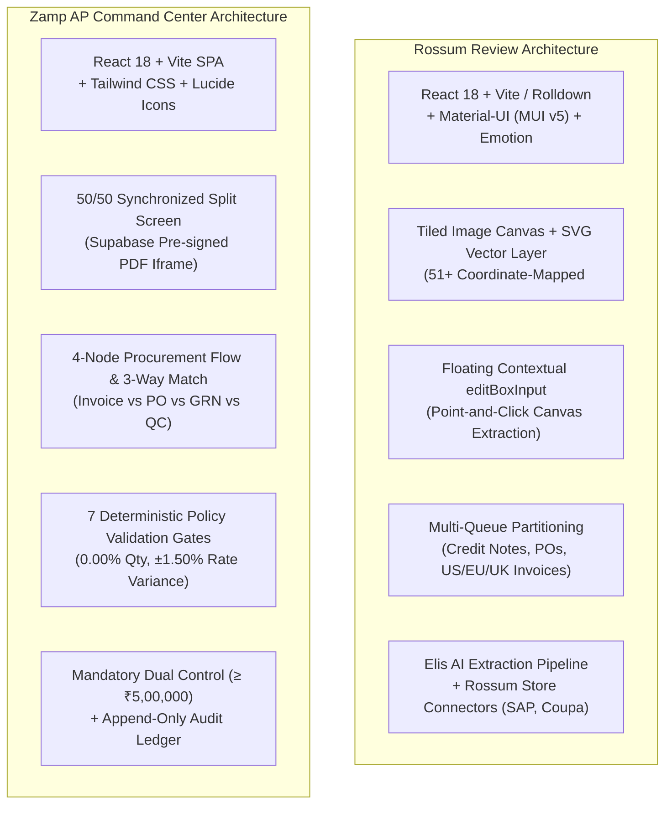

# Rossum vs Zamp AP Command Center — Comparative Product Audit & Reviewer UX Analysis

**Target Competitor:** Rossum Cloud Platform (`https://svit.rossum.app/`, Trial Org `SVIT`, User `Neeraj S`)  
**Our Product:** Zamp AP Command Center (`Autonomous AP Operations Platform`, Supabase / FastAPI / React)  
**Investigation Framework:** Chrome DevTools Protocol Remote Debugging (`127.0.0.1:9222`) + Playwright Telemetry (REA MCP fallback)  
**Date of Audit:** November 03, 2026  
**Status:** Complete Empirical Comparative Analysis  

---

## 1. Executive Summary & Strategic Positioning

This comparative audit evaluates **Rossum** and **Zamp AP Command Center** across document review ergonomics, interactive PDF-to-data linking, extraction validation, document queue architectures, exception resolution, reviewer productivity, operational analytics, and governance controls.

### 1.1 Fundamental Strategic Paradigms

A critical foundational distinction governs this comparison:

| Product Dimension | Rossum Cloud Platform | Zamp AP Command Center | Strategic Implication |
|:---|:---|:---|:---|
| **Product Category** | Enterprise Intelligent Document Processing (IDP) & Transactional Extraction Engine | Autonomous AP Verification, 3-Way Match & Pre-Payment Governance Platform | Rossum specializes in turning messy unstructured documents into verified structured JSON/XML for ERPs. Zamp specializes in verifying whether an invoice *should legally and commercially be paid*. |
| **Core Target User** | Data Entry Clerks, Document Annotators, IDP Administrators, Shared Services Leads | Accounts Payable Clerks, AP Team Leads, Financial Controllers, Internal/External Auditors | Rossum optimizes for high-speed field validation and OCR correction; Zamp optimizes for fraud prevention, price/quantity variance control, and dual-approval sign-off. |
| **Core Value Proposition** | "Extract any document schema with human-in-the-loop AI and export clean payloads to SAP/Coupa" | "Deterministic 7-gate verification against PO/GRN/QC records before any disbursement occurs" | Rossum's review workspace ends at clean data extraction; Zamp's review workspace ends at policy compliance and authorized sign-off. |
| **Commercial Model** | Enterprise volume-based tiering (per document/page processed) + Rossum Store connectors | Enterprise AP Operations Platform / per tenant workspace | Rossum sells OCR speed and throughput; Zamp sells financial risk reduction and statutory audit compliance. |

### 1.2 The Core Comparative Finding

1. **Where Rossum Outperforms Zamp Decisively (Reviewer Ergonomics):**
   - **Bidirectional SVG Bounding Box Mesh:** Rossum overlays an interactive SVG layer with 51+ coordinate-mapped `<rect>` elements over the document. Clicking any field immediately centers and pulses its source region on the PDF; clicking or dragging over text on the PDF immediately populates the field. Zamp's PDF iframe has zero coordinate linking (`bounding_box: null`).
   - **In-Place Field & Line Correction:** Rossum provides instant keyboard editing via a floating contextual input (`editBoxInput`) and allows point-and-click extraction from the canvas. Zamp's extracted fields and line items are 100% read-only in the UI.
   - **Continuous Queue Processing:** Confirming an invoice in Rossum automatically advances to the next document in the queue. Zamp requires returning to the inbox and selecting the next invoice manually.
   - **Reviewer Productivity Tooling:** Rossum provides in-viewer full-text search (`Find in document`), real-time multilingual document translation (`Ctrl+T`), and field-to-field `Tab` navigation that auto-scrolls the PDF.
   - **Reviewer Velocity Analytics:** Rossum tracks average turnaround time in seconds, reviewer corrections per document, and SLA compliance. Zamp tracks business pipeline velocity, but lacks individual operator speed metrics.

2. **Where Zamp Outperforms Rossum Decisively (AP Verification & Governance):**
   - **Authoritative 3-Way Line Matching:** Zamp executes full 4-node verification: Billed Claim vs Purchase Order vs Goods Receipt (GRN) vs Quality Inspection (QC) Certificate. Rossum is a document reader; it has no native GRN or QC inspection verification.
   - **Deterministic Policy Controls & Tolerances:** Zamp enforces 7 immutable policy validation gates with strict mathematical tolerances (0.00% quantity variance, ±1.50% unit price variance, ₹20 rounding). Rossum only checks extraction completeness and basic schema formatting.
   - **Statutory Dual-Control Governance:** Zamp enforces a mandatory ₹5,00,000 threshold requiring secondary Financial Controller sign-off (with self-approval blocked). Rossum has no dual-approval concepts; single operators confirm any document regardless of dollar value.
   - **Indian Statutory Compliance:** Zamp calculates statutory MSMED Act §15 / §43B(h) 45-day payment deadlines for registered suppliers and reconciles Indian CGST/SGST/IGST tax rates. Rossum treats tax as generic line items.
   - **Zero-Trust Document Security:** Zamp serves documents from private Supabase Storage via dynamic 300s pre-signed URLs with SHA-256 cryptographic proof. Rossum relies on persistent session tokens.

---

## 2. Technical Stack & Reviewer Workspace Architecture



### 2.1 Architectural Comparison

| Architectural Layer | Rossum Implementation | Zamp AP Command Center Implementation | Operational Consequence |
|:---|:---|:---|:---|
| **Document Viewer** | Tiled canvas with dynamic SVG vector overlay (`basepageContainerLayout`) | Pure browser `<iframe>` embedding private Supabase pre-signed URL | Rossum renders 50+ interactive vector bounding boxes at 60 FPS; Zamp renders a static PDF preview without coordinate interactivity. |
| **Field-Canvas Binding** | Fully bidirectional: Field Focus ↔ SVG `<rect>` coordinate highlight & point-and-click capture | Decoupled: PDF preview on left, read-only data tabs on right (`bounding_box: null`) | Rossum allows 2-click error correction directly from canvas; Zamp requires manual visual cross-referencing. |
| **Input Capture Mode** | Dynamic floating input (`editBoxInput`) that renders adjacent to active field | Read-only tabular presentation in extracted fields and matching grids | Rossum enables zero-lag keyboard data entry; Zamp currently blocks in-place field correction. |
| **Workload Partitioning** | 8 discrete specialized queues with independent extraction schemas | Single Invoices Inbox with stage/decision quick-filter tabs | Rossum separates schemas by document type; Zamp centralizes all invoices in a unified AP pipeline. |
| **Continuous Review Loop**| Confirming a document immediately auto-loads the next document in queue | Confirming records internal approval; user must manually navigate back to inbox | Rossum is engineered for continuous assembly-line data review; Zamp is engineered for deliberative risk evaluation. |

---

## 3. Detailed Comparative Audit: 9 Operational Dimensions

### 3.1 Document Review Workspace & Layout Allocation

| UX Dimension | Rossum Behavior | Zamp AP Command Center Behavior | Evaluation |
|:---|:---|:---|:---|
| **Layout Split** | 50/50 horizontal split between canvas and data form | 50/50 horizontal split between PDF iframe and analysis tabs | **Tie.** Both utilize the golden 50/50 split-screen standard. |
| **Document Controls** | Zoom In/Out, Reset Zoom, Fit to Width/Height, Find in Document, Translation (`Ctrl+T`), Rotate | Zoom In/Out, Reset Zoom, Open in Tab, Refresh Signed URL, Copy SHA-256, Download | **Rossum Advantage:** In-document search and live translation provide superior reading capabilities. |
| **Layout Flexibility** | Fixed split; right flyout drawers for comments and document info | Three responsive workspace modes: Split View (50/50), Expand Analysis (12-col), Document Focus | **Zamp Advantage:** Zamp allows expanding complex 9-column line-item tables to full screen with one click. |
| **Header Status Bar** | Document Name, Page Counter (`1/1`), Error Pill (`1 error / 0 warnings`), Confirm CTA | Invoice Number, Status Badge, Dual Control Pill, Supplier Name, Total INR, MSMED Due Date, Tour, Glossary | **Zamp Advantage:** Zamp surfaces much richer financial and compliance context in the header. |

### 3.2 PDF-to-Field Interaction & Bounding Boxes

| UX Dimension | Rossum Behavior | Zamp AP Command Center Behavior | Evaluation |
|:---|:---|:---|:---|
| **Source Highlighting** | Clicking a field auto-scrolls canvas and highlights the exact SVG `<rect>` with pulsing blue border | Clicking a field does not highlight the PDF; no coordinate tracking | **Rossum Decisive Win.** Eliminates eye searching across complex documents. |
| **Point-and-Click Capture** | Clicking or dragging over text on the PDF canvas immediately populates the active field | Not supported; PDF iframe is non-interactive | **Rossum Decisive Win.** Massive ergonomic advantage for human-in-the-loop correction. |
| **OCR Bounding Box Mesh** | Pre-renders 51+ vector `<rect>` elements matching OCR word tokens | Schema holds `bounding_box: null` | **Rossum Win.** Pure vector SVG avoids pixelation at any zoom level. |

### 3.3 Extracted Data Presentation & Line Items

| UX Dimension | Rossum Behavior | Zamp AP Command Center Behavior | Evaluation |
|:---|:---|:---|:---|
| **Field Organization** | Collapsible cards: Basic Info, Totals & Subtotals, Vendor & Customer, Line Items | 4 Synchronized Tabs: Matching & Lines, Policy Checks, Extracted Info, Audit Trail | **Zamp Advantage.** Zamp separates policy governance, matching, and audit trail cleanly. |
| **Line-Item Inspection** | Generic line items table (Description, Qty, Rate, Tax, Total); collapsed by default | Authoritative Line-by-Line Match comparing Billed lines against contracted PO lines with rate variance | **Zamp Decisive Win.** Zamp performs real 3-way matching; Rossum only displays extracted lines. |
| **Tolerances & Variances** | None in core review form | Explicit rate variance percentage, variance in INR, and 0.00% quantity tolerance flags | **Zamp Decisive Win.** Zamp enforces commercial pricing discipline. |
| **Payable Settlement** | Gross "Amount Due" field | Deterministic Net Payable Waterfall (Billed Base + Reconciled GST = Net Authorizable Amount) | **Zamp Advantage.** Clarifies exact disbursement exposure. |

### 3.4 Extraction Validation vs. Policy Validation

| Dimension | Rossum Behavior (Extraction Validation) | Zamp Behavior (Policy Validation) | Strategic Comparison |
|:---|:---|:---|:---|
| **Scope of Validation** | Checks if required fields exist, regex patterns match, and totals sum mathematically. | Checks supplier registration, PO validity, GRN receipt, QC acceptance, tax math, price variance, and duplicates. | **Fundamental Scope Difference.** Rossum checks *document syntax*; Zamp checks *business legality*. |
| **Error Visibility** | High-visibility red `?` badge on missing fields; header error pill (`1 error / 0 warnings`). | Prominent Verdict Banner ("Approval Blocked: 2 Checks Failed") with explicit failing checks and next actions. | **Both Excellent.** Rossum excels at field syntax; Zamp excels at business risk communication. |
| **Error Resolution** | Reviewer clicks field and clicks text on canvas; error clears immediately. | Extracted fields are read-only; reviewer must execute structured triage action (Hold, Debit Note, Reject). | **Rossum Win for OCR Typos; Zamp Win for Commercial Exceptions.** |
| **Policy Overrides** | Reviewer can confirm despite warnings if schema allows. | Policy overrides strictly disabled; approval is locked until all 7 gates pass. | **Zamp Win for Governance.** Prevents internal fraud and rogue approvals. |

### 3.5 Document Queues & Workload Management

| UX Dimension | Rossum Behavior | Zamp AP Command Center Behavior | Evaluation |
|:---|:---|:---|:---|
| **Queue Organization** | 8 Specialized Queues segregated by schema (`Tax invoices US`, `Credit notes`, etc.) | Single Invoices Inbox with stage tabs (`All`, `Exceptions`, `Ready`, `Approved`, `Quarantine`) | **Trade-off.** Rossum handles multi-schema IDP; Zamp provides a focused, unified AP pipeline. |
| **Queue Metadata Density** | Default table hides supplier names and dollar amounts (only Status, Name, Details) | Table displays Invoice #, Supplier, GSTIN, PO Ref, Billed INR, Stage Badge, and MSMED Deadline | **Zamp Decisive Win.** Zamp allows instant financial scanning and prioritization. |
| **Workload Counter Badges** | Unread badges on sidebar queues; status filter pills (`Reviews (1)`, `Postpone`) | Top-level sidebar badges on `Invoices` (amber) and `Approvals` (purple); dashboard outcome tiles | **Zamp Advantage.** Real-time financial exposure (e.g. ₹25,960 blocked) visible on dashboard. |
| **Continuous Review Loop** | Confirming an invoice automatically advances to the next document in the queue | Reviewing an invoice leaves user on detail page; requires manual return to inbox | **Rossum Decisive Win.** Auto-advance is essential for high-throughput processing. |
| **Queue Reassignment** | "Move to another queue" button allowing fast reclassification of misrouted documents | Not implemented | **Rossum Advantage.** Handles multi-document type misclassifications cleanly. |

### 3.6 Reviewer Productivity & Keyboard Navigation

| Capability | Rossum Keyboard Implementation | Zamp AP Command Center Implementation | Evaluation |
|:---|:---|:---|:---|
| **Shortcuts Help Sheet** | Press `?` (Shift+Slash) opens comprehensive cheat sheet | Press `?` (Shift+Slash) opens Keyboard Shortcuts modal | **Tie.** Both follow standard web shortcut conventions. |
| **Field-to-Field Navigation**| `Tab` / `Shift+Tab` advances through fields; auto-scrolls canvas | Not implemented (fields are read-only) | **Rossum Decisive Win.** Zero-mouse field traversal. |
| **Global Route Sequences** | Not supported; requires sidebar mouse clicks | `g` then `t/i/a/u/s/c/r/m` jumps to Today, Invoices, Approvals, Audit, Setup, etc. | **Zamp Advantage.** Excellent top-level navigation ergonomics. |
| **Document Actions** | `Ctrl+Enter` confirms document; `Ctrl+D` moves queue; `Ctrl+Backspace` rejects | `1-4` switches tabs; `d` toggles zoom; `a/h/c/s/r` triggers triage actions; `Ctrl+Enter` confirms modal | **Zamp Advantage for Triage; Rossum Advantage for Confirmation.** |
| **In-Document Find** | Dedicated `Ctrl+F` in-canvas OCR search | Browser default search only | **Rossum Advantage.** |

### 3.7 Collaboration, Exception Triage & Audit Trail

| Capability | Rossum Behavior | Zamp AP Command Center Behavior | Evaluation |
|:---|:---|:---|:---|
| **Collaborative Comments** | Slide-out `DetailDrawer` allowing reviewers to leave notes and tag team members | Internal justification notes logged on triage actions | **Rossum Advantage for Chat; Zamp Advantage for Formal Audit.** |
| **Triage Actions** | Confirm, Postpone, Reject, Move to Queue | 7 Consequence-Aware Actions: Hold, Ask Supplier to Correct, Debit Note, Escalate, Quarantine, Reject, Approve | **Zamp Decisive Win.** Models real enterprise AP operational decisions. |
| **Justification Enforcement** | Free-form notes; optional on confirm | Mandatory justification reason with built-in professional reason templates | **Zamp Decisive Win.** Enforces audit rigor and regulatory compliance. |
| **Audit Ledger Integration** | Configuration changelog in settings; document history in info drawer | Immutable append-only timeline tab on every invoice with actor ID, role, action, and timestamp | **Zamp Decisive Win.** Complete provenance visible right inside the review workspace. |

### 3.8 Dashboard & Operational Analytics

| Analytics Dimension | Rossum Implementation (`/statistics`) | Zamp AP Command Center Implementation (`/today`) | Operational Assessment |
|:---|:---|:---|:---|
| **Reviewer Speed & Turnaround** | Average turnaround time (seconds/minutes), SLA compliance ("On time vs. late") | Not tracked at individual reviewer level | **Rossum Advantage.** Excellent for managing BPO/shared-services operator quotas. |
| **Extraction Accuracy / RLHF** | Reviewer corrections per document; post-confirm satisfaction survey | Not tracked | **Rossum Advantage.** Builds continuous ML retraining data. |
| **Financial Exposure & Risk** | Not tracked (Rossum is agnostic to invoice amounts) | Blocked INR value in open exceptions (₹25,960), high-value dual-approval queue | **Zamp Decisive Win.** AP managers care about cash flow and blocked liabilities, not just seconds per page. |
| **Statutory Compliance Tracking**| Not tracked | MSMED Act §15 / §43B(h) statutory payment deadlines prioritized in Next-Up Queue | **Zamp Decisive Win.** Protects Indian enterprises from statutory interest penalties. |
| **System Readiness Transparency** | Opaque | 6-point live Operational Readiness Checklist verifying DB, storage, IdP, Gmail, ERP | **Zamp Advantage.** Truthful operational transparency. |

---

## 4. Five Key Areas Where Rossum Outperforms Zamp

```text
┌────────────────────────────────────────────────────────────────────────┐
│                     ROSSUM COMPETITIVE ADVANTAGES                      │
├────────────────────────────────────────────────────────────────────────┤
│ 1. Bidirectional SVG Bounding Box Mesh (60 FPS Vector Highlighting)   │
│ 2. Point-and-Click Canvas Data Capture & Floating editBoxInput        │
│ 3. Continuous Assembly-Line Review (Instant Auto-Advance on Confirm)  │
│ 4. In-Viewer Productivity Tools (Find in Document, Ctrl+T Translation) │
│ 5. Reviewer Velocity & Turnaround Time Analytics (Seconds per Doc)     │
└────────────────────────────────────────────────────────────────────────┘
```

1. **Bidirectional SVG Bounding Box Mesh:** Rossum overlays 50+ coordinate-mapped SVG rectangles directly on the document canvas. Clicking any field instantly centers and pulses the bounding box on the PDF. Zamp has zero coordinate linking.
2. **Point-and-Click Field Capture & Floating Input:** Rossum allows reviewers to click an empty field and click text on the canvas to populate it, or type directly into a floating `editBoxInput`. Zamp's fields are completely read-only in the UI.
3. **Continuous Queue Processing:** Confirming a document in Rossum immediately loads the next document in the queue, enabling high-velocity assembly-line review. Zamp forces the user back to the inbox after every single invoice.
4. **In-Viewer Translation & Text Search:** Rossum allows instant translation of foreign invoices (`Ctrl+T`) and full-text substring search across rendered OCR words. Zamp relies on static PDF viewing.
5. **Operator Performance Metrics:** Rossum tracks turnaround time in seconds, reviewer corrections per document, and on-time SLA metrics. Zamp lacks individual reviewer velocity tracking.

---

## 5. Five Key Areas Where Zamp AP Command Center Outperforms Rossum

```text
┌────────────────────────────────────────────────────────────────────────┐
│                   ZAMP AP COMMAND CENTER SUPERIORITY                   │
├────────────────────────────────────────────────────────────────────────┤
│ 1. Authoritative 3-Way Line Matching (Invoice vs PO vs GRN vs QC)      │
│ 2. 7 Deterministic Policy Validation Gates (Rate & Qty Tolerances)     │
│ 3. Statutory Dual-Control Governance (₹5,00,000 Controller Gate)      │
│ 4. Rich Financial Queue Metadata (Vendor, Billed INR, MSMED Deadlines) │
│ 5. Immutable Append-Only Audit Trail & Consequence-Aware Triage        │
└────────────────────────────────────────────────────────────────────────┘
```

1. **Authoritative 3-Way Procurement Verification:** Zamp cross-verifies invoice lines against authoritative PO contracts, physical Goods Receipt Notes (GRN), and Quality Inspection (QC) certificates. Rossum is purely a document extractor with no native 3-way match logic.
2. **Deterministic Policy Gates with Strict Tolerances:** Zamp enforces 7 immutable gates with strict mathematical rules (0.00% quantity variance, ±1.50% unit price variance, ₹20 rounding) and prevents policy overrides. Rossum only checks extraction syntax.
3. **Mandatory Dual-Control Governance:** Zamp enforces a ₹5,00,000 threshold requiring secondary Financial Controller sign-off (with self-approval blocked). Rossum allows single operators to confirm invoices of unlimited value.
4. **Financial Queue Density & MSMED Deadlines:** Zamp's inbox displays supplier names, PO references, net payable amounts in INR, and statutory MSMED Act 45-day payment deadlines. Rossum's queue table hides supplier names and amounts by default.
5. **Consequence-Aware Triage & Immutable Provenance:** Zamp provides 7 structured AP triage actions (Hold, Supplier Correction, Debit Note, Escalate, Quarantine, Reject, Approve) requiring mandatory audit justification. Rossum provides only basic Confirm, Postpone, and Reject.

---

## 6. Strategic Synthesis: What Zamp Must Adapt vs Avoid

### What Zamp Must Adapt from Rossum:
- **Adapt the Bounding Box Visualization:** Ingest OCR bounding box coordinates `[ymin, xmin, ymax, xmax]` from the extraction engine and render an SVG coordinate layer over the PDF canvas so clicking a field centers and highlights its source.
- **Adapt In-Place Field & Line Correction:** Enable authenticated editing of extracted fields with instant re-validation of the 7 policy gates and append-only audit logging.
- **Adapt Continuous Queue Review ("Confirm & Next"):** When a clean-match invoice is approved, provide an optional toggle to immediately load the next pending invoice in the queue, eliminating unnecessary round-trips to the inbox.
- **Adapt In-Viewer Text Search:** Add a search input in the document toolbar that highlights matching text on the document canvas.
- **Adapt Field-to-Field Keyboard Navigation:** Support `Tab` / `Shift+Tab` traversal across extracted fields with synchronized auto-scrolling of the document viewer.

### What Zamp Must Strictly Avoid from Rossum:
- **Never Dilute AP Verification into Generic OCR:** Do not abandon Zamp's authoritative 3-way matching, GRN delivery verification, or QC certificate checks to mimic Rossum's generic document extraction.
- **Never Allow Single-User Sign-Off on High-Value Invoices:** Never adopt Rossum's unconstrained confirmation model. The ₹5,00,000 dual-approval threshold and Controller sign-off must remain strictly enforced.
- **Never Hide Financial Data in the Queue:** Do not copy Rossum's sparse 3-column queue. Finance operators must see supplier names, billed amounts, and statutory due dates directly in the list.
- **Never Add Post-Confirmation Survey Fatigue:** Do not introduce Rossum's mandatory post-confirmation feedback surveys into daily AP operations.
