# Rossum vs Zamp AP Command Center — Side-by-Side Workflow & Interaction-Cost Comparison

**Target Competitor:** Rossum Cloud Platform (`https://svit.rossum.app/`)  
**Our Product:** Zamp AP Command Center  
**Methodology:** Empirical Task Tracing, Click-Cost Measurement, Screen Transition Auditing & Cognitive Load Analysis  
**Date:** November 03, 2026  

---

## 1. High-Level Workflow Architecture

```mermaid
flowchart TD
    subgraph Rossum_Pipeline["Rossum Document Processing Lifecycle"]
        R_1["1. Ingestion (Email / Upload / API)"] --> R_2["2. OCR & Layout Extraction<br/>Generates OCR Coordinate Tokens"]
        R_2 --> R_3["3. Queue Assignment<br/>(e.g., Tax Invoices US, Credit Notes)"]
        R_3 --> R_4{"Extraction Rules Check"}
        R_4 -->|Missing Required Field / Error| R_5["'To Review' Queue (Error Flagged)"]
        R_4 -->|All Fields High Confidence| R_6["Straight-Through Processing / Confirmed"]
        R_5 --> R_7["Review Workspace (Split View)<br/>Canvas Highlight ↔ editBoxInput"]
        R_7 -->|2 Clicks: Click Field + Click PDF| R_8["Error Resolved (Pill Decrements 1→0)"]
        R_8 --> R_9["Click Confirm (Ctrl+Enter)"]
        R_9 --> R_10["Micro-Survey Feedback Prompt"]
        R_10 --> R_11["Auto-Advance to Next Document in Queue"]
    end

    subgraph Zamp_Pipeline["Zamp AP Command Center Lifecycle"]
        Z_1["1. Intake (PDF Upload / Gmail OAuth)"] --> Z_2["2. Hybrid Extractor + Mantle AI<br/>Extracts Header & Line Items"]
        Z_2 --> Z_3["3. 4-Node 3-Way Match & 7 Policy Gates<br/>Evaluates PO, GRN, QC Snapshots & Tolerances"]
        Z_3 --> Z_4{"Policy Gates Verdict"}
        Z_4 -->|All 7 Checks Pass Cleanly| Z_5["'Ready to Approve' (MATCH_CANDIDATE)"]
        Z_4 -->|Gate Failed / Discrepancy| Z_6["'Action Required' (FLAGGED_EXCEPTION)"]
        Z_5 & Z_6 --> Z_7["Invoice Detail Workspace (50/50 Split)<br/>Original PDF + 4 Evidence Tabs"]
        Z_7 --> Z_8{"User Decision & Amount Check"}
        Z_8 -->|Failing Gates| Z_9["Consequence-Aware Triage Actions<br/>Hold, Supplier Correction, Debit Note, Escalate, Reject"]
        Z_8 -->|All Pass & < ₹5L| Z_10["Approve Review (AP Lead Sign-Off)"]
        Z_8 -->|All Pass & ≥ ₹5L| Z_11["Secondary Sign-Off (Financial Controller Gate)"]
        Z_9 & Z_10 & Z_11 --> Z_12["Append-Only Audit Event Logged"]
        Z_12 --> Z_13["Manual Navigation Back to Queue"]
    end
```

---

## 2. Granular Task-by-Task Journey Tracing

Below is the side-by-side empirical breakdown of 10 equivalent operational journeys executed across both applications. Every interaction count represents verified UI operations.

---

### Journey 1: Find a Document Requiring Review

| Parameter | Rossum Cloud Platform | Zamp AP Command Center |
|:---|:---|:---|
| **Starting Point** | Global App Shell (`/documents`) | Global App Shell (`/today`) |
| **Screens Visited** | 2 screens (`Sidebar Queue List`, `Active Queue Table`) | 2 screens (`Dashboard`, `Invoices Inbox`) |
| **Actual Interactions** | **2 clicks:** 1. Click queue name in left sidebar (e.g. `Tax invoices US (5)`) (1 click). 2. Scan `Reviews (5)` tab (already active by default, 0 clicks). 3. Locate document row (1 click to select). | **1 click:** 1. Scan "Needs Attention" outcome card showing count (2) and blocked value (₹25,960). 2. Click card directly (1 click) to land on pre-filtered exception queue (`/invoices?stage=ACTION_REQUIRED`). |
| **Decisions Required** | Select which specialized queue to inspect. | None. Primary exception backlog is elevated on dashboard. |
| **Context Switching** | Low. Queue loads instantly inside main container. | Low. Fast client-side SPA routing. |
| **Main Friction** | Queue list defaults to 3 columns (`Status`, `Document Name`, `Details`); financial totals and supplier names are hidden. | None. Queue displays supplier, amount, PO ref, and statutory MSMED deadline. |
| **Outcome** | Rossum queue focused on invoices to review. | Zamp queue focused on actionable exception invoices. |

---

### Journey 2: Open a Document for Review

| Parameter | Rossum Cloud Platform | Zamp AP Command Center |
|:---|:---|:---|
| **Starting Point** | Queue Table View (`/document-queues/<id>`) | Invoices Inbox (`/invoices`) |
| **Screens Visited** | 1 screen transition to Review Workspace (`/document/<id>`) | 1 screen transition to Review Workspace (`/invoices/<id>`) |
| **Actual Interactions** | **1 click:** Click document name or row. Workspace loads with split view and canvas. | **1 click:** Click invoice row in table. Workspace loads with 50/50 split view, PDF preview, and evidence tabs. |
| **Decisions Required** | Zero. | Zero. |
| **Context Switching** | Zero. Instant client-side render via Vite/React. | Zero. Instant client-side render via Vite/React. |
| **Main Friction** | First-time users see onboarding tour modal (`EV-006`); requires 1 click to dismiss or complete. | If document link has expired (300s TTL), reviewer must click "Generate Fresh Signed URL" (1 click). |
| **Outcome** | Rossum 50/50 review workspace loaded. | Zamp 50/50 review workspace loaded. |

---

### Journey 3: Inspect the Document Canvas / PDF Preview

| Parameter | Rossum Cloud Platform | Zamp AP Command Center |
|:---|:---|:---|
| **Starting Point** | Review Workspace (Left Canvas) | Review Workspace (Left Pane) |
| **Screens Visited** | 0 (Already open on left pane) | 0 (Already open on left pane) |
| **Actual Interactions** | **0 clicks:** Document renders on interactive multi-resolution tiled canvas with overlaid SVG bounding boxes pre-rendered. Floating zoom toolbar on bottom-left. | **0 clicks:** Document renders in embedded `<iframe>` preview with top toolbar for zoom in/out, 100% reset, open in new tab, and download. |
| **Decisions Required** | Decide whether to zoom or search for text. | Decide whether to zoom or inspect specific pages. |
| **Context Switching** | Zero. | Zero. |
| **Main Friction** | None. Fast vector rendering. | Static iframe lacks in-document text search and OCR word highlighting. |
| **Outcome** | High-fidelity interactive document canvas ready for inspection. | Standard embedded PDF preview ready for inspection. |

---

### Journey 4: Verify Extracted Header Fields Against Document Source

| Parameter | Rossum Cloud Platform | Zamp AP Command Center |
|:---|:---|:---|
| **Starting Point** | Review Workspace | Review Workspace |
| **Screens Visited** | 0 (In-workspace) | 0 (In-workspace, Tab 3) |
| **Actual Interactions** | **1 click (or 0 with Tab key):** Click `Vendor Name` field. The document viewer immediately auto-scrolls to the vendor region and highlights the exact SVG `<rect>` coordinate with a pulsing blue box (`EV-009`). | **1 click:** Click `Extracted Information` tab (or press key `3`). Table displays supplier name, GSTIN, date, amounts, confidence scores (0.95–0.99), and source pages. **No canvas highlighting.** |
| **Decisions Required** | Confirm visual alignment between blue box and document text. | Eye-scan PDF on left to manually find where supplier name and date appear. |
| **Context Switching** | Zero. Bidirectional synchronization. | Low visual fatigue: reviewer must visually search across PDF canvas. |
| **Main Friction** | None. Flawless vector coordinate auto-centering. | Zamp lacks bounding box cross-highlighting; schema holds `bounding_box: null`. |
| **Outcome** | Immediate visual proof of extraction origin. | Extraction confidence verified via confidence badge, but manual eye-search required on PDF. |

---

### Journey 5: Review Multi-Row Line Items

| Parameter | Rossum Cloud Platform | Zamp AP Command Center |
|:---|:---|:---|
| **Starting Point** | Review Workspace (Right Panel) | Review Workspace (Tab 1: `Matching & Lines`) |
| **Screens Visited** | 0 | 0 |
| **Actual Interactions** | **1 click:** Scroll down to `Line Items` card and click to expand table (`EV-020`). Displays description, quantity, unit price, tax, total. | **0 clicks (Default Tab):** Displays 4-node Procurement Verification Flow and Line-by-Line Match comparing Billed vs Contracted PO lines with rate variance in INR and percentage. |
| **Decisions Required** | Eyeball check whether line totals add up. | Verify whether unit rate variance exceeds ±1.50% and quantity variance exceeds 0.00%. |
| **Context Switching** | None. | None. |
| **Main Friction** | Line items collapsed by default; no comparison against purchase orders or goods receipt notes. | On smaller laptop screens, 9-column table requires toggling between "Comparison" and "9-Col Ledger" modes. |
| **Outcome** | Raw extracted line items visible in generic table. | Authoritative 3-way line matching verified with explicit commercial tolerances. |

---

### Journey 6: Correct an Incorrect or Missing Extracted Field

| Parameter | Rossum Cloud Platform | Zamp AP Command Center |
|:---|:---|:---|
| **Starting Point** | Review Workspace (Focused on error field) | Review Workspace |
| **Screens Visited** | 0 | 0 |
| **Actual Interactions** | **Option A (Canvas Point-and-Click): 2 clicks** 1. Click empty field (`Document ID ?`) (1 click). 2. Click or drag over invoice number on PDF canvas (1 click). Value immediately extracts into field! **Option B (Keyboard): 1 click + keystrokes** 1. Click field (1 click). 2. Floating `editBoxInput` captures typing (keystrokes). 3. Press `Enter` (1 keystroke). Value committed! | **N/A (Feature Not Implemented in UI).** Extracted fields and line items in Zamp are 100% read-only in the UI. If the OCR engine makes a typo, the reviewer cannot edit it in the workspace. |
| **Decisions Required** | Select correct text region on PDF or type number. | Reviewer must decide whether to place invoice on Hold, Ask Supplier to Correct, or Reject. |
| **Context Switching** | Zero. Seamless inline correction. | Severe. Reviewer forced into administrative triage loop. |
| **Main Friction** | None. Industry-benchmark point-and-click capture. | **Severe Defect in Zamp.** Inability to correct OCR typos forces unnecessary exception flagging and invoice rejection. |
| **Outcome** | Error resolved in 2 clicks; error pill decrements from `1` to `0`. | Invoice remains blocked; reviewer must log formal exception action. |

---

### Journey 7: Resolve an Exception or Policy Discrepancy

| Parameter | Rossum Cloud Platform | Zamp AP Command Center |
|:---|:---|:---|
| **Starting Point** | Review Workspace | Review Workspace |
| **Screens Visited** | 0 (Top Action Bar) | 1 screen + Consequence-Aware Action Modal |
| **Actual Interactions** | **1 click:** Click `Postpone` (to park document) or click `Reject` (to discard invalid bill) (`EV-015`). | **3 clicks + keystrokes:** 1. Click triage action on sticky bar (e.g. `Hold for Evidence` or `Ask Supplier to Correct`) (1 click). 2. ConsequenceAwareActionModal opens, displaying policy thresholds, consequences, and reason templates. 3. Select reason template or type justification (1 click / keystrokes). 4. Click "Confirm Action" (1 click). |
| **Decisions Required** | Decide whether to postpone or reject without structured reason. | Select appropriate operational triage action and supply mandatory audit justification. |
| **Context Switching** | None. Direct status toggle. | None. In-context modal with consequence warnings. |
| **Main Friction** | Rossum treats exceptions as binary (confirm or postpone); lacks structured AP triage categories. | Mandatory justification adds 1 extra interaction, but guarantees audit defensibility. |
| **Outcome** | Document moved to `Postponed` or `Rejected` tab. | Triage action recorded in append-only timeline with mandatory audit explanation. |

---

### Journey 8: Complete Permitted Review Action (Single Document)

| Parameter | Rossum Cloud Platform | Zamp AP Command Center |
|:---|:---|:---|
| **Starting Point** | Review Workspace (All errors cleared) | Review Workspace (All 7 checks passed) |
| **Screens Visited** | 0 (In-workspace) | 0 (In-workspace) |
| **Actual Interactions** | **1 click (or `Ctrl+Enter` hotkey):** Click `Confirm` button in top-right header (1 click). Document status transitions to `Confirmed`. | **3 clicks + keystrokes:** 1. Click `Approve Review` on sticky bar (1 click). 2. ConsequenceAwareActionModal prompts for justification. 3. Select pre-drafted reason template (1 click). 4. Click `Confirm Approval` (1 click). |
| **Decisions Required** | Ensure all fields are visually correct. | Verify all 7 policy checks passed (button is locked if any check failed). |
| **Context Switching** | None. | None. |
| **Main Friction** | Confirm immediately triggers a satisfaction micro-survey ("How satisfied are you with data extraction?"), adding 1 extra dismiss click (`EV-018`). | Mandatory justification reason required even for clean matches. |
| **Outcome** | Document confirmed and marked ready for ERP export. | If < ₹5L: Internal AP approval recorded. If ≥ ₹5L: Moved to `PENDING_SECOND_APPROVAL` for Controller sign-off. |

---

### Journey 9: Move to the Next Document in the Queue

| Parameter | Rossum Cloud Platform | Zamp AP Command Center |
|:---|:---|:---|
| **Starting Point** | Post-Confirmation Screen | Invoice Detail Workspace (Approved) |
| **Screens Visited** | 0 screen transitions (Continuous in-workspace load) | 1 screen transition (Back to Inbox) + 1 transition (Open next invoice) |
| **Actual Interactions** | **0 clicks:** Rossum automatically loads the next pending document in the queue immediately after confirmation! | **2 clicks:** 1. Click `Return to Invoices` (1 click). 2. In Inbox table, locate and click next invoice row (1 click). |
| **Decisions Required** | None. Next invoice is presented automatically. | Reviewer must locate which invoice to pick next from the table. |
| **Context Switching** | **Zero.** Assembly-line continuous processing. | **High.** Forces reviewer out of review mode back into list management mode. |
| **Main Friction** | Feedback micro-survey momentarily blocks auto-advance until dismissed. | **Major Ergonomic Bottleneck in Zamp.** Lack of "Approve & Next" continuous queue processing. |
| **Outcome** | Next invoice loaded in split-screen workspace in < 1 second. | Next invoice loaded after navigating through the inbox list. |

---

### Journey 10: Revisit a Previously Processed Document & Verify Audit History

| Parameter | Rossum Cloud Platform | Zamp AP Command Center |
|:---|:---|:---|
| **Starting Point** | Review Workspace | Review Workspace |
| **Screens Visited** | 1 drawer overlay (`Document Info` or `Comments`) | 0 (Tab 4: `Audit Trail`) |
| **Actual Interactions** | **2 clicks:** 1. Click Document Info icon (1 click). 2. Inspect import channel and timestamp (`EV-013`). Detailed audit events are buried in `Settings -> Changelog`. | **1 click:** Click `Audit Trail` tab (or press key `4`). Immediately displays chronological timeline of all actions, actors, roles, timestamps, and justification reasons. |
| **Decisions Required** | Figure out whether info panel or settings has the audit trail. | None. Tab is embedded directly on the document. |
| **Context Switching** | Medium. System changelog is separated from document. | Zero. In-context audit timeline. |
| **Main Friction** | Rossum decouples schema change logs from document event history. | None. High-contrast vertical timeline. |
| **Outcome** | Basic document info displayed in side drawer. | Complete immutable document provenance verified. |

---

## 3. Comprehensive Interaction Cost & Metric Summary Table

| Operational Journey | Rossum Clicks / Keystrokes | Rossum Screen Transitions | Zamp AP Command Center Clicks / Keystrokes | Zamp Screen Transitions | Efficiency Winner |
|:---|:---:|:---:|:---:|:---:|:---:|
| **1. Find Document to Review** | 2 clicks | 1 screen switch | **1 click** | 1 screen switch | **Zamp (Elevated dashboard)** |
| **2. Open Document Workspace** | 1 click | 0 | 1 click | 0 | **Tie (Instant split view)** |
| **3. Inspect PDF Preview** | **0 clicks** | 0 | **0 clicks** | 0 | **Rossum (Vector SVG canvas)** |
| **4. Verify Header against PDF**| **1 click (or 0 hotkey)** | 0 | 1 click | 0 | **Rossum (SVG auto-scroll)** |
| **5. Review Line Items** | 1 click | 0 | **0 clicks** | 0 | **Zamp (Default 3-way match)** |
| **6. Correct Extracted Field** | **2 clicks (Canvas point)** | 0 | *N/A (Read-only)* | *N/A* | **Rossum (Decisive win)** |
| **7. Resolve / Triage Exception**| **1 click** | 0 | 3 clicks + keystrokes | 0 | **Rossum for speed; Zamp for audit rigor** |
| **8. Complete Review Action** | **1 click** (or `Ctrl+Enter`) | 0 | 3 clicks + keystrokes | 0 | **Rossum (1 click less)** |
| **9. Advance to Next Document** | **0 clicks (Auto-advance)** | 0 | **2 clicks** | 2 screen switches | **Rossum (Assembly-line loop)** |
| **10. Revisit Audit History** | 2 clicks | 1 drawer switch | **1 click** | 0 | **Zamp (Embedded timeline)** |

---

## 4. Key Takeaways for Workflow Optimization

1. **Rossum dominates high-speed human-in-the-loop data correction:** In Journeys 4, 6, 8, and 9, Rossum's SVG coordinate binding, point-and-click extraction, and instant auto-advance create an unmatched assembly-line review experience.
2. **Zamp dominates multi-node commercial risk governance:** In Journeys 1, 5, 7, and 10, Zamp provides actionable dashboard prioritization, authoritative 3-way line matching, 7 deterministic policy gates, and an immutable audit trail that Rossum completely lacks.
3. **The Ultimate AP Reviewer Workflow combines both:** By introducing Rossum's SVG bounding box highlighting, in-place field correction, and "Approve & Next" continuous processing into Zamp's 3-way matching and 7-gate governance platform, Zamp can establish complete market leadership.
