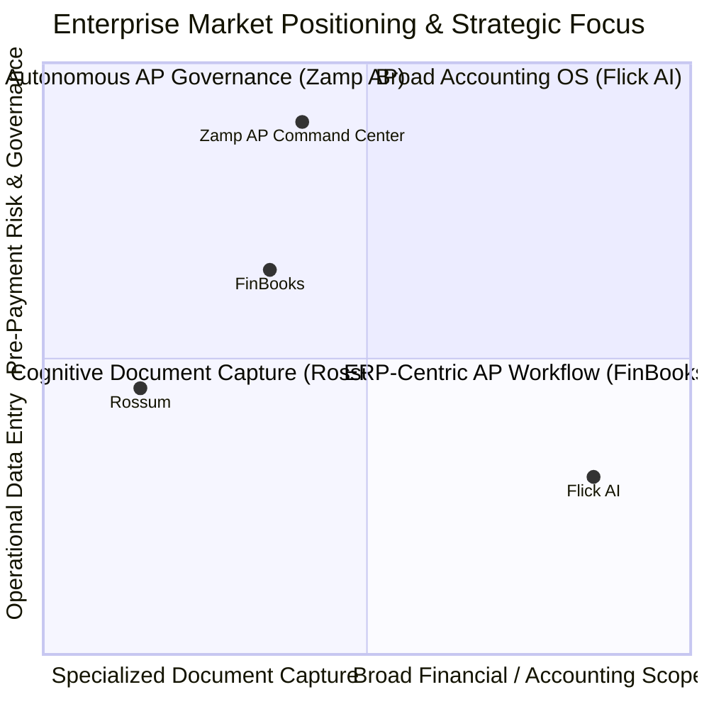
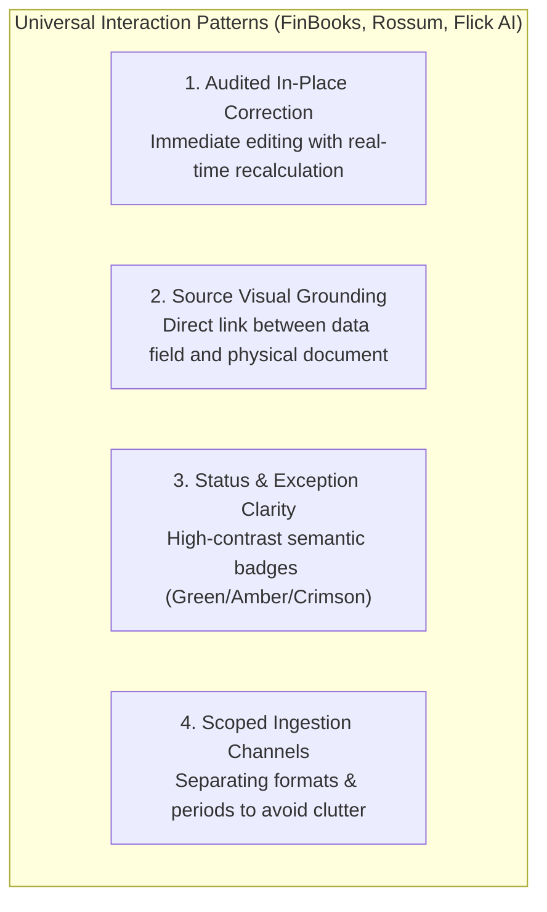
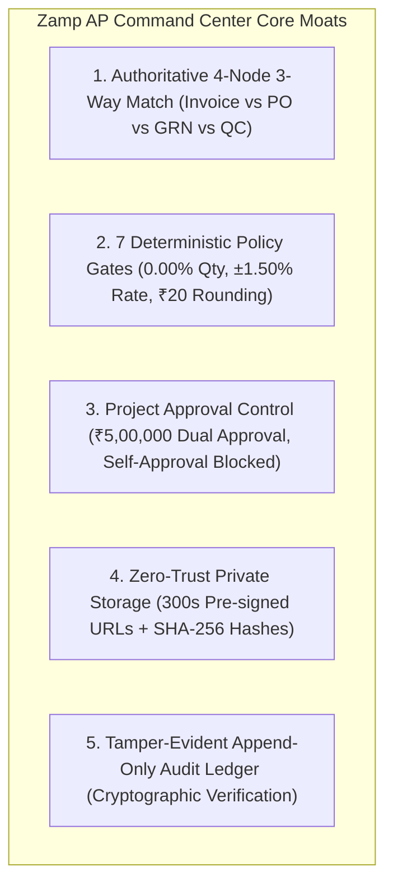

# Consolidated Competitor Intelligence & Strategic Analysis
## FinBooks vs Rossum vs Flick AI vs Zamp AP Command Center

**Target Deliverable:** `competitor_research/05_consolidated_strategy/CONSOLIDATED_COMPETITOR_ANALYSIS.md`  
**Date of Synthesis:** November 03, 2026  
**Audited Platforms:**
1. **FinBooks** (`competitor_research/01_finbooks/`) — ERP-Centric AP Automation & 3-Way Matching Engine
2. **Rossum** (`competitor_research/02_rossum/`) — Enterprise Intelligent Document Processing (IDP) & Reviewer Ergonomics
3. **Flick AI** (`competitor_research/03_flickai/`) — Cloud Accounting OS, Indian GST Compliance & Financial Cockpit
4. **Zamp AP Command Center** (`http://127.0.0.1:8000`) — Autonomous AP Verification & Pre-Payment Governance Platform

---

## 1. Executive Summary & Product Positioning

Over three consecutive reverse-engineering missions, we empirically evaluated the production environments, client bundles, and user workflows of three distinct market competitors: **FinBooks**, **Rossum**, and **Flick AI**. 

This consolidated analysis integrates those three distinct intelligence vectors to define an authoritative, evidence-based product strategy for **Zamp AP Command Center**.

### 1.1 The Fundamental Product Boundary

Zamp AP Command Center is an **Autonomous AP Verification & Pre-Payment Governance Platform**. 

It is designed to serve as an enterprise risk firewall between raw incoming vendor invoices and final payment execution in ERPs like SAP S/4HANA. 

It is **NOT** intended to become:
- A general ledger or double-entry bookkeeping engine (Flick AI).
- A customer billing or sales invoicing suite (Flick AI).
- A generic optical character recognition (OCR) transcription utility (Rossum).
- A direct bank disbursement or payment gateway runner.

Its core operational mission is singular and non-negotiable:
$$\text{Invoice Ingested} \longrightarrow \text{Data Extracted} \longrightarrow \text{Procurement Verified (PO/GRN/QC)} \longrightarrow \text{7 Policy Gates Enforced} \longrightarrow \text{Exceptions Resolved} \longrightarrow \text{Dual-Control Approval} \longrightarrow \text{ERP Handoff}$$

The primary UX objective:
> **A finance operator must be able to understand immediately what they are looking at, what requires attention, why it matters, and what action they can safely take—without developer intervention or opaque manual calculations.**

---

## 2. Strategic Triangulation: What Each Competitor Teaches Us

| Strategic Dimension | FinBooks (`01_finbooks`) | Rossum (`02_rossum`) | Flick AI (`03_flickai`) | Zamp AP Command Center (Target State) |
|:---|:---|:---|:---|:---|
| **Core DNA** | Enterprise AP Automation | Cognitive IDP & Document Capture | SME Accounting OS & Indian Tax | Pre-Payment Risk & Policy Firewall |
| **Primary User** | AP Specialist & AP Manager | Data Entry Clerk & Reviewer | Founder & General Accountant | AP Specialist, Controller & Auditor |
| **Workspace Topology** | Split-screen with OCR overlay | 50/50 Split Canvas + SVG vector mesh | Full-width spreadsheet data matrix | 50/50 Split (Iframe PDF + Verification) |
| **Document Grounding** | Coordinate bounding boxes | Bidirectional 51+ SVG `<rect>` mesh | None (Detached PDF in `/files`) | Interactive coordinate highlight overlay |
| **Data Correction** | Inline form field correction | Floating contextual `editBoxInput` | High-speed spreadsheet matrix cell edit | Audited in-place correction with auto-revalidation |
| **Matching Engine** | 2-Way & 3-Way PO Matching | External webhook schema match | Bank & Gateway cash reconciliation | Authoritative 4-Node Match (Inv/PO/GRN/QC) |
| **Policy Governance** | Threshold approval rules | Basic schema validation checks | UI form errors (`Customer required`) | 7 Deterministic Gates (0.00% Qty, $\pm 1.50\%$ Rate) |
| **Financial Visibility** | Invoices pending approval | Queue throughput & speed metrics | Scorecard: Net Exposure, Overdue, GST | AP Capital Exposure, Aging & MSMED Due Dates |
| **Document Intake** | Batch ERP sync & email | Multi-queue document partitioning | Temporal Year/Month scoped dropzone | Period-partitioned inbox + batch templates |
| **Assistance Model** | Field validation tooltips | Keyboard hotkey HUD & translation | Ambient "Ask Flick" AI drawer | Ambient "Ask Zamp" Policy Copilot |
| **Approval Controls** | Role-based threshold routing | Single-operator document confirm | Single-tier write permissions | Mandatory Dual Control ($\ge \text{₹5,00,000}$) |
| **Downstream Output** | ERP voucher creation | JSON/XML webhook to ERP | General Ledger, P&L, Balance Sheet | Cryptographic audit ledger & SAP payload |

---

## 3. In-Depth Competitor Profiles & Empirical Takeaways

### 3.1 FinBooks: Lessons in AP Workflow & ERP Alignment
FinBooks provides an enterprise AP workflow benchmark closely aligned with Zamp's domain.

#### What FinBooks Teaches Us:
1. **Clean Procurement Data Alignment:** FinBooks presents purchase order lines and invoice lines with clear tabular variance indicators. Reviewers can see contracted vs billed rates instantly.
2. **Contextual Action Modals:** When an invoice fails matching, FinBooks prompts the user with structured choices (e.g., Hold with vendor inquiry, Reject, or Route for exception approval), ensuring consistent operational handling.
3. **Structured Batch Ingestion:** Invoices are grouped by vendor or ingestion batch, enabling AP clerks to process identical vendor bills consecutively.
4. **Where FinBooks Falls Short:** FinBooks lacks deep manufacturing quality inspection (QC) verification, relies on brittle iframe PDF viewers without vector coordinate snapping, and lacks high-level capital exposure analytics.

### 3.2 Rossum: Lessons in Reviewer Ergonomics & Cognitive Speed
Rossum is the gold standard for high-throughput transactional document review.

#### What Rossum Teaches Us:
1. **Bidirectional SVG Bounding Box Mesh:** Rossum renders an SVG layer with 51+ coordinate-mapped `<rect>` elements over the document. Clicking any field pulses its source text on the canvas; clicking text on the canvas immediately captures it into the active input.
2. **Contextual In-Place Editing (`editBoxInput`):** Instead of opening heavy edit dialogs, a floating input renders directly adjacent to the active field, supporting complete keyboard data entry.
3. **Continuous Queue Navigation (`Confirm & Next`):** Confirming an invoice automatically loads the next document in the queue, eliminating the need to return to the inbox after every review.
4. **Reviewer Ergonomics:** Features field-to-field `Tab` navigation that auto-scrolls the PDF, in-document search (`Find in document`), and keyboard shortcut HUDs.
5. **Where Rossum Falls Short:** Rossum ends at data extraction. It has no procurement 3-way matching, no GRN/QC inspection verification, no financial policy gates, and no dual-control governance.

### 3.3 Flick AI: Lessons in Financial Visibility & Operational Utility
Flick AI provides an exceptional benchmark for financial clarity and Indian compliance ergonomics.

#### What Flick AI Teaches Us:
1. **Executive Financial Health Visibility:** Flick’s dashboard displays **Net Exposure** (payable/receivable ratio), **Net Profit & Margin %**, a high-contrast crimson card for **90+ Days Overdue** aged debt, and **GST Net Liability**.
2. **Temporal Accounting Period Partitioning:** Documents are scoped by synchronized **Year** (`2026`) and **Month** (`November`) dropdowns, isolating monthly closing periods and preventing table sluggishness.
3. **Self-Service Downloadable Batch Templates:** Ingestion tabs feature 1-click `CSV Template` and `Sample Template` download buttons, eliminating formatting mismatches before upload.
4. **Native Indian Dual-Zone GST Calculation Engine:** Automatically calculates and splits taxes into **CGST + SGST (50/50)** for intra-state or **IGST (100%)** for interstate supply based on Place of Supply.
5. **Ambient Conversational Assistant ("Ask Flick"):** A persistent floating button launches a slide-out AI assistant with context-aware prompt chips (*"What is my total revenue this quarter?"*, *"Show overdue payables"*).
6. **Where Flick AI Falls Short:** Flick AI completely lacks 3-way procurement matching, detaches the source PDF from the invoice builder, lacks dual-control approvals, and has no immutable audit trail.

---

## 4. Common Industry Patterns Across All Three Competitors

Across all three investigations, four universal interaction patterns emerge:

1. **In-Place Field Correction:** In all three competitors, users can correct misread data directly in the UI. Zamp is currently the only platform where extracted fields and lines are 100% read-only.
2. **Source Visual Grounding:** Both Rossum and FinBooks visually tether data fields to physical document coordinates. Flick detaches the PDF, which proved to be its greatest ergonomic flaw.
3. **High-Contrast Semantic Status Signifiers:** All competitors use standardized color semantics (Emerald `#2e7d32` for passed/matched, Amber `#ed6c02` for pending/unmatched, Crimson `#d32f2f` for failed/overdue).
4. **Scoped Ingestion & Batch Control:** Ingestion is never a generic dumping ground; files are scoped by ingestion channel, vendor batch, or calendar closing period.

---

## 5. Unique Strengths & Moats to Preserve in Zamp

Zamp AP Command Center possesses profound enterprise advantages that must be fiercely protected:

1. **Authoritative 4-Node 3-Way Matching:** Neither Rossum nor Flick has any concept of Goods Receipt Notes (GRN) or Quality Inspection (QC) certificates. Zamp alone verifies physical goods receipt and quality passage before payment.
2. **7 Deterministic Policy Gates:** Zamp evaluates exact commercial legality and mathematical variance, whereas competitors rely on basic UI field checks.
3. **Dual-Control Approval Governance:** Invoices $\ge \text{₹5,00,000}$ mandate independent Financial Controller sign-off with self-approval strictly blocked. Competitors allow single-user posting.
4. **Zero-Trust Document Security:** Private Supabase storage with 300-second pre-signed URLs and SHA-256 binary validation guarantees document authenticity.
5. **Tamper-Evident Immutable Audit Trail:** Every field correction, gate evaluation, and approval decision is permanently logged.

---

## 6. Explicitly Rejected Competitor Concepts

To prevent scope creep and maintain financial governance, the following concepts are **permanently rejected**:

1. **General Ledger & Double-Entry Bookkeeping (Flick AI):** Zamp will not create journal accounts, trial balances, or balance sheets. Zamp exports verified payment payloads to external ERPs (SAP S/4HANA).
2. **Customer Sales Invoicing & Quotations (Flick AI):** Zamp is an Accounts Payable (AP) product. Accounts Receivable (AR) features have no place in an AP verification engine.
3. **Automated AI-Assisted Approval Decisions (Rossum / Flick):** AI must never approve an invoice or bypass a policy gate. AI in Zamp is strictly informational and assistive.
4. **Document Translation (`Ctrl+T`) (Rossum):** Enterprise B2B vendor bills in Indian and global corporate contexts are legally denominated in English or statutory regional languages. Live machine translation introduces unacceptable compliance risk.
5. **Reviewer Speed Gamification / Race Timers (Rossum):** Displaying per-invoice second countdowns incentivizes rushed reviews and sloppy variance checks, increasing fraud exposure.
6. **Direct Bank Payment Execution / Cash Disbursement:** Zamp verifies and authorizes pre-payment claims. Bank execution is handled by enterprise banking rails or ERP disbursement modules.
7. **Unchecked Bulk Approvals for Exceptions or High-Value Invoices:** Invoices with failed policy gates or amounts $\ge \text{₹5,00,000}$ must never be approved via bulk action.
8. **Silent Field Overwrites Without Audit Logging:** No field or rate correction may occur without capturing the previous value, new value, reviewer identity, timestamp, and justification in the immutable audit trail.
