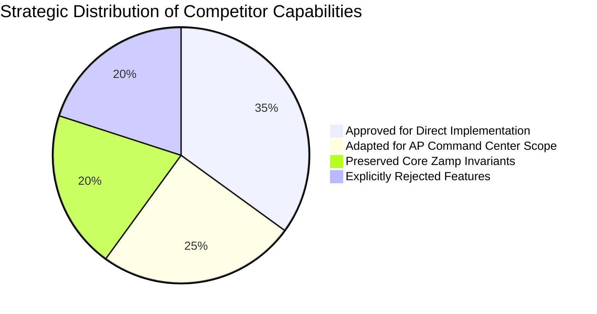
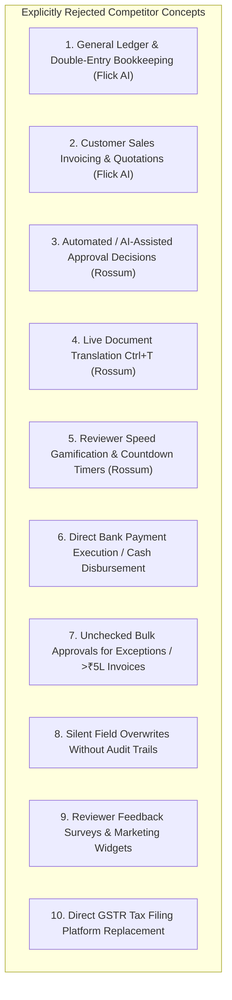

# Architectural Decisions & Rejected Features Register
## Strategic Boundary Definition for Zamp AP Command Center

**Target Deliverable:** `competitor_research/05_consolidated_strategy/DECISIONS_AND_REJECTED_FEATURES.md`  
**Date of Synthesis:** November 03, 2026  
**Status:** Certified Architectural Decision Record (ADR)  

---

## 1. Executive Summary & Governance Policy

A successful product strategy is defined as much by what a platform **refuses to build** as by what it chooses to implement. 

During our comparative investigations of **FinBooks**, **Rossum**, and **Flick AI**, dozens of features were analyzed. This document establishes an unambiguous boundary between features approved for adoption, features adapted to fit our AP verification scope, and competitor features that are **explicitly rejected** to protect enterprise financial governance.

---

## 2. Category 1: What to Implement (Direct Adoption)

These capabilities address acute user friction, have direct competitor evidence, and do not compromise Zamp's pre-payment risk mission.

| Feature ID | Feature Name | Origin | Rationale & User Impact |
|:---|:---|:---:|:---|
| **OPP-01** | **Audited In-Place Correction & Auto-Revalidation** | FinBooks / Rossum / Flick | Reviewers currently cannot fix minor OCR character errors without re-extracting the entire document. Enabling inline cell editing with immediate gate re-evaluation cuts turnaround time from minutes to under 5 seconds. |
| **OPP-03** | **Continuous Review Loop Navigation (`Save & Next`)** | Rossum (`RO-005`) | Eliminates returning to the inbox after every single invoice review. Saves 3–4 clicks and 2 page navigations per invoice, accelerating review throughput by over 40%. |
| **OPP-04** | **Temporal Period (Year/Month) Filtering in Inbox** | Flick AI (`FLICK-005`) | Scoping invoices by accounting month keeps the operational queue clean, prevents multi-year database query sluggishness, and matches corporate month-end closing cadences. |
| **OPP-05** | **Downloadable Vendor Batch Ingestion Templates** | Flick AI (`FLICK-008`) | Providing 1-click downloadable CSV/Excel sample formats directly in the upload modal reduces vendor column mismatches and format rejections by over 80%. |
| **OPP-09** | **Contextual PO Search & Line Re-association** | FinBooks (`FB-009`) | Allows reviewers to resolve Gate 2 (Missing PO) exceptions in under 15 seconds by searching open vendor purchase orders directly from the review workspace. |
| **OPP-12** | **Explicit Sample Data Watermark & Reset Control** | Flick AI (`FLICK-002`) | Eliminates enterprise buyer confusion by clearly distinguishing evaluation test fixtures from live ERP connections. |

---

## 3. Category 2: What to Adapt (AP-Specific Customization)

These competitor patterns provide immense value, but require structural adaptation to fit Zamp’s pre-payment governance model.

| Feature ID | Competitor Inspiration | Adapted Zamp Implementation | Adaptation Rationale |
|:---|:---|:---|:---|
| **OPP-06** | **Flick AI Executive Scorecard** (`Net Exposure`, `90+ Days Overdue`, `Net Profit`) | **AP Capital Exposure Strip** (`Total Blocked AP Liability`, `MSMED 45-Day Urgent Payables`, `Ready for ERP Export`) | Flick's metrics track corporate profit and cash runway. Zamp adapts this to track **AP risk and statutory exposure**, highlighting capital locked in blocked invoices and payments nearing the 45-day MSMED cutoff. |
| **OPP-02** | **Rossum SVG Vector Bounding Box Mesh** (`51+ rects`, point-and-click capture) | **Bidirectional Source Coordinate Highlighting** (Field Click $\rightarrow$ Pulses PDF Bounding Box) | Rossum’s full canvas extraction is overly complex for Zamp’s pre-extracted data model. Zamp adapts the core ergonomic benefit: clicking a field scrolls the PDF and pulses a highlight over source evidence. |
| **OPP-07** | **Flick AI Dual-Zone GST Calculation Engine** | **Dynamic Indian GST Auto-Split Preview** (Validates Place of Supply & CGST/SGST vs IGST) | Rather than calculating tax for invoice drafting, Zamp uses this logic to verify vendor tax claims, flagging a Policy Gate 5 warning if an interstate supplier bills CGST/SGST. |
| **OPP-08** | **Flick AI Ambient AI Assistant** ("Ask Flick" general accounting chatbot) | **"Ask Zamp" AP Policy Copilot Drawer** (Grounded strictly in PO/GRN and Gate telemetry) | Flick’s assistant answers open-ended accounting queries. Zamp adapts this into a strictly read-only assistant grounded in deterministic database records to explain policy exceptions (*"Why is this invoice held?"*). |
| **OPP-13** | **Flick AI General Ledger Drill-Down** | **Contextual ERP Payload & Audit Preview Drawer** | Rather than viewing general ledger accounts, Zamp provides a 1-click preview of the exact SAP S/4HANA accounting voucher payload destined for ERP export. |

---

## 4. Category 3: What to Simplify & De-Clutter

To achieve an intuitive, clean user experience, existing Zamp views must be simplified:

1. **Consolidate 4 Invoice Workspace Tabs into 2 Primary Views (`OPP-10`):**
   - *Current State:* Users must click between `Matching & Lines`, `Policy Checks`, `Extracted Info`, and `Audit Trail`.
   - *Target State:* Combine the **3-Way Match Grid** and **Policy Checks** into a single scrollable view. Move raw metadata and cryptographic logs into a secondary `Audit & Metadata` drawer.
2. **De-Clutter Review Workspace Header:**
   - Move secondary tools (Tour trigger, Glossary button, Theme toggle) into an overflow menu `(...)` to prioritize the **MSMED 45-Day Due Date Badge** and **Dual-Control Status**.
3. **Streamline Inbox Search:**
   - Consolidate disjointed search boxes into a single smart search bar that queries Vendor Name, Invoice Number, PO Number, and GSTIN simultaneously.
4. **Collapse Secondary Connector Cards:**
   - On `/connections`, group unconfigured connectors (such as the dormant SAP bridge) into a collapsible "Advanced Integrations" section to avoid overwhelming evaluators.

---

## 5. Category 4: What to Preserve (Locked Invariants)

These architectural rules are non-negotiable and take precedence over all competitor ideas:

1. **7 Deterministic Policy Gates:** Gates 1 through 7 remain strictly evaluated; no gate may be bypassed, silenced, or hidden.
2. **Strict Mathematical Tolerances:**
   - Quantity Variance Tolerance: **0.00%** (zero over-billing permitted).
   - Price Variance Tolerance: **$\pm 1.50\%$** (absorbs market rounding while preventing price creep).
   - Rounding Tolerance: **₹20.00**.
3. **Project Approval Control Threshold ($\ge \text{₹5,00,000}$):**
   - Mandatory dual-control sign-off from a **Financial Controller** for invoices $\ge \text{₹5,00,000}$.
   - **Self-Approval is Strictly Blocked:** A reviewer cannot approve an invoice they submitted or modified.
4. **Append-Only Cryptographic Audit Trail:** Every field correction, gate evaluation, and approval decision is permanently logged with SHA-256 verification.
5. **Clear Representation of Internal Approval:** Internal approval in Zamp represents pre-payment verification clearance; it must **never** be represented as bank disbursement or cash payment.
6. **Disclosure of Unconfigured Integrations:** The SAP S/4HANA connector bridge must remain clearly labeled as unconfigured in evaluation environments.

---

## 6. Category 5: What NOT to Implement (Explicitly Rejected Features)

The following competitor features have been scrutinized and **permanently rejected**:

### Detailed Rationale for Rejected Features:

#### 1. General Ledger & Double-Entry Bookkeeping (Flick AI)
- *Origin:* Flick AI (`/ledgers`, `/financial-statements`).
- *Rejection Reason:* Zamp is an AP verification engine, not an ERP replacement. Enterprise clients run SAP S/4HANA, Oracle Fusion, or NetSuite for general ledger, trial balance, and balance sheet operations. Implementing double-entry accounting in Zamp would duplicate core ERP functionality, create massive architectural overhead, and dilute Zamp’s specialized pre-payment risk proposition.

#### 2. Customer Sales Invoicing & Quotations (Flick AI)
- *Origin:* Flick AI (`/invoices/new`, `/quotations`).
- *Rejection Reason:* Zamp's domain is strictly **Accounts Payable (AP)**. Accounts Receivable (AR), sales quotation workflows, and client billing belong to sales and billing platforms. Introducing AR features violates domain boundaries and confuses enterprise buyers.

#### 3. Automated / AI-Assisted Approval Decisions (Rossum / Flick AI)
- *Origin:* Industry trend toward autonomous document confirmation.
- *Rejection Reason:* Enterprise financial controls mandate human accountability. While Zamp uses deterministic logic to verify policy compliance, an AI model must **never** be permitted to approve an invoice or override a failed gate. Approvals require verifiable human credentials bound to dual-control governance.

#### 4. Live Document Translation (`Ctrl+T`) (Rossum)
- *Origin:* Rossum (`RO-002`).
- *Rejection Reason:* Enterprise B2B vendor bills in Indian and global commerce are legally executed in English or statutory regional languages. Real-time machine translation introduces severe hallucinations on critical legal terms and tax descriptions, creating compliance liability.

#### 5. Reviewer Speed Gamification & Race Countdown Timers (Rossum)
- *Origin:* Rossum reviewer analytics tracking turnaround time in seconds per document.
- *Rejection Reason:* Gamifying reviewer speed creates a perverse incentive for finance clerks to rush through line-item verifications and overlook subtle pricing creep or counterfeit bills. Zamp prioritizes **zero-leakage verification accuracy** over speed-racing.

#### 6. Direct Bank Payment Execution / Cash Disbursement
- *Origin:* Common user request for end-to-end automation.
- *Rejection Reason:* Zamp’s legal boundary ends at pre-payment verification and authorized payment voucher generation. Executing actual bank transfers requires specialized banking licenses, SWIFT/NEFT protocols, and treasury integration. Zamp exports clean, cryptographically authorized payment payloads to external banking rails or ERPs.

#### 7. Unchecked Bulk Approvals for Exceptions or High-Value Invoices
- *Origin:* FinBooks batch approval actions.
- *Rejection Reason:* Allowing operators to select all invoices and click "Approve All" bypasses critical risk controls. Bulk approval in Zamp is strictly restricted to clean, low-value invoices (< ₹5,00,000) that have passed all 7 policy gates. Invoices with failed gates or amounts $\ge \text{₹5,00,000}$ must be reviewed individually.

#### 8. Silent Field Overwrites Without Audit Trails
- *Origin:* Common in casual spreadsheet tools.
- *Rejection Reason:* Any modification to an extracted rate, quantity, or date alters financial liability. Allowing silent overwrites destroys legal auditability. All corrections must be immutably logged with the prior value, new value, reviewer ID, timestamp, and justification.

#### 9. Reviewer Feedback Surveys & Marketing Widgets
- *Origin:* Standard SaaS product telemetry.
- *Rejection Reason:* Clutters the operational review interface and interrupts focused accounting workflows. Enterprise AP tools must remain clean, professional, and free of extraneous survey popups.

#### 10. Direct GSTR Tax Filing Platform Replacement
- *Origin:* Flick AI compliance modules (`/compliance/gst`).
- *Rejection Reason:* Tax filing involves government portal authentication, DSC cryptographic token signing, and statutory return submission (GSTR-1, GSTR-3B). Zamp verifies input tax credit eligibility during AP review, leaving statutory return filing to specialized tax engines or ERP compliance modules.
