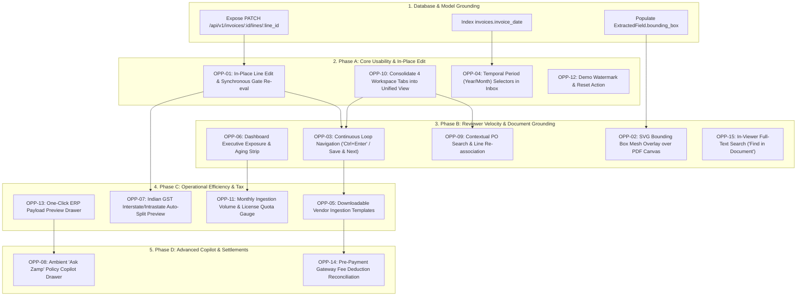
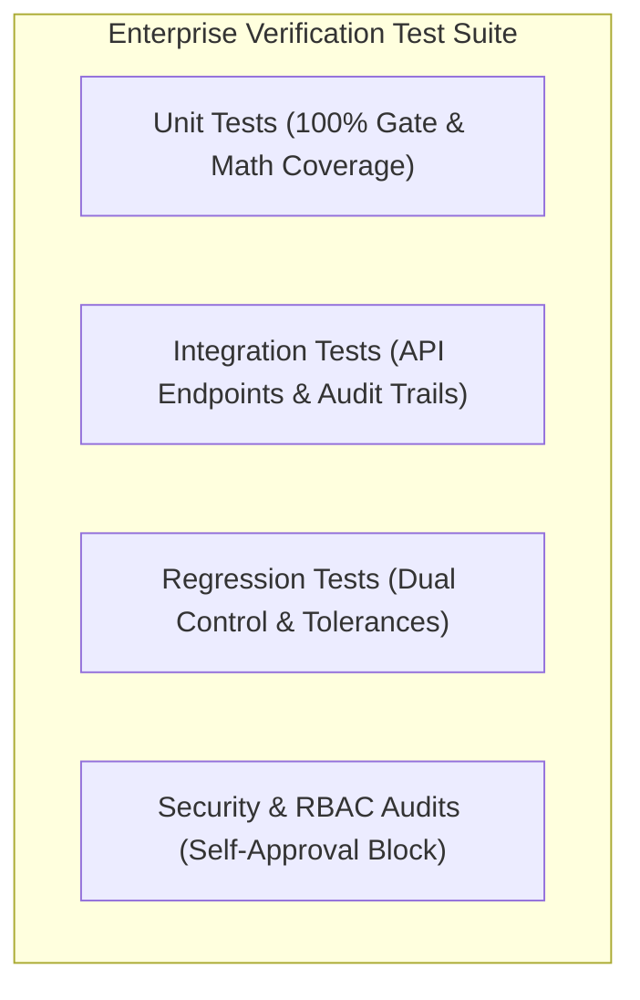

# Implementation Sequence & Engineering Acceptance Criteria
## Technical Blueprint for Zamp AP Command Center Roadmap

**Target Deliverable:** `competitor_research/05_consolidated_strategy/IMPLEMENTATION_SEQUENCE_AND_ACCEPTANCE_CRITERIA.md`  
**Date of Synthesis:** November 03, 2026  
**Status:** Certified Engineering Specification  

---

## 1. Master Engineering Dependency Chain

Every capability in this roadmap is sequenced to respect technical dependencies and avoid rework:



---

## 2. Granular Technical Specifications by Capability

---

### Sprint 1–2: Phase A — Core Usability & Trust

#### OPP-01: Audited In-Place Data Correction & Synchronous Gate Re-evaluation
- **Backend / API Changes:**
  - Create endpoint: `PATCH /api/v1/invoices/{invoice_id}/lines/{line_id}`
  - Request Payload:
    ```json
    {
      "billed_quantity": 100.0,
      "billed_unit_rate": 13900.0,
      "correction_reason": "OCR character misread on rate"
    }
    ```
  - Handler Logic:
    1. Verify caller has `AP_ASSOCIATE` or `CONTROLLER` role.
    2. Retrieve `InvoiceLine` record; preserve previous values.
    3. Update `billed_quantity` or `billed_unit_rate`; recompute `billed_line_total`.
    4. Synchronously execute `MatchRun` re-evaluation across Gate 3 (Qty) and Gate 4 (Price).
    5. Write immutable record to `audit_events`:
       ```json
       {
         "event_type": "LINE_ITEM_CORRECTED",
         "field": "billed_unit_rate",
         "old_value": "14500.00",
         "new_value": "13900.00",
         "user_id": "current_user_id",
         "justification": "OCR character misread on rate"
       }
       ```
    6. Return updated `InvoiceLine` and newly calculated `MatchRun` outcome.
- **Frontend Changes:**
  - In `InvoiceDetailPage.tsx`, make `Invoice Qty` and `Invoice Rate` cells interactive on double-click.
  - Render an inline numeric input with `Enter` (save) and `Esc` (cancel).
  - Update local state immediately on successful patch without page reload.
- **Definition of Done (DoD):**
  - Unit test verifying Gate 4 transitions from `Failed` to `Passed` when corrected rate falls within $\pm 1.50\%$ of PO rate.
  - Regression test proving raw OCR in `extracted_fields` remains untouched.
  - Verification that the edit appears in `/audit` with full before/after diff.

---

#### OPP-10: Redundant Tab Consolidation & Split Workspace Polish
- **Frontend Changes:**
  - In `frontend/src/pages/InvoiceDetailPage.tsx`:
    - Refactor 4 tabs (`Matching & Lines`, `Policy Checks`, `Extracted Info`, `Audit Trail`) into 2 primary views:
      1. **Verification Workspace (Primary):** Displays the 4-Node 3-Way Match grid with the 7 Deterministic Policy Gates summary embedded directly above it.
      2. **Audit & Metadata (Secondary):** Houses the cryptographic audit timeline, raw extracted JSON, and file properties.
    - Preserve 3 layout modes: Split View (50/50), Expand Analysis (12-column full screen), and Document Focus mode.
- **Definition of Done (DoD):**
  - Reviewers can view line-item variances and policy gate outcomes simultaneously in the same viewport without clicking tabs.

---

#### OPP-04: Temporal Period (Year/Month) Filtering in Inbox
- **Backend / API Changes:**
  - Update `GET /api/v1/inbox` to accept optional query parameters: `?fy=2026-27&month=11`.
  - Add SQLAlchemy filter:
    ```python
    if fy and month:
        query = query.filter(
            extract('year', Invoice.invoice_date) == target_year,
            extract('month', Invoice.invoice_date) == target_month
        )
    ```
- **Database Changes:**
  - Add B-tree index on `invoices.invoice_date` in migration script.
- **Frontend Changes:**
  - In `frontend/src/pages/InboxPage.tsx`, add dual `<select>` controls for Fiscal Year and Month in the table toolbar.
  - Persist selected period in `localStorage`.
- **Definition of Done (DoD):**
  - Selecting `November 2026` returns only invoices dated in that calendar month.
  - Query latency remains $< 50\text{ms}$ on a 50,000-invoice dataset.

---

#### OPP-12: Explicit Sample Data Watermark & Evaluation Reset Control
- **Frontend Changes:**
  - In `frontend/src/components/AppShell.tsx`, evaluate environment flag `VITE_APP_MODE === 'demo'`.
  - When true, render top header banner: `[Evaluation Mode: Mock ERP Fixtures Loaded]`.
  - In developer drawer, add button: `Reset Demo Data` calling `POST /api/v1/system/reset-demo`.
- **Definition of Done (DoD):**
  - Watermark is visible across all pages when demo fixtures are active.
  - Clicking `Reset Demo Data` restores default database fixtures within 2 seconds.

---

### Sprint 3–4: Phase B — Reviewer Velocity & Document Grounding

#### OPP-03: Continuous Review Loop Navigation & Keyboard Shortcuts
- **Backend / API Changes:**
  - Update `GET /api/v1/invoices/{id}` to return cursor metadata: `{"next_invoice_id": "inv_090", "prev_invoice_id": "inv_088", "remaining_in_queue": 4}`.
- **Frontend Changes:**
  - In `InvoiceDetailPage.tsx`, add persistent `Save & Next` primary button in header.
  - Add global keyboard listener:
    - `Ctrl + Enter`: Triggers `Save & Next` (approves if eligible and navigates to `next_invoice_id`).
    - `Alt + H`: Opens Put on Hold modal.
    - `Alt + R`: Opens Reject Invoice modal.
    - `[` and `]`: Steps backward/forward through active queue.
- **Definition of Done (DoD):**
  - `Ctrl + Enter` is strictly disabled if any policy gate is failing, or if invoice is $\ge \text{₹5,00,000}$ and pending dual control.
  - Advancing loads the next invoice without page reload.

---

#### OPP-06: Executive AP Capital Exposure & Aging Scorecard
- **Backend / API Changes:**
  - Create endpoint: `GET /api/v1/dashboard/exposure`
  - Returns:
    ```json
    {
      "total_blocked_inr": 2845200.00,
      "blocked_invoices_count": 4,
      "msmed_urgent_inr": 1230000.00,
      "msmed_urgent_count": 2,
      "cleared_for_erp_inr": 4510000.00,
      "cleared_invoices_count": 8
    }
    ```
- **Frontend Changes:**
  - In `DashboardPage.tsx`, render 3-card metric strip above the Next-Up Review Queue.
- **Definition of Done (DoD):**
  - Blocked INR updates synchronously when an invoice status transitions.

---

#### OPP-02: Bidirectional PDF-to-Field Source Linking & Coordinate Highlighting
- **Backend / API Changes:**
  - Ensure LayoutLM OCR pipeline populates `ExtractedField.bounding_box` with normalized coordinates `[x1, y1, x2, y2, page]`.
- **Frontend Changes:**
  - Overlay an SVG vector canvas over the PDF viewport in `InvoiceDetailPage.tsx`.
  - When user focuses or clicks a field, dispatch coordinate payload to PDF viewer; viewer scrolls to page and pulses a blue SVG `<rect>` (`#2563eb`, opacity 0.35) for 1.5 seconds.
- **Definition of Done (DoD):**
  - Clicking any line item pulses the exact physical text region on the PDF canvas.
  - Coordinates scale accurately at any zoom level without coordinate drift.

---

#### OPP-09: Contextual PO Search & Line Re-association
- **Backend / API Changes:**
  - Create endpoint: `PATCH /api/v1/invoices/{id}/link-po` accepting `{"po_number": "PO-2026-901"}`.
  - Links PO to invoice, repopulates 3-way match grid, re-evaluates Gate 2, Gate 3, and Gate 4, and logs action to audit trail.
- **Frontend Changes:**
  - On invoices failing Gate 2 (PO Match), render prominent button: `[Link Purchase Order]`.
  - Modal lists open, unbilled POs filtered to the vendor's GSTIN.
- **Definition of Done (DoD):**
  - Selecting a PO updates Gate 2 to `Passed` and refreshes match lines within 1 second.

---

#### OPP-15: In-Viewer Full-Text Document Search ("Find in Document")
- **Frontend Changes:**
  - In PDF viewer toolbar, add search input (`Ctrl + F`).
  - Queries underlying text layer and highlights all matching token occurrences on canvas.
- **Definition of Done (DoD):**
  - Typing a query highlights matching occurrences across multi-page documents.

---

### Sprint 5–6: Phase C — Operational Efficiency & Indian Compliance

#### OPP-05: Downloadable Vendor Batch Ingestion Templates
- **Frontend Changes:**
  - Host static asset `/public/templates/zamp_vendor_intake_template.csv`.
  - In Upload Modal, embed 1-click download link.
- **Definition of Done (DoD):**
  - Downloaded CSV contains valid headers matching backend batch ingestion schema.

---

#### OPP-07: Dynamic Indian GST Interstate/Intrastate Auto-Split Preview
- **Frontend Changes:**
  - Create utility `formatIndianGstBreakdown(taxRate, supplierGstin, entityGstin)`.
  - Compares first 2 digits (State Code):
    - Matching: splits into **CGST (50%) + SGST (50%)**.
    - Different: aggregates into **IGST (100%)**.
  - Surface visual warning on Policy Gate 5 if interstate supplier bills CGST/SGST.
- **Definition of Done (DoD):**
  - Intra-state invoices display explicit CGST and SGST line items; interstate invoices display IGST.

---

#### OPP-11: Ingestion Volume & License Quota Tracker
- **Backend / API Changes:**
  - Create endpoint: `GET /api/v1/system/usage` returning monthly invoice count and bucket size.
- **Frontend Changes:**
  - Render progress meter in header and Settings view.
- **Definition of Done (DoD):**
  - Gauge reflects actual monthly database records.

---

#### OPP-13: One-Click Contextual Audit & ERP Payload Preview Drawer
- **Backend / API Changes:**
  - Create endpoint: `GET /api/v1/invoices/{id}/erp-payload` returning SAP S/4HANA accounting voucher JSON.
- **Frontend Changes:**
  - In Inbox, clicking an `Approved` status badge opens a slide-out drawer displaying the exact voucher payload.
- **Definition of Done (DoD):**
  - Drawer renders valid SAP payload within 300ms.

---

### Sprint 7–8: Phase D — Advanced Assistance & Settlements

#### OPP-08: Ambient "Ask Zamp" AP Policy Copilot Drawer
- **Backend / API Changes:**
  - Create endpoint: `POST /api/v1/copilot/query`
  - Strictly injects current invoice metadata, line items, PO records, and gate evaluation results into prompt context.
- **Frontend Changes:**
  - Persistent bottom-right floating trigger launching 380px slide-out drawer with pre-configured prompt chips.
- **Definition of Done (DoD):**
  - Asking *"Why is this invoice held?"* returns exact hold condition within 2 seconds.
  - Copilot is strictly read-only; has no access to mutation endpoints.

---

#### OPP-14: Pre-Payment Gateway Fee Deduction Reconciliation
- **Database Changes:**
  - Create table `settlement_reconciliations` linked to `invoice_id`.
- **Backend Changes:**
  - Ingest Razorpay settlement CSVs; match gateway processing fee claims against verified debits.
- **Definition of Done (DoD):**
  - Net vendor payable equals gross bill minus verified gateway fee deductions.

---

## 3. Comprehensive Testing & Verification Plan



1. **Unit Tests:**
   - 100% code coverage across all 7 Policy Gates.
   - Exact mathematical variance tests verifying 0.00% quantity and $\pm 1.50\%$ rate tolerances.
2. **Integration Tests:**
   - Test `PATCH /invoices/:id/lines/:line_id` verifying synchronous Gate 3/4 re-evaluation and audit event persistence.
   - Test `GET /dashboard/exposure` verifying capital sums match database realities.
3. **Regression Tests:**
   - Verify invoices $\ge \text{₹5,00,000}$ can **never** be approved without secondary Financial Controller sign-off.
   - Verify self-approval is permanently blocked.
4. **Security & Cryptographic Audits:**
   - Verify every document upload produces an authoritative SHA-256 binary hash.
   - Verify audit log is strictly append-only (rejects `UPDATE` and `DELETE` SQL operations via RLS policies).
