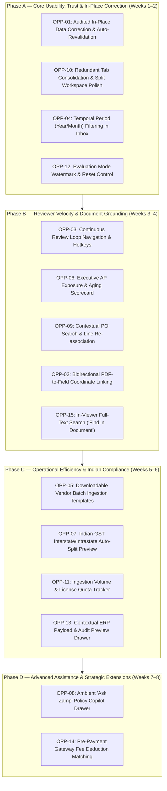

# Prioritised Product Implementation Roadmap
## Zamp AP Command Center — Phased Engineering Execution Strategy

**Target Deliverable:** `competitor_research/05_consolidated_strategy/PRIORITISED_IMPLEMENTATION_ROADMAP.md`  
**Date of Synthesis:** November 03, 2026  
**Status:** Certified Engineering Roadmap  

---

## 1. Roadmap Architecture & Phasing Principles

This roadmap organizes the 15 consolidated opportunities from the [UNIFIED_UX_OPPORTUNITY_REGISTER.md](file:///c:/Zamp%20Casse%20Study/competitor_research/05_consolidated_strategy/UNIFIED_UX_OPPORTUNITY_REGISTER.md) into four sequential, dependency-ordered engineering phases.

### Core Execution Invariants Preserved Across All Phases:
1. **Zero Tolerance Drift:** Quantity tolerance remains **0.00%**; unit price rate tolerance remains **$\pm 1.50\%$**; rounding remains **₹20.00**.
2. **7 Deterministic Policy Gates:** Gates 1 through 7 remain strictly evaluated with zero silent overrides.
3. **Statutory Dual-Control Governance:** The **₹5,00,000 threshold** requiring secondary Financial Controller approval with self-approval blocked remains absolute.
4. **Audit Immutability:** All actions, edits, and state transitions append to the tamper-evident audit ledger with SHA-256 verification.

---

## 2. Granular Phase Specifications

---

### Phase A — Core Usability, Trust & In-Place Correction

- **Phase Objective:** Resolve the primary operational bottlenecks that cause user frustration: enable audited field corrections, eliminate redundant tab switching, isolate monthly closing periods, and eliminate demo data confusion.
- **Duration:** 2 Weeks (10 Engineering Days)
- **Features Included:**
  1. `OPP-01`: Audited In-Place Data Correction with Automatic Revalidation (P0)
  2. `OPP-10`: Redundant Tab Consolidation & Workspace Polish (P0)
  3. `OPP-04`: Temporal Accounting Period (Year/Month) Filtering in Inbox (P1)
  4. `OPP-12`: Explicit Sample Data Watermark & Evaluation Reset Control (P1)

#### Dependencies & Technical Blueprint:
- Frontend: Refactor `InvoiceDetailPage.tsx` to combine the `Matching & Lines` grid and `Policy Checks` into a unified primary view; implement editable cell state; add period dropdowns in `InboxPage.tsx`.
- Backend: Expose `PATCH /api/v1/invoices/:id/lines/:line_id`; trigger synchronous policy gate re-evaluation on update; log field changes in `backend/api/v1/audit.py`.
- Database: Ensure `invoices.invoice_date` is indexed.

#### Risks & Mitigations:
- *Risk:* Reviewers attempting to manually edit numbers to artificially bypass policy gates.
- *Mitigation:* Preserve raw OCR in `extracted_metadata`; mandate that mathematical tolerances (0.00% qty, $\pm 1.50\%$ rate) are strictly enforced against the corrected value; record previous vs new values in the immutable audit trail.

#### Measurable Acceptance Criteria:
- Reviewers can double-click `Invoice Rate` or `Invoice Qty`, update the value, and see Gate 3/4 status update within 500ms without page reloads.
- Reviewers can view line-item variances and policy gate outcomes on the same screen without clicking tabs.
- Selecting `November 2026` in the Inbox filters invoices exclusively to that calendar month.
- Demo banner `[Evaluation Mode: Mock ERP Fixtures Loaded]` is permanently visible when test data is active.

#### Explicit Exclusions from Phase A:
- No vector SVG coordinate overlays (deferred to Phase B).
- No general ledger or P&L reporting (permanently rejected).

---

### Phase B — Reviewer Velocity & Document Grounding

- **Phase Objective:** Transform Zamp into a rapid, high-trust review workstation by linking extracted data to source document pixels, enabling continuous queue navigation, and surfacing capital exposure.
- **Duration:** 2 Weeks (10 Engineering Days)
- **Features Included:**
  1. `OPP-03`: Continuous Review Loop Navigation & Keyboard Shortcuts (`Ctrl+Enter`) (P1)
  2. `OPP-06`: Executive AP Capital Exposure & Aging Scorecard (P1)
  3. `OPP-09`: Contextual PO Search & Line Re-association (P1)
  4. `OPP-02`: Bidirectional PDF-to-Field Source Linking & Coordinate Highlighting (P1)
  5. `OPP-15`: In-Viewer Full-Text Document Search ("Find in Document") (P2)

#### Dependencies & Technical Blueprint:
- Frontend: Implement React keyboard navigation provider (`Ctrl+Enter`, `Alt+H`, `Alt+R`); integrate SVG coordinate layer over the PDF canvas; add `Link Purchase Order` modal.
- Backend: Add next-item cursor in `GET /api/v1/invoices/:id`; add `GET /api/v1/dashboard/exposure` aggregation; add `PATCH /api/v1/invoices/:id/link-po`.

#### Risks & Mitigations:
- *Risk:* Accidental approvals via errant keystrokes.
- *Mitigation:* `Ctrl+Enter` is strictly disabled if any policy gate is failing, or if the invoice is $\ge \text{₹5,00,000}$ and awaiting dual control.

#### Measurable Acceptance Criteria:
- Approving an eligible invoice immediately advances to the next pending document without returning to the inbox.
- Clicking any field in the matching table auto-scrolls the PDF viewer and pulses a blue highlight over the source text.
- Invoices failing Gate 2 (PO Match) can be linked to an open vendor PO in under 15 seconds without leaving the workspace.
- The dashboard displays `Total Blocked AP Liability` and `MSMED 45-Day Urgent Payables` updating in real time.

#### Explicit Exclusions from Phase B:
- No automated/AI approvals; all approvals require human trigger.
- No speed gamification or reviewer countdown timers.

---

### Phase C — Operational Efficiency & Indian Compliance

- **Phase Objective:** Streamline supplier batch onboarding, automate Indian statutory GST rate splits, track platform ingestion quotas, and enable instant audit previews.
- **Duration:** 2 Weeks (10 Engineering Days)
- **Features Included:**
  1. `OPP-05`: Downloadable Vendor Batch Ingestion Templates (P1)
  2. `OPP-07`: Dynamic Indian GST Interstate/Intrastate Auto-Split Preview (P2)
  3. `OPP-11`: Ingestion Volume & License Quota Tracker (P2)
  4. `OPP-13`: One-Click Contextual Audit & ERP Payload Preview Drawer (P2)

#### Dependencies & Technical Blueprint:
- Frontend: Place downloadable CSV/Excel template assets in `/public/templates/`; implement Indian GST calculation utility in `formatIndianGstBreakdown()`; build slide-out ERP payload preview drawer.
- Backend: Expose `GET /api/v1/system/usage` and `GET /api/v1/invoices/:id/erp-payload`.

#### Risks & Mitigations:
- *Risk:* Ingestion quota indicator confusing users as a system block.
- *Mitigation:* Ensure quota meter is informational; never halt ingestion of emergency vendor bills.

#### Measurable Acceptance Criteria:
- Upload modal provides 1-click download of a standardized vendor batch ingestion template.
- Invoices between intra-state parties display explicit CGST (9%) + SGST (9%) breakdowns; interstate invoices display IGST (18%).
- Clicking an `Approved` status pill in the Inbox opens a slide-out drawer displaying the exact SAP S/4HANA journal entry payload within 300ms.

#### Explicit Exclusions from Phase C:
- No direct GSTN tax filing or tax return submission (AP verification scope only).

---

### Phase D — Advanced Assistance & Strategic Extensions

- **Phase Objective:** Provide intelligent, conversational guidance for complex policy exceptions and expand verification capabilities to payment gateway fee deductions.
- **Duration:** 2 Weeks (10 Engineering Days)
- **Features Included:**
  1. `OPP-08`: Ambient "Ask Zamp" AP Policy Copilot Drawer (P2)
  2. `OPP-14`: Pre-Payment Gateway & Fee Deduction Validation Tab (P3)

#### Dependencies & Technical Blueprint:
- Frontend: Build 380px slide-out drawer triggered by persistent floating action button; add `Fee Deductions & Settlements` sub-tab.
- Backend: Implement `POST /api/v1/copilot/query` connecting to schema-grounded LLM; add table `settlement_reconciliations`.

#### Risks & Mitigations:
- *Risk:* AI copilot hallucinating policy approvals or advising users to circumvent controls.
- *Mitigation:* Ground copilot strictly in deterministic database records (PO, GRN, Gate telemetry); copilot is strictly read-only with zero mutation endpoints.

#### Measurable Acceptance Criteria:
- Asking *"Why is this invoice held?"* returns the exact hold category and blocking gate condition within 2 seconds.
- Ingesting a Razorpay settlement CSV verifies net vendor payable equals gross claim minus verified gateway fees.

#### Explicit Exclusions from Phase D:
- Copilot cannot approve invoices, change statuses, or bypass policy gates.

---

## 3. Master Implementation Timeline & Resource Allocation

| Phase | Milestone Name | Sprints | Engineering Days | Primary Target Persona | Core Deliverables |
|:---|:---|:---:|:---:|:---|:---|
| **Phase A** | **Core Usability & Trust** | Sprints 1–2 | 10 Days | AP Reviewers & Evaluators | In-place data editing, workspace tab consolidation, period filters, demo watermark |
| **Phase B** | **Reviewer Velocity & Grounding** | Sprints 3–4 | 10 Days | AP Specialists & Controllers | Continuous queue loop (`Ctrl+Enter`), PDF coordinate linking, PO re-linking, exposure strip |
| **Phase C** | **Operational Efficiency** | Sprints 5–6 | 10 Days | Finance Managers & Tax Clerks | CSV templates, Indian GST auto-split, volume gauge, ERP preview drawer |
| **Phase D** | **Advanced Assistance** | Sprints 7–8 | 10 Days | Controllers & Digital AP Teams | Ambient "Ask Zamp" policy copilot, gateway fee deduction matching |
| **Total** | **Full Roadmap Execution** | **8 Sprints** | **40 Days** | **Enterprise AP Operations** | **Complete Transformation to Autonomous AP Leadership** |
