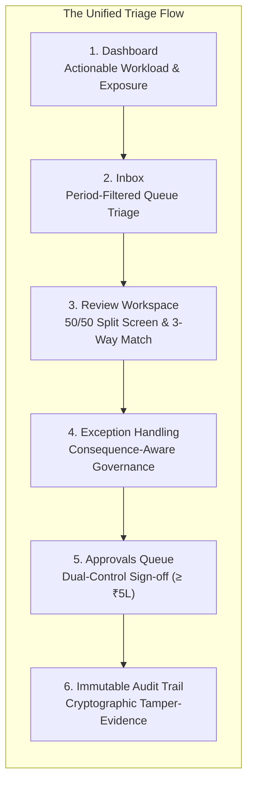
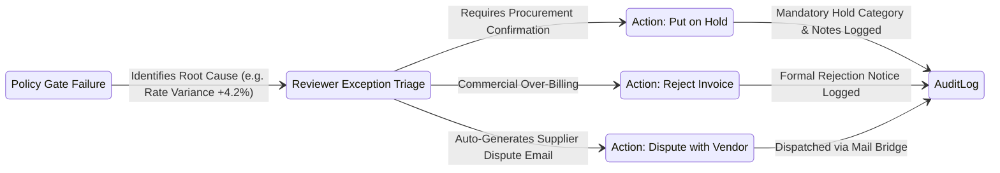

# Target Product Experience & Information Architecture
## Zamp AP Command Center — End-State Design & Interaction Specification

**Target Deliverable:** `competitor_research/05_consolidated_strategy/TARGET_PRODUCT_EXPERIENCE.md`  
**Date of Synthesis:** November 03, 2026  
**Status:** Certified Product Design Specification  

---

## 1. Executive UX Philosophy: "Understand, Triage, Act"

The target user experience of **Zamp AP Command Center** is anchored to a simple human-centric premise:
> **A finance operator must be able to understand immediately what they are looking at, what requires attention, why it matters, and what action they can safely take.**

Every screen, badge, table, and modal is engineered to eliminate unnecessary clicks, minimize context switching, reduce duplicated information, and provide crystal-clear consequences for every financial action.



---

## 2. Granular Module Specifications

---

### 2.1 The Target Dashboard (`/dashboard`)

The dashboard serves two distinct personas without cluttering the screen:
1. **The Operational AP Clerk:** Wants to know: *"What do I work on next?"*
2. **The Financial Controller / CFO:** Wants to know: *"Where is company capital blocked, and what statutory liabilities are approaching?"*

```text
+----------------------------------------------------------------------------------------------------+
|  [Evaluation Mode: Mock ERP Fixtures Loaded]                                [Reset Demo] [Neeraj S]|
+----------------------------------------------------------------------------------------------------+
|  EXECUTIVE AP CAPITAL EXPOSURE STRIP                                                               |
|  +-----------------------+ +-----------------------+ +-----------------------+ +-----------------+ |
|  | TOTAL BLOCKED AP      | | URGENT MSMED AGING    | | CLEARED FOR ERP       | | MONTHLY VOLUME  | |
|  | ₹28,45,200 (4 Bills)  | | ₹12,30,000 (2 Bills)  | | ₹45,10,000 (8 Bills)  | | 412 / 1,000     | |
|  | ⚠ High Rate Variances | | 🔴 Due in < 7 Days    | | Ready for Payment     | | Invoices (41%)  | |
|  +-----------------------+ +-----------------------+ +-----------------------+ +-----------------+ |
|                                                                                                    |
|  NEXT-UP REVIEW QUEUE (Priority Triage)                                 [View All in Inbox ->]     |
|  +-----------------------------------------------------------------------------------------------+ |
|  | Priority | Invoice #    | Vendor Name        | Amount (INR) | Blocking Policy Gate | Action   | |
|  | P1-High  | INV-2026-089 | Tata Steel Ltd     | ₹14,50,000   | Gate 4: Rate +4.2%   | [Review] | |
|  | P1-High  | INV-2026-092 | Infosys Enterprise | ₹8,20,000    | Gate 2: PO Missing   | [Review] | |
|  | P2-Med   | INV-2026-095 | Blue Dart Express  | ₹1,45,000    | Gate 5: Tax Mismatch | [Review] | |
|  +-----------------------------------------------------------------------------------------------+ |
|                                                                                                    |
|  CRITICAL SYSTEM HEALTH & CONNECTIONS (Collapsible)                                                |
|  [✓ Supabase Storage: Active (300s URLs)]  [✓ Gmail Bridge: Connected]  [⚠ SAP ERP: Unconfigured] |
+----------------------------------------------------------------------------------------------------+
```

- **What Users See First:** The **Executive Exposure Strip** gives immediate clarity on locked capital and statutory deadlines.
- **Immediate Next Action:** The **Next-Up Review Queue** displays the top 5 highest-priority blocked or pending invoices. Clicking `[Review]` launches directly into the review workspace.
- **What is Collapsed / De-emphasized:** Technical setup wizards, unconfigured connector cards, and raw logs are collapsed into a clean bottom tray.

---

### 2.2 The Target Invoices Inbox (`/invoices`)

The Inbox is an operational command post designed for rapid triage, clean period scoping, and zero visual clutter.

- **Temporal Period Selectors:** Synchronized dropdowns for `Fiscal Year (FY 2026-27)` and `Month (November 2026)`. Isolates active closing records from historical archives.
- **Stage & Decision Tabs:**
  - `All Invoices`
  - `Needs Review` (Pending OCR verification or gate check)
  - `Blocked Exceptions` (Failing one or more of the 7 policy gates)
  - `Awaiting Approval` (Passed all gates, pending Controller sign-off)
  - `Approved / Cleared` (Ready for ERP export)
  - `Disputed / Rejected`
- **Unified Smart Search:** A single high-speed search bar that queries across Vendor Name, Invoice Number, PO Number, and GSTIN simultaneously.
- **Visual Status Signifiers:**
  - `Emerald Pill`: `Passed 7/7 Gates`
  - `Crimson Pill`: `Blocked: Gate 4 (Rate +4.2%)`
  - `Purple Pill`: `Awaiting Dual Approval (≥ ₹5L)`
  - `Amber Pill`: `MSMED Due: 4 Days Remaining`
- **Downloadable Ingestion Templates:** Upload dialog includes a 1-click link to `Download Vendor Batch Ingestion Template (.csv / .xlsx)`.

---

### 2.3 The Target Invoice Review Workspace (`/invoices/:id`)

The review workspace is the centerpiece of the application. It employs a **Golden 50/50 Split Screen** that anchors every extracted number to physical source evidence.

```text
+----------------------------------------------------------------------------------------------------+
| [<- Inbox]  INV-2026-089  |  Tata Steel Ltd  |  ₹14,50,000  |  MSMED Due: 14 Days   [Save & Next ->]|
+----------------------------------------------------------------------------------------------------+
| LEFT PANE: 50% SOURCE PDF VIEWER               | RIGHT PANE: 50% UNIFIED VERIFICATION WORKSPACE    |
|                                                |                                                   |
| [Zoom -/+] [Fit] [Find: "HR Sheet"] [Page 1/2] | (•) 3-Way Match & Policy Gates   ( ) Audit & Meta |
| +--------------------------------------------+ | +-----------------------------------------------+ |
| | INVOICE                                    | | | 7 DETERMINISTIC POLICY GATES SUMMARY          | |
| | Tata Steel Ltd        Invoice: INV-2026-089| | | [✓ Gate 1: Onboarded]  [✓ Gate 2: PO Matched] | |
| | GSTIN: 27AAAAA0000A1Z5   Date: 04/11/2026  | | | [✓ Gate 3: Qty Match]  [🔴 Gate 4: Rate +4.2%]| |
| |                                            | | | [✓ Gate 5: Tax 18%]    [✓ Gate 6: Unique]     | |
| | Billed Item:                               | | | [✓ Gate 7: MSMED §15 Deadline Verified]       | |
| | +----------------------------------------+ | | +-----------------------------------------------+ |
| | | HR Coils 2.5mm                         | | |                                                   |
| | | Qty: 100 MT   Rate: ₹14,500/MT (PULSING| | | 4-NODE 3-WAY MATCHING DATA GRID (Double-Click Edit)|
| | +----------------------------------------+ | | +-----------------------------------------------+ |
| |                                            | | | Line | Description | Inv Qty | PO Qty| Inv Rate| |
| | Subtotal: ₹14,50,000                       | | | 1    | HR Coils    | 100 MT  | 100 MT| ₹14,500 | |
| | CGST (9%): ₹1,30,500                       | | |      | (Rate Discrepancy: PO Rate was ₹13,900)| |
| | SGST (9%): ₹1,30,500                       | | |                                               | |
| | TOTAL: ₹17,11,000                          | | | [CGST: ₹1,30,500 (9%)]  [SGST: ₹1,30,500 (9%)]| |
| +--------------------------------------------+ | +-----------------------------------------------+ |
|                                                | GOVERNANCE ACTIONS:                               |
| [Pulsing Blue Box highlights Rate on PDF]      | [Put on Hold]  [Reject Invoice]  [Request Dispute]|
+----------------------------------------------------------------------------------------------------+
```

#### Key Ergonomic Features:
1. **Source Grounding (OPP-02):** Clicking any field in the right-hand table immediately scrolls the PDF to that line and pulses a blue SVG bounding box over the source text.
2. **Audited In-Place Correction (OPP-01):** Double-clicking `Inv Rate` or `Inv Qty` opens an inline input. Correcting an OCR misread recalculates Gate 3 and Gate 4 synchronously and logs the change to the audit trail.
3. **Consolidated Tabs (OPP-10):** The 7 Policy Gates are displayed directly above the 3-Way Match grid, eliminating the need to click back and forth between tabs.
4. **Continuous Review Loop (OPP-03):** Clicking `[Save & Next]` (or pressing `Ctrl+Enter`) saves the action and smoothly advances to the next invoice in queue.
5. **Contextual PO Linker (OPP-09):** If Gate 2 fails (PO Missing), a prominent `[Link Purchase Order]` button appears, allowing the reviewer to select an open PO for that vendor in 2 clicks.

---

### 2.4 The Target Exception Flow

When an invoice fails one or more policy gates, the interface avoids dead-ends and guides the reviewer through **Consequence-Aware Governance**:



- **Root Cause Clarity:** The failing gate displays an plain-English explanation:
  `"Gate 4 Failed: Billed unit rate of ₹14,500 exceeds PO rate of ₹13,900 by +4.32% (allowable tolerance: ±1.50%). Total financial leakage: ₹60,000."`
- **Controlled Governance Actions:**
  - **Put on Hold:** Prompts reviewer to select a categorized reason (`Pricing Discrepancy`, `Pending Credit Note`, `Damaged Goods in QC`) and enter internal notes.
  - **Reject Invoice:** Formally blocks payment and generates a formal supplier rejection memorandum citing contract terms.
  - **No Silent Overrides:** Overriding a failed gate is forbidden without formal dual-control sign-off and permanent audit justification.

---

### 2.5 The Target Approvals Flow & Dual Control

To prevent corporate fraud, Zamp enforces a mandatory **Project Approval Control Threshold**:

| Invoice Amount Range | Approval Protocol | Sign-off Requirements | Self-Approval Policy |
|:---|:---|:---|:---|
| **Under ₹5,00,000** | Single Reviewer Sign-off | AP Specialist approves after all 7 gates pass | Permitted if reviewer is authorized |
| **₹5,00,000 and Above** | **Mandatory Dual Control** | Requires secondary sign-off from **Financial Controller** | **Strictly Blocked** (Reviewer cannot approve own submission) |

- **Approvals Queue (`/approvals`):** Dedicated queue for Financial Controllers displaying high-value invoices awaiting second sign-off.
- **Safe Bulk Operations:**
  - Bulk approval is permitted **ONLY** for invoices under ₹5,00,000 that have passed all 7 policy gates with 100% clean matching.
  - Invoices with exceptions, failed gates, or amounts $\ge \text{₹5,00,000}$ are **strictly excluded** from bulk approval actions and must be reviewed individually.

---

### 2.6 The Target Audit Experience (`/audit`)

Trust is established through complete, tamper-evident transparency.

- **Append-Only Event Ledger:** Every user interaction, OCR extraction, gate evaluation, in-place edit, hold, rejection, and approval is written to an immutable append-only ledger.
- **Cryptographic Verification:** Every invoice record stores a permanent **SHA-256 binary hash** of the uploaded PDF and a cryptographic signature of the approval state.
- **Diff Visualizer:** When an in-place field correction occurs (OPP-01), the audit log displays an explicit visual diff:
  `"Invoice Rate modified: [₹1,850.00] -> [₹1,050.00] by Neeraj S (AP Specialist). Reason: OCR Character Misread."`
- **Contextual ERP Preview Drawer (OPP-13):** Clicking an approved invoice pill opens a slide-out drawer displaying the exact JSON/XML accounting voucher payload destined for SAP S/4HANA.

---

### 2.7 Proposed Global Navigation Structure

```text
/
├── /dashboard                    # Executive Exposure Scorecard & Next-Up Review Queue
├── /invoices                     # Period-Scoped Invoices Inbox (Year/Month Selectors)
│   ├── /:id                      # 50/50 Split Review Workspace (3-Way Match & Gates)
├── /approvals                    # Financial Controller Dual-Approval Queue (≥ ₹5,00,000)
├── /source-records               # Procurement Reference Data Explorer (POs, GRNs, QC)
├── /audit                        # System-Wide Append-Only Audit Trail (SHA-256 Proof)
├── /connections                  # Storage, Email Bridges & ERP Connector Status
└── /settings                     # Organization Configuration, Team RBAC & Quotas
```

---

## 3. End-to-End User Journey Walkthrough

```mermaid
sequenceDiagram
    autonumber
    actor Clerk as AP Specialist
    actor Controller as Financial Controller
    participant App as Zamp AP Command Center
    participant ERP as SAP S/4HANA Bridge

    Note over Clerk,App: 1. Ingestion & Priority Triage
    Clerk->>App: Logs in; views Dashboard Executive Exposure Strip
    Clerk->>App: Clicks 'Review' on top priority invoice INV-2026-089 (₹14,50,000)
    
    Note over Clerk,App: 2. 50/50 Review & Source Grounding
    App->>App: Opens 50/50 Split Workspace (PDF Left, Match Grid Right)
    Clerk->>App: Clicks 'Invoice Rate' cell; PDF canvas pulses bounding box
    Clerk->>App: Double-clicks Rate cell to correct OCR misread (₹14,500 -> ₹13,900)
    App->>App: Synchronously re-evaluates Gate 4 -> Status updates to PASSED
    App->>App: Appends field correction event to immutable audit log

    Note over Clerk,App: 3. Verification & Dual-Control Routing
    Clerk->>App: Presses 'Ctrl+Enter' (Save & Next)
    App->>App: Detects Total ≥ ₹5,00,000; routes to Approvals Queue
    App->>App: Smoothly advances workspace to next invoice in queue

    Note over Controller,ERP: 4. Second Sign-off & ERP Clearance
    Controller->>App: Opens /approvals; inspects INV-2026-089
    Controller->>App: Reviews audit diff and confirms 7/7 gates passed
    Controller->>App: Clicks 'Authorize Payment Clearance'
    App->>App: Records secondary sign-off; generates SHA-256 proof
    App->>ERP: Transmits authorized voucher payload to SAP Bridge
```
