# Unified UX & Product Opportunity Register
## Consolidated, Deduplicated Improvement Opportunities for Zamp AP Command Center

**Target Deliverable:** `competitor_research/05_consolidated_strategy/UNIFIED_UX_OPPORTUNITY_REGISTER.md`  
**Date of Synthesis:** November 03, 2026  
**Status:** Certified Engineering Backlog  

---

## 1. Synthesis & Deduplication Methodology

This register extracts and merges every meaningful improvement opportunity surfaced across the three competitor audits (**FinBooks**, **Rossum**, and **Flick AI**). 

Redundant and overlapping concepts have been consolidated into coherent, enterprise-grade capabilities that respect Zamp's pre-payment governance invariants.

```mermaid
flowchart TD
    subgraph Raw_Dossier_Inputs["Raw Competitor Recommendations"]
        FB_Edit["FinBooks: Field Editing"]
        RO_Edit["Rossum: Contextual editBoxInput"]
        FL_Edit["Flick AI: Spreadsheet Line Edit"]

        FB_Box["FinBooks: OCR Bounding Boxes"]
        RO_Box["Rossum: SVG Vector Mesh (51+ rects)"]

        RO_Queue["Rossum: Confirm & Next Navigation"]
        FB_Queue["FinBooks: Next Document In Queue"]

        FL_Period["Flick AI: Year/Month Period Selectors"]
        FB_Batch["FinBooks: Ingestion Batch Scoping"]

        FL_Temp["Flick AI: Downloadable CSV Templates"]
        FL_Dash["Flick AI: Net Exposure & Overdue Strip"]
        FL_GST["Flick AI: Indian GST Auto-Split"]
        FL_Chat["Flick AI: 'Ask Flick' Copilot Drawer"]
    end

    subgraph Consolidated_Capabilities["Consolidated Zamp Opportunities"]
        C_Edit["OPP-01: Audited Data Correction & Revalidation"]
        C_Box["OPP-02: Bidirectional PDF-to-Field Source Linking"]
        C_Queue["OPP-03: Continuous Review Loop & Keyboard Hotkeys"]
        C_Period["OPP-04: Temporal Accounting Period Filtering"]
        C_Temp["OPP-05: Downloadable Vendor Ingestion Templates"]
        C_Dash["OPP-06: Executive AP Capital Exposure & Aging Strip"]
        C_GST["OPP-07: Indian GST Interstate/Intrastate Auto-Split"]
        C_Chat["OPP-08: Ambient 'Ask Zamp' Policy Copilot Drawer"]
    end

    FB_Edit & RO_Edit & FL_Edit --> C_Edit
    FB_Box & RO_Box --> C_Box
    RO_Queue & FB_Queue --> C_Queue
    FL_Period & FB_Batch --> C_Period
    FL_Temp --> C_Temp
    FL_Dash --> C_Dash
    FL_GST --> C_GST
    FL_Chat --> C_Chat
```

---

## 2. Priority Scoring Rubric

Opportunities are prioritized across four strict tiers:
- **P0 (Immediate / Blocker):** Foundational usability flaws or missing capabilities that force users out of the application or cause high cognitive friction in routine reviews.
- **P1 (High Value / Core Sprint):** Substantial operational velocity improvements, auditability enhancements, or executive financial visibility.
- **P2 (Medium Value / Next Cycle):** Workflow polish, batch utilities, and regulatory automation that streamline Indian accounting compliance.
- **P3 (Low Value / Strategic Horizon):** Specialized edge-case utilities, complex aggregations, or advanced assistive interfaces.

---

## 3. Deduplicated Opportunity Catalog

---

### OPP-01: Audited In-Place Data Correction with Automatic Revalidation

1. **Opportunity ID:** `OPP-01`
2. **Short Name:** Audited In-Place Correction & Auto-Revalidation
3. **User Problem:** When OCR misreads a character (e.g., misreading `₹1,050.00` as `₹1,850.00`), Policy Gate 4 triggers an invalid rate failure. Because Zamp's current review workspace is 100% read-only, reviewers cannot correct the misread number inline and are forced to trigger full backend re-extraction.
4. **Current Zamp Behaviour:** All extracted fields, header metadata, and line items in `InvoiceDetailPage.tsx` are rendered as static, non-editable text elements (``).
5. **Relevant Competitor Evidence:**
   - FinBooks: Inline field editing with live recalculation (`FB-008`).
   - Rossum: Contextual floating `editBoxInput` rendering directly over active canvas fields (`RO-004`).
   - Flick AI: High-speed editable spreadsheet data matrix on `/invoices/new` with instant tax recalculation (`FLICK-011`, `FLICK-013`).
6. **Competitors Demonstrating Pattern:** FinBooks, Rossum, Flick AI (Universal Pattern).
7. **Proposed Zamp Behaviour:**
   - Authorized reviewers can double-click any extracted header field or line item (`Invoice Qty`, `Invoice Rate`, `Invoice Number`).
   - The cell transforms into a focused input with keyboard controls (`Enter` to save, `Esc` to cancel).
   - Saving immediately re-evaluates Gate 3 (Qty), Gate 4 (Price), Gate 5 (Tax), and Gate 6 (Duplicates) without reloading the page.
   - The correction is recorded in the append-only audit trail with the previous value, new value, reviewer ID, timestamp, and justification.
8. **Expected Business Value:** Eliminates re-extraction turnaround delays; cuts invoice correction cycle time from minutes to under 5 seconds.
9. **User Experience Impact:** Very High. Resolves the single most frustrating bottleneck in the reviewer experience.
10. **Technical Dependencies:** `PATCH /api/v1/invoices/:id/lines/:line_id` endpoint; frontend inline edit state in `InvoiceDetailPage.tsx`; automatic gate re-evaluation hook.
11. **Complexity:** Medium (3–4 Engineering Days).
12. **Priority:** **P0 (Immediate Blocker)**.
13. **Risks and Safeguards:**
    - *Risk:* Reviewers might falsify numbers to bypass policy gates.
    - *Safeguard:* Strict immutable audit logging; original raw OCR extraction permanently preserved in `extracted_metadata`; mathematical tolerances (0.00% qty, $\pm 1.50\%$ rate) remain strictly enforced against the corrected value.
14. **Evidence Confidence:** `[V]` Verified across all 3 competitors.
15. **Acceptance Criteria:**
    - Double-clicking `Invoice Rate` opens an input populated with the current value.
    - Pressing `Enter` dispatches a `PATCH` request and updates the cell immediately.
    - Gate 4 status updates synchronously from `Failed` to `Passed` if the corrected rate falls within $\pm 1.50\%$ of the PO rate.
    - An immutable audit event is visible in the Audit Trail tab within 500ms.

---

### OPP-02: Bidirectional PDF-to-Field Source Linking & Coordinate Highlighting

1. **Opportunity ID:** `OPP-02`
2. **Short Name:** Bidirectional PDF-to-Field Source Linking
3. **User Problem:** In multi-page or dense 50-line vendor invoices, reviewers must manually scan back and forth between the right-hand data table and the left-hand PDF iframe to verify numbers, creating severe visual fatigue.
4. **Current Zamp Behaviour:** PDF viewer is an isolated `<iframe>` rendering a pre-signed URL. Extracted data fields store `bounding_box: null`. There is zero visual connection between a field and its location on the PDF.
5. **Relevant Competitor Evidence:**
   - Rossum: Interactive SVG vector mesh with 51+ coordinate-mapped `<rect>` elements overlaying the document; clicking a field pulses its source text; clicking text on the canvas captures it into the active input (`RO-003`).
   - FinBooks: Bounding box coordinate highlighting on document canvas (`FB-005`).
6. **Competitors Demonstrating Pattern:** Rossum, FinBooks.
7. **Proposed Zamp Behaviour:**
   - Persist bounding box coordinates `[x_min, y_min, x_max, y_max, page]` during OCR extraction in `extracted_metadata`.
   - Render an interactive SVG vector overlay on top of the PDF viewport.
   - Clicking a field in the `Matching & Lines` tab auto-scrolls the PDF viewer to the relevant page and pulses a subtle blue highlight box (`#2563eb`) around the source text for 1.5 seconds.
8. **Expected Business Value:** Eliminates visual searching across complex documents; reduces reviewer verification time by ~35%.
9. **User Experience Impact:** Very High. Delivers an authoritative, high-trust review experience.
10. **Technical Dependencies:** Backend OCR pipeline must emit bounding boxes; frontend PDF viewer component must support coordinate layer overlays (e.g. `pdfjs-dist` or SVG canvas overlay).
11. **Complexity:** High (6–8 Engineering Days).
12. **Priority:** **P1 (High Value)**.
13. **Risks and Safeguards:**
    - *Risk:* Layout shifts across different screen resolutions and zoom levels.
    - *Safeguard:* Normalize coordinates to percentage dimensions (`0.0` to `1.0`) relative to natural page dimensions.
14. **Evidence Confidence:** `[V]` Verified in Rossum (`RO-003`) and FinBooks (`FB-005`).
15. **Acceptance Criteria:**
    - Clicking the `Invoice Number` header field scrolls the PDF canvas to Page 1 and highlights the bounding box.
    - Zooming the PDF scales the SVG highlight layer deterministically without coordinate drift.

---

### OPP-03: Continuous Review Loop Navigation & Keyboard Shortcuts

1. **Opportunity ID:** `OPP-03`
2. **Short Name:** Continuous Review Navigation & Keyboard Hotkeys
3. **User Problem:** After verifying or holding an invoice, the reviewer must click `Back to Inbox`, wait for the table to load, find the next invoice, and click `Review`, incurring 3–4 unnecessary clicks per invoice.
4. **Current Zamp Behaviour:** Confirming an action (Approve, Hold, Reject) leaves the user on the current invoice detail page; navigation requires returning to `/invoices`.
5. **Relevant Competitor Evidence:**
   - Rossum: Continuous assembly-line document advancing; confirming a document immediately loads the next pending invoice; complete keyboard navigation (`Ctrl+Enter` to confirm, `Tab` between fields) (`RO-005`).
   - FinBooks: `Next Invoice` quick button in review header (`FB-007`).
6. **Competitors Demonstrating Pattern:** Rossum, FinBooks.
7. **Proposed Zamp Behaviour:**
   - Add a persistent `Save & Next` (or `Approve & Next`) primary button in the invoice workspace header.
   - Add keyboard hotkeys: `Ctrl+Enter` to approve (if eligible), `Alt+H` to Put on Hold, `Alt+R` to Reject, and `[` / `]` to navigate between invoices.
   - Executing an action smoothly transitions the workspace to the next invoice in the active queue without returning to the inbox.
8. **Expected Business Value:** Eliminates 3 clicks and 2 page navigations per invoice; accelerates continuous queue throughput by over 40%.
9. **User Experience Impact:** High. Transforms the interface into a rapid, fluid review station.
10. **Technical Dependencies:** Queue context provider in React state; next-item cursor in `GET /api/v1/invoices/:id`.
11. **Complexity:** Low (2 Engineering Days).
12. **Priority:** **P1 (High Value)**.
13. **Risks and Safeguards:**
    - *Risk:* Accidental approvals via errant keystrokes.
    - *Safeguard:* `Ctrl+Enter` is strictly disabled if any blocking policy gate is failing, or if the invoice is $\ge \text{₹5,00,000}$ and pending dual control.
14. **Evidence Confidence:** `[V]` Verified in Rossum (`RO-005`).
15. **Acceptance Criteria:**
    - On an approved-eligible invoice, pressing `Ctrl+Enter` approves the invoice, displays a success snackbar, and loads the next pending invoice.
    - If the queue is empty, the user is cleanly redirected to the Inbox with a `"All pending invoices reviewed"` celebration banner.

---

### OPP-04: Temporal Accounting Period (Year/Month) Partitioning in Inbox

1. **Opportunity ID:** `OPP-04`
2. **Short Name:** Temporal Period (Year/Month) Filtering
3. **User Problem:** Zamp's Inbox displays an unsegmented flat list of all invoices across all time. Invoices from previous fiscal years mix with active monthly bills, cluttering the view and slowing down month-end closing.
4. **Current Zamp Behaviour:** Flat table in `InboxPage.tsx` with generic pagination.
5. **Relevant Competitor Evidence:**
   - Flick AI: Synchronized **Year** (`2026`) and **Month** (`November`) dropdown selectors scoping all file intake and ledger views (`FLICK-005`, `FLICK-007`).
   - FinBooks: Fiscal period filtering in AP voucher queues (`FB-003`).
6. **Competitors Demonstrating Pattern:** Flick AI, FinBooks.
7. **Proposed Zamp Behaviour:**
   - Add synchronized `Fiscal Year` (e.g. `FY 2026-27`) and `Accounting Month` (e.g. `November 2026`) dropdowns above the inbox table.
   - Defaults to the active calendar month, with an `All Periods` option.
   - Selected period filters the inbox table and persists in user session storage.
8. **Expected Business Value:** Keeps the operational inbox focused exclusively on the active closing cycle; prevents database query degradation on multi-year datasets.
9. **User Experience Impact:** High. Aligns the software with how enterprise finance departments actually close their books.
10. **Technical Dependencies:** Add `fy` and `month` query parameters to `GET /api/v1/inbox`; database index on `invoices.invoice_date`.
11. **Complexity:** Low (2 Engineering Days).
12. **Priority:** **P1 (High Value)**.
13. **Risks and Safeguards:**
    - *Risk:* Users might mistakenly think older invoices were deleted.
    - *Safeguard:* Prominent badge indicating active filter (e.g. `Showing: November 2026 (7 Invoices) [Clear Filter]`).
14. **Evidence Confidence:** `[V]` Verified in Flick AI (`FLICK-005`, `FLICK-007`).
15. **Acceptance Criteria:**
    - Selecting `November 2026` immediately updates the inbox table to display only invoices dated in that month.
    - Switching to `All Periods` restores the complete multi-year list.

---

### OPP-05: Downloadable Vendor Batch Ingestion Templates

1. **Opportunity ID:** `OPP-05`
2. **Short Name:** Downloadable Batch Ingestion Templates
3. **User Problem:** Suppliers and internal AP staff frequently upload spreadsheets with arbitrary column headers, triggering format errors and parsing failures.
4. **Current Zamp Behaviour:** Upload modal accepts single PDF drag-and-drop; no guidance or sample formats are provided for structured data.
5. **Relevant Competitor Evidence:**
   - Flick AI: Direct 1-click `CSV Template` and `Sample Template` download buttons on ingestion tabs (`FLICK-008`, `FLICK-017`).
6. **Competitors Demonstrating Pattern:** Flick AI.
7. **Proposed Zamp Behaviour:**
   - Inside the Upload Invoices modal, provide a permanent link: `Download Vendor Batch Template (.xlsx / .csv)`.
   - The template includes standardized headers: `Supplier GSTIN`, `Invoice Number`, `Invoice Date`, `PO Number`, `Line Item #`, `HSN/SAC`, `Billed Qty`, `Unit Rate`, `Tax Rate %`.
8. **Expected Business Value:** Eliminates vendor formatting confusion; reduces ingestion rejection rates by over 80%.
9. **User Experience Impact:** Medium. Simplifies onboarding for vendors and shared-service clerks.
10. **Technical Dependencies:** Static template hosting in frontend `/public/templates/`.
11. **Complexity:** Low (1 Engineering Day).
12. **Priority:** **P1 (High Value)**.
13. **Risks and Safeguards:** None. Purely an assistive static asset.
14. **Evidence Confidence:** `[V]` Verified in Flick AI (`FLICK-008`).
15. **Acceptance Criteria:**
    - Clicking the template link downloads a valid `.csv` file with pre-populated sample rows and correct headers.

---

### OPP-06: Executive AP Capital Exposure & Aging Scorecard

1. **Opportunity ID:** `OPP-06`
2. **Short Name:** Executive AP Exposure & Aging Scorecard
3. **User Problem:** Zamp’s dashboard displays invoice volume counts (`Total: 7`, `Pending: 3`), but fails to communicate **capital exposure**. A Financial Controller cannot see how much money is blocked by failed policy gates, or what liability is approaching statutory deadlines.
4. **Current Zamp Behaviour:** Purely operational metrics in `DashboardPage.tsx` (`Total Invoices`, `Approved Count`, `Pending Count`, `Flagged Count`).
5. **Relevant Competitor Evidence:**
   - Flick AI: Executive scorecard displaying `Net Exposure`, `GST Net Liability`, and a high-contrast crimson card for `90+ Days Overdue` (`FLICK-003`).
   - FinBooks: Total payable exposure widgets (`FB-002`).
6. **Competitors Demonstrating Pattern:** Flick AI, FinBooks.
7. **Proposed Zamp Behaviour:**
   - Add a 3-card **Executive Exposure Strip** directly above the Next-Up Review Queue:
     1. **Total Blocked AP Liability:** Aggregated INR value of invoices blocked by policy gates (e.g. `₹28,45,200 Locked`).
     2. **Statutory MSMED Urgent Aging:** Count and INR of invoices exceeding or within 7 days of the statutory 45-day deadline.
     3. **Cleared for Payment:** Total INR value of fully verified invoices ready for ERP voucher export.
8. **Expected Business Value:** Instantly exposes liquidity risk and statutory compliance exposure to Financial Controllers.
9. **User Experience Impact:** High. Bridges the gap between operational review and executive financial oversight.
10. **Technical Dependencies:** `GET /api/v1/dashboard/exposure` endpoint grouping invoice amounts by status and MSMED deadline.
11. **Complexity:** Low (2 Engineering Days).
12. **Priority:** **P1 (High Value)**.
13. **Risks and Safeguards:**
    - *Risk:* Conflating operational aging with statutory MSMED claims.
    - *Safeguard:* Strictly label statutory deadlines only when vendor MSMED registration is verified; otherwise label as operational aging.
14. **Evidence Confidence:** `[V]` Verified in Flick AI (`FLICK-003`).
15. **Acceptance Criteria:**
    - The dashboard displays total blocked INR updated in real time as invoices are approved or put on hold.
    - Invoices nearing 45 days highlight with amber warning badges.

---

### OPP-07: Dynamic Indian GST Interstate/Intrastate Auto-Split Preview

1. **Opportunity ID:** `OPP-07`
2. **Short Name:** Dynamic Indian GST Auto-Split Preview
3. **User Problem:** Indian statutory compliance requires explicit separation between **CGST + SGST** (intra-state) and **IGST** (interstate). Zamp validates total tax percentage via Gate 5, but displays tax as a single aggregated number.
4. **Current Zamp Behaviour:** Displays a single `Tax Amount` figure without Place of Supply (PoS) split verification.
5. **Relevant Competitor Evidence:**
   - Flick AI: Automated dual-zone tax calculation engine dynamically splitting tax into CGST/SGST (50/50) or IGST (100%) based on supplier vs organization state codes (`FLICK-012`).
6. **Competitors Demonstrating Pattern:** Flick AI.
7. **Proposed Zamp Behaviour:**
   - Compare the Supplier GSTIN state prefix (e.g., `27` for Maharashtra) with the Operating Entity GSTIN.
   - If intra-state: display explicit **CGST (9%) + SGST (9%)** breakdown.
   - If interstate: display explicit **IGST (18%)** breakdown.
   - Flag a Policy Gate 5 warning if an interstate supplier bills CGST/SGST or vice versa.
8. **Expected Business Value:** Prevents fraudulent or erroneous GST tax split filings that lead to tax authority audits.
9. **User Experience Impact:** Medium. Eliminates manual tax split verification for Indian finance operators.
10. **Technical Dependencies:** Frontend utility in `formatIndianGstBreakdown()` + GSTIN state dictionary.
11. **Complexity:** Low (2 Engineering Days).
12. **Priority:** **P2 (Medium Value)**.
13. **Risks and Safeguards:** Purely a preview and validation enhancement; preserves existing Gate 5 tolerance checks.
14. **Evidence Confidence:** `[V]` Verified in Flick AI (`FLICK-012`).
15. **Acceptance Criteria:**
    - Invoices with matching state codes display separate CGST and SGST line items.
    - Invoices with mismatched state codes display an IGST line item.

---

### OPP-08: Ambient "Ask Zamp" AP Policy Copilot Drawer

1. **Opportunity ID:** `OPP-08`
2. **Short Name:** Ambient "Ask Zamp" AP Policy Copilot Drawer
3. **User Problem:** Non-technical clerks and new controllers often struggle to understand why an invoice failed a specific gate or what documentation is needed to clear a hold.
4. **Current Zamp Behaviour:** No conversational assistant exists; users must decipher technical gate messages manually.
5. **Relevant Competitor Evidence:**
   - Flick AI: Slide-out Material-UI drawer triggered by a persistent floating action button, complete with contextual prompt chips (`FLICK-028`).
6. **Competitors Demonstrating Pattern:** Flick AI.
7. **Proposed Zamp Behaviour:**
   - Persistent bottom-right floating trigger button across all views.
   - Opens a 380px slide-out drawer that does not obstruct the review workspace.
   - Surfaces context-aware prompt chips:
     - *"Why is this invoice held?"*
     - *"What is the rate variance on Line 2?"*
     - *"Which MSMED vendor invoices are due this Friday?"*
   - Strictly grounded in deterministic database records (PO, GRN, Gate telemetry) rather than hallucinated open-domain web data.
8. **Expected Business Value:** Reduces onboarding time and training costs; provides instant policy guidance.
9. **User Experience Impact:** High. Provides an intelligent, reassuring conversational layer.
10. **Technical Dependencies:** `POST /api/v1/copilot/query` endpoint connecting to schema-grounded LLM service.
11. **Complexity:** High (5–6 Engineering Days).
12. **Priority:** **P2 (Medium Value)**.
13. **Risks and Safeguards:**
    - *Risk:* AI might hallucinate approval decisions or advise bypassing policy gates.
    - *Safeguard:* The copilot is strictly read-only; it has zero access to approval mutations or gate override actions.
14. **Evidence Confidence:** `[V]` Verified in Flick AI (`FLICK-028`).
15. **Acceptance Criteria:**
    - Asking *"Why is this invoice held?"* returns the exact hold category and blocking gate condition within 2 seconds.
    - The drawer can be dismissed with `Esc` or by clicking outside.

---

### OPP-09: Contextual PO Search & Line Re-association

1. **Opportunity ID:** `OPP-09`
2. **Short Name:** Contextual PO Search & Line Re-association
3. **User Problem:** When a supplier omits the PO number from an invoice or enters a typo, Policy Gate 2 fails. Reviewers have no way inside the review workspace to search for open POs for that vendor and link the correct PO.
4. **Current Zamp Behaviour:** Gate 2 fails; user must leave the review workspace, navigate to `/source-records`, manually look up the PO, and return.
5. **Relevant Competitor Evidence:**
   - FinBooks: Contextual PO search dialog allowing reviewers to search open POs by vendor and re-link lines in-place (`FB-009`).
6. **Competitors Demonstrating Pattern:** FinBooks.
7. **Proposed Zamp Behaviour:**
   - On invoices failing Gate 2 (PO Match), render a prominent action button: `Link Purchase Order`.
   - Opens a modal pre-filtered to open, unbilled POs for that specific supplier.
   - Selecting a PO automatically re-runs Gate 2, Gate 3, and Gate 4 in real time and logs the manual linkage to the audit trail.
8. **Expected Business Value:** Solves one of the most common causes of AP invoice holds in under 15 seconds.
9. **User Experience Impact:** High. Eliminates jarring navigation away from the review workspace.
10. **Technical Dependencies:** `PATCH /api/v1/invoices/:id/link-po` endpoint; modal reading `source_records`.
11. **Complexity:** Medium (3 Engineering Days).
12. **Priority:** **P1 (High Value)**.
13. **Risks and Safeguards:**
    - *Risk:* Linking an invoice to an unrelated PO.
    - *Safeguard:* Modal only lists POs matching the vendor GSTIN; re-linkage requires mandatory reviewer confirmation logged to the audit trail.
14. **Evidence Confidence:** `[V]` Verified in FinBooks (`FB-009`).
15. **Acceptance Criteria:**
    - Clicking `Link Purchase Order` displays only open POs for that vendor.
    - Confirming linkage updates Gate 2 to `Passed` and repopulates the 3-way match grid.

---

### OPP-10: Streamlined Split/Expand Workspace & Redundant Tab Consolidation

1. **Opportunity ID:** `OPP-10`
2. **Short Name:** Redundant Tab Consolidation & Workspace Polish
3. **User Problem:** The review workspace currently forces users to switch between 4 separate tabs (`Matching & Lines`, `Policy Checks`, `Extracted Info`, `Audit Trail`). Information is fragmented, requiring excessive clicking to evaluate an invoice.
4. **Current Zamp Behaviour:** 4 tabs in `InvoiceDetailPage.tsx`; policy checks are detached from matching lines.
5. **Relevant Competitor Evidence:**
   - Rossum: Single scrollable panel with collapsible cards (Basic Info, Totals, Lines) next to the PDF canvas (`RO-001`).
   - FinBooks: Integrated match table with inline check indicators (`FB-004`).
6. **Competitors Demonstrating Pattern:** Rossum, FinBooks.
7. **Proposed Zamp Behaviour:**
   - Consolidate the 4 tabs into 2 primary views:
     1. **Verification Workspace (Default):** Combines the 3-Way Matching Grid with collapsible Policy Checks directly below or adjacent, providing a unified view of lines and gates.
     2. **Audit & Metadata (Secondary):** Houses the cryptographic audit trail, raw extracted JSON, and binary file properties.
8. **Expected Business Value:** Reduces tab-switching clicks by over 60%; presents the full verification story in a single viewport.
9. **User Experience Impact:** Very High. Dramatically streamlines review flow.
10. **Technical Dependencies:** Refactoring layout in `InvoiceDetailPage.tsx`.
11. **Complexity:** Medium (3 Engineering Days).
12. **Priority:** **P0 (Immediate Blocker)**.
13. **Risks and Safeguards:** Ensure 12-column full-screen expand mode remains available for wide 10-column line grids.
14. **Evidence Confidence:** `[V]` Verified in Rossum (`RO-001`) and FinBooks (`FB-004`).
15. **Acceptance Criteria:**
    - Reviewers can view line-item variances and policy gate outcomes on the same screen without clicking tabs.

---

### OPP-11: Ingestion Volume & License Quota Tracker

1. **Opportunity ID:** `OPP-11`
2. **Short Name:** Ingestion Volume & License Quota Tracker
3. **User Problem:** Operators have no visibility into how many invoices have been ingested in the current monthly cycle or how much storage is consumed in the private Supabase bucket.
4. **Current Zamp Behaviour:** Completely unmonitored; no volume indicators displayed.
5. **Relevant Competitor Evidence:**
   - Flick AI: Explicit monthly quota progress badge: `"Trial account: 100 PDF invoices/month. This month: 0/100."` (`FLICK-007`).
6. **Competitors Demonstrating Pattern:** Flick AI.
7. **Proposed Zamp Behaviour:**
   - In the application header and Settings view, display a subtle **Monthly Ingestion Gauge**: `Invoices Processed: 412 / 1,000 this month`.
   - Warns in amber at 80% capacity; alerts in red at 95% capacity.
8. **Expected Business Value:** Prevents unexpected license cap breaches or storage exhaustion.
9. **User Experience Impact:** Low. Purely an administrative indicator.
10. **Technical Dependencies:** `GET /api/v1/system/usage` endpoint.
11. **Complexity:** Low (1 Engineering Day).
12. **Priority:** **P2 (Medium Value)**.
13. **Risks and Safeguards:** Must be informational only; must not halt emergency invoice processing.
14. **Evidence Confidence:** `[V]` Verified in Flick AI (`FLICK-007`).
15. **Acceptance Criteria:**
    - The usage counter matches the actual count of invoices in the database for the active month.

---

### OPP-12: Explicit Sample Data Watermark & Evaluation Reset Control

1. **Opportunity ID:** `OPP-12`
2. **Short Name:** Evaluation Mode Watermark & Reset Control
3. **User Problem:** Prospective enterprise evaluators frequently confuse mock evaluation fixtures with live production ERP data, causing confusion regarding SAP integration readiness.
4. **Current Zamp Behaviour:** Evaluation fixtures load silently; no persistent banner indicates demo mode.
5. **Relevant Competitor Evidence:**
   - Flick AI: Prominent trial badges and clear organization boundaries (`FLICK-002`).
6. **Competitors Demonstrating Pattern:** Flick AI, Rossum.
7. **Proposed Zamp Behaviour:**
   - When mock fixtures are loaded, display a clean top header pill: `[Evaluation Mode: Mock ERP Fixtures Loaded]`.
   - Add a 1-click `Reset Demo Data` button in the developer drawer to restore baseline evaluation states.
8. **Expected Business Value:** Eliminates enterprise buyer confusion; guarantees demo data is never mistaken for live ERP data.
9. **User Experience Impact:** Medium. Reassures compliance evaluators.
10. **Technical Dependencies:** Client-side environment check reading `VITE_APP_MODE`.
11. **Complexity:** Low (1 Engineering Day).
12. **Priority:** **P1 (High Value)**.
13. **Risks and Safeguards:** None. Strengthens operational clarity.
14. **Evidence Confidence:** `[V]` Verified.
15. **Acceptance Criteria:**
    - The watermark is visible on every screen in evaluation mode.
    - Clicking `Reset Demo Data` resets the database to default fixture states within 2 seconds.

---

### OPP-13: One-Click Contextual Audit & ERP Payload Preview Drawer

1. **Opportunity ID:** `OPP-13`
2. **Short Name:** Contextual ERP Payload & Audit Preview Drawer
3. **User Problem:** To inspect what accounting entry will be posted to SAP/ERP, reviewers must open the invoice, navigate to the audit tab, and decode JSON fields.
4. **Current Zamp Behaviour:** Requires full page navigation into `InvoiceDetailPage.tsx`.
5. **Relevant Competitor Evidence:**
   - Flick AI: Direct 1-click drill-down into party-wise ledger entries from any transaction row (`FLICK-024`).
6. **Competitors Demonstrating Pattern:** Flick AI.
7. **Proposed Zamp Behaviour:**
   - In the Invoices Inbox, clicking an `Approved` status pill opens a slide-out **ERP Payload Preview Drawer**:
     - Shows the exact SAP journal entry payload (Line debits, GST debits, Vendor AP credit).
     - Shows approving controller identity and cryptographic SHA-256 hash.
8. **Expected Business Value:** Provides instant confidence to Financial Controllers before ERP handoff.
9. **User Experience Impact:** Medium. Speeds up executive audit spot-checks.
10. **Technical Dependencies:** Slide-out drawer in `InboxPage.tsx` reading `/api/v1/invoices/:id/erp-payload`.
11. **Complexity:** Low (2 Engineering Days).
12. **Priority:** **P2 (Medium Value)**.
13. **Risks and Safeguards:** Read-only preview; zero mutation capability.
14. **Evidence Confidence:** `[V]` Verified in Flick AI (`FLICK-024`).
15. **Acceptance Criteria:**
    - Clicking an `Approved` badge opens the drawer displaying valid SAP accounting schema within 300ms.

---

### OPP-14: Pre-Payment Gateway & Fee Deduction Validation Tab

1. **Opportunity ID:** `OPP-14`
2. **Short Name:** Pre-Payment Gateway Fee Deduction Matching
3. **User Problem:** Modern digital and marketplace businesses frequently receive consolidated vendor bills that deduct payment gateway processing fees (e.g. Razorpay fees) directly from disbursements.
4. **Current Zamp Behaviour:** Treats all bills as direct PO matches; fee deductions cause line amount mismatches.
5. **Relevant Competitor Evidence:**
   - Flick AI: Dedicated Razorpay payment aggregator ingestion tab with pre-configured fee mappings (`FLICK-017`).
6. **Competitors Demonstrating Pattern:** Flick AI.
7. **Proposed Zamp Behaviour:**
   - In the matching workspace, provide an optional `Fee Deductions & Gateway Settlements` sub-tab.
   - Ingests Razorpay settlement CSVs and matches processing fee claims against verified gateway debits.
8. **Expected Business Value:** Extends Zamp's appeal to high-growth digital economy enterprises.
9. **User Experience Impact:** Medium. Solves complex marketplace fee reconciliation.
10. **Technical Dependencies:** Add `settlement_reconciliations` table linked to `invoice_id`.
11. **Complexity:** Medium (4 Engineering Days).
12. **Priority:** **P3 (Low Value / Strategic Horizon)**.
13. **Risks and Safeguards:** Strictly pre-payment validation; preserves deterministic verification before funds release.
14. **Evidence Confidence:** `[V]` Verified in Flick AI (`FLICK-017`).
15. **Acceptance Criteria:**
    - Net payable equals gross invoice minus verified gateway fee deductions.

---

### OPP-15: In-Viewer Full-Text Document Search ("Find in Document")

1. **Opportunity ID:** `OPP-15`
2. **Short Name:** In-Viewer Full-Text Document Search
3. **User Problem:** In 10-page contracts or multi-page logistics bills, finding a specific serial number or terms clause requires tedious manual scrolling.
4. **Current Zamp Behaviour:** Standard browser PDF viewer search is disabled or unreliable inside the sandboxed iframe.
5. **Relevant Competitor Evidence:**
   - Rossum: Dedicated `Find in document` toolbar action with keyboard shortcut (`Ctrl+F`) highlighting text occurrences directly on the document canvas (`RO-002`).
6. **Competitors Demonstrating Pattern:** Rossum.
7. **Proposed Zamp Behaviour:**
   - Add a persistent search bar in the PDF viewer toolbar.
   - Typing queries highlights all matching word tokens on the document canvas and jumps to the first occurrence.
8. **Expected Business Value:** Dramatically speeds up review of lengthy multi-page logistics and service bills.
9. **User Experience Impact:** Medium.
10. **Technical Dependencies:** PDF rendering layer exposing text token search (e.g. `pdfjs-dist`).
11. **Complexity:** Medium (3 Engineering Days).
12. **Priority:** **P2 (Medium Value)**.
13. **Risks and Safeguards:** None. Read-only search utility.
14. **Evidence Confidence:** `[V]` Verified in Rossum (`RO-002`).
15. **Acceptance Criteria:**
    - Searching a SKU code highlights all occurrences across all pages of the PDF.
