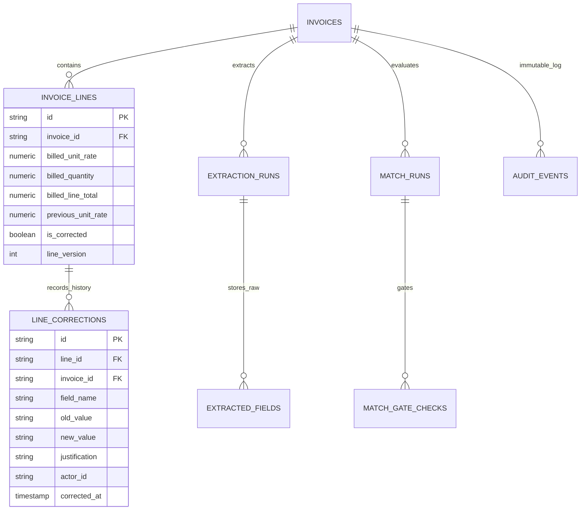

# Audited Correction & Revalidation Architecture
## Technical Architecture for Versioned Line-Item Corrections, Concurrency & Invalidation

**Artifact ID:** `CORRECTION_AND_REVALIDATION_DESIGN.md`  
**Target Repository:** `C:\Zamp Casse Study`  
**Domain Subsystem:** Accounts Payable Verification Core & Policy Enforcement  
**Date of Synthesis:** November 03, 2026  
**Status:** Certified Architecture Design Document  

---

## 1. Architectural Problem & Invariants

When an AP reviewer corrects an OCR misread (e.g. updating a unit rate from `₹1,850.00` to `₹1,050.00`), the application must treat the operation not as a simple database update, but as a **formal financial state mutation**.

### Critical Architectural Requirements:
1. **Preservation of Raw Evidence:** Original extracted OCR values must never be overwritten or deleted.
2. **Explicit Before-and-After Diffs:** The previous value, corrected value, actor ID, timestamp, and justification must be recorded immutably.
3. **Synchronous Policy Invalidation:** Previous policy gate outcomes become immediately void upon modification.
4. **Stale Approval Invalidation:** Any existing first-level or final approval must be automatically revoked if financial facts change.
5. **Optimistic Concurrency Control:** Stale writes from concurrent browser sessions must be detected and rejected.
6. **Atomicity & Transaction Safety:** Line updates, total recalculations, gate evaluations, and audit event writes must execute in a single atomic database transaction.

---

## 2. Data Model & Versioning Strategy



### 2.1 Preserving Raw vs Corrected Values
- **Raw Evidence Layer (`extracted_fields`):**
  - Populated strictly once during the initial OCR extraction pipeline.
  - Guaranteed immutable. No `UPDATE` queries are ever executed on this table.
  - Stores the original machine perception: `field_name: "billed_unit_rate", extracted_value: "14500.00", confidence: 0.99`.
- **Operational Working Layer (`invoice_lines`):**
  - Contains active fields used by the procurement matching engine: `billed_unit_rate`, `billed_quantity`, `billed_line_total`.
  - Added tracking columns:
    - `is_corrected = Column(Boolean, default=False, nullable=False)`
    - `previous_unit_rate = Column(Numeric(12, 4), nullable=True)`
    - `line_version = Column(Integer, default=1, nullable=False)`
- **Correction Audit Layer (`line_corrections` or `audit_events`):**
  - Each edit creates a structured audit record capturing the full transition delta.

---

## 3. Concurrency & Stale Write Protection

To prevent concurrent reviewer collisions, Zamp enforces **HTTP ETag / Optimistic Concurrency Control**:

```mermaid
sequenceDiagram
    autonumber
    actor ReviewerA as Reviewer A (Browser)
    actor ReviewerB as Reviewer B (Browser)
    participant API as FastAPI Backend
    participant DB as PostgreSQL Database

    Note over ReviewerA,DB: Step 1: Both reviewers fetch Invoice INV-089 (updated_at = T0)
    ReviewerA->>API: GET /invoices/inv_089
    API-->>ReviewerA: Returns Invoice (ETag: "T0")
    ReviewerB->>API: GET /invoices/inv_089
    API-->>ReviewerB: Returns Invoice (ETag: "T0")

    Note over ReviewerA,DB: Step 2: Reviewer A saves rate correction (₹14,500 -> ₹13,900)
    ReviewerA->>API: PATCH /lines/line_01 (If-Match: "T0")
    API->>DB: Validates ETag == updated_at; Updates line; Sets updated_at = T1
    DB-->>API: Transaction Committed (T1)
    API-->>ReviewerA: HTTP 200 OK (New ETag: "T1")

    Note over ReviewerB,DB: Step 3: Reviewer B attempts stale save based on T0
    ReviewerB->>API: PATCH /lines/line_01 (If-Match: "T0")
    API->>DB: Checks ETag ("T0") vs DB updated_at ("T1") -> MISMATCH!
    API-->>ReviewerB: HTTP 412 Precondition Failed
    Note over ReviewerB: Browser prompts: "This invoice was updated by Reviewer A. Please refresh to view changes."
```

---

## 4. Atomic Transaction Boundary & Revalidation Flow

The entire correction and revalidation process is executed within a **single ACID transaction**:

```python
@router.patch("/invoices/{invoice_id}/lines/{line_id}")
def update_invoice_line(
    invoice_id: str,
    line_id: str,
    payload: LineCorrectionPayload,
    if_match: Optional[str] = Header(None),
    current_user: AuthenticatedUser = Depends(require_active_membership),
    db: Session = Depends(get_db),
):
    with db.begin():
        # 1. Fetch Invoice with row-level lock (FOR UPDATE)
        inv = db.scalar(
            select(Invoice)
            .where(Invoice.id == invoice_id, Invoice.org_id == current_user.org_id)
            .with_for_update()
        )
        if not inv:
            raise HTTPException(404, "Invoice not found.")

        # 2. Optimistic Concurrency Check
        current_etag = inv.updated_at.isoformat()
        if if_match and if_match.strip('"') != current_etag:
            raise HTTPException(
                status_code=412,
                detail="Precondition Failed: Invoice has been modified by another reviewer. Please refresh."
            )

        # 3. Fetch Line
        line = db.scalar(
            select(InvoiceLine)
            .where(InvoiceLine.id == line_id, InvoiceLine.invoice_id == invoice_id)
            .with_for_update()
        )
        if not line:
            raise HTTPException(404, "Invoice line not found.")

        old_rate = float(line.billed_unit_rate)
        old_qty = float(line.billed_quantity)
        new_rate = float(payload.billed_unit_rate)
        new_qty = float(payload.billed_quantity)

        # 4. Apply Line Update & Recalculate Line Total
        line.previous_unit_rate = line.billed_unit_rate
        line.billed_unit_rate = new_rate
        line.billed_quantity = new_qty
        line.billed_line_total = round(new_rate * new_qty, 2)
        line.is_corrected = True
        line.line_version += 1

        # 5. Recalculate Invoice Subtotal & Grand Total
        all_lines = db.scalars(select(InvoiceLine).where(InvoiceLine.invoice_id == invoice_id)).all()
        new_subtotal = sum(float(l.billed_line_total) for l in all_lines)
        inv.subtotal_amount = new_subtotal
        inv.total_amount = round(new_subtotal + float(inv.tax_amount or 0.0), 2)
        inv.net_payable_amount = inv.total_amount

        # 6. CRITICAL: Invalidate Stale Approvals
        existing_approval = db.scalar(
            select(ApprovalRequest).where(ApprovalRequest.invoice_id == invoice_id)
        )
        if existing_approval:
            existing_approval.status = "REVOKED_CORRECTION"
            existing_approval.first_approver_id = None
            existing_approval.first_approved_at = None
            inv.stage = "ACTION_REQUIRED"
            inv.decision = "NEEDS_REVIEW"
            inv.decision_reason = f"Previous approval invalidated: Line {line.line_number} unit rate corrected from {old_rate:.2f} to {new_rate:.2f}."

        # 7. Synchronous Deterministic Gate Re-evaluation
        new_match_run = reevaluate_match_gates(db, inv, current_user.org_id)

        # 8. Record Immutable Audit Event
        audit_event = AuditEvent(
            id=f"evt_{uuid.uuid4().hex[:12]}",
            invoice_id=invoice_id,
            org_id=current_user.org_id,
            actor_id=current_user.id,
            actor_role=current_user.role.value if current_user.role else "AP_ASSOCIATE",
            action="LINE_ITEM_CORRECTED",
            reason=payload.correction_reason,
            source_reference=f"line_no:{line.line_number}; old_rate:{old_rate}; new_rate:{new_rate}; delta_total:{inv.total_amount}",
            created_at=datetime.datetime.utcnow(),
        )
        db.add(audit_event)

        inv.updated_at = datetime.datetime.utcnow()

    return {
        "status": "UPDATED",
        "line": serialize_line(line),
        "invoice": serialize_invoice(inv),
        "match_run": serialize_match_run(new_match_run)
    }
```

---

## 5. Failure Handling & Atomicity Guarantees

1. **All-or-Nothing Commit:**
   - If recalculation or audit logging fails, the database automatically rolls back the line rate edit. The invoice is never left in a partially updated or corrupted financial state.
2. **Idempotency on Network Retries:**
   - Retried HTTP requests supplying the same payload and `If-Match` token are handled safely:
   - If the first request committed, the second request will detect that `current_etag != if_match` and return `HTTP 412`, preventing duplicate audit events or double increments of `line_version`.
3. **Audit Log Non-Repudiation:**
   - Because audit events share the transaction boundary, an edit can **never** occur without a corresponding audit event.

---

## 6. Architecture Verification Test Cases

| Test Case ID | Scenario | Expected Behavior |
|:---|:---|:---|
| **TC-CORR-01** | Reviewer updates rate from ₹14,500 to ₹13,900 (PO Rate = ₹13,900). | Gate 6 status updates from `FAIL` to `PASS`. Line total updates to ₹13,90,000. Audit event logged. |
| **TC-CORR-02** | Reviewer updates rate while invoice is in `PENDING_SECOND_APPROVAL`. | `ApprovalRequest.status` set to `REVOKED_CORRECTION`. Invoice stage resets to `ACTION_REQUIRED`. |
| **TC-CORR-03** | Auditor role attempts to execute `PATCH /lines/{id}`. | Request rejected with `HTTP 403 Forbidden` (`Auditor has read-only permissions`). |
| **TC-CORR-04** | Stale write attempt with mismatched `If-Match` header. | Request rejected with `HTTP 412 Precondition Failed`. Database state unchanged. |
| **TC-CORR-05** | Database failure during audit event insertion. | Entire transaction rolls back; line rate remains at original value. |
