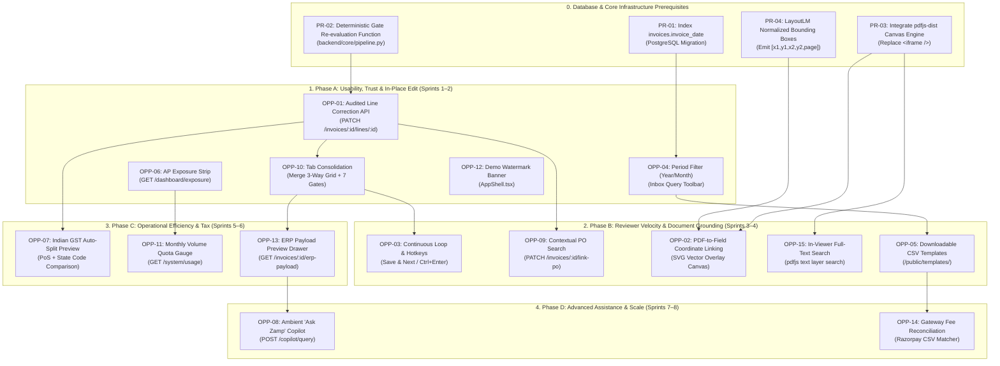

# Implementation Dependency & Critical Path Map
## Technical Dependency Topology for Zamp AP Command Center Implementation

**Artifact ID:** `IMPLEMENTATION_DEPENDENCY_MAP.md`  
**Target Repository:** `C:\Zamp Casse Study`  
**Date of Synthesis:** November 03, 2026  
**Status:** Certified Engineering Dependency Map  

---

## 1. Master Architectural Dependency Graph

---

## 2. Critical Path Analysis

The critical path represents the minimum sequential chain of technical deliverables that must be executed without slippage:

$$\mathbf{Critical\ Path} = \mathbf{PR\text{-}02} \longrightarrow \mathbf{OPP\text{-}01} \longrightarrow \mathbf{OPP\text{-}10} \longrightarrow \mathbf{OPP\text{-}03} \longrightarrow \mathbf{PR\text{-}03} \longrightarrow \mathbf{OPP\text{-}02}$$

| Sequence Step | Capability / Task | Why it is on the Critical Path | Estimated Effort |
|:---:|:---|:---|:---:|
| **1** | **PR-02: Deterministic Re-evaluator** | Line corrections cannot update gate statuses without an atomic re-evaluation function. | 2 Days |
| **2** | **OPP-01: Audited Line Edit API** | Reviewers cannot fix misread data without this backend patch endpoint. | 3 Days |
| **3** | **OPP-10: Tab Consolidation** | Unifying 3-way matching and policy gates in the UI is necessary to see re-evaluation results. | 2 Days |
| **4** | **OPP-03: Continuous Loop (`Ctrl+Enter`)** | Advancing through invoices requires that in-place corrections and tab layouts are stable. | 2 Days |
| **5** | **PR-03: `pdfjs-dist` Integration** | Replacing the native browser iframe is the prerequisite for coordinate overlays. | 4 Days |
| **6** | **OPP-02: PDF Coordinate Linking** | Renders SVG bounding boxes over canvas tokens; completes reviewer grounding. | 3 Days |

---

## 3. Prerequisite Truth Matrix by Roadmap Phase

### Phase A Prerequisites (Zero External Blockers)
All Phase A features can proceed **immediately**:
- `OPP-01` (Line Edit): Needs `PR-02` (in-repo backend re-evaluator).
- `OPP-10` (Tab Consolidation): In-repo React component refactoring.
- `OPP-04` (Period Filtering): Needs `PR-01` (SQL index migration).
- `OPP-06` (AP Exposure Scorecard): In-repo SQL aggregations.
- `OPP-12` (Demo Watermark): In-repo UI banner.

### Phase B Prerequisites (Requires Viewer Architecture Shift)
- `OPP-02` (Coordinate Linking) & `OPP-15` (Find in Document): **STRICTLY BLOCKED** by `PR-03` (`pdfjs-dist` replacing native iframe) and `PR-04` (OCR pipeline emitting coordinates).
- `OPP-03` (Continuous Review Loop): Blocked by `OPP-01` and `OPP-10`.
- `OPP-09` (Contextual PO Linker): Blocked by `OPP-01` re-evaluation logic.

### Phase C Prerequisites
- `OPP-07` (Indian GST Auto-Split): Requires Place of Supply (PoS) extraction field; cannot rely on GSTIN prefix alone.
- `OPP-13` (ERP Preview Drawer): Requires finalized SAP voucher payload schema.

### Phase D Prerequisites
- `OPP-08` ("Ask Zamp" Copilot): Requires schema-grounded LLM inference service.
- `OPP-14` (Gateway Reconciliation): Requires database migration for `settlement_reconciliations`.
