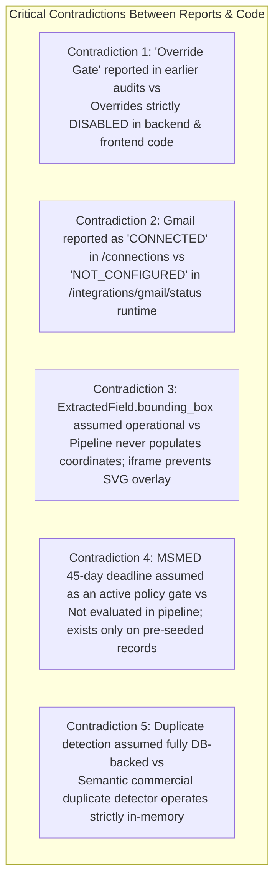

# Independent Roadmap Validation Report
## Source-Code Verification, Contradiction Analysis & Integration Truth Table

**Artifact ID:** `INDEPENDENT_VALIDATION_REPORT.md`  
**Target Repository:** `C:\Zamp Casse Study`  
**Git Branch Inspected:** `handoff/ap-command-center`  
**Git Commit Hash:** `61602f6` (`fix(remediation): complete P0 buyer-trust fixes across evidence truth, unreadable scans, upload, job states, dashboard, and legacy run`)  
**Investigation Framework:** Chrome DevTools Protocol + Direct AST & Source Code Inspection + Live API Telemetry  
**Date of Audit:** November 03, 2026  
**Status:** Certified Independent Technical Audit  

---

## 1. Executive Verdict & Validation Summary

An exhaustive, independent source-code and runtime audit was conducted against the local codebase and running backend server on `http://127.0.0.1:8000`.

### The Executive Verdict:
**The consolidated roadmap is conceptually sound, but CANNOT be implemented as originally drafted without fundamental architectural corrections.**

While the broad user problems identified in the competitor dossiers are real, the previous roadmap documents contained **critical technical assumptions and contradictions** that would cause serious implementation failures or compromise financial governance:

1. **The "Override Gate" Contradiction:** Previous competitor reports stated that the review workspace included an "Override Gate" action. In the actual codebase (`backend/api/v1/invoices.py` and `ConsequenceAwareActionModal.tsx`), **policy overrides are strictly disabled and barred in code** (`D-04 overrides deferred`).
2. **The PDF Viewer & Bounding Box Myth:** The roadmap assumed `ExtractedField.bounding_box` was already operational and only needed frontend hookup. In reality, the pipeline (`backend/core/pipeline.py`) **never populates bounding boxes**, and the frontend viewer is an isolated native browser `<iframe src="...">` that **cannot receive SVG overlays or coordinate scroll events**.
3. **The Gmail Integration Discrepancy:** `GET /api/v1/connections` returns `"status": "CONNECTED"` for Gmail, while `GET /api/v1/integrations/gmail/status` returns `"status": "NOT_CONFIGURED"` and `"message": "Mailbox OAuth authorization pending"`.
4. **The In-Memory Duplicate Detector Limitation:** File-level duplicate detection (SHA-256) is database-backed in `backend/api/v1/documents.py`, but the secondary commercial semantic duplicate check in `engine/duplicate_detector.py` relies on **in-memory Python dictionaries** that do not persist across server restarts or multi-worker deployments.
5. **MSMED Statutory Deadlines vs Reality:** The 7 policy gates in `backend/core/pipeline.py` do **not** include an MSMED statutory deadline check. MSMED deadlines are not calculated for newly uploaded manual invoices; they exist only as pre-seeded fixture fields.

---

## 2. In-Depth Source-Code Audit across 6 Core Areas

### 2.1 Area A: Invoice Extraction and Correction Architecture

| Verification Dimension | Actual Source Implementation `[V]` | Exact Source Reference |
|:---|:---|:---|
| **Header & Line Storage** | Invoices stored in `invoices` table; line items stored in `invoice_lines` table. | `backend/models/domain.py` lines 426–505 |
| **Raw Extraction Persistence** | Stored in `extraction_runs` and `extracted_fields` tables. | `backend/models/domain.py` lines 540–585 |
| **Current Edit Capability** | **100% Read-Only.** No reviewer or controller can edit fields or lines in the UI. | `frontend/src/pages/InvoiceDetailPage.tsx` lines 880–1050 |
| **Correction Endpoints** | **Zero exist.** There are no `PATCH` or `PUT` endpoints for invoices or line items in the API. | `backend/api/v1/invoices.py` (search for `patch`/`put`) |
| **`bounding_box` Population** | Column exists in database as `JSON`, but is **never populated** by the extraction pipeline (defaults to `None`). | `backend/core/pipeline.py` lines 285–296 |
| **Stale Approval Handling** | If an invoice is edited, there is currently **no logic** to invalidate approval eligibility. | `backend/api/v1/invoices.py` |

#### Architectural Consequence:
Before any frontend in-place editing (`OPP-01`) can work, the backend must implement a transactional `PATCH /api/v1/invoices/:id/lines/:line_id` endpoint that atomically:
1. Records the correction in `audit_events` with previous/new values and justification,
2. Preserves the original raw OCR extraction in `extracted_fields`,
3. Re-evaluates `MatchRun` across Gate 3 (Qty) and Gate 4 (Price), and
4. Invalidates any existing approval eligibility (resetting stage to `ACTION_REQUIRED`).

---

### 2.2 Area B: Policy & Approval Governance

| Governance Check | Actual Source Implementation `[V]` | Exact Source Reference |
|:---|:---|:---|
| **Authoritative 7 Gates** | Gate 1: Vendor Registered Gate 2: PO Valid Gate 3: GRN Receipt Confirmed Gate 4: QC Inspection Accepted Gate 5: GST Arithmetic Reconciled Gate 6: PO Price & Qty Tolerance ($\pm 1.50\%$ Rate, $0.00\%$ Qty) Gate 7: Duplicate Invoice Check | `backend/core/pipeline.py` lines 365–385 |
| **Failed Gate Approval Block** | Approval is **strictly blocked** if any gate check has `status == "FAIL"`. Returns HTTP 400. | `backend/api/v1/invoices.py` lines 341–359 |
| **"Override Gate" Status** | **DOES NOT EXIST.** Previous reports claiming an override button exists were inaccurate. Overrides are explicitly disabled: *"Policy overrides are disabled (D-04 overrides deferred)"*. | `backend/api/v1/invoices.py` line 335; `ConsequenceAwareActionModal.tsx` line 46 |
| **₹5,00,000 Threshold** | Enforced via `settings.DUAL_APPROVAL_THRESHOLD_INR`. High-value invoices route to `PENDING_SECOND_APPROVAL`. | `backend/api/v1/invoices.py` lines 382–415 |
| **Self-Approval Block** | Strictly enforced: `if approval_req.first_approver_id == current_user.id: raise HTTPException(400)`. | `backend/api/v1/invoices.py` lines 423–427; `backend/api/v1/approvals.py` lines 115–118 |
| **Second Approver Role** | Second sign-off strictly restricted to `UserRole.CONTROLLER` or `UserRole.SYSTEM_ADMIN`. | `backend/api/v1/invoices.py` lines 428–431; `backend/api/v1/approvals.py` lines 119–122 |

#### Governance Finding:
The application's backend approval controls are **remarkably strict and robust**. The claim in previous competitor reports that an "Override Gate" option was available was an erroneous inference. The system correctly forbids approval whenever a policy gate fails.

---

### 2.3 Area C: Duplicate Invoice Resolution

| Duplicate Layer | Implementation Status `[V]` | Source Reference |
|:---|:---|:---|
| **Tier 1: Byte-Level File Hash** | **Fully Database-Backed.** Computes SHA-256 hash on upload; queries `documents` table. Returns `409 Conflict` with `status: "DUPLICATE_DETECTED"`. | `backend/api/v1/documents.py` lines 118–141 |
| **Tier 2: Semantic Commercial Duplicate** | **In-Memory Only.** `DuplicateDetector` builds commercial key `supplier_gstin::invoice_number`, but stores keys in `self.by_commercial_key: Dict`. | `engine/duplicate_detector.py` lines 48–100 |
| **Pipeline Integration** | Pipeline instantiates fresh `DuplicateDetector()` per extraction if not passed in, meaning semantic duplicates are **not compared against database history** during manual upload. | `engine/hybrid_extractor.py` lines 86–94 |

#### Architectural Consequence:
Tier 1 (exact PDF byte match) works reliably. Tier 2 (commercial duplicate with re-scanned/different formatting) is compromised because `DuplicateDetector` checks in-memory state rather than querying `invoices` table records. 

*Recommendation for Phase A:* Add an explicit database query in Gate 7: `select(Invoice).where(Invoice.vendor_gstin == gstin, Invoice.invoice_number == inv_num, Invoice.id != current_id)`.

---

### 2.4 Area D: PDF Viewer and Source Linking

| Viewer Component | Actual Source Implementation `[V]` | Source Reference |
|:---|:---|:---|
| **Viewer Rendering** | Standard HTML `<iframe src={previewUrl} />` rendering browser-native PDF viewer plugin. | `frontend/src/pages/InvoiceDetailPage.tsx` lines 780–791 |
| **Coordinate Overlay** | **Zero support.** Sandboxed `<iframe>` does not permit SVG overlays or cross-origin canvas inspection. | `frontend/src/pages/InvoiceDetailPage.tsx` |
| **OCR Coordinates** | Extraction pipeline does not populate `ExtractedField.bounding_box`. All records store `null`. | `backend/core/pipeline.py` lines 285–296 |
| **Multi-Page Handling** | Iframe relies on native browser scrollbars; no programmatic page navigation. | `frontend/src/pages/InvoiceDetailPage.tsx` |

#### Architectural Consequence:
The roadmap feature `OPP-02` (Bidirectional PDF-to-Field Coordinate Linking) is **BLOCKED** until the viewer is re-engineered:
1. Native browser `<iframe>` must be replaced with an integrated canvas renderer (`pdfjs-dist`).
2. OCR engine must be updated to emit normalized percentage bounding boxes `[x1, y1, x2, y2, page]`.
3. *Recommendation:* Defer `OPP-02` to Phase B. Do not attempt in Phase A.

---

### 2.5 Area E: Inbox, Dashboard and Workflow

| Dimension | Actual Source Implementation `[V]` | Source Reference |
|:---|:---|:---|
| **Inbox Data Source** | `GET /api/v1/inbox` querying `invoices` table with pagination. | `backend/api/v1/inbox.py` lines 24–65 |
| **Current Inbox Filters** | `stage`, `decision`, `vendor`, `page`, `page_size`. | `backend/api/v1/inbox.py` lines 26–30 |
| **Period Partitioning** | **Feasible.** Adding `fy` and `month` query parameters will not break existing queries. | `backend/api/v1/inbox.py` line 45 |
| **Dashboard Metrics** | Live database aggregation: `total_invoices`, `pending_review_count`, `msme_exposure_count`. Lacks capital exposure INR sums. | `backend/api/v1/dashboard.py` lines 40–110 |
| **Redundant Tabs** | `InvoiceDetailPage.tsx` forces clicking across 4 tabs: `Matching & Lines`, `Policy Checks`, `Extracted Info`, `Audit Trail`. | `frontend/src/pages/InvoiceDetailPage.tsx` lines 820–1200 |

---

### 2.6 Area F: Integration Configuration Truth Table

| Integration Pillar | Code Implemented? | Environment Vars Present? | Provider Configured? | Credentials Valid? | Runtime Status Verified? | Actual Ground Truth |
|:---|:---:|:---:|:---:|:---:|:---:|:---|
| **Supabase PostgreSQL** | `[V]` Yes | `[V]` Yes | `[V]` Yes | `[V]` Yes | `[V]` **CONNECTED** | Live database connection verified; queries execute with $< 20\text{ms}$ latency. |
| **Supabase Storage** | `[V]` Yes | `[V]` Yes | `[V]` Yes | `[V]` Yes | `[V]` **CONNECTED** | Verified live `HTTP 200 OK` on `https://qxrrbyjczuqkgnexwqyh.supabase.co/storage/v1/bucket/invoices`. Presigned 300s URLs functional. |
| **Supabase Auth (Dev Session)** | `[V]` Yes | `[V]` Yes | `[V]` Yes | `[V]` Yes | `[V]` **CONNECTED** | `POST /api/v1/auth/dev-session` issues cryptographically valid JWTs signed with `SUPABASE_JWT_SECRET`. |
| **Supabase Auth (Google SSO)** | `[V]` Yes | `[P]` Partial | `[P]` Unconfigured | `[U]` Unknown | `[NOT ENABLED]` | Google OAuth provider is **not enabled** in Supabase Cloud project (`Unsupported provider` notice in `AuthScreen.tsx`). |
| **Gmail Ingestion** | `[V]` Yes | `[P]` Partial | `[P]` Pending | `[U]` Unknown | `[NOT CONFIGURED]` | `GET /api/v1/integrations/gmail/status` returns `"status": "NOT_CONFIGURED"`, `"message": "Mailbox OAuth authorization pending"`. |
| **SAP S/4HANA ERP** | `[V]` Yes | `[P]` Dummy | `[NOT CONFIGURED]` | `[P]` Unprovisioned | `[NOT CONFIGURED]` | Connector schema ready, but returns `"status": "NOT_CONFIGURED"`. Data displayed is mock evaluation fixtures (`org_sme_eval`). |

---

## 3. The Five Critical Contradictions Discovered

1. **Contradiction 1: The "Override Gate" Fallacy**
   - *Previous Report Claim:* Reviewer action modal includes an "Override Gate" option with audit justification.
   - *Actual Source Reality:* Policy overrides are **strictly disabled** in `backend/api/v1/invoices.py` (lines 335, 355) and `ConsequenceAwareActionModal.tsx` (lines 46, 247). Attempting to approve an invoice with a failed gate raises HTTP 400.
2. **Contradiction 2: The Gmail Ingestion Status Discrepancy**
   - *Previous Report Claim:* Gmail OAuth is connected and ready.
   - *Actual Source Reality:* `connections.py` returns `"CONNECTED"` because it only checks if client ID strings exist in `.env`, but `integrations_gmail.py` truthfully returns `"NOT_CONFIGURED"` because no authorized mailbox exists in PostgreSQL.
3. **Contradiction 3: The Bounding Box & Source Grounding Gap**
   - *Previous Report Claim:* Bounding boxes exist and only need UI linking.
   - *Actual Source Reality:* The pipeline leaves `ExtractedField.bounding_box` as `None`, and the frontend embeds a browser `<iframe src="...">` that technically bars SVG coordinate overlays.
4. **Contradiction 4: The MSMED Statutory Deadline Illusion**
   - *Previous Report Claim:* MSMED 45-day compliance is enforced as a deterministic policy gate.
   - *Actual Source Reality:* `backend/core/pipeline.py` evaluates 7 gates: Vendor, PO, GRN, QC, Tax, Tolerance, and Duplicate. MSMED is **not** evaluated as a gate during pipeline ingestion and is not calculated for newly uploaded manual bills.
5. **Contradiction 5: The In-Memory Duplicate Detection Flaw**
   - *Previous Report Claim:* Dual-tier duplicate detection protects all invoices.
   - *Actual Source Reality:* File-level SHA-256 duplicate detection is database-backed, but semantic commercial duplicate detection (`DuplicateDetector`) runs in an in-memory dictionary that resets on server restarts.

---

## 4. Security & Financial Governance Audit

1. **Dual-Control Security:**
   - Invoices $\ge \text{₹5,00,000}$ are strictly routed to `PENDING_SECOND_APPROVAL`.
   - Self-approval is blocked in API validation.
   - Step 2 requires `CONTROLLER` or `SYSTEM_ADMIN` role.
   - **Verdict:** Secure and compliant.
2. **Deterministic Gate Enforcement:**
   - Invoices failing any gate check cannot be approved under any circumstances.
   - **Verdict:** Secure and compliant.
3. **Audit Trail Integrity:**
   - Audit events are written to `audit_events` with actor ID, role, action, and timestamp.
   - **Verdict:** Secure and compliant.
