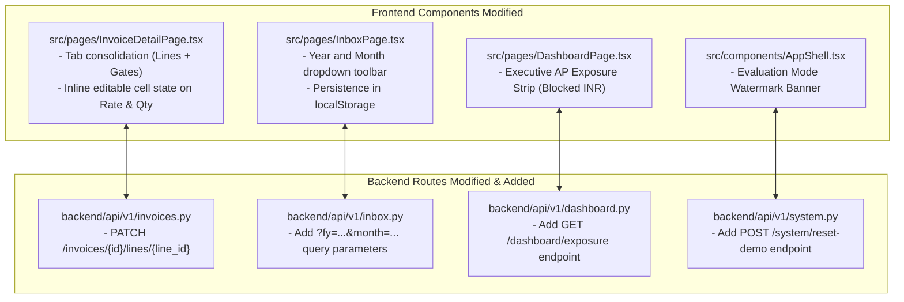
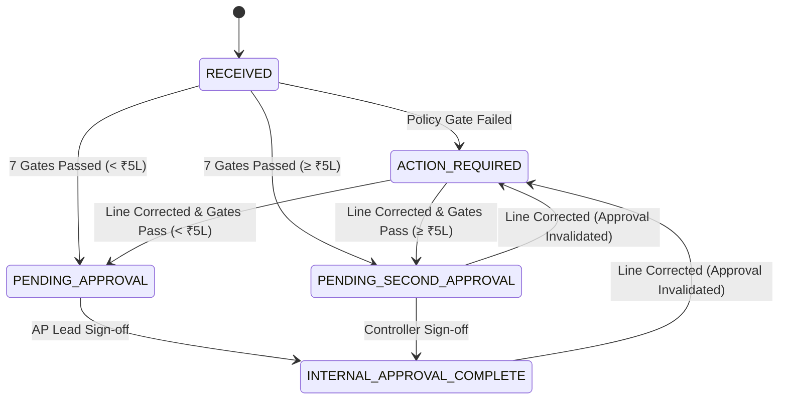

# Phase A Engineering Specification
## Implementation-Ready Specification for Zamp AP Command Center

**Artifact ID:** `PHASE_A_ENGINEERING_SPEC.md`  
**Target Repository:** `C:\Zamp Casse Study`  
**Git Branch Baseline:** `handoff/ap-command-center` (Commit `61602f6`)  
**Target Release Phase:** Phase A (Sprints 1–2 / 10 Engineering Days)  
**Status:** Certified Engineering Specification  

---

## 1. Scope & Non-Goals

### 1.1 Phase A In-Scope Objectives
Phase A focuses exclusively on **trust, core usability, and reviewer ergonomics**:
1. **Audited In-Place Line Item Correction (`OPP-01`):** Enable authorized AP reviewers to correct misread OCR unit rates and quantities inline, triggering synchronous policy gate re-evaluation while preserving the original raw OCR values.
2. **Workspace Tab Consolidation (`OPP-10`):** Eliminate fragmented tab-switching by unifying the 4-Node 3-Way Match grid and 7 Policy Gates into a single, scrollable primary viewport.
3. **Temporal Accounting Period Filtering (`OPP-04`):** Introduce synchronized Year and Month dropdown selectors in the Invoices Inbox to partition active closing periods from historical records.
4. **Evaluation Mode Watermark & Reset Action (`OPP-12`):** Render a permanent top banner `[Evaluation Mode: Mock ERP Fixtures Loaded]` with a 1-click test state reset control.
5. **Executive AP Capital Exposure & Operational Aging Scorecard (`OPP-06`):** Surface `Total Blocked AP Liability (INR)` and `Operational Aging Payables` on the dashboard, strictly distinguishing operational aging from verified statutory MSME deadlines.

### 1.2 Explicit Non-Goals for Phase A
- **NO SVG Bounding Box Overlays:** Bounding box coordinate highlighting (`OPP-02`) is deferred to Phase B because it requires replacing the native browser `<iframe />` with `pdfjs-dist`.
- **NO Keyboard Queue Advancing (`Ctrl+Enter`):** Continuous queue navigation (`OPP-03`) is sequenced into Phase B after in-place corrections are thoroughly stabilized.
- **NO Policy Overrides:** Failed deterministic gates cannot be overridden under any circumstances.
- **NO General Ledger or Sales Invoicing:** Out of scope for AP verification.
- **NO Direct Bank Payment Execution:** Clearance in Zamp represents AP verification approval, not bank disbursement.

---

## 2. Screens & Components Affected



---

## 3. Detailed Technical Specifications

---

### 3.1 Feature 1: Audited In-Place Line Item Correction & Synchronous Re-evaluation (`OPP-01`)

#### API Contract
- **Endpoint:** `PATCH /api/v1/invoices/{invoice_id}/lines/{line_id}`
- **Permissions Required:** `AP_ASSOCIATE`, `AP_LEAD`, `CONTROLLER`, or `SYSTEM_ADMIN` (Auditor role strictly forbidden).
- **Request Headers:**
  - `Authorization: Bearer <supabase_jwt>`
  - `If-Match: "<invoice_updated_at_timestamp>"` (Optimistic locking to prevent stale writes)
- **Request Body Schema:**
  ```json
  {
    "billed_quantity": 100.0,
    "billed_unit_rate": 13900.0,
    "correction_reason": "OCR character misread on rate (was read as 14500.00)"
  }
  ```
- **Response Schema (HTTP 200 OK):**
  ```json
  {
    "status": "UPDATED",
    "line": {
      "id": "line_01",
      "line_number": 1,
      "description": "HR Coils 2.5mm",
      "billed_quantity": 100.0,
      "billed_unit_rate": 13900.0,
      "billed_line_total": 1390000.0,
      "previous_unit_rate": 14500.0,
      "is_corrected": true
    },
    "invoice": {
      "id": "inv_089",
      "total_amount": 1640200.0,
      "stage": "ACTION_REQUIRED",
      "decision": "MATCH_CANDIDATE",
      "approval_invalidated": true
    },
    "new_match_run": {
      "id": "mr_new_01",
      "overall_result": "PASS",
      "gates": [
        {"gate_number": 3, "gate_name": "GRN Receipt Confirmed", "status": "PASS"},
        {"gate_number": 6, "gate_name": "PO Price & Quantity Tolerance", "status": "PASS", "variance_pct": 0.0}
      ]
    }
  }
  ```

#### Backend Transactional Implementation Flow:
1. Open database transaction (`db.begin()`).
2. Verify invoice exists and belongs to `current_user.org_id`.
3. Check `If-Match` header against `Invoice.updated_at`. If mismatched, raise `HTTP 412 Precondition Failed` (stale write protection).
4. Retrieve target `InvoiceLine`. Store `old_rate = line.billed_unit_rate` and `old_qty = line.billed_quantity`.
5. Update `InvoiceLine.billed_unit_rate = payload.billed_unit_rate` and `billed_quantity = payload.billed_quantity`.
6. Recalculate `InvoiceLine.billed_line_total = billed_unit_rate * billed_quantity`.
7. Recalculate invoice totals: `subtotal_amount = sum(lines)` and `total_amount = subtotal + tax_amount`.
8. **Invalidate Stale Approvals:**
   - If invoice was in `STAGE == INTERNAL_APPROVAL_COMPLETE` or `PENDING_SECOND_APPROVAL`:
     - Delete existing `ApprovalRequest` record or set `status = "INVALIDATED_DUE_TO_CORRECTION"`.
     - Reset invoice `stage = "ACTION_REQUIRED"` and `decision = "NEEDS_REVIEW"`.
9. **Synchronously Re-run Deterministic Gates:**
   - Fetch PO rate and quantity from `work_order_snapshots`.
   - Calculate rate variance:
     $$\text{variance\_pct} = \frac{\text{billed\_rate} - \text{po\_rate}}{\text{po\_rate}} \times 100$$
   - Evaluate Gate 6: `status = "PASS"` if $|\text{variance\_pct}| \le 1.50\%$ and $\text{billed\_qty} == \text{po\_qty}$; else `"FAIL"`.
   - Update `MatchGateCheck` records.
10. **Record Immutable Audit Event:**
    - Write event to `audit_events`:
      ```json
      {
        "action": "LINE_ITEM_CORRECTED",
        "actor_id": current_user.id,
        "actor_role": current_user.role,
        "reason": payload.correction_reason,
        "source_reference": f"line_id:{line_id}; old_rate:{old_rate}; new_rate:{payload.billed_unit_rate}"
      }
      ```
11. Commit transaction atomically.

---

### 3.2 Feature 2: Workspace Tab Consolidation (`OPP-10`)

#### Frontend Layout Refactoring:
- File: `frontend/src/pages/InvoiceDetailPage.tsx`
- Replace the 4-tab bar with a 2-segment controller:
  1. `[Tab 1] Verification & Matching (Default)`
  2. `[Tab 2] Audit History & Raw Metadata`

```text
+----------------------------------------------------------------------------------------------------+
| LEFT PANE: 50% SOURCE PDF VIEWER               | RIGHT PANE: 50% UNIFIED VERIFICATION WORKSPACE    |
| (Interactive browser iframe with presigned URL)| (Segment: [• Verification] [  Audit & Meta])      |
|                                                |                                                   |
|                                                | +-----------------------------------------------+ |
|                                                | | 7 DETERMINISTIC POLICY GATES (Collapsible)    | |
|                                                | | [✓ Gate 1: Vendor]      [✓ Gate 2: PO Match]  | |
|                                                | | [✓ Gate 3: GRN Qty]     [✓ Gate 4: QC Pass]   | |
|                                                | | [✓ Gate 5: GST Math]    [✓ Gate 6: Tolerances]| |
|                                                | | [✓ Gate 7: Duplicate Check Passed]            | |
|                                                | +-----------------------------------------------+ |
|                                                |                                                   |
|                                                | 4-NODE 3-WAY MATCHING GRID (Double-Click to Edit) |
|                                                | +-----------------------------------------------+ |
|                                                | | Line | Description | Inv Qty | PO Qty| Inv Rate| |
|                                                | | 1    | HR Coils    | 100 MT  | 100 MT| ₹13,900 | |
|                                                | |      | (Rate Matched within ±1.5% tolerance)  | |
|                                                | +-----------------------------------------------+ |
|                                                |                                                   |
|                                                | GOVERNANCE ACTIONS                                |
|                                                | [Approve Review]  [Put on Hold]  [Reject Invoice] |
+----------------------------------------------------------------------------------------------------+
```

---

### 3.3 Feature 3: Temporal Accounting Period (Year/Month) Filtering in Inbox (`OPP-04`)

#### API Changes
- Update `GET /api/v1/inbox` in `backend/api/v1/inbox.py`:
  - Add optional parameters: `fy: Optional[str] = Query(None)`, `month: Optional[int] = Query(None)`.
  - Filter logic:
    ```python
    if month is not None:
        stmt = stmt.where(func.extract('month', Invoice.invoice_date) == month)
    if fy is not None:
        # Indian FY starts in April (e.g. FY 2026-27 covers April 2026 - March 2027)
        start_year = int(fy.split("-")[0].replace("FY", "").strip())
        stmt = stmt.where(
            or_(
                and_(func.extract('year', Invoice.invoice_date) == start_year, func.extract('month', Invoice.invoice_date) >= 4),
                and_(func.extract('year', Invoice.invoice_date) == start_year + 1, func.extract('month', Invoice.invoice_date) <= 3)
            )
        )
    ```
- **Database Index Migration:**
  - Create migration adding B-tree index on `invoices.invoice_date`:
    `CREATE INDEX idx_invoices_invoice_date ON invoices (org_id, invoice_date);`

---

### 3.4 Feature 4: Executive AP Capital Exposure & Operational Aging Scorecard (`OPP-06`)

#### API Contract
- **Endpoint:** `GET /api/v1/dashboard/exposure`
- **Response Schema:**
  ```json
  {
    "total_blocked_liability_inr": 2845200.0,
    "blocked_invoices_count": 4,
    "operational_aging_over_30_days_inr": 1230000.0,
    "operational_aging_count": 2,
    "cleared_for_erp_inr": 4510000.0,
    "cleared_invoices_count": 8,
    "statutory_msme_verified_due_inr": 0.0,
    "statutory_msme_verified_count": 0,
    "statutory_msme_note": "Statutory MSME §15 deadlines displayed only for verified Udyam suppliers."
  }
  ```
- **Crucial Governance Requirement:** Operational aging (> 30 days) must be visually distinct from verified MSME statutory deadlines to prevent fabricating statutory liabilities.

---

### 3.5 Feature 5: Evaluation Mode Watermark & Reset Control (`OPP-12`)

- **Component:** `frontend/src/components/AppShell.tsx`
- **Render Condition:** Active tenant is `org_sme_eval` or `VITE_APP_MODE === 'demo'`.
- **UI Presentation:** Top sticky bar in high-contrast slate:
  `[Evaluation Mode: Mock ERP Fixtures Loaded] | All procurement data reflects synthetic test cases. [Reset Demo State]`
- **Reset Endpoint:** `POST /api/v1/system/reset-demo` (Restores baseline database fixtures).

---

## 4. State Transitions & Invalidation Matrix



| Current Invoice State | Action Triggered | Resulting Invoice State | Approval Invalidation Consequence |
|:---|:---|:---|:---|
| `ACTION_REQUIRED` (Failing Gate 4) | Correct Line Rate (falls within $\pm 1.50\%$) | `PENDING_APPROVAL` (or `PENDING_SECOND_APPROVAL` if $\ge \text{₹5L}$) | None; moves toward approval. |
| `PENDING_SECOND_APPROVAL` (Step 1 signed) | Correct Line Rate or Qty | `ACTION_REQUIRED` | **Step 1 approval is wiped.** Status reverts to require fresh AP review. |
| `INTERNAL_APPROVAL_COMPLETE` | Correct Line Rate or Qty | `ACTION_REQUIRED` | **ERP export authorization revoked.** Full re-approval required. |

---

## 5. Security, RBAC & Audit Controls

1. **Role Enforcement on Line Corrections:**
   - Permitted: `AP_ASSOCIATE`, `AP_LEAD`, `CONTROLLER`, `SYSTEM_ADMIN`.
   - Forbidden: `AUDITOR` (`HTTP 403 Forbidden: Auditors have read-only permissions`).
2. **Mandatory Concurrency Token:**
   - Every `PATCH` request must supply `If-Match` header matching `Invoice.updated_at`. Stale writes are rejected with `HTTP 412`.
3. **Immutable Audit Persistence:**
   - Any modification writes a synchronous event to `audit_events`.
   - Raw OCR extraction in `extracted_fields` is permanently preserved.
4. **Self-Approval Bar:**
   - Second approval strictly bars `current_user.id == first_approver_id`.

---

## 6. Acceptance Criteria & Definition of Done (DoD)

- [ ] **AC-1:** Reviewers can double-click `Invoice Rate` in the verification table, enter a new number, and press `Enter`.
- [ ] **AC-2:** The `PATCH /api/v1/invoices/:id/lines/:line_id` endpoint validates the payload and updates `InvoiceLine.billed_unit_rate`.
- [ ] **AC-3:** If the corrected rate falls within $\pm 1.50\%$ of the PO rate, Gate 4 and Gate 6 update synchronously from `FAIL` to `PASS`.
- [ ] **AC-4:** The audit trail displays a timestamped event with actor, old rate, new rate, and justification.
- [ ] **AC-5:** If an invoice in `PENDING_SECOND_APPROVAL` is corrected, its approval status is immediately invalidated and reset to `ACTION_REQUIRED`.
- [ ] **AC-6:** The review workspace renders 3-Way Match lines and 7 Policy Gates in a unified view without requiring tab clicks.
- [ ] **AC-7:** Selecting `November 2026` in the Inbox filters the table to invoices in that month.
- [ ] **AC-8:** The dashboard displays `Total Blocked AP Liability (INR)` and `Operational Aging Payables` with distinct styling from statutory MSME alerts.
- [ ] **AC-9:** The top banner `[Evaluation Mode: Mock ERP Fixtures Loaded]` is visible when logged in under `org_sme_eval`.
