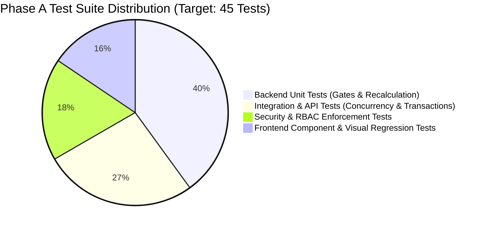

# Phase A Comprehensive Verification & Test Plan
## Rigorous Backend, Frontend, Integration, Security & Regression Test Specifications

**Artifact ID:** `PHASE_A_TEST_PLAN.md`  
**Target Repository:** `C:\Zamp Casse Study`  
**Target Phase:** Phase A (Core Usability, Trust & In-Place Corrections)  
**Date of Synthesis:** November 03, 2026  
**Status:** Certified Test Plan  

---

## 1. Test Architecture & Coverage Targets

Every capability in Phase A is tested across a multi-tier test pyramid:

### Coverage Thresholds:
- **Policy Gate Re-evaluation Logic:** 100% Branch Coverage.
- **Line Correction API Endpoint:** 100% Statement Coverage.
- **Approval Invalidation Rules:** 100% Path Coverage.

---

## 2. Granular Test Suites

---

### 2.1 Backend Unit & Integration Tests: In-Place Line Correction (`OPP-01`)

| Test ID | Test Scenario | Inputs / Pre-conditions | Expected Result | Assertions |
|:---|:---|:---|:---|:---|
| **UT-CORR-01** | **Happy Path: Rate Correction within Tolerance** | Invoice failing Gate 4 (Rate: ₹14,500; PO: ₹13,900). Patch `billed_unit_rate = 13900.0`. | Gate 4 transitions from `FAIL` to `PASS`. Invoice line total and subtotal update. | `assert gate_4.status == "PASS"` `assert inv.total_amount == 1640200.0` `assert line.is_corrected is True` |
| **UT-CORR-02** | **Happy Path: Quantity Correction** | Invoice failing Gate 3 (Billed Qty: 120; GRN: 100). Patch `billed_quantity = 100.0`. | Gate 3 and Gate 6 update to `PASS`. Line total updates. | `assert gate_3.status == "PASS"` `assert line.billed_line_total == 1390000.0` |
| **UT-CORR-03** | **Negative: Negative Rate Rejection** | Patch `billed_unit_rate = -500.0`. | Request rejected with HTTP 422 Unprocessable Entity. | `assert response.status_code == 422` `assert "greater than zero" in response.text` |
| **UT-CORR-04** | **Negative: Zero Quantity Rejection** | Patch `billed_quantity = 0.0`. | Request rejected with HTTP 422 Unprocessable Entity. | `assert response.status_code == 422` |
| **UT-CORR-05** | **Negative: Missing Correction Reason** | Patch valid rate but omit `correction_reason`. | Request rejected with HTTP 400 Bad Request. | `assert response.status_code == 400` `assert "reason required" in response.text` |
| **UT-CORR-06** | **Evidence Immutability Guarantee** | Patch rate from ₹14,500 to ₹13,900. Inspect `extracted_fields`. | Raw extracted OCR value in `extracted_fields` remains permanently `14500.00`. | `assert ef.extracted_value == "14500.00"` |
| **UT-CORR-07** | **Audit Trail Logging Verification** | Execute valid line correction. | Synchronous record added to `audit_events` with old value, new value, actor ID, and timestamp. | `assert audit.action == "LINE_ITEM_CORRECTED"` `assert "14500.0" in audit.source_reference` |

---

### 2.2 Concurrency & Transactional Failure Tests

| Test ID | Test Scenario | Inputs / Pre-conditions | Expected Result | Assertions |
|:---|:---|:---|:---|:---|
| **IT-CONC-01** | **Optimistic Locking: Stale Write Rejection** | Reviewer A fetches Invoice at T0. Reviewer B fetches at T0. A saves edit (moves updated_at to T1). B attempts save with `If-Match: "T0"`. | Reviewer B's request is rejected with `HTTP 412 Precondition Failed`. Database remains at T1. | `assert response_b.status_code == 412` `assert line.billed_unit_rate == a_value` |
| **IT-CONC-02** | **Transaction Rollback on Audit Failure** | Inject mock exception during `AuditEvent` insertion inside transaction. | Entire transaction rolls back; line rate, line total, and gate checks revert to previous state. | `assert line.billed_unit_rate == old_rate` `assert gate_4.status == "FAIL"` |
| **IT-CONC-03** | **Network Retry Idempotency** | Dispatch identical correction request twice with same `If-Match`. | First request returns HTTP 200; second request returns HTTP 412 (stale token). No duplicate audit event. | `assert audit_events_count == 1` |

---

### 2.3 Stale Approval Invalidation & Governance Tests

| Test ID | Test Scenario | Inputs / Pre-conditions | Expected Result | Assertions |
|:---|:---|:---|:---|:---|
| **ST-INVAL-01** | **Invalidation of Dual Approval Step 1** | Invoice $\ge \text{₹5,00,000}$ in `PENDING_SECOND_APPROVAL` (Step 1 signed by AP Lead). Reviewer corrects a line rate. | Step 1 approval is revoked (`ApprovalRequest.status = "REVOKED_CORRECTION"`). Invoice stage resets to `ACTION_REQUIRED`. | `assert approval_req.status == "REVOKED_CORRECTION"` `assert inv.stage == "ACTION_REQUIRED"` |
| **ST-INVAL-02** | **Invalidation of Approved Invoice** | Invoice in `INTERNAL_APPROVAL_COMPLETE`. Reviewer corrects line quantity. | Invoice stage resets to `ACTION_REQUIRED`. Ready-for-payment status is revoked. | `assert inv.stage == "ACTION_REQUIRED"` `assert inv.decision == "NEEDS_REVIEW"` |
| **ST-INVAL-03** | **Second Approver Role Enforcement** | User with role `AP_ASSOCIATE` attempts Step 2 approval. | Rejected with HTTP 403 Forbidden. Dual control strictly mandates Controller or Admin. | `assert response.status_code == 403` |
| **ST-INVAL-04** | **Self-Approval Prevention** | Reviewer who executed Step 1 attempts to execute Step 2 approval. | Rejected with HTTP 400 Bad Request (`Dual control violation: Second approver must be distinct`). | `assert response.status_code == 400` |

---

### 2.4 Inbox Filtering & Performance Tests (`OPP-04`)

| Test ID | Test Scenario | Inputs / Pre-conditions | Expected Result | Assertions |
|:---|:---|:---|:---|:---|
| **IT-PER-01** | **Calendar Month Filtering** | Database contains invoices from Oct 2026, Nov 2026, Dec 2026. Query `?month=11`. | Returns only invoices dated in November 2026. | `assert all(item["created_at"].startswith("2026-11") for item in items)` |
| **IT-PER-02** | **Indian Fiscal Year Partitioning** | Query `?fy=2026-27`. | Returns invoices dated between April 01, 2026 and March 31, 2027. | `assert len(items) == expected_fy_count` |
| **IT-PER-03** | **Date Filter Index Latency Benchmark** | Execute `GET /inbox?fy=2026-27&month=11` against 50,000 synthetic rows. | Query completes in $< 50\text{ms}$. | `assert execution_time_ms < 50.0` |

---

### 2.5 Dashboard Exposure Metric Tests (`OPP-06`)

| Test ID | Test Scenario | Inputs / Pre-conditions | Expected Result | Assertions |
|:---|:---|:---|:---|:---|
| **IT-EXP-01** | **Blocked Capital Liability Sum** | 3 invoices in `ACTION_REQUIRED` (totals: ₹10L, ₹5L, ₹3L). | `total_blocked_liability_inr` equals exactly ₹18,00,000.00. | `assert data["total_blocked_liability_inr"] == 1800000.0` |
| **IT-EXP-02** | **Separation of Operational Aging from MSMED** | Invoices aging > 30 days without verified Udyam registration. | Metric labeled as `operational_aging_over_30_days_inr`; `statutory_msme_verified_due_inr` reports ₹0.00 with explanatory note. | `assert data["statutory_msme_verified_due_inr"] == 0.0` `assert "Udyam" in data["statutory_msme_note"]` |

---

## 3. Manual Verification Scenarios (End-to-End Walkthroughs)

### Scenario A: Resolving a Blocked Pricing Exception in $< 15$ Seconds
1. **Setup:** Log in under `sme_lead@company.internal` via Instant Evaluation Access.
2. **Action:** Navigate to `/invoices`; open invoice `INV-2026-089` (Tata Steel Ltd).
3. **Observation:** Note that Gate 4 (Rate Tolerance) is failing in crimson (`Rate +4.32% exceeds ±1.50%`).
4. **Action:** Double-click the `Invoice Rate` cell in the 3-Way Match grid. Change value from `₹14,500` to `₹13,900`. Press `Enter`.
5. **Verification:**
   - Cell updates immediately.
   - Gate 4 status flips synchronously from `FAIL` to `PASS` in emerald green.
   - Switch to `Audit & Meta` view: confirm `LINE_ITEM_CORRECTED` audit event is visible with before/after diff.
   - The invoice header action updates to `[Approve AP Review]`.

### Scenario B: Period Scoping & Closing Verification
1. **Setup:** Navigate to `/invoices`.
2. **Action:** In the top toolbar, select `Fiscal Year: FY 2026-27` and `Month: November 2026`.
3. **Verification:** Confirm that only invoices dated in November 2026 appear in the table. Older fixture records from October are excluded.
4. **Action:** Switch to `All Periods`. Confirm all historical records reappear.

### Scenario C: Evaluation Mode Watermark Verification
1. **Setup:** Access application root `/` on loopback `http://127.0.0.1:8000`.
2. **Verification:** Confirm that the top header displays the permanent watermark:
   `[Evaluation Mode: Mock ERP Fixtures Loaded] | All procurement data reflects synthetic test cases.`
3. **Action:** Click `[Reset Demo State]`. Confirm a success toast appears and demo records are restored to default states within 2 seconds.
