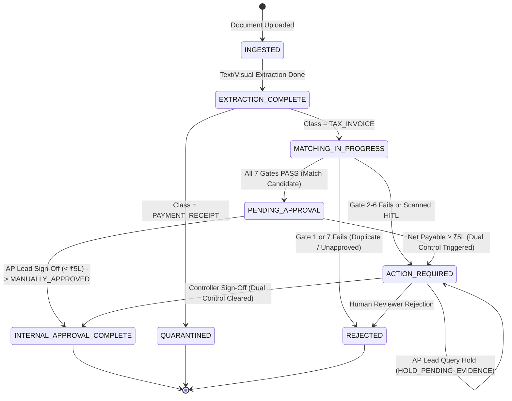

# Accounts Payable Business Rules & Matching Logic

This document specifies the deterministic business logic, matching gates, tax verification rules, and approval state transitions enforced by the Autonomous AP Command Center.

---

## 1. The Seven Deterministic Match Gates

Every ingested invoice passes through 7 sequential policy gates implemented in Python/SQL ([`engine/indian_tax_rules.py`](../engine/indian_tax_rules.py) and [`backend/api/v1/invoices.py`](../backend/api/v1/invoices.py)):

| Gate # | Gate Name | Validation Objective | Pass Condition | Failure Action |
| :---: | :--- | :--- | :--- | :--- |
| **Gate 1** | **Vendor Master Verification** | Confirms supplier is an active, approved vendor. | Vendor GSTIN and PAN match active record in `vendors` table. Status != `SUSPENDED`. | `REJECTED` (`VENDOR_UNAPPROVED` or `VENDOR_SUSPENDED`). |
| **Gate 2** | **PO Authorization** | Confirms invoice references a valid, open Purchase Order. | Referenced PO exists in `purchase_orders` for the same tenant; remaining balance covers invoice amount. | `FLAGGED_EXCEPTION` (`MISSING_PO_REFERENCE` or `PO_EXHAUSTED`). |
| **Gate 3** | **GRN Receipt Match** | Verifies physical receipt of goods in warehouse. | Linked Goods Receipt Note (`goods_receipt_notes`) exists; received quantity $\ge$ billed quantity. | `FLAGGED_EXCEPTION` (`GRN_NOT_FOUND` or `UNRECEIVED_QUANTITY`). |
| **Gate 4** | **QC Technical Acceptance** | Verifies delivered items passed quality inspection. | Linked Quality Certificate (`qc_certificates`) exists with status `ACCEPTED`. | `FLAGGED_EXCEPTION` (`QC_REJECTED` or `QC_PENDING`). |
| **Gate 5** | **GST Arithmetic & Tax Match** | Verifies tax math and interstate/intrastate classification. | $\left\|\text{Subtotal} + \text{Taxes} - \text{Total}\right\| \le ₹20.00$; correct IGST vs CGST+SGST based on state codes. | `FLAGGED_EXCEPTION` (`GST_MATH_MISMATCH` or `INVALID_TAX_SPLIT`). |
| **Gate 6** | **PO Price & Qty Tolerance** | Checks billed unit rates against contracted PO prices. | Line unit rate variance $\le 1.50\%$; line quantity does not exceed remaining PO quantity. | `FLAGGED_EXCEPTION` (`PRICE_VARIANCE_EXCEEDED` or `QTY_OVERRUN`). |
| **Gate 7** | **Duplicate Payment Check** | Prevents double payment of identical invoices. | No existing record with identical SHA-256 hash or identical (Vendor GSTIN + Invoice Number + FY). | `REJECTED` (`DUPLICATE_DETECTED`). |

---

## 2. Indian GST Arithmetic & Statutory Rules

The system implements GST verification tailored to Indian corporate statutory compliance:

1. **State Code Reconciliation:**
   - Evaluates the first 2 digits of the Supplier GSTIN (e.g., `29` for Karnataka, `27` for Maharashtra) against Customer GSTIN.
   - **Intrastate Supply (Same State):** Requires equal split between **CGST** and **SGST** (e.g. 9% CGST + 9% SGST for an 18% rate). Zero IGST permitted.
   - **Interstate Supply (Different State):** Requires **IGST** (e.g. 18% IGST). Zero CGST and SGST permitted.
2. **Tolerance Bounds:**
   - Penny/rounding discrepancies up to **₹20.00** (`settings.ROUNDING_TOLERANCE_INR`) are absorbed to accommodate software rounding differences.
3. **MSME Statutory Payment Tracking:**
   - The vendor's MSME classification (Micro, Small, Medium) is tracked. Under Section 15 of the MSME Development Act, payment is flagged if aging approaches 45 days.

---

## 3. Financial Approval State Machine

### Critical State Definitions

- **`MATCH_CANDIDATE` (Recommendation):** Initial pipeline status when all 7 match gates pass. It is **not** an approval. It indicates that the invoice is clean and awaiting human sign-off.
- **`AUTO_APPROVED` (Straight-Through Processing):** Reserved strictly for fully automated, touchless processing where zero human intervention took place. Conflating human approvals with `AUTO_APPROVED` is forbidden as it skews touchless rate analytics.
- **`MANUALLY_APPROVED` (Human Review Complete):** Assigned when an `AP_LEAD` or `CONTROLLER` reviews the 3-pane evidence and submits `APPROVE_AP_REVIEW`.
- **`HOLD_PENDING_EVIDENCE` (Query Hold):** Applied when an AP Lead places an operational hold (e.g., waiting for vendor rate credit note or amended PO).
- **`QUARANTINED`:** Assigned to non-payable commercial files (receipts, statements). Zero liability is registered in the AP ledger.

---

## 4. Dual-Control Financial Policy ($\ge ₹5,00,000$)

- **Threshold:** Set at `settings.DUAL_APPROVAL_THRESHOLD_INR = 500000.00` (₹5 Lakhs INR).
- **Single Approval ($< ₹5,00,000$):** Can be fully approved by `AP_LEAD` (`usr_sme_lead_01`).
- **Dual Approval ($\ge ₹5,00,000$):**
  1. `AP_LEAD` submits first approval. Invoice stage transitions to `ACTION_REQUIRED` with `ApprovalRequest` status `PENDING_SECOND_APPROVAL`.
  2. Second sign-off must be performed by a different user with role `CONTROLLER` (`usr_sme_ctrl_01`).
  3. **Anti-Self-Approval Rule:** If the Controller's user ID matches the initial approver, the request is rejected with HTTP 400.

---

## 5. Strict Decoupling from Payments & ERP Ledger Mutations

The AP Command Center strictly enforces internal governance separation:
- **Zero Payment Execution:** No payment gateway, bank API, NEFT, RTGS, or ACH disbursement is executed upon internal approval.
- **Zero Direct ERP Ledger Mutations:** The system does not directly post debits/credits to SAP S/4HANA or ERP general ledgers upon approval. Export of approved vouchers for ERP ingestion is an asynchronous batch process governed by corporate treasury authorization.
