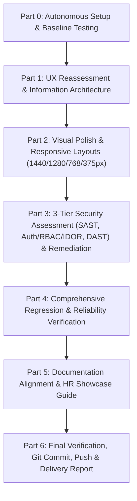

# Autonomous Execution Plan — AP Command Center
## UX Completion, UI Polish, Security Assessment & HR Showcase Readiness

**Mission Initiated:** 2026-11-02T06:05:00+05:30  
**Target Branch:** `handoff/ap-command-center`  
**Repository:** `https://github.com/neerajs22is-ux/Zamp-Case-Study-PS-1-`  
**Lead Agent Role:** Full-Stack & Security Integration Lead  

---

### Executive Overview & Strategic Mandate

The goal of this autonomous mission is to transition the AP Command Center from its current Phase 2 state into a fully polished, robust, secure, and self-explanatory enterprise showcase ready for evaluation by executive management, finance leaders, and HR evaluators.

The user will be away for approximately 3 hours. All actions must be executed methodically, rigorously verified, and recorded in persistent execution state files with automated regression proof at every step.

---

### Architectural & Operating Invariants

1. **Product Truth Strictness:**
   - Zero fabrication of live external integrations (no live SAP S/4HANA sync, no automated payment execution, no external vendor email dispatch).
   - Clear disclosure of synthetic evaluation fixtures and static snapshot data.
   - Maintain the strict split: Bedrock Mantle async extraction $\to$ deterministic 7-gate validation $\to$ human sign-off $\to$ append-only audit trail.
2. **Security & Financial Controls:**
   - D-04 gate overrides remain strictly disabled; failed gates unconditionally block approvals in frontend and backend.
   - Strict dual-approval enforcement for disbursements $> \text{INR } 5,00,000$.
   - Multi-tenant data isolation strictly enforced at the SQL query and repository layer.
   - RBAC enforced server-side: Auditors are read-only; AP Leads and Controllers have segregated signing authorities.
3. **Ergonomic & Visual Standards (Using Impeccable, Stageshow, and Taste-Skill):**
   - Eliminate text overlap, cramped tables, overcrowded cards, and excessive nested containers.
   - Enforce scannable visual hierarchy across Desktop (1440px, 1280px), Tablet (768px), and Mobile (375px).
   - Provide clear one-sentence purposes on every operational screen.

---

### Phase Breakdown & Execution Sequence

#### Part 0: Autonomous Setup & Baseline Testing
- Discover environment capabilities and confirm daemon processes.
- Initialize `docs/AUTONOMOUS_EXECUTION_STATE.md`, `docs/RECOVERY_AND_RESUME.md`, and `docs/FINAL_DELIVERY_CHECKLIST.md`.
- Run complete baseline test suite (`pytest`, `playwright`, `vite build`) and record starting metrics.

#### Part 1: Full Product & UX Reassessment
- Reconcile all navigation routes: `/today`, `/invoices`, `/invoices/:id`, `/approvals`, `/audit`, `/vendors`, `/setup`.
- Address the 10 Central User-Experience Questions directly in the UI layout.
- Eliminate visual clutter, repetitive explanations, and engineering jargon across every page.
- Build an end-to-end transparent invoice lifecycle journey from receipt to internal sign-off.

#### Part 2: Visual Polish & Responsive Hardening
- Audit every page at 1440px, 1280px, 768px, and 375px.
- Fix text clipping, wrapping collisions, badge overflows, and table horizontal scroll issues.
- Apply consistent typography, rhythm, and card structures per `impeccable` and `taste-skill`.
- Capture before and after visual regression screenshots in `scratch/screenshots/`.

#### Part 3: Security Assessment & Penetration Testing
- **Assessment A (Static Analysis, Secrets & Dependencies):** Scan code for hardcoded secrets, SQL injection vectors, unsafe deserialization, insecure regex, and vulnerable packages.
- **Assessment B (Authentication, RBAC & Multi-Tenant Isolation):** Test unauthenticated access, IDOR on invoices/documents, cross-tenant leak attempts, self-approval bypass attempts, and auditor modification attempts.
- **Assessment C (Dynamic API & Web Penetration Testing):** Test API input validation, path traversal on file download/preview endpoints, rate limiting, and CORS/security headers.
- **Remediation:** Fix all Critical and High findings directly in code; verify fixes with re-tests.

#### Part 4: Comprehensive Regression & Reliability Verification
- Execute full 266+ pytest suite.
- Run multi-role Playwright browser verification suite across all viewports.
- Run clean production frontend build (`npm run build`).

#### Part 5: Repository Cleanup & HR Showcase Guide
- Clean up any untracked or unnecessary debug files.
- Align `README.md`, `docs/PRODUCT_CAPABILITY_TRUTH.md`, and `docs/KNOWN_LIMITATIONS.md`.
- Author comprehensive `docs/HR_SHOWCASE_GUIDE.md` detailing the 6 core evaluation scenarios with exact IDs.

#### Part 6: Final Delivery, Git Commit & Handoff
- Stage verified files and perform git security review.
- Commit to branch `handoff/ap-command-center`.
- Push to GitHub remote `origin/handoff/ap-command-center`.
- Generate final delivery report `docs/FINAL_PROJECT_COMPLETION_REPORT.md` and complete the goal.
