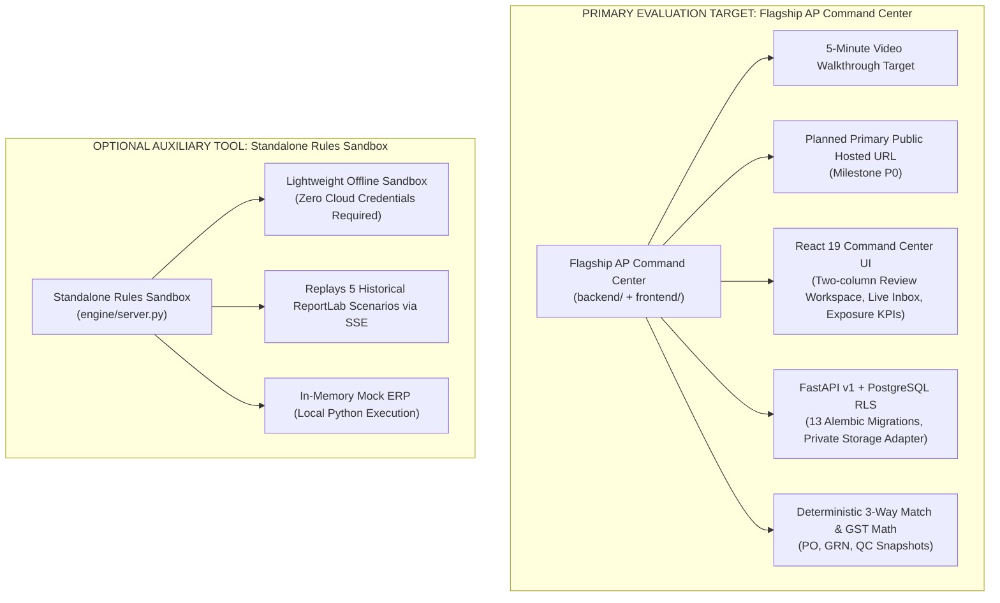

# Zamp PS-1 Case Study Product Strategy: AP Command Center vs. Standalone Engine

**Date:** 8 November 2026  
**Author:** Neeraj Shivkumar  
**Target Evaluation:** Zamp AI Solutions Associate — Problem Statement 1 (PS-1: Autonomous Accounts Payable Processing)  
**Document Status:** Candidate Product Strategy & Architectural Proposal Baseline  

---

## 1. Executive Intent & Submission Hierarchy

The primary product and central evaluation target of this submission is the **AP Command Center** (`backend/` + `frontend/`). 

It is **NOT** a speculative enterprise roadmap, an optional future add-on, or a secondary prototype. It is the full-stack, production-grade application designed, implemented, and tested to meet the Zamp PS-1 mandate: an autonomous accounts payable digital employee that handles real documents, validates financial truth, explains its decisions to human operators, and enforces strict governance.



### The Two Application Roles:
1. **The Flagship AP Command Center (Primary Deliverable):**
   - The application showcased in the required **5-minute video walkthrough**.
   - The application target for the **planned primary public hosted URL** (Milestone P0).
   - The application through which evaluators experience safe, interactive role-based access (`AP_LEAD`, `CONTROLLER`, `AUDITOR`, `AP_ASSOCIATE`) to inspect golden path matching, rate/quantity exceptions, low-res scan routing, and dual-control approvals once deployment is complete.
2. **The Standalone Engine (Secondary / Auxiliary Sandbox):**
   - An in-memory, single-process execution tool retained under `engine/`.
   - Serves as an **offline evaluation sandbox** for reviewers who want to inspect deterministic regex parsing and millisecond Server-Sent Event (SSE) streaming locally without provisioning PostgreSQL, Supabase, or AWS credentials.
   - Distinct from the flagship in extraction modality, database persistence, and statutory rules.

---

## 2. Required Submission Deliverables & Deployment Status

| Deliverable | Form & Target Environment | Current Status | Evaluation Purpose |
| :--- | :--- | :--- | :--- |
| **Deliverable 1: Live Hosted Application** | Planned Public Hosted URL (Cloud Run / Render) | **Pending P0 Deployment** (Local execution verified on `127.0.0.1:8001`) | Proves the application runs in a public cloud environment, accepts documents, persists state, and executes multi-tenant AP governance. |
| **Deliverable 2: 5-Minute Walkthrough Video** | Recorded Screencast + Defense Narrative | **Pending P1 Recording** (Script & shotlist prepared) | Demonstrates domain fluency, the 3-pane evidence view, 3-way matching against PO/GRN/QC, rate variance handling, degraded scan triage, and dual-control sign-off. |
| **Optional Deliverable 3: Standalone Sandbox** | Secondary Local / Hosted Link (`python run.py --sandbox`) | **Locally Runnable** (`python run.py`) | Provides a lightweight, self-contained local environment without cloud credentials to inspect algorithmic policy gates and line-matching mechanics offline. |

---

## 3. Architectural Boundaries & System Comparison

To avoid evaluator confusion, the architectural boundaries between the flagship and the standalone sandbox are strictly demarcated:

```
┌──────────────────────────────────────────────────────────────────────────────────────────┐
│                             AP COMMAND CENTER ARCHITECTURE                               │
├────────────────────────────────────────┬─────────────────────────────────────────────────┤
│ Dimension                              │ Flagship AP Command Center                      │
├────────────────────────────────────────┼─────────────────────────────────────────────────┤
│ Primary Codebase                       │ backend/ (FastAPI) + frontend/ (React 19)       │
│ User Interface                         │ Modern React 19 SPA, Tailwind CSS, Lucide Icons │
│ Document Inspection                    │ 3-Pane View: Document PDF, Line Match, Gates    │
│ Multi-Tenancy & Security               │ PostgreSQL Row-Level Security (RLS), ASVS L2    │
│ Object Storage                         │ Supabase Private Storage (Signed URLs)          │
│ Extraction Pipeline                    │ Hybrid: Bedrock Mantle Qwen-235B + Grounding    │
│ Match Verification                     │ 3-Way: Invoice vs PO vs GRN vs QC Inspection    │
│ Currency & Statutory Tax               │ INR / Multi-Currency + Indian GST (CGST/SGST)   │
│ Payment Governance                     │ Never auto-disburses; emits MATCH_CANDIDATE     │
│ Persistence Layer                      │ PostgreSQL (13 Alembic Migrations)              │
├────────────────────────────────────────┼─────────────────────────────────────────────────┤
│ Dimension                              │ Standalone Rules Sandbox                        │
├────────────────────────────────────────┼─────────────────────────────────────────────────┤
│ Primary Codebase                       │ engine/server.py + engine/pipeline.py           │
│ User Interface                         │ Single-file index.html + Tailwind CDN           │
│ Document Inspection                    │ Card-based summary + SSE stage stepper          │
│ Multi-Tenancy & Security               │ Single-tenant in-memory execution               │
│ Object Storage                         │ Local filesystem (fixtures/data/)               │
│ Extraction Pipeline                    │ Deterministic regex over text-stream layout     │
│ Match Verification                     │ 2-Way: Invoice vs Purchase Order                │
│ Currency & Statutory Tax               │ USD flat tax calculation                        │
│ Payment Governance                     │ Auto-approves vouchers on 5/5 gates pass        │
│ Persistence Layer                      │ In-memory MockERPDatabase (reset per run)       │
└────────────────────────────────────────┴─────────────────────────────────────────────────┘
```

### Shared Engine Libraries:
The standalone sandbox is not entirely isolated; the flagship backend directly reuses verified algorithmic engines located in `engine/`:
- [`engine/hybrid_extractor.py`](../engine/hybrid_extractor.py): Core hybrid document intelligence engine.
- [`engine/pdf_safety.py`](../engine/pdf_safety.py): High-throughput PDF extraction and safety checks.
- [`engine/grounding.py`](../engine/grounding.py): Mathematical source-grounding, token occurrence, and page provenance verification.
- [`engine/indian_tax_rules.py`](../engine/indian_tax_rules.py): Statutory GST arithmetic and state-code tax logic.
- [`engine/duplicate_detector.py`](../engine/duplicate_detector.py): Multi-factor duplicate submission detection.

---

## 4. Modality & Processing Boundaries

1. **Digital Text PDFs (Golden Path):**
   - Extracted through the hybrid pipeline with mathematical source-text grounding.
   - Values must strictly align with source page text; ungrounded fields fail closed to human review.
2. **Degraded & Scanned Invoices:**
   - Scanned or low-contrast documents ($\sigma < 10.0$ or text length $< 20$ chars) fail the extraction pre-screener.
   - **Fail-Closed Governance Invariant:** In accordance with institutional AP safety, degraded scans are routed directly to `FLAGGED_HITL_REVIEW`. The system never guesses financial figures from degraded images.
   - *Palmyra Vision 7B:* Evaluated in a dedicated benchmark harness ([`engine/palmyra_benchmark_runner.py`](../engine/palmyra_benchmark_runner.py)), but deliberately feature-flagged OFF in the active production extraction path to prevent unverified model variance on financial records.
3. **Commercial Non-Invoice Documents:**
   - Inbound payment receipts, delivery challans, and customer acknowledgments are intercepted by the document classifier and routed to `QUARANTINE_NON_INVOICE`, completely preventing false AP liability creation.

---

## 5. Decision State Taxonomy

The flagship enforces a zero-trust financial state machine distinct from the standalone sandbox:

| Flagship State | Meaning | Operational Consequence |
| :--- | :--- | :--- |
| **`MATCH_CANDIDATE`** | All 7 deterministic match gates passed (PO, GRN, QC, GST, Rates, Math, Dupes). | Ready for human sign-off; **never auto-disbursed**. |
| **`FLAGGED_EXCEPTION`** | Contractual rate, quantity, or tax variance detected against PO/GRN. | Routed to AP Lead with automated debit note recommendation. |
| **`FLAGGED_HITL_REVIEW`** | Low-contrast scan, missing PO, or unverified grounding evidence. | Placed in triage queue for manual OCR verification. |
| **`ACTION_REQUIRED`** | Supplier clarification required (e.g. missing bank details, GSTIN mismatch). | 1-click supplier inquiry draft generated. |
| **`REJECTED`** | Hard compliance failure (suspended vendor, invalid format, hard duplicate). | Transaction terminated; formal rejection notice logged. |
| **`QUARANTINE_NON_INVOICE`**| Non-payable document (receipt, delivery note). | Fenced in security vault with zero liability creation. |

---

## 6. Implementation & Positioning Realignment

To execute this product strategy truthfully and reliably:
1. **The Front Door (`README.md`):** Must present the AP Command Center as the primary flagship product, leading with its architecture, video plans, and truthful local/hosted launch commands.
2. **The Launcher (`run.py`):** In the upcoming P0 implementation milestone, `python run.py` will launch the flagship Command Center (`backend.main:app`) by default, relegating the standalone engine to `python run.py --sandbox`.
3. **Container Deployment (`Dockerfile`):** Already targets `backend.main:app` with multi-stage React 19 compilation, fully aligned with the flagship strategy.
