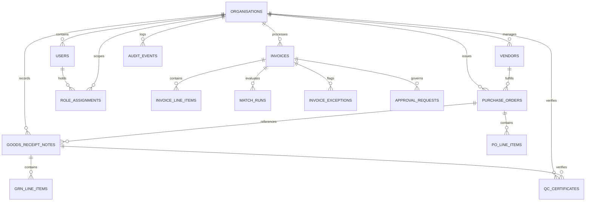

# Database Architecture & Migration Guide

The Autonomous AP Command Center uses **PostgreSQL 15+** managed via SQLAlchemy 2.0 ORM and Alembic migrations.

---

## 1. Schema Overview

The database schema is organized around multi-tenant accounts payable operations, audit immutability, and relational reconciliation:



### Core Entities

1. **`organisations`**: Multi-tenant customer accounts (e.g. `org_sme_eval`). All tables contain `org_id` column enforcing strict row-level segregation.
2. **`users` & `role_assignments`**: Real user identities and their active role assignments (`AP_ASSOCIATE`, `AP_LEAD`, `CONTROLLER`, `AUDITOR`, `SYSTEM_ADMIN`) within each tenant.
3. **`vendors`**: Authorized supplier master records, including Legal Name, Trade Name, GSTIN, PAN, Bank Details, and MSME Classification.
4. **`purchase_orders` & `po_line_items`**: Approved procurement commitments containing unit prices, authorized quantities, and delivery milestones.
5. **`goods_receipt_notes` (GRN)**: Warehouse receipt vouchers confirming physically delivered quantities and delivery dates.
6. **`qc_certificates`**: Quality inspection records confirming technical acceptance or rejection of received goods.
7. **`documents`**: Ingested binary files tracked by cryptographic SHA-256 hash, storage object path, modality classification (`DIGITAL_TEXT_PDF`, `SCANNED_IMAGE`), and ingestion status.
8. **`invoices` & `invoice_line_items`**: Commercial liabilities extracted from documents, including invoice number, invoice date, currency, GSTIN, taxable subtotal, CGST, SGST, IGST, and net payable.
9. **`match_runs` & `invoice_exceptions`**: Deterministic 7-gate match results, variance records (price/quantity discrepancies), and severity levels.
10. **`approval_requests`**: Workflow state records for single and dual-approval financial controls.
11. **`audit_events`**: Append-only, immutable operational log recording every ingestion, system classification, math validation, match gate evaluation, and human action.
12. **`quarantined_documents`**: Register of non-payable commercial files (advance payment receipts, vendor account statements, credit advices) with SHA-256 and quarantine reason.

---

## 2. Row-Level Security (RLS) & Tenant Isolation

Tenant isolation is enforced through two redundant layers:

1. **Application-Level SQLAlchemy Query Scoping:**
   Every query executed in [`backend/core/database.py`](../backend/core/database.py) requires an active `tenant_id` context (`set_tenant_context(org_id)`). ORM queries strictly filter by `org_id == current_org_id`.
2. **PostgreSQL Native Row-Level Security (RLS):**
   PostgreSQL RLS policies on Supabase enforce that queries executed with Supabase JWTs cannot access rows belonging to other `org_id`s:
   ```sql
   ALTER TABLE invoices ENABLE ROW LEVEL SECURITY;
   CREATE POLICY tenant_isolation_policy ON invoices
       FOR ALL
       USING (org_id = current_setting('app.current_tenant', true));
   ```

---

## 3. Database-Level Audit Immutability

To guarantee compliance with statutory audit standards (Companies Act 2013 and SOC 2 Type II), the `audit_events` table is protected by a PostgreSQL trigger that blocks `UPDATE` and `DELETE` operations at the database engine level:

```sql
CREATE OR REPLACE FUNCTION prevent_audit_events_mutation()
RETURNS TRIGGER AS $$
BEGIN
    RAISE EXCEPTION 'Audit events are strictly append-only and cannot be updated or deleted.';
END;
$$ LANGUAGE plpgsql;

CREATE TRIGGER trg_audit_events_immutability
BEFORE UPDATE OR DELETE ON audit_events
FOR EACH ROW
EXECUTE FUNCTION prevent_audit_events_mutation();
```

---

## 4. Connection Separation Architecture

To prevent serverless connection starvation and guarantee DDL safety:

```
FastAPI Application (Port 8000)
    │
    ├── Runtime Queries ──► Port 6543 (Supabase Transaction Pooler) ──► PgBouncer (High Concurrency)
    │
Alembic Migrations / CLI
    │
    └── DDL Migrations  ──► Port 5432 (Direct PostgreSQL / Session) ──► PostgreSQL Engine (Schema Locks)
```

- **Runtime Connection (`DATABASE_URL`):** Connects to PgBouncer Transaction Pooler on port `6543`. Optimized for low latency and scale-to-zero serverless containers. Prepared statements are disabled.
- **Migration Connection (`MIGRATION_DATABASE_URL`):** Connects to direct PostgreSQL on port `5432`. Required for Alembic transactional DDL locks (`CREATE TABLE`, `ALTER TABLE`).

---

## 5. Running Migrations

1. **Verify Migration Status:**
   ```bash
   alembic current
   ```

2. **Apply All Pending Migrations:**
   ```bash
   alembic upgrade head
   ```

3. **Generate a New Migration (Schema Change):**
   ```bash
   alembic revision --autogenerate -m "describe_schema_change"
   ```

4. **Rollback the Last Migration:**
   ```bash
   alembic downgrade -1
   ```
