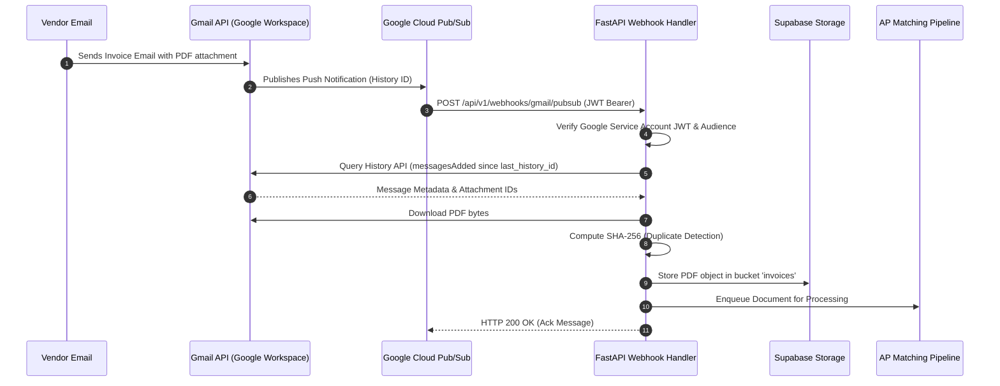

# Gmail Ingestion & Webhook Architecture

This document details the automated email ingestion subsystem of the Autonomous Accounts Payable (AP) Command Center.

---

## 1. Overview & Operational Flow

The Gmail ingestion pipeline continuously monitors designated AP inboxes (e.g. `ap-invoices@company.com`) for incoming vendor bills, extracts PDF attachments, computes cryptographic SHA-256 hashes, and enqueues them for extraction without human intervention.

---

## 2. Security & Webhook Authentication

1. **Least-Privilege Scopes:** The OAuth integration requests only `https://www.googleapis.com/auth/gmail.readonly`. Zero write or send permissions are requested.
2. **Encrypted Refresh Tokens:** In production, user and mailbox refresh tokens are encrypted at rest using AES-256-GCM with a dedicated master key (`GMAIL_ENCRYPTION_KEY`) before persistence in the `gmail_accounts` table.
3. **Pub/Sub Push Authentication:** Incoming webhooks on `POST /api/v1/webhooks/gmail/pubsub` are verified against Google's public OIDC certs (`https://www.googleapis.com/oauth2/v3/certs`). Requests must match the configured `PUBSUB_SERVICE_ACCOUNT_EMAIL` and `PUBSUB_VERIFICATION_AUDIENCE`.

---

## 3. Reliability & Deduplication

- **Incremental History API:** The ingestion worker uses Gmail's `users.history.list` API, synchronizing only messages added since the last stored `history_id`. This prevents duplicate message fetches and eliminates polling overhead.
- **Payload Idempotency:** Before persisting an attachment, the system calculates its SHA-256 checksum. If an invoice with an identical hash already exists in `documents` for that tenant, ingestion is safely acknowledged without duplicating the financial record.
- **Timeout Safety & Reclaim:** Long-running attachments enforce an internal deadline of 240 seconds (`GMAIL_SYNC_TIMEOUT_SECONDS`), comfortably beneath Cloud Run's 300-second container timeout. In-flight jobs unacknowledged after 30 minutes are reclaimed by a background reconciliation scheduler.
