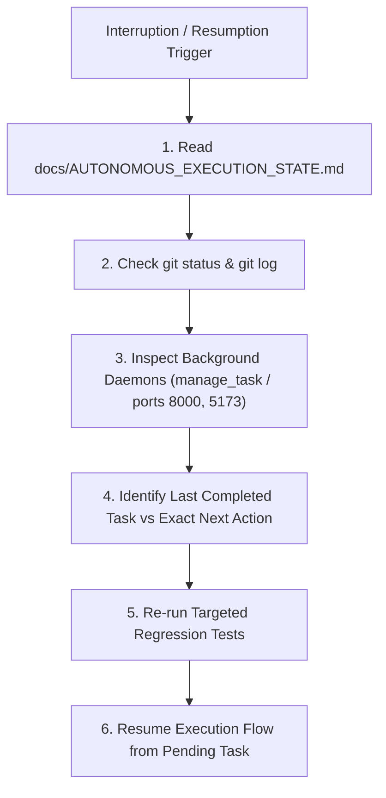

# Recovery and Resume Protocol — AP Command Center
## Autonomous Interruption Handling & State Recovery

**Target Environment:** Antigravity AI Agent Assistant on Windows PowerShell  
**Application Base Directory:** `c:\Zamp Casse Study`  
**Git Branch:** `handoff/ap-command-center`  

---

### 1. Interruption Scenarios & Response Guide

If an agent run is interrupted, tool calls fail, or the context is compacted:



#### Step 1: Read Authoritative State
Read `docs/AUTONOMOUS_EXECUTION_STATE.md` to identify:
- Last recorded checkpoint.
- Active phase.
- Exact next action.

#### Step 2: Inspect Git Status
Run:
```powershell
git status
git log -n 5 --oneline
```
- If the working directory has uncommitted files, inspect `git diff` to determine whether they belong to the current incomplete task.
- If changes are partial and untested, DO NOT commit them. Complete the task or revert cleanly to the last verified commit.

#### Step 3: Inspect Backend & Frontend Services
Verify if port 8000 (FastAPI) and port 5173 (Vite) are responding:
```powershell
Get-Process -Name python, node -ErrorAction SilentlyContinue
Test-NetConnection -ComputerName 127.0.0.1 -Port 8000
```
If FastAPI is not running:
```powershell
python -m uvicorn backend.main:app --host 127.0.0.1 --port 8000
```
If Vite is not running:
```powershell
npm --prefix frontend run dev
```

#### Step 4: Resume at Exact Task
Resume execution strictly from the first incomplete task in `docs/AUTONOMOUS_EXECUTION_STATE.md`. Do not re-run completed phases from scratch.

---

### 2. Failure Prevention Invariants

1. **No Infinite Loops:** If a tool call or command fails more than 2 times, stop retrying blindly. Read the error log, inspect the code, formulate an explicit fix, or document the limitation.
2. **Safe Git Operations:**
   - Never use `git push --force`.
   - Never commit `.env` or credential files.
   - Always run `npm --prefix frontend run build` and `pytest tests/` before creating a commit.
3. **Multi-Agent Conflict Prevention:**
   - All code edits and commits are routed through the Primary Integration Agent.
   - Background subagents are used strictly for read-only research, security analysis, or visual inspections.
