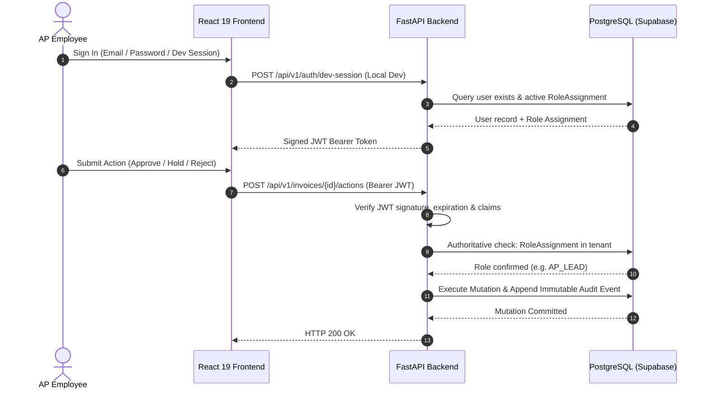

# Security Architecture & Role-Based Access Control (RBAC)

This document specifies the authentication, authorization, role enforcement, and cryptographic safeguards of the Autonomous Accounts Payable (AP) Command Center.

---

## 1. Authentication Architecture

The application uses **Supabase Auth** with JSON Web Tokens (JWT) signed using HS256 (symmetric secret) or RS256/ES256 (asymmetric keys).

### JWT Claim Architecture

To ensure strict compatibility with PostgreSQL Row-Level Security (RLS) while maintaining granular application permissions:

1. **Database Role Claim (`role`):** Standard claim set to `"role": "authenticated"`. Supabase PostgreSQL RLS relies on this claim to grant table access.
2. **Application Role Claims (`user_role` and `app_metadata.role`):** Carry the specific enterprise role string (`AP_LEAD`, `CONTROLLER`, `AP_ASSOCIATE`, `AUDITOR`).
3. **Server-Side Authoritative Resolution:** The backend never trusts JWT role claims blindly. The [`resolve_server_side_membership`](../backend/core/auth.py) function queries the database `role_assignments` table for the authenticated `user_id` and `org_id`. Forged or tampered role claims in the JWT payload are ignored.

---

## 2. Role-Based Access Control (RBAC) Matrix

The platform enforces 5 distinct roles:

| Role Name | Scope & Persona | Read Invoices | Upload & Ingest | Approve ($< ₹5L$) | Approve ($\ge ₹5L$) | Place Query Hold | Reject Invoice |
| :--- | :--- | :---: | :---: | :---: | :---: | :---: | :---: |
| **`AP_ASSOCIATE`** | Junior AP Clerk | ✅ | ✅ | ❌ | ❌ | ❌ | ❌ |
| **`AP_LEAD`** | AP Team Lead / Senior Accountant | ✅ | ✅ | ✅ | Initiates Dual Control | ✅ | ✅ |
| **`CONTROLLER`** | Financial Controller / VP Finance | ✅ | ✅ | ✅ | ✅ Secondary Sign-off | ✅ | ✅ |
| **`AUDITOR`** | Statutory & Internal Auditor | ✅ (Read-Only)| ❌ | ❌ | ❌ | ❌ | ❌ |
| **`SYSTEM_ADMIN`** | IT & DevOps Administrator | ✅ | ✅ | ❌ | ❌ | ❌ | ❌ |

### Special Role Enforcement Rules

1. **Auditor Immutability Rule:** Any mutation attempt (`POST /api/v1/invoices/{id}/actions` or document uploads) by a user with role `AUDITOR` immediately returns **HTTP 403 Forbidden** (*"Auditor role is strictly read-only and cannot execute mutations"*).
2. **Dual-Control Enforcement Rule:** Invoices with net payable $\ge ₹5,00,000.00$ require two distinct individuals:
   - First approval by `AP_LEAD` transitions invoice stage to `ACTION_REQUIRED` and creates an `ApprovalRequest` with status `PENDING_SECOND_APPROVAL`.
   - Second sign-off must be executed by a user with role `CONTROLLER`.
   - **Anti-Self-Approval Check:** The second approver cannot be the same user ID as the initial approver. Self-approval attempts return **HTTP 400 Bad Request** (*"Self-approval rejected under dual control policy"*).

---

## 3. Development Session Security (`POST /api/v1/auth/dev-session`)

To prevent unauthorized access while allowing frictionless local development, the development session generator is fortified with 3 redundant security layers:

1. **Environment Gate:** Strictly blocked if `APP_ENV` is `staging` or `production` (returns HTTP 403 Forbidden).
2. **Explicit Feature Flag:** Requires `ENABLE_DEV_SESSION=true` in `.env` (defaults to `false`).
3. **Loopback IP Sandbox:** Inspects client IP address. Only requests originating from `127.0.0.1`, `localhost`, `::1`, or `testclient` are accepted. External network callers receive HTTP 403 Forbidden.
4. **Identity Verification:** Mints tokens only for existing active employees in `users` with verified `role_assignments` in the tenant. Non-existent identities are rejected.

---

## 4. Secret Hygiene & Storage Security

- **Server-Side Secret Containment:** All master keys (`SUPABASE_JWT_SECRET`, `SUPABASE_SERVICE_ROLE_KEY`, `MANTLE_API_KEY`, `GMAIL_CLIENT_SECRET`) reside exclusively in server-side environment variables.
- **Zero Frontend Leakage:** The React frontend bundle contains zero references to server-side keys. All document retrieval utilizes signed URLs generated server-side with a strict 900-second (15-minute) TTL.
- **Git Shielding:** `.gitignore` excludes `.env`, `*.token`, `*.jwt`, `*.key`, and `scratch/` directories.
