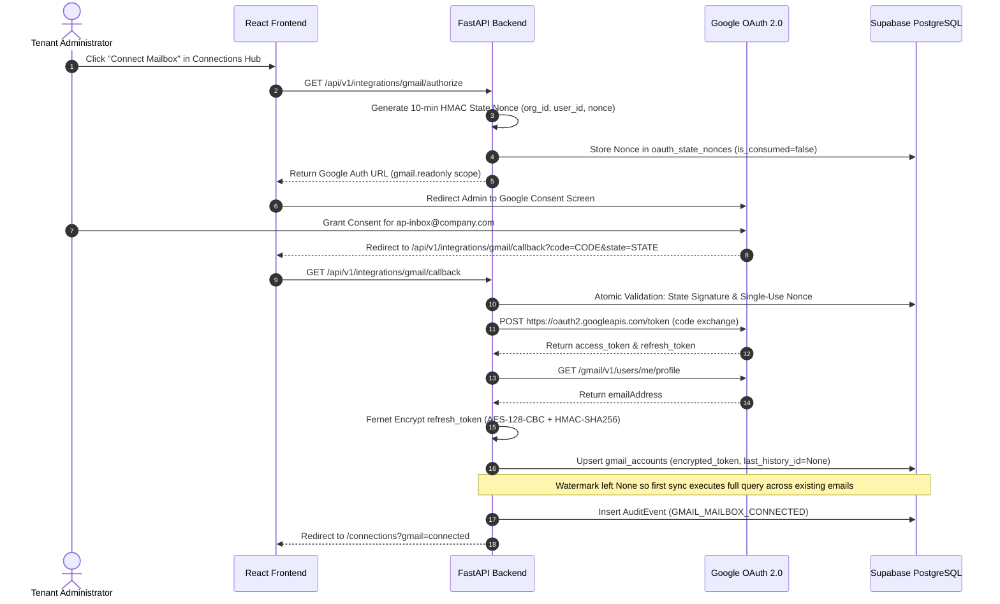
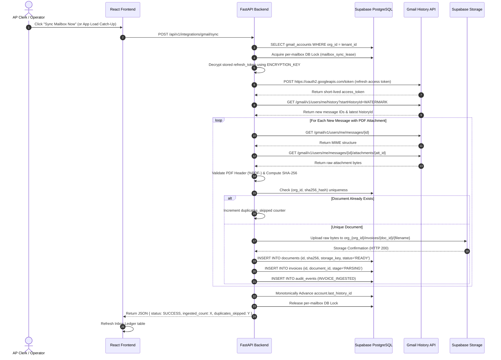
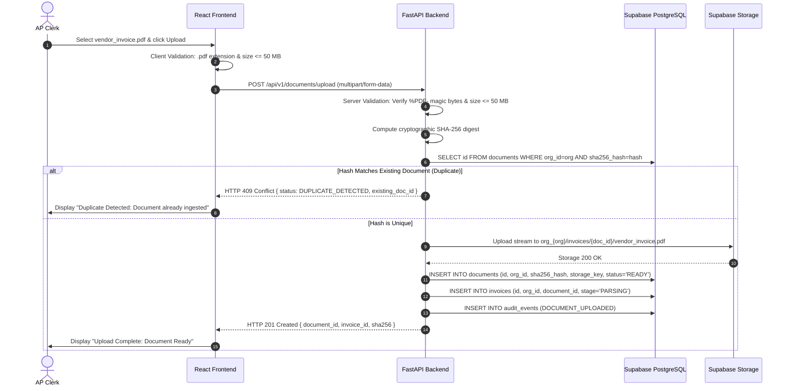
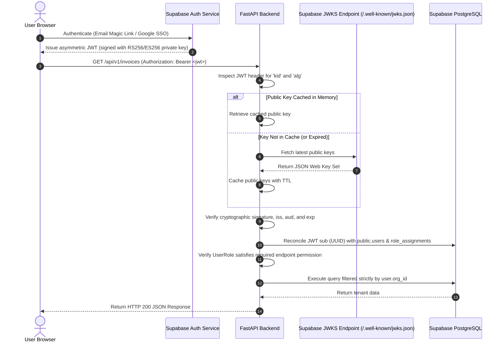
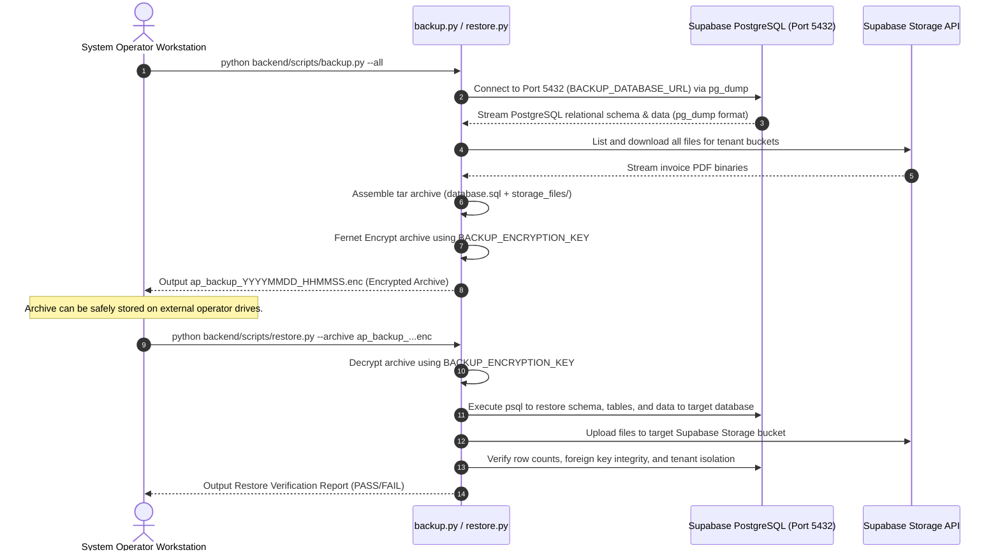

# AP Command Center — Data Flow & Security Controls

> **Document Status:** Active Standard  
> **Security Model:** Zero-Trust Multi-Tenant Architecture  
> **Cryptographic Framework:** Asymmetric JWKS (RS256/ES256) + Authenticated Fernet (AES-128-CBC + HMAC-SHA256)

---

## 1. End-to-End System Data Flows

### 1.1. Gmail OAuth 2.0 Authorization & Token Encryption Flow



---

### 1.2. Email Invoice Ingestion Flow (On-Demand / Incremental History API with Fallback Recovery)

> **Initial Sync vs Incremental:** On initial connection (`last_history_id=None`), step 6 executes full query reconciliation (`has:attachment filename:pdf`), ingesting all pre-existing invoice emails and then seeding the watermark. On subsequent synchronizations, step 6 uses `users.history.list`. If Gmail returns HTTP 404 (`HistoryExpiredError`), the system automatically executes full reconciliation fallback and refreshes the watermark. Both flows run under the per-mailbox lease lock.



---

### 1.3. Direct Document Upload & SHA-256 Deduplication Flow



---

### 1.4. Invoice Review, Three-Way Matching & Dual-Control Approval Flow

```mermaid
sequenceDiagram
    autonumber
    actor Lead as AP Lead (Ingestor)
    actor Controller as Financial Controller
    participant API as FastAPI Backend
    participant DB as Supabase PostgreSQL

    Lead->>API: POST /api/v1/invoices/{id}/match
    API->>DB: Perform 3-Way Match (Invoice Lines vs PO Lines vs Goods Receipt)
    API->>DB: Calculate variance; determine policy approval threshold
    API->>DB: UPDATE invoices SET stage='MATCHED', decision='NEEDS_REVIEW'
    API-->>Lead: Return Match Breakdown & Line Variance

    Note over Lead, Controller: Policy Rule: Creator cannot approve their own high-value invoice.
    Lead->>API: POST /api/v1/invoices/{id}/approve (Self-Approval Attempt)
    API->>DB: Check invoice.created_by == current_user.id
    alt Creator Tries to Approve High-Value Invoice
        API-->>Lead: HTTP 403 Forbidden { detail: "Dual control violation: Creator cannot self-approve." }
    end

    Controller->>API: POST /api/v1/invoices/{id}/approve (Second Control Actor)
    API->>DB: Verify Controller role & distinct actor_id
    API->>DB: UPDATE invoices SET stage='APPROVED', approved_by=Controller.id
    API->>DB: INSERT INTO audit_events (INVOICE_APPROVED, actor_role='CONTROLLER')
    API-->>Controller: HTTP 200 OK { status: "APPROVED" }
```

---

### 1.5. Authentication & Authorization Flow (Asymmetric JWKS)



---

### 1.6. Operator Backup & Restore Flow



---

## 2. Security Controls & Defensive Invariants Inventory

### 2.1. Encryption Controls

| Layer | Implementation | Specification | Status |
| :--- | :--- | :--- | :--- |
| **In-Transit Encryption** | TLS 1.3 / HTTPS | All external communication with Render, Supabase, and Google is strictly encrypted over TLS 1.3. Plain HTTP connections are automatically redirected to HTTPS. | `[IMPLEMENTED]` |
| **At-Rest Database Encryption** | Supabase Transparent Data Encryption (TDE)| Underlying AWS storage volumes utilized by Supabase are encrypted at rest with AES-256. | `[IMPLEMENTED]` |
| **At-Rest Credential Encryption**| Server-Side Fernet Cipher | Gmail OAuth `refresh_token`s are encrypted using Fernet (AES-128-CBC + HMAC-SHA256 authenticated encryption) prior to SQL insertion. Decryption occurs only in volatile memory during active synchronization. | `[IMPLEMENTED]` |
| **At-Rest Backup Encryption** | Fernet Archive Encryption | Database dumps and invoice binaries are packed into tarballs and encrypted with AES-128-CBC before writing to disk. | `[IMPLEMENTED]` |

### 2.2. Authentication & Identity Controls

| Mechanism | Implementation | Security Benefit | Status |
| :--- | :--- | :--- | :--- |
| **Asymmetric JWKS Verification** | RS256 / ES256 | Backend validates signatures using public keys fetched from Supabase JWKS. No shared signing secret is stored in application environment variables. | `[IMPLEMENTED]` |
| **Fail-Closed Verification** | Cryptographic Signature Check | Malformed, expired, tampered, or unsigned tokens are immediately rejected with HTTP 401 Unauthorized. | `[IMPLEMENTED]` |
| **Dynamic Key Rotation** | In-Memory JWKS Cache | Public keys are cached in memory; encountering an unknown `kid` triggers a safe key refresh from Supabase without restarting the application. | `[IMPLEMENTED]` |
| **Multi-Factor Authentication** | Supabase Auth MFA | End users can enroll in TOTP (Authenticator App) directly through Supabase Auth without backend code changes. | `[IMPLEMENTED]` |

### 2.3. Authorization & Tenant Isolation Controls

| Mechanism | Implementation | Enforcement Point | Status |
| :--- | :--- | :--- | :--- |
| **Strict Multi-Tenant Scoping** | Mandatory `org_id` on all entities | Every database query and storage path includes `org_id`. The application context extracts `org_id` from validated user claims; users cannot supply an arbitrary `org_id`. | `[IMPLEMENTED]` |
| **Role-Based Access Control (RBAC)**| 5-Tier Hierarchical Roles | Roles: `SYSTEM_ADMIN`, `CONTROLLER`, `AP_LEAD`, `CLERK`, `READ_ONLY`. Endpoints enforce role guards using FastAPI dependency injection (`require_role`). | `[IMPLEMENTED]` |
| **Dual-Control Separation of Duties**| Anti-Self-Approval Check | Users who upload or ingest an invoice are prohibited from approving that same invoice if it exceeds the low-value policy limit. Approval requires an independent controller. | `[IMPLEMENTED]` |
| **Row-Level Security (RLS)** | PostgreSQL RLS Policies | Supabase tables maintain RLS policies ensuring that even direct database access is constrained to the authenticated tenant. | `[IMPLEMENTED]` |

### 2.4. Storage & File Security Controls

| Mechanism | Implementation | Security Benefit | Status |
| :--- | :--- | :--- | :--- |
| **Private Buckets Only** | Supabase Storage `invoices` | Public read access is completely disabled. Direct HTTP requests without authentication return HTTP 403 Forbidden. | `[IMPLEMENTED]` |
| **Short-Lived Presigned URLs** | TTL = 300 seconds (5 minutes) | Documents are accessed via temporary signed URLs generated on-demand by authorized users. URLs expire after 5 minutes, preventing link leakage. | `[IMPLEMENTED]` |
| **File Format & Header Validation**| Magic byte check (`%PDF-`) | Prevents malicious executable uploads disguised as PDF files. Uploads must strictly start with PDF magic bytes. | `[IMPLEMENTED]` |
| **File Size Ceilings** | Client & Server Limit &le; 50 MB | Rejects oversized files before processing, preventing Denial-of-Service (DoS) memory exhaustion on free hosting instances. | `[IMPLEMENTED]` |
| **SHA-256 Deduplication** | Cryptographic hash unique index | Unique constraint on `(org_id, sha256_hash)` blocks duplicate invoice processing and prevents storage exhaustion. | `[IMPLEMENTED]` |

### 2.5. Audit Trail & Immutability Controls

| Mechanism | Implementation | Compliance Value | Status |
| :--- | :--- | :--- | :--- |
| **Append-Only Ledger** | `audit_events` table | All state changes (ingestion, approval, rejection, soft-delete) generate an audit log entry with actor ID, role, action, and timestamp. | `[IMPLEMENTED]` |
| **Database-Enforced Immutability**| PostgreSQL triggers | Database triggers intercept and raise exceptions on any `UPDATE` or `DELETE` statement targeting `audit_events`. Even application administrators cannot modify audit records. | `[IMPLEMENTED]` |
| **Two-Tier Soft-Delete Lifecycle**| Soft-delete with storage preservation| Deleting an invoice marks the database record as deleted (`is_deleted=True`), preserving the original file in Supabase Storage. Permanent file purge requires explicit admin privileges. | `[IMPLEMENTED]` |

### 2.6. Operational Secret Hygiene

| Rule | Enforcement Mechanism | Status |
| :--- | :--- | :--- |
| **Zero Plaintext Secrets in Database** | Fernet encryption on all refresh tokens; zero unencrypted API keys stored. | `[IMPLEMENTED]` |
| **Redacted Logging** | `Settings.redacted_dict()` masks passwords in connection URLs across logs and diagnostics. | `[IMPLEMENTED]` |
| **Zero Secrets Committed to Git** | `.gitignore` covers `.env`, `*.enc`, `*.key`, `backups/`, and service account keys. | `[IMPLEMENTED]` |
| **Separated Connection Strings** | `DATABASE_URL` (Port 6543 pooler), `MIGRATION_DATABASE_URL` (Port 5432 direct), `BACKUP_DATABASE_URL` (Port 5432 direct). | `[IMPLEMENTED]` |
