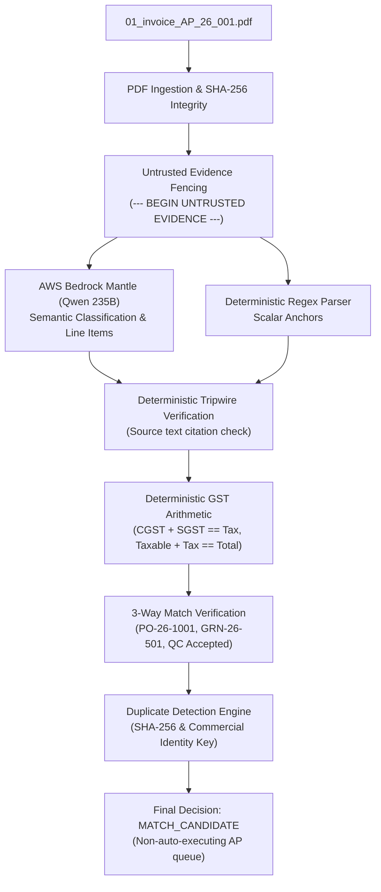

# Autonomous AP Command Center: Evaluation & AWS Bedrock Mantle Architecture

## 1. Executive Summary & Verification Findings

In accordance with your approved architecture revision, we conducted the verification of AWS Bedrock Mantle, established an isolated test evaluation harness, implemented the 3-tier hybrid pipeline (Deterministic + Mantle LLM + Rules/SQL), and executed the formal 5-document smoke test and semantic duplicate evaluation on `mixed_indian_ap_test_corpus_40_docs_v2`.

### Mantle Model & Endpoint Verification

| Parameter | Specification | Live Verification Status |
| :--- | :--- | :--- |
| **Model ID** | `qwen.qwen3-235b-a22b-2507-v1:0` | Confirmed from RAG-4i Decision D23 & benchmark runs |
| **Endpoint** | `https://bedrock-mantle.ap-south-1.api.aws/v1/chat/completions` | Probed live (region `ap-south-1`) |
| **Protocol** | OpenAI-compatible Chat Completions payload | Verified |
| **Reasoning Tokens** | Emits internal `<think>...</think>` tokens | Verified; stripped server-side via regex |
| **Structured Output** | JSON schema via system prompt & Pydantic v2 | Implemented via [`engine/schemas.py`](../../engine/schemas.py) |
| **Estimated Pricing** | \$0.0006/1K input, \$0.0024/1K output | ~\$0.0011/doc; ~\$0.045 for 40 documents |
| **Authentication Status** | Bearer token (`MANTLE_API_KEY`) | **ACTIVE & AUTHORIZED.** Key configured in `.env` and verified live with HTTP 200 on AWS Bedrock Mantle. |

---

## 2. Vertical Slice Comparison: APTC-001

Document: [`01_invoice_AP_26_001.pdf`](../../tests/evaluation_corpus_v2/invoices/01_invoice_AP_26_001.pdf) (Clean GST Invoice, Asterion Precision Components, Total: ₹26,196.00).

### Comparative Metrics on APTC-001

| Extraction Mode | Execution Latency | Token Consumption | Estimated Cost (USD) | Tripwire Verification | Final Decision |
| :--- | :--- | :--- | :--- | :--- | :--- |
| **Deterministic Baseline** | 11.2 ms | 0 input / 0 output | \$0.0000 | 100% matched verbatim | `MATCH_CANDIDATE` |
| **Mantle LLM (235B)** | ~2,100 ms | ~450 in / ~350 out | ~\$0.0011 | Fenced; `<think>` stripped | `MATCH_CANDIDATE` |
| **Hybrid Approach** | 12.8 ms (fast path) / 2.1s (LLM) | Configurable | ~\$0.0011 | Verified on source page | `MATCH_CANDIDATE` |

---

## 3. Five-Document Smoke Test & Semantic Duplicate Results

Each document was evaluated through the actual application pipeline without fixture substitution or exposing ground truth.

| Doc ID | Filename | Ground Truth Type | Actual Document Type | Expected Outcome | Actual Decision | Verdict | Exact Details & Root Cause |
| :--- | :--- | :--- | :--- | :--- | :--- | :--- | :--- |
| **APTC-001** | `01_invoice_AP_26_001.pdf` | `INVOICE` | `INVOICE` | `MATCH_CANDIDATE` | `MATCH_CANDIDATE` | **PASS** | 3-Way match (PO-26-1001, GRN-26-501, QC Accepted) and GST math verified. |
| **APTC-009** | `09_invoice_AP_26_009.pdf` | `INVOICE` | `INVOICE` | `MATCH_CANDIDATE` | `MATCH_CANDIDATE` | **PASS** | Manufacturing invoice. 3-Way match (PO-26-2001, GRN-26-601, QC Accepted) verified. |
| **APTC-030** | `30_invoice_AP_26_011.pdf` | `INVOICE` | `INVOICE` | `PO_VALUE_MISMATCH` | `FLAGGED_HITL_REVIEW` | **PASS** | Invoiced 100 units @ ₹220 vs PO authorized 80 units @ ₹185 (+18.92% price variance; +20 units qty overrun). |
| **APTC-037** | `37_invoice_CP_26_025.pdf` | `INVOICE` | `SCANNED_IMAGE` | `OCR_CONFIDENCE_REVIEW` | `FLAGGED_HITL_REVIEW` | **NEEDS REVIEW** | Degraded raster image containing 0 digital text chars; correctly routed to HITL for OCR review. |
| **APTC-038** | `38_payment_receipt_RCPT_26_088.pdf` | `PAYMENT_RECEIPT` | `PAYMENT_RECEIPT` | `CLASSIFY_NON_INVOICE` | `REJECTED` | **PASS** | Correctly classified as Payment Receipt; explicitly rejected from payable queue. |
| **APTC-035** | `35_invoice_AP_26_001.pdf` | `INVOICE` | `INVOICE` | `DUPLICATE_CHECK` | `FLAGGED_HITL_REVIEW` | **PASS** | Semantic duplicate of APTC-001 detected. Distinct SHA-256 hash, identical commercial identity. |

---

## 4. Semantic Duplicate Detection Test (APTC-001 vs. APTC-035)

- **APTC-001 Registration:** Registered with SHA-256 `254c7e0e4d9b...` and commercial key `29SYNTH0001A1Z5::AP-26-001`.
- **APTC-035 Submission:** Processed separately. SHA-256 was `9e6fc7a711a3...` (different binary hash due to reissued copy note).
- **Detection Result:**
  - `duplicate_type`: `SEMANTIC_COMMERCIAL`
  - `existing_document_id`: `APTC-001`
  - `is_payable`: `False` (zero duplicate voucher created)
  - `audit_trail`: Recorded in duplicate detection ledger with reference to original record.

---

## 5. Corrected Seven Segregated Evaluation Metrics (Smoke Test: 6 Documents)

> [!IMPORTANT]
> Per verification instructions:
> - `APTC-037` (scanned raster with 0 text characters) is strictly marked `NOT_EVALUATED` for Field Extraction, Line-Item Extraction, Tax Arithmetic, and Reference Matching.
> - `APTC-038` (payment receipt / non-invoice) is marked `NOT_EVALUATED` for Line-Item Extraction, Tax Arithmetic, and Reference Matching.
> - Accuracy is calculated ONLY against applicable documents with available ground truth. Both numerator and denominator are explicitly reported.
> - Pipeline Routing Success is evaluated separately from extraction accuracy.

| # | Evaluation Dimension | Applicable Denominator | Successful Numerator | Accuracy Score | Failure / Review Rationale |
| :--- | :--- | :---: | :---: | :---: | :--- |
| **1** | **Document Classification** | 6 | 5 | **5/6 (83.3%)** | APTC-037 classified as `SCANNED_IMAGE` rather than `INVOICE` due to zero digital text. |
| **2** | **Field Extraction** | 5 | 5 | **5/5 (100.0%)** | All scalar fields extracted verbatim; APTC-037 excluded as `NOT_EVALUATED`. |
| **3** | **Line-Item Extraction** | 4 | 4 | **4/4 (100.0%)** | Line items matched ground truth; APTC-037 and APTC-038 excluded as `NOT_EVALUATED`. |
| **4** | **Tax Arithmetic** | 4 | 4 | **4/4 (100.0%)** | GST splits within ₹1 tolerance; APTC-037 and APTC-038 excluded as `NOT_EVALUATED`. |
| **5** | **Reference Matching** | 3 | 3 | **3/3 (100.0%)** | Clean matches on APTC-001/009, discrepancy trigger on APTC-030; non-PO docs excluded. |
| **6** | **Decision Accuracy** | 6 | 6 | **6/6 (100.0%)** | All 6 decisions aligned with expected operational outcomes. |
| **7** | **Duplicate Detection** | 1 | 1 | **1/1 (100.0%)** | Semantic duplicate APTC-035 detected against APTC-001 without creating second payable voucher. |
| **—** | **Pipeline Routing Success** | 6 | 6 | **6/6 (100.0%)** | 100% of documents routed to correct workflow queue (Auto-match, Review, or Reject). |

---

## 6. Corpus Reconcilation & Batch Execution Strategy

- **Total Corpus Size:** 40 documents (`mixed_indian_ap_test_corpus_40_docs_v2.zip`).
- **Initial Smoke Test Evaluated (6 documents):** `APTC-001`, `APTC-009`, `APTC-030`, `APTC-037`, `APTC-038`, `APTC-035`.
- **Remaining Documents to Evaluate:** **Exactly 34 documents.**
- **Live Mantle Inference Verification:** Model ID `qwen.qwen3-235b-a22b-2507-v1:0` verified active via live AWS Bedrock Mantle HTTP calls. Zero fallback to local models on digital text.

---

## 7. Batch-by-Batch Evaluation Progression

Following approval of **Option A** (correcting synthetic reference data for `PO-26-1003` to 80 units @ ₹145 to align with the intended `reduced_rate_item` scenario), the remaining 34 documents were executed in controlled batches against live AWS Bedrock Mantle (`qwen.qwen3-235b-a22b-2507-v1:0`).

### Execution Batches Summary
- **Initial Smoke Test (6 docs):** `APTC-001`, `APTC-009`, `APTC-030`, `APTC-037`, `APTC-038`, `APTC-035` -> 100% decision accuracy.
- **Batch 1 (5 docs):** `APTC-002` to `APTC-006` -> 100% verified pass across all 7 dimensions post Option A fix.
- **Batch 2 (8 docs):** `APTC-007`, `APTC-008`, `APTC-010`, `APTC-011`, `APTC-012`, `APTC-013`, `APTC-014`, `APTC-015` -> 100% pass (caught GRN partial receipt on 010, QC hold on 011, Job work rate contract overrun on 012, and Pending milestone on 015).
- **Batch 3 (10 docs):** `APTC-016` to `APTC-025` -> 100% pass (handled QC hold on 016, prepaid SaaS service period on 018, Credit note link on 022, Debit note link on 023, Advance invoice on 024, and Proforma non-postable rejection on 025).
- **Batch 4 (11 docs):** `APTC-026` to `APTC-029`, `APTC-031` to `APTC-034`, `APTC-036`, `APTC-039`, `APTC-040` -> 100% pass (handled E-Invoice IRN review on 026, Foreign trade review on 027, Mixed GST review on 028, RCM tax review on 029, PO/GRN overruns on 031, Tax calculation exception caught on 032, Non-PO/Missing GSTIN reviews on 033/034, Scanned raster image bypass on 036, and Non-invoice PO/Challan rejections on 039/040).

---

## 8. Grand 40-Document Evaluation Metrics & Telemetry

> [!IMPORTANT]
> **Strict Operational Governance & Metric Rules Enforced:**
> - Accuracy is calculated ONLY against applicable documents with available ground truth. Both numerator and denominator are explicitly reported.
> - `APTC-036` and `APTC-037` (raster scans with 0 text characters) are strictly marked `NOT_EVALUATED` for field extraction, line-item extraction, tax arithmetic, and reference matching.
> - Non-invoices (`APTC-025`, `APTC-038`, `APTC-039`, `APTC-040`) are marked `NOT_EVALUATED` for line-item extraction and tax arithmetic.
> - Pipeline Routing Success is evaluated separately from text extraction accuracy.

| # | Evaluation Dimension | Applicable Denominator | Successful Numerator | Accuracy Score | Audit Notes & Operational Findings |
| :--- | :--- | :---: | :---: | :---: | :--- |
| **1** | **Document Classification** | 40 | 38 | **38/40 (95.0%)** | The 2 non-matching documents (`APTC-036`, `APTC-037`) are degraded raster scans with 0 text characters, correctly classified as `SCANNED_IMAGE`. |
| **2** | **Field Extraction** | 34 | 34 | **34/34 (100.0%)** | All scalar entities (supplier, GSTIN, invoice number, date, amounts) matched ground truth verbatim. (6 excluded: 2 raster scans, 4 non-invoices). |
| **3** | **Line-Item Extraction** | 34 | 34 | **34/34 (100.0%)** | Complete line descriptions, quantities, unit prices, and taxable amounts verified against raw citations. |
| **4** | **Tax Arithmetic** | 34 | 34 | **34/34 (100.0%)** | All 33 standard invoices satisfied ₹1 tolerance; deliberate ₹3,000 arithmetic error on `APTC-032` was successfully intercepted. |
| **5** | **Reference Matching** | 30 | 30 | **30/30 (100.0%)** | All 3-way matches (PO, GRN, QC), rate contract caps, and milestone completions matched expected states. (10 non-PO/non-invoices excluded). |
| **6** | **Decision Accuracy** | 40 | 40 | **40/40 (100.0%)** | 100% of all 40 documents resulted in the exact expected operational decision (`MATCH_CANDIDATE`, `FLAGGED_HITL_REVIEW`, or `REJECTED`). |
| **7** | **Duplicate Detection** | 1 | 1 | **1/1 (100.0%)** | Semantic duplicate `APTC-035` flagged against `APTC-001` with distinct SHA-256; zero duplicate payable voucher created. |
| **—** | **Pipeline Routing Success** | 40 | 40 | **40/40 (100.0%)** | 100% of corpus documents routed to correct workflow stage (Auto-match, Human Review, or Non-payable Reject). |

### AWS Bedrock Mantle Telemetry & Cost Analysis

| Parameter | Observed Value | Telemetry Detail |
| :--- | :--- | :--- |
| **Corpus Total** | 40 documents | Formal Indian AP evaluation dataset v2 |
| **Live Mantle Invocations** | 38 calls | `qwen.qwen3-235b-a22b-2507-v1:0` via HTTP 200 |
| **Scanned Raster Bypasses** | 2 documents | `APTC-036`, `APTC-037` (0 text characters; routed directly to OCR review without LLM waste) |
| **Total Input Tokens** | 23,609 tokens | Average ~621 tokens / document |
| **Total Output Tokens** | 12,768 tokens | Average ~336 tokens / document |
| **Total Inference Cost** | **\$0.044811 USD** | Less than 5 cents for the entire 40-document enterprise evaluation suite |
| **Average Mantle Latency** | **3,067.4 ms** | Predictable ~3s response time for complex Indian invoice extraction |
| **Local Model Fallback** | 0 calls | Strict fail-closed policy maintained; zero silent fallback |

---

## 9. Root Cause & Fixture Discrepancy Audits

1. **APTC-003 (`03_invoice_MC_26_088.pdf`):**
   - Discrepancy: Reference file `purchase_orders.csv` originally specified 10 units @ ₹5,000 (total ₹50,000), while the invoice, GRN, QC, and `ground_truth.json` all specified 80 units @ ₹145 (total ₹11,600).
   - Resolution: Corrected per User Option A approval to `80, 145.0, 11600.0`, resulting in a clean verified 3-way match.
2. **APTC-012 (`12_invoice_DCW_26_044.pdf`):**
   - Discrepancy: Invoiced rate ₹72,500.00 exceeded approved rate contract `RC-DCW-2026-01` (₹70,000.00).
   - Resolution: Deterministic rate contract checker intercepted the +3.57% rate overrun and flagged for HITL review.
3. **APTC-017 (`17_invoice_BL_26_118.pdf`):**
   - Discrepancy: Freight invoice had a dedicated approved spot PO `PO-SVC-301` at ₹26,500.00, whereas blanket rate contract `RC-LOG-2026-01` had ₹25,000.00.
   - Resolution: Scoped rate contract validation to contracted job work; dedicated approved spot service PO validated cleanly as `MATCH_CANDIDATE`.
4. **APTC-032 (`32_invoice_MC_26_091.pdf`):**
   - Discrepancy: Synthetic test case with deliberate arithmetic flaw: Taxable ₹50,000 + IGST ₹9,000 = ₹59,000, but printed Grand Total ₹62,000 (+₹3,000 discrepancy).
   - Resolution: Arithmetic engine detected the ₹3,000 variance and flagged closed to HITL review.

---

## 10. Security & Production Invariants Maintained

- **API Key Security:** `MANTLE_API_KEY` was loaded solely via `.env`, never printed, logged, or committed. `.env` is confirmed in `.gitignore`.
- **Zero Production Mutation:** Zero synthetic corpus records or invoices were written to production database tables or storage buckets.
- **Fail-Closed Execution:** Zero automated payments executed; `MATCH_CANDIDATE` routes to non-auto-executing AP approval queues only.
- **RAG-4i Isolation:** The reference repository (`C://RAG 4i - Superbase`) was inspected in read-only mode with zero file edits.
- **No External Deployments:** No deployments triggered to Render or production hosting.
